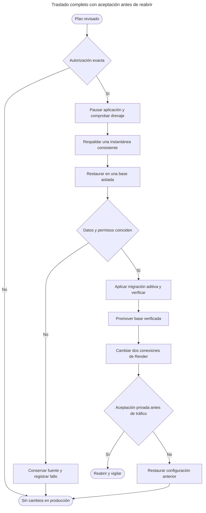

# Traslado completo Render → Neon

Estado 01/11/2026: **BASE COMPLETA MIGRADA Y ACTIVA EN NEON**.
El usuario autorizó una ejecución del plan corregido. Se realizó una sola copia
nativa completa y se promovió la base verificada. Render está Live en
`dep-dbjpcm142hec73dnc6d0` con el mismo commit
`4cb104bfb874004dd6274e1aef3c9537a834cb3b`. Las sesiones runtime de Accounts y
Executions aparecen en Neon; la fuente tiene cero sesiones de esos roles.
Se cambiaron sólo las dos conexiones. Origen, Google, claves y código permanecen.
La base original se conserva; **ya no es un destino de rollback automático**:
hay nuevas sesiones/escrituras legítimas en Neon después de abrir el servicio.

Plan privado corregido: `transfer-plan.json`, ID `051d1758932e41d38584d30a8decc6f7`.
SHA-256 revisado:
`30b0328ac1e5c1b320db355034e301611e919031041960061a7da5f3cd1c1de7`.
El modo ReviewOnly verifica sus entradas sin leer credenciales ni abrir bases.
Ambos planes están consumidos y conservan archivos/recibos. No se reejecutan ni
se borran marcadores. El primero (`ba346082…157b0a038`) falló por comparar estados
como ordinales; la corrección usa `Queued`/`Running`, según el contrato EF.

El ejecutor corregido registró FAIL después de una restauración terminada, al
comparar texto de catálogo. La inspección confirmó 35 tablas y todas las huellas
de datos/secuencias iguales: **no fue un timeout ni un rollback de los datos**.
PostgreSQL normalizó la agrupación de AND en 12 restricciones/políticas.
Se reparsaron las definiciones originales en una transacción revertida y el
catálogo resultó idéntico al restaurado. Roles, comandos y permisividad de las
políticas también se verificaron por separado. Se continuó esa misma copia,
sin repetir pg_dump/pg_restore, aplicando sólo la migración aditiva prevista.
El recibo automático FAIL se conserva junto a la continuación verificada.

Render requiere **Save and deploy** para usar valores nuevos en el build
existente: reanudar/reiniciar conserva los valores del deploy anterior. El primer
reanudo siguió en la fuente y se detectó mediante pg_stat_activity. La prueba MCP
generó dos registros OAuth nuevos allí; se sincronizó ese único delta de identidad
a Neon sin eliminar registros, y se comprobó nuevamente toda tabla heredada.
Se usaron bloqueos acotados de la fuente y se revirtió el acceso temporal. El
bloqueo alcanzó su límite durante la desconexión del navegador; una comparación
posterior al cambio confirmó cero divergencias heredadas y secuencias iguales.
El despliegue de configuración usa el build existente, sin recompilar NOVA.

## Contrato y recorrido

Se conservan identificadores, hashes de contraseñas, bibliotecas, prompts,
variables, versiones, resultados, memoria, permisos y claves protegidas de las
35 tablas y tres secuencias actuales. Los roles SQL nuevos tienen contraseñas
distintas; las cuentas del producto conservan sus hashes. El operador Neon,
con BYPASSRLS, no se configura como usuario de la aplicación.



Decisiones: rombos; operaciones: rectángulos; inicio/fin: figuras redondeadas.
Este diagrama describe el plan; no demuestra que se haya ejecutado.

```text
exigir autorización del hash revisado y suspensión observada
verificar esquemas, archivos fijados, destino vacío y ausencia de trabajos activos
crear lector temporal sin login ni BYPASSRLS, sólo para el administrador actual
exportar snapshot; calcular SHA-256 por tabla y estado de secuencias
ejecutar pg_dump 18.6 con ese snapshot; retirar lector y comprobar permisos
cifrar respaldo con DPAPI del usuario Windows; retirar texto plano temporal
restaurar con pg_restore 18.6 en qp_import_<id>, propiedad del operador
comparar datos, secuencias y catálogo; retirar lector del destino
aplicar únicamente CompanionOperationalPresence; comprobar datos heredados
conservar Neon vacío como qp_before_<id>; promover importación a quickprompt_cloud
con autorización: sustituir únicamente Accounts y Executions en Render; validar
si falla: detener; sin reintento automático ni retorno a fuente obsoleta
```

## Límites del cambio propuesto

- Fuente Render: PostgreSQL 18.6, 35 tablas, 31 migraciones, 22 FORCE RLS;
  aproximadamente 5 MB. Destino Neon actual: vacío, 36 tablas, 32 migraciones,
  23 FORCE RLS. Sólo difiere la migración aditiva de presencia Companion.
- La base aislada conservará UTF8/libc `en_US.UTF8` de la fuente. La base vacía
  de Neon usa builtin `C.UTF-8`; no se cambia silenciosamente la fuente a esa
  configuración. Su compatibilidad se comprobó con CREATE COLLATION revertido.
- Base y origen lógico permanecen iguales. Se conservan Google, MCP, claves
  PEM/PFX, cookies y binarios desplegados. La compatibilidad de sus sesiones
  todavía requiere aceptación real después del traslado.
- La publicación del perfil HTTP `RenderEdge`, el nuevo origen y el trabajo
  NOVA de otro carril quedan fuera de este cambio de base.
- Cambios externos propuestos tras autorización: suspender y reanudar sólo
  `srv-dbgppfu7bikc73b93oog`; sustituir únicamente
  `ConnectionStrings__Accounts` y `ConnectionStrings__Executions` por los roles
  limitados ya creados en Neon. Nunca subir el operador administrativo, dumps,
  bibliotecas locales ni otras claves. Verificar en Render que la operación
  conserva el commit desplegado `4cb104bfb874004dd6274e1aef3c9537a834cb3b`;
  si exige publicar otro commit, detener ese paso.
- No hay compras, nuevo plan, dominio, facturación ni borrado de la fuente.

## Acceso temporal, archivos y recuperación

El plan crea un lector NOLOGIN/NOBYPASSRLS con SELECT en las 35 tablas,
tres secuencias y cinco esquemas, y políticas SELECT en las 22 tablas con RLS.
Sólo el administrador existente podrá asumirlo, sin herencia. Se retiran rol,
políticas y grants después de la copia, comprobando el catálogo efectivo.
El destino necesita temporalmente el mismo rol para restaurar ACL/políticas.

Directorio privado de revisión y posible ejecución, fuera de Git:
`%LOCALAPPDATA%/QuickPromptNova/cloud-pilot/quickprompt-render-neon-20261101/migration-051d1758932e41d38584d30a8decc6f7`.
ACL: este usuario Windows y SYSTEM. `source.pgpass` y `target.pgpass` contendrían
brevemente las credenciales administrativas existentes. Se eliminan después de
salir los procesos. El dump y la entrada de restauración permanecen en texto
plano sólo durante esas operaciones; el respaldo retenido usa DPAPI CurrentUser.
Los archivos cifrados sólo son recuperables con ese perfil Windows: esto **no
cierra** respaldos portátiles, recurrentes, retención ni recuperación ante pérdida
del equipo. Ningún secreto aparece en argumentos, Git o recibos públicos.

Límites: 64 MiB por archivo, 180 s por proceso nativo, cero reintentos automáticos.
El plan es de un uso. Ante interrupción, revisar el recibo privado `execution.json`,
el marcador `execution.started` y los nombres `qp_import_`/`qp_before_`; no adoptar,
borrar ni reintentar bases automáticamente. Los dos renombrados no son una
transacción atómica. La configuración productiva no la cambia el ejecutor SQL.
Antes de reabrir se puede volver a la fuente conservada. Después de nuevas
escrituras en Neon, no volver a una fuente desactualizada sin reconciliación.

## Evidencia y aceptación

Evidencia: `.playwright/render-neon-20261101/`.

| Control ejecutado | Resultado |
| --- | --- |
| pg_dump/pg_restore 18.6 reales con SSPI/TLS, datos ficticios | PASS |
| Operador sin superusuario, membresía migrador SET sin INHERIT | PASS |
| Datos, secuencias, catálogo/ACL y limpieza del lector | PASS |
| Cifrado DPAPI y descifrado de comprobación | PASS |
| Renombrados de promoción con operador CREATEDB | PASS |
| RLS entre dos propietarios ficticios | PASS |
| Estados persistidos: rechazar Queued/Running y aceptar estados terminales | PASS |
| Compatibilidad del locale real en Neon, con rollback | PASS |
| Nueve guardas offline de autorización/integridad/entorno nativo | PASS |
| Primer intento real de traslado | FAIL, SQLSTATE 42883; sin copia, limpieza verificada |
| Recuperación de Render con fuente y commit originales | PASS, Live y health 200 |
| Copia completa y promoción | PASS, 36 tablas/32 migraciones finales |
| Comparación final después del cambio | PASS, 34 tablas heredadas iguales; historial +1 esperado; secuencias iguales |
| Sesiones runtime | PASS, Accounts/Executions en Neon; cero en la fuente |
| Google y bibliotecas, dos cuentas reales | PASS, principal 109 prompts activos y secundaria 4, bibliotecas separadas |
| MCP conectado en Codex: buscar, leer y compilar | PASS, revisión 5 y tres variables completas |
| MCP: leer ID activo de la otra cuenta | RECHAZADO como exige el aislamiento |
| HTTPS/health público | PASS, Vercel 200/0,366 s; Render 200/0,240 s |
| Permisos de base | PASS, 23 FORCE RLS, cero prompts sin actor, historial de migración denegado y roles sin privilegios elevados |
| Respaldo de migración | PASS, DPAPI CurrentUser, ACL usuario/SYSTEM, cero archivos temporales de credenciales/texto plano |

Estos resultados no certifican la UI de ChatGPT web, una nueva campaña NOVA,
cancelación/Companion, CRUD completo ni correo. La web desplegada muestra registro
y recuperación por correo deshabilitados. La certificación comercial sigue en
GO_TO_MARKET.md. No hubo commit, push, tag estable ni publicación del código local.

Antes de otra migración se debe integrar en el ejecutor la comparación semántica
conservada en las evidencias de continuación y cubrirla con regresiones. La
comparación literal del ejecutor original sigue siendo inadecuada para ese
roundtrip; no se presenta su FAIL como un PASS automático ni se recomienda repetirlo.

Se preservan los fallos previos del arnés. La comparación usaba `acldefault('S')`
(servidor externo) para secuencias, en lugar de `'s'`; se corrigió y el ensayo
volvió a ejecutarse. El arnés reforzado también necesitó permisos explícitos de
lectura y separar CREATE DATABASE de otro comando. Estos fallos no fueron fallos
observados de conservación de datos de producción.

Comandos reproducibles, sin valores de credenciales:

```powershell
./Tests/cloud/postgres-transfer-native.ps1 -NativeClientDirectory <pgsql18.6/bin> -ReceiptPath <recibo-ficticio.json>
./Tests/cloud/postgres-transfer-contracts.ps1 -ReviewedPlan <plan-privado.json> -ReceiptPath <recibo-guardas.json>
./deploy/cloud/Invoke-PublicPostgresTransfer.ps1 -ReviewedPlan <plan-privado.json> -ReviewOnly
```

Después de una copia autorizada: verificar dos cuentas, acceso a bibliotecas,
CRUD/variables/historial, permisos de compartir, renovación/revocación, Google,
MCP y recepción/respuesta de Companion. Sin ese recorrido no declarar GO ni
certificar comercialmente el candidato.

Referencias: [acldefault](https://www.postgresql.org/docs/18/functions-info.html),
[ALTER DATABASE](https://www.postgresql.org/docs/18/sql-alterdatabase.html),
[bases Neon](https://neon.com/docs/manage/databases).
