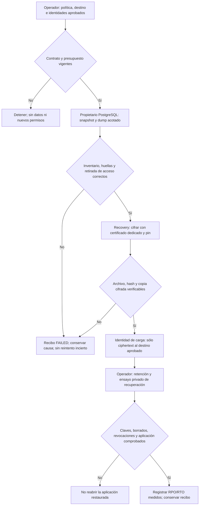

# Operación del MVP: alojamiento, correo y protección de datos

## Corte operativo vigente — 02/11/2026

**NO-GO.** Este bloque y el [roadmap único R1–R6](../../docs/development/GO_TO_MARKET.md)
prevalecen como estado actual sobre los cortes históricos conservados debajo.
El destino aceptado es Render Free + Neon Free; el piloto sirve el origen Vercel.
Con autorización expresa del usuario se publicó sólo correo/cuentas `e16e4ee`
y se configuró Brevo en Render con la credencial privada existente. Recepción,
confirmación y recuperación reales verificadas; 21 controles HTTP públicos y
210 pruebas de transporte PASS. No se publicó RC2 ni NOVA experimental.
Dos cuentas QA independientes completaron CRUD/versiones/compilación/aislamiento
y compartir/revocar. Reinicio real del 02/11 a las 16:48 (UTC−4) conservó contenido
exacto, sesiones y aislamiento; el FAIL previo de espera del arnés se conserva.
Recibos: `.playwright/public-two-account-20261102/RESULT.md` y el corte público
de `docs/development/ACCOUNT_MAIL.md`. Respaldo privado recurrente y restauración
siguen pendientes. EmailJS es un intento histórico, sin requisito adicional.

Seguimiento del 02/11 a las 17:02–17:11 UTC: health 200 en ambos orígenes y
opciones 200, con correo todavía sin configurar. La demora previa no se reprodujo
ni se confirmó su causa. Fronteras públicas anónimas responden 401 al acceso a
bibliotecas/perfil y al POST initialize MCP; GET MCP 405 es compatible con
Streamable HTTP sin SSE. Cookie CSRF Secure/HttpOnly/Strict observada. Estos
controles no prueban las dos sesiones QA ni el flujo instalado. Recibos y fallos
del arnés en `.playwright/public-route-diagnosis-20261102/RESULT.md`.

Observación posterior del 02/11/2026 a las 16:51:26 UTC: health de Vercel,
opciones de Vercel y health directo de Render agotaron aproximadamente 15 s por
sonda. Esto deja su disponibilidad actual sin confirmar; no demuestra una causa
de red o alojamiento. El ensayo local de ejecución 5/6 se retiró del producto
por no superar el criterio 6/6; no cambió la configuración, el paquete instalado
ni ningún servicio publicado. Evidencia en el [roadmap](../../docs/development/GO_TO_MARKET.md).

| Servicio y propietario | Iniciar | Detener | Diagnosticar y límites comprobados |
| --- | --- | --- | --- |
| UI React / Cloud | `npm run build --prefix apps/web`; Cloud sirve `QuickPrompt:WebRoot` o la imagen incluye `wwwroot` | Se detiene con su host Cloud; no borrar `dist` ni bibliotecas | `npm run test:release --prefix apps/web`, `/`, consola del navegador. 532 pruebas y build PASS; chunk 539,09 kB advertido |
| Cloud/Accounts / .NET | Build `dotnet build backend/QuickPrompt.Cloud -c Release`. Configurar las conexiones limitadas, origen y key ring según [cloud](../cloud/README.md); ejecutar el DLL o la imagen existente. No aplica migraciones al arrancar | Ctrl+C en su consola propia; en QA validar PID y ruta del snapshot antes de detenerlo. Reinicio público requiere ventana y aprobación del operador | `/health`, `/account/options`, logs saneados y guardas de roles/RLS. El health no acredita CRUD ni correo |
| PostgreSQL sintético / Docker | `./scripts/Start-QuickPromptPostgres.ps1`, sólo `quickprompt_development` para QA | `docker stop quickprompt-saas-postgres`; conserva el volumen. No usar `down -v` | `docker exec quickprompt-saas-postgres pg_isready -U quickprompt_bootstrap -d quickprompt_development`; suites Accounts y `Test-QuickPromptPostgresRestore.ps1` |
| Core Python / Inference | Lo inicia el consumidor por petición con Python/worker/SDK explícitos del perfil; no es un servicio cloud separado | Cancelar la petición o el Companion propietario; no terminar otros Python | Doctor del paquete, recibos correlacionados de Core y prueba real. El arranque no instala dependencias ni pesos |
| Qwen / Docker Model Runner | Abrir Docker Desktop y verificar Models; reutilizar el pin instalado. Este corte no cambia su configuración | Detener consumidores; descargar de RAM con `docker model unload <pin>` sólo con reserva libre. No eliminar modelos | `docker model status`, `list`, `configure show <pin>`. Contexto 12288, parallel 1, reasoning-budget 0, endpoint 12434; digest en [Docker AI](../../docs/development/DOCKER_AI.md) |
| Companion Windows / paquete instalado | `Companion.ps1 -Command doctor -ConfigPath <JSON> -CheckProvider`, luego `status` y `run` con ese JSON externo | Ctrl+C; comprobar `last-run.json`, fin `UserStopped` y ausencia del PID. `disconnect` revoca la conexión y es una decisión distinta de detener | Arranque real del launcher: 02/11 a las 9:10:57 a. m. (UTC−4), parada 9:12:12 a. m.; cero trabajos. No certifica resultado público |
| MCP / Cloud y ChatGPT | Mismo Cloud, `/mcp`, issuer y callback exactos; vincular sólo la biblioteca y scopes revisados | Revocar la conexión correspondiente desde la cuenta; nunca parar la base ni ampliar scopes para probar | Discovery HTTPS observado; contratos MCP PASS. La respuesta visible de ChatGPT no sustituye comprobar autenticación, escritura, refresh y revocación del candidato final |

El host QA ejecutado se identifica en
`.playwright/closure-20261102/qa-runtime.json`; su helper acotado `start-qa.ps1`
está junto a la evidencia y no es un instalador de producción. Usa exclusivamente
HTTP loopback 5297, PostgreSQL sintético y buzón privado de desarrollo, sin Google,
delegación ni credenciales públicas. Su reinicio conservó cookies, contenido exacto
y aislamiento entre dos cuentas. No ejecutar campañas de cola sobre esa base
mientras otro host de pruebas pueda reclamar sus trabajos.

### Instalación y rollback comprobados

El ZIP actual del Companion tiene 68 archivos y SHA-256
`727c311faee80f775f69eff471fe78dc6829a3182abcdb8de1fc4dd76f8758f0`.
Dos exports aislados son idénticos. Extracción/relocación: 15/15; actualización,
rollback y retirada de payloads sintéticos: 9/9. La configuración externa, ACL y
fixture cifrado permanecieron iguales. Esto usa los prerrequisitos ya instalados:
**SO limpio y actualización de un worker activo no ejecutados**.

Para actualizar un Companion real: detener su sesión, verificar manifiesto del ZIP,
extraer en otro directorio, usar el mismo JSON externo, ejecutar doctor, revisar
compatibilidad y arrancar; conservar el directorio anterior. Para volver atrás,
detener el nuevo, seleccionar el anterior y repetir doctor sin copiar credenciales
al paquete. No revincular ni ampliar permisos por actualizar. No instalar este
candidato como estable mientras R1–R6 estén abiertos.

El rollback cloud debe conservar el origen, las claves y **Neon**; la base Render
anterior quedó obsoleta y no es un destino de rollback de datos. No hay una
restauración privada ni política recurrente nueva autorizada. Recovery pasó 45
pruebas sintéticas; el restore PostgreSQL real de QA pasó. Retención, custodia,
destino externo y alertas siguen pendientes del contrato descrito abajo.

### Cuotas verificadas y oferta

Consulta oficial del 02/11: [Render Free](https://render.com/docs/free) entra en
reposo tras 15 minutos, arranca en aproximadamente un minuto, usa disco efímero
y puede suspender servicios al agotar cuotas. El proveedor desaconseja Free para
producción. [Neon Free](https://neon.com/docs/introduction/plans) publica 100 CU-h
por proyecto, 1 GB por proyecto y una ventana histórica de seis horas; no equivale
a nuestro respaldo cifrado externo. No se activó facturación ni se contrató nada.
La cola conserva sus límites versionados; no se ha medido capacidad comercial ni
recuperación pública de SSE bajo carga. No ofrecer disponibilidad que esos límites
y las pruebas actuales no sostienen.

Estado del 29/10/2026: **preparación local, sin habilitar servicios nuevos**.
El piloto publicado y su prueba puntual de recuperación no son una autorización
permanente para copiar datos. La última aprobación de respaldo y restauración de
35 tablas ya se consumió. No reutilizar sus planes, IDs, carpetas, credenciales
temporales o copias detenidas como una tarea programada.

Esta guía reutiliza los propietarios existentes: [host persistente](../cloud/README.md),
[PostgreSQL](../cloud/POSTGRES.md), [correo](../../docs/development/ACCOUNT_MAIL.md)
y [Recovery](../../tools/QuickPrompt.Recovery/Program.cs). El estado de publicación
lo fija el [cierre del candidato](../../docs/MVP_CLOSURE.md).

## Flujo y decisiones



Algoritmo operativo: comprobar política y autorización; adquirir exclusión de una
ejecución; fijar snapshot, inventario, formato y huellas por tabla; producir un dump
custom acotado; verificar retirada exacta del acceso temporal si lo hubo; cifrar;
verificar SHA-256 y tamaño del ciphertext; copiar sólo ese archivo al destino
aprobado; verificar el recibo del destino; aplicar retención autorizada; registrar
fallos y finalizar sin adoptar ejecuciones anteriores. Una respuesta incierta no
activa otro envío, dump o borrado. El diagrama es el contrato propuesto, no un
scheduler instalado ni una descripción de efectos ejecutados en esta fase.

## Alojamiento: condiciones que faltan

Actualización posterior del 01/11/2026: el usuario aceptó **Render Free para la
imagen completa y Neon Free para PostgreSQL**. Dos proveedores de alojamiento
quedan permitidos para conservar $0; Netlify no forma parte de esta ruta. Neon se
creó e inicializó sin datos personales; las verificaciones y pendientes vigentes
están en [R1–R6](../../docs/development/GO_TO_MARKET.md). El ingreso directo es un
cambio local comprobado, todavía no publicado. El texto de decisiones anteriores
de esta sección se conserva como historial; no autoriza retomar Firebase/Railway.

**Decisión vigente:** una aplicación desplegable, un origen y un proveedor de
alojamiento, reutilizando la imagen .NET que incluye React/API/NOVA/MCP.
PostgreSQL debe ser durable dentro del mismo proveedor; no incrustarlo en el
filesystem efímero del web service. La [arquitectura propietaria](../../docs/ARCHITECTURE.md)
conserva los contratos y los requisitos del corte. La propuesta distribuida
Netlify/Render/Neon que se describe como evaluación anterior queda retirada.

Por decisión del usuario del 01/11/2026, **Oracle/OCI queda descartado**. La
preferencia posterior es cloud gratuito, sin servidor propio. La [comparación
vigente](../../docs/research/CLOUD_FREE_REVIEW_20261101.md) registra ahora Firebase
con $0 estricto. Spark no aloja la aplicación .NET/PostgreSQL completa; Cloud Run
y Cloud SQL conservarían el stack en Google, pero requieren facturación y su uso
permanente a $0 no está demostrado ni autorizado. Railway queda como selección
anterior: su cuenta observada tenía prueba vencida y factura pendiente. Netlify/Render/
Neon permanece sólo como comparación histórica retirada; Coolify no tiene servidor
instalado. El [manifiesto preparado](../cloud/railway.json), las sondas de salud y
la carga portable de claves tienen comprobaciones locales, no un destino remoto
habilitado. No hay otra configuración de ingreso activada.
Presupuesto $0 conservado. No se cambió la infraestructura pública. Persistencia,
cuotas y disponibilidad requieren pruebas; no se infieren de una etiqueta «free».

No hay aún dominio/subdominio HTTPS estable aprobado para el destino comercial.
Cambiarlo afecta cookies, OAuth de Google, issuer, callbacks y conexiones MCP;
preparar ese corte y rollback antes del cambio. Reutilizar el host existente y su
entrada web: `AccountHost.MapAccountPage` soporta el modo cuentas del build local.
Los manifests de imágenes admiten ARM64, pero build y ejecución ARM no se probaron.

La configuración pública debe mantener `VerifyFull` en Accounts y Executions,
incluso si PostgreSQL queda en la misma VM. Un loopback no reemplaza certificado y
nombre verificados. Usar el perfil de ingreso y proxy de confianza adecuado a la
infraestructura comprobada, sin rangos universales ni mezclar perfiles. Mantener
PostgreSQL y sus claves sin puertos públicos innecesarios. La plantilla
[cloud](../cloud/.env.template) es inventario, no configuración lista para arrancar.

Consulta read-only del piloto, 29/10/2026 antes de migrar el nuevo RC: el cliente
Npgsql fijado abrió la conexión existente con `quickprompt_app` y `VerifyFull`;
PostgreSQL 18.6 informó TLS 1.3/256 bits, `transaction_read_only=on`, sin SUPERUSER
ni BYPASSRLS, 35 tablas y 22 FORCE RLS. Duración observada: 1.425 ms. No se leyeron
filas de negocio, no se usó el operador y no se alteraron permisos. Es una señal
fechada de transporte/catálogo; no valida recuperación ni el esquema futuro.

Render documenta AES-256 **en reposo** para PostgreSQL, incluidas réplicas y
respaldos de plataforma. Esa afirmación se obtiene de su documentación, no del
campo TLS ni de una inspección local de discos. No proporciona cifrado de extremo
a extremo frente al servidor en ejecución ni reemplaza el archivo cifrado externo
de Recovery. [Cifrado de PostgreSQL](https://render.com/docs/postgresql-creating-connecting).
El plan Free excluye backups gestionados, expira a los 30 días y conserva después
un plazo de 14 días para pasar a pago antes de eliminar datos; no se aprobó pago.
El filesystem del servicio web es efímero y no sirve para conservar dumps o claves
generadas durante ejecución. Mantener material estable en los secretos privados
ya aprobados no equivale a respaldarlo de forma independiente.
[Límites de Free](https://render.com/docs/free).

## Política recurrente que puede aprobarse una vez y consumirse por ejecución

[backup-policy.template.json](backup-policy.template.json) es el borrador sin
secretos que se completa en una carpeta privada fuera de Git. **No es una
autorización ni un archivo consumido automáticamente por un scheduler existente.**
Sus campos nulos identifican decisiones reales pendientes. Editar `state` o añadir
un hash no concede acceso. La futura aprobación debe fijar el hash del documento,
identidades, destinos, permisos, vigencia y efectos; cada ejecución tendrá recibo e
ID nuevos dentro de ese mismo alcance. Cambios de origen, esquema, clave, destino,
permisos, presupuesto o expiración requieren revisar el contrato, no un bypass.

El borrador propone:

| Campo | Propuesta concreta y límite |
| --- | --- |
| Origen | Servicio `quickprompt-nova-jpt`; host y base exactos por fijar desde configuración privada revisada, sin proyectar la conexión |
| Snapshot inicial | PostgreSQL 18; inventario final f49: 35 tablas, 22 FORCE RLS, 31 migraciones y tres secuencias; SQL e inventario fijados por SHA-256 |
| Formato | `PGDMP`, UTF-8, UTC, ISO/YMD, extra_float_digits=1 y fingerprint v2 con orden `pg_catalog.C` interior y exterior |
| Identidad lectora | Por designar y revisar; el permiso temporal de un respaldo anterior no se convierte en permiso recurrente |
| Preparación local | Carpeta física nueva bajo `%LOCALAPPDATA%/QuickPromptNova/operations/backups`, pendiente de aprobar; ACL operador/SYSTEM antes de bytes, fuera de Git, sin junctions, shares ni unidades de red |
| Cifrado | Recovery, destinatario dedicado de cifrado documental y pin SHA-256; certificado público para cifrar, clave privada bajo custodia separada para recuperar |
| Destino externo | No configurado. Fijar proveedor, cuenta, región, bucket, prefijo `quickprompt-mvp/encrypted/` e identidades antes de copiar un byte |
| Permisos de carga | Crear sólo ciphertext bajo ese prefijo; sin administración IAM, lectura de datos en claro ni cambios de retención |
| Retención y cuotas | Propuesta: siete copias diarias y cuatro semanales, máximo 35 días y 1 GiB; no habilitada |
| Horario y concurrencia | Propuesta: diario a las 03:00 UTC, una ejecución, cero reintentos de efectos inciertos, autorización por 30 días |
| Objetivos | RPO propuesto 24 h; RTO pendiente de medición, sin compromiso comercial todavía |
| Alarmas | Destino pendiente: el correo de cuentas no es un sistema de alertas operativas ni está entregando correos reales aún |

El executor puntual actual está fijado a una aprobación y carpeta únicas. **No
existe todavía un executor recurrente autorizado que consuma esta política.** No
envolverlo en cron ni copiar sus wrappers para eludir ese límite. El siguiente
incremento, después de aprobar origen/clave/destino, debe extender al propietario
existente para consumir la política y emitir recibos por ejecución, conservando
sus guardas; no crear otro framework de backup ni un endpoint HTTP de descarga.
Un cambio de migraciones, como una futura tabla de presencia del agente, invalida
la base f49 del borrador hasta revisar el nuevo inventario.

## Cifrado y recuperación con el ejecutable existente

No se generó ni usó una clave real en esta preparación. Los comandos siguientes
son los de Recovery para un operador **después** de aprobar cada ruta y custodio.
Requieren un dump autorizado y sus recibos, no una copia del expediente QA. Un
dump existente aprobado puede cifrarse sin repetir la captura de PostgreSQL.
Los argumentos de hash y certificado son públicos; no colocar contraseñas en
argumentos, variables de entorno, logs o archivos temporales.

```powershell
# Variables locales: rutas absolutas aprobadas y hashes de sus recibos.
# $recoveryDll identifica un build revisado de tools/QuickPrompt.Recovery.
& $dotnet $recoveryDll protect --repository-root $repositoryRoot `
  --input $authorizedDump --output $newPrivateArchive `
  --plaintext-sha256 $dumpSha256 --recipient-cert $publicRecipientCertificate `
  --recipient-sha256 $recipientSha256 --retain-until $retentionDeadlineUtc
if ($LASTEXITCODE -ne 0) { throw 'El cifrado falló; no copiar ni declarar respaldo completo.' }

# Verificación deliberada en RAM, sin archivo plaintext de salida.
& $dotnet $recoveryDll verify --repository-root $repositoryRoot `
  --input $authorizedArchive --archive-sha256 $archiveSha256 `
  --plaintext-sha256 $dumpSha256 --recipient-pfx $existingDedicatedRecipientPfx `
  --recipient-sha256 $recipientSha256
if ($LASTEXITCODE -ne 0) { throw 'La verificación falló; no declarar recuperabilidad del archivo.' }

# Recuperación deliberada en una consola interactiva, sólo en destino aprobado.
& $dotnet $recoveryDll recover --repository-root $repositoryRoot `
  --input $authorizedArchive --output $newPrivateDump `
  --archive-sha256 $archiveSha256 --plaintext-sha256 $dumpSha256 `
  --recipient-pfx $existingDedicatedRecipientPfx --recipient-sha256 $recipientSha256
if ($LASTEXITCODE -ne 0) { throw 'La recuperación del archivo falló; no restaurar una base.' }
```

El comando `recover` solicita la contraseña sin eco; exige un PFX dedicado ya
existente, acotado, cargado de forma efímera. No usa TLS, delegación o el key ring
como clave de backup. Ningún comando genera claves, se conecta a PostgreSQL,
publica, elimina originales, programa tareas o confirma recuperación de cuentas.
El PFX productivo y su operación interactiva siguen sin ensayarse en esta fase.

`verify` comparte esos mismos controles interactivos y criptográficos; rechaza
`--output`, autentica y descifra en RAM, comprueba `PGDMP` y limpia el buffer. Su
recibo declara `outputWritten=false` y `retentionDeletionPerformed=false`; no
contiene datos, rutas ni contraseña. No usar entrada redirigida ni intentar
pasar la contraseña por argumento, entorno o archivo. Los recibos anteriores de
`protect` y `recover` permanecen compatibles. Esta comprobación no abre una base,
no prueba login/llaves del servicio y no retira el dump original ni otras copias.

El máximo piloto es **64 MiB en claro** y 64 MiB + 8.192 bytes para el archivo.
Once copias máximas son 738.287.616 bytes, dentro de la reserva propuesta de 1 GiB;
eso no demuestra capacidad comercial universal. Un dump mayor debe rechazarse,
nunca truncarse ni presentarse como éxito. El límite incluye todas las tablas del
inventario, no sólo prompts.

`retain-until` se autentica dentro del archivo, pero **no borra archivos** y
Recovery rechaza recuperarlos después de ese instante. La selección diaria/semanal
debe decidir el plazo al crear cada archivo; no puede ampliarse editando JSON ni
metadatos. No dejar vencer la única copia recuperable: verificar reemplazo y
custodia antes de retirar o vencer una generación. El borrado físico y remoto
requiere una identidad y política de retención autorizadas por separado. El dump
en claro y un archivo parcial tras fallo requieren un ciclo de retirada explícito
y revisado: Recovery no hace limpieza ni garantiza borrado seguro del soporte.

## Aceptación antes de habilitar recurrencia o reabrir una restauración

1. Aprobación vigente y exacta para origen, destino, lector, custodio de clave,
   permisos, horario, presupuesto y retención; no tomar los hashes históricos como
   nueva autorización. Mantener las claves fuera de Git y del servicio de carga.
2. Dump y manifiesto obtenidos del mismo snapshot; por tabla comparar conteos y
   huellas portátiles, texto original y su SHA-256 sin reserializar, secuencias,
   RLS, catálogo y permisos. No reemplazar una huella fallida por la observada.
3. Cifrado y copia externa con hashes y tamaños comprobados. El recibo de cifrado
   no prueba existencia remota. El contador de archivos no prueba recuperabilidad.
4. Restauración en una copia privada separada autorizada, autenticada y detenida
   en `finally`; nunca datos humanos en QA. Restaurar flags, permisos y objetos
   globales sólo mediante su procedimiento revisado, sin inferirlos de un dump.
5. Reconciliar borrados y revocaciones posteriores al snapshot **antes** de abrir
   tráfico. La implementación actual no acredita un ledger exhaustivo ni el
   borrado integral de cuentas y copias. Esa ausencia bloquea prometer restauración
   comercial sin resurrección de datos.
6. Probar descifrado del key ring con el material custodiado y el ciclo de acceso
   de la aplicación restaurada, tokens de recuperación, revocaciones y conexiones
   MCP; después medir RPO/RTO. Restaurar tablas no prueba estas capacidades.
7. Ensayar fallo de cuota, archivo corrupto y clave incorrecta con fixtures
   sintéticas; alarmas y retención con el destino real sólo tras aprobarlo.

La prueba privada puntual del esquema f49 permanece válida dentro de su alcance;
estos pendientes no la anulan y tampoco quedan cerrados por ella. No se realizó
ninguna conexión productiva, copia de datos privados, creación de rol o restauración
privada en esta preparación.

La adaptación del comparador público para la futura tabla `companion_presence`
se contrastó aparte con datos sintéticos: 28 comprobaciones sobre dos bases UUID
nuevas, con dump/restore y limpieza comprobada. Comprueba el catálogo, observaciones,
RLS y permisos de esa fixture; no ejecuta ni renueva la autorización del respaldo
privado f49. La restauración integral del nuevo candidato queda para CI. El borrador
de política conserva explícitamente la base f49: antes de usarlo para el nuevo
esquema habrá que revisar inventario, huellas y contadores de esa nueva migración.

## Correo: alternativa preparada, proveedor pendiente

Brevo conserva su configuración anterior. SMTP2GO sólo se selecciona mediante
`QuickPrompt__Accounts__MailProvider=Smtp2Go`, tres opciones privadas completas y
ninguna configuración Brevo simultánea. Mailjet requiere selector `Mailjet`,
clave y secreto propios, remitente validado y ninguna configuración del proveedor
anterior. No se presupone que una cuenta creada o un adaptador probado habiliten
el envío. Consultar el
[contrato y comparación oficial](../../docs/development/ACCOUNT_MAIL.md).
No activar un proveedor sin autorizar su cuenta, condiciones y destino de la clave.
La llegada a un buzón, confirmación y recuperación consumidas desde la interfaz
siguen siendo los criterios de aceptación; `mailDelivery=configured` no los prueba.
