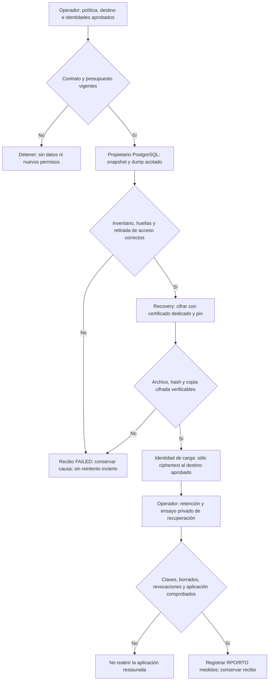

# Operación del MVP: alojamiento, correo y protección de datos

Estado del 29/10/2026: **preparación local, sin habilitar servicios nuevos**.
El piloto publicado y su prueba puntual de recuperación no son una autorización
permanente para copiar datos. La última aprobación de respaldo y restauración de
35 tablas ya se consumió. No reutilizar sus planes, IDs, carpetas, credenciales
temporales o copias detenidas como una tarea programada.

Esta guía reutiliza los propietarios existentes: [host persistente](../cloud/README.md),
[PostgreSQL](../cloud/POSTGRES.md), [correo](../../docs/development/ACCOUNT_MAIL.md)
y [Recovery](../../tools/QuickPrompt.Recovery/Program.cs). El estado de publicación
lo fija la [auditoría MVP](../../docs/development/MVP_RELEASE_AUDIT_20261029.md).

## Flujo y decisiones



Algoritmo operativo: comprobar política y autorización; adquirir exclusión de una
ejecución; fijar snapshot, inventario, formato y huellas por tabla; producir un dump
custom acotado; verificar retirada exacta del acceso temporal si lo hubo; cifrar;
verificar SHA-256 y tamaño del ciphertext; copiar sólo ese archivo al destino
aprobado; verificar el recibo del destino; aplicar retención autorizada; registrar
fallos y finalizar sin adoptar ejecuciones anteriores. Una respuesta incierta no
activa otro envío, dump o borrado. El diagrama es el contrato propuesto, no un
scheduler instalado ni una descripción de efectos ejecutados en esta fase.

## Alojamiento: condiciones que faltan

La opción de $0 evaluada es OCI, conservando .NET 10/PostgreSQL y usando un origen
HTTPS compartido detrás de un proxy explícito. No se creó cuenta ni se aprobaron
recursos o traslado de datos. [Evaluación y fuentes oficiales](../../docs/research/OCI_FREE_REVIEW_20261029.md).
Antes de provisionar, comprobar contrato de la cuenta real, capacidad Always Free,
home region, reclamación de VM, cuotas y alertas; no sustituir esas comprobaciones
por una etiqueta «free». Vercel Hobby sólo sirve al piloto no comercial. Render
Free no resuelve la persistencia: la base del piloto tiene caducidad registrada.

No hay aún dominio/subdominio HTTPS estable aprobado para el destino comercial.
Cambiarlo afecta cookies, OAuth de Google, issuer, callbacks y conexiones MCP;
preparar ese corte y rollback antes del cambio. Reutilizar el host existente y su
entrada web: `AccountHost.MapAccountPage` soporta el modo cuentas del build local.
Los manifests de imágenes admiten ARM64, pero build y ejecución ARM no se probaron.

La configuración pública debe mantener `VerifyFull` en Accounts y Executions,
incluso si PostgreSQL queda en la misma VM. Un loopback no reemplaza certificado y
nombre verificados. Usar el perfil de ingreso y proxy de confianza adecuado a la
infraestructura comprobada, sin rangos universales ni mezclar perfiles. Mantener
PostgreSQL y sus claves sin puertos públicos innecesarios. La plantilla
[cloud](../cloud/.env.template) es inventario, no configuración lista para arrancar.

Consulta read-only del piloto, 29/10/2026 antes de migrar el nuevo RC: el cliente
Npgsql fijado abrió la conexión existente con `quickprompt_app` y `VerifyFull`;
PostgreSQL 18.6 informó TLS 1.3/256 bits, `transaction_read_only=on`, sin SUPERUSER
ni BYPASSRLS, 35 tablas y 22 FORCE RLS. Duración observada: 1.425 ms. No se leyeron
filas de negocio, no se usó el operador y no se alteraron permisos. Es una señal
fechada de transporte/catálogo; no valida recuperación ni el esquema futuro.

Render documenta AES-256 **en reposo** para PostgreSQL, incluidas réplicas y
respaldos de plataforma. Esa afirmación se obtiene de su documentación, no del
campo TLS ni de una inspección local de discos. No proporciona cifrado de extremo
a extremo frente al servidor en ejecución ni reemplaza el archivo cifrado externo
de Recovery. [Cifrado de PostgreSQL](https://render.com/docs/postgresql-creating-connecting).
El plan Free excluye backups gestionados, expira a los 30 días y conserva después
un plazo de 14 días para pasar a pago antes de eliminar datos; no se aprobó pago.
El filesystem del servicio web es efímero y no sirve para conservar dumps o claves
generadas durante ejecución. Mantener material estable en los secretos privados
ya aprobados no equivale a respaldarlo de forma independiente.
[Límites de Free](https://render.com/docs/free).

## Política recurrente que puede aprobarse una vez y consumirse por ejecución

[backup-policy.template.json](backup-policy.template.json) es el borrador sin
secretos que se completa en una carpeta privada fuera de Git. **No es una
autorización ni un archivo consumido automáticamente por un scheduler existente.**
Sus campos nulos identifican decisiones reales pendientes. Editar `state` o añadir
un hash no concede acceso. La futura aprobación debe fijar el hash del documento,
identidades, destinos, permisos, vigencia y efectos; cada ejecución tendrá recibo e
ID nuevos dentro de ese mismo alcance. Cambios de origen, esquema, clave, destino,
permisos, presupuesto o expiración requieren revisar el contrato, no un bypass.

El borrador propone:

| Campo | Propuesta concreta y límite |
| --- | --- |
| Origen | Servicio `quickprompt-nova-jpt`; host y base exactos por fijar desde configuración privada revisada, sin proyectar la conexión |
| Snapshot inicial | PostgreSQL 18; inventario final f49: 35 tablas, 22 FORCE RLS, 31 migraciones y tres secuencias; SQL e inventario fijados por SHA-256 |
| Formato | `PGDMP`, UTF-8, UTC, ISO/YMD, extra_float_digits=1 y fingerprint v2 con orden `pg_catalog.C` interior y exterior |
| Identidad lectora | Por designar y revisar; el permiso temporal de un respaldo anterior no se convierte en permiso recurrente |
| Preparación local | Carpeta física nueva bajo `%LOCALAPPDATA%/QuickPromptNova/operations/backups`, pendiente de aprobar; ACL operador/SYSTEM antes de bytes, fuera de Git, sin junctions, shares ni unidades de red |
| Cifrado | Recovery, destinatario dedicado de cifrado documental y pin SHA-256; certificado público para cifrar, clave privada bajo custodia separada para recuperar |
| Destino externo | No configurado. Fijar proveedor, cuenta, región, bucket, prefijo `quickprompt-mvp/encrypted/` e identidades antes de copiar un byte |
| Permisos de carga | Crear sólo ciphertext bajo ese prefijo; sin administración IAM, lectura de datos en claro ni cambios de retención |
| Retención y cuotas | Propuesta: siete copias diarias y cuatro semanales, máximo 35 días y 1 GiB; no habilitada |
| Horario y concurrencia | Propuesta: diario a las 03:00 UTC, una ejecución, cero reintentos de efectos inciertos, autorización por 30 días |
| Objetivos | RPO propuesto 24 h; RTO pendiente de medición, sin compromiso comercial todavía |
| Alarmas | Destino pendiente: el correo de cuentas no es un sistema de alertas operativas ni está entregando correos reales aún |

El executor puntual actual está fijado a una aprobación y carpeta únicas. **No
existe todavía un executor recurrente autorizado que consuma esta política.** No
envolverlo en cron ni copiar sus wrappers para eludir ese límite. El siguiente
incremento, después de aprobar origen/clave/destino, debe extender al propietario
existente para consumir la política y emitir recibos por ejecución, conservando
sus guardas; no crear otro framework de backup ni un endpoint HTTP de descarga.
Un cambio de migraciones, como una futura tabla de presencia del agente, invalida
la base f49 del borrador hasta revisar el nuevo inventario.

## Cifrado y recuperación con el ejecutable existente

No se generó ni usó una clave real en esta preparación. Los comandos siguientes
son los de Recovery para un operador **después** de aprobar cada ruta y custodio.
Requieren un dump nuevo autorizado y sus recibos, no una copia del expediente QA.
Los argumentos de hash y certificado son públicos; no colocar contraseñas en
argumentos, variables de entorno, logs o archivos temporales.

```powershell
# Variables locales: rutas absolutas aprobadas y hashes de sus recibos.
# $recoveryDll identifica un build revisado de tools/QuickPrompt.Recovery.
& $dotnet $recoveryDll protect --repository-root $repositoryRoot `
  --input $authorizedDump --output $newPrivateArchive `
  --plaintext-sha256 $dumpSha256 --recipient-cert $publicRecipientCertificate `
  --recipient-sha256 $recipientSha256 --retain-until $retentionDeadlineUtc
if ($LASTEXITCODE -ne 0) { throw 'El cifrado falló; no copiar ni declarar respaldo completo.' }

# Recuperación deliberada en una consola interactiva, sólo en destino aprobado.
& $dotnet $recoveryDll recover --repository-root $repositoryRoot `
  --input $authorizedArchive --output $newPrivateDump `
  --archive-sha256 $archiveSha256 --plaintext-sha256 $dumpSha256 `
  --recipient-pfx $existingDedicatedRecipientPfx --recipient-sha256 $recipientSha256
if ($LASTEXITCODE -ne 0) { throw 'La recuperación del archivo falló; no restaurar una base.' }
```

El comando `recover` solicita la contraseña sin eco; exige un PFX dedicado ya
existente, acotado, cargado de forma efímera. No usa TLS, delegación o el key ring
como clave de backup. Ningún comando genera claves, se conecta a PostgreSQL,
publica, elimina originales, programa tareas o confirma recuperación de cuentas.
El PFX productivo y su operación interactiva siguen sin ensayarse en esta fase.

El máximo piloto es **64 MiB en claro** y 64 MiB + 8.192 bytes para el archivo.
Once copias máximas son 738.287.616 bytes, dentro de la reserva propuesta de 1 GiB;
eso no demuestra capacidad comercial universal. Un dump mayor debe rechazarse,
nunca truncarse ni presentarse como éxito. El límite incluye todas las tablas del
inventario, no sólo prompts.

`retain-until` se autentica dentro del archivo, pero **no borra archivos** y
Recovery rechaza recuperarlos después de ese instante. La selección diaria/semanal
debe decidir el plazo al crear cada archivo; no puede ampliarse editando JSON ni
metadatos. No dejar vencer la única copia recuperable: verificar reemplazo y
custodia antes de retirar o vencer una generación. El borrado físico y remoto
requiere una identidad y política de retención autorizadas por separado. El dump
en claro y un archivo parcial tras fallo requieren un ciclo de retirada explícito
y revisado: Recovery no hace limpieza ni garantiza borrado seguro del soporte.

## Aceptación antes de habilitar recurrencia o reabrir una restauración

1. Aprobación vigente y exacta para origen, destino, lector, custodio de clave,
   permisos, horario, presupuesto y retención; no tomar los hashes históricos como
   nueva autorización. Mantener las claves fuera de Git y del servicio de carga.
2. Dump y manifiesto obtenidos del mismo snapshot; por tabla comparar conteos y
   huellas portátiles, texto original y su SHA-256 sin reserializar, secuencias,
   RLS, catálogo y permisos. No reemplazar una huella fallida por la observada.
3. Cifrado y copia externa con hashes y tamaños comprobados. El recibo de cifrado
   no prueba existencia remota. El contador de archivos no prueba recuperabilidad.
4. Restauración en una copia privada separada autorizada, autenticada y detenida
   en `finally`; nunca datos humanos en QA. Restaurar flags, permisos y objetos
   globales sólo mediante su procedimiento revisado, sin inferirlos de un dump.
5. Reconciliar borrados y revocaciones posteriores al snapshot **antes** de abrir
   tráfico. La implementación actual no acredita un ledger exhaustivo ni el
   borrado integral de cuentas y copias. Esa ausencia bloquea prometer restauración
   comercial sin resurrección de datos.
6. Probar descifrado del key ring con el material custodiado y el ciclo de acceso
   de la aplicación restaurada, tokens de recuperación, revocaciones y conexiones
   MCP; después medir RPO/RTO. Restaurar tablas no prueba estas capacidades.
7. Ensayar fallo de cuota, archivo corrupto y clave incorrecta con fixtures
   sintéticas; alarmas y retención con el destino real sólo tras aprobarlo.

La prueba privada puntual del esquema f49 permanece válida dentro de su alcance;
estos pendientes no la anulan y tampoco quedan cerrados por ella. No se realizó
ninguna conexión productiva, copia de datos privados, creación de rol o restauración
privada en esta preparación.

La adaptación del comparador público para la futura tabla `companion_presence`
se contrastó aparte con datos sintéticos: 28 comprobaciones sobre dos bases UUID
nuevas, con dump/restore y limpieza comprobada. Comprueba el catálogo, observaciones,
RLS y permisos de esa fixture; no ejecuta ni renueva la autorización del respaldo
privado f49. La restauración integral del nuevo candidato queda para CI. El borrador
de política conserva explícitamente la base f49: antes de usarlo para el nuevo
esquema habrá que revisar inventario, huellas y contadores de esa nueva migración.

## Correo: alternativa preparada, proveedor pendiente

Brevo conserva su configuración anterior. SMTP2GO sólo se selecciona mediante
`QuickPrompt__Accounts__MailProvider=Smtp2Go`, tres opciones privadas completas y
ninguna configuración Brevo simultánea. Consultar el
[contrato y comparación oficial](../../docs/development/ACCOUNT_MAIL.md).
No activar un proveedor sin autorizar su cuenta, condiciones y destino de la clave.
La llegada a un buzón, confirmación y recuperación consumidas desde la interfaz
siguen siendo los criterios de aceptación; `mailDelivery=configured` no los prueba.
