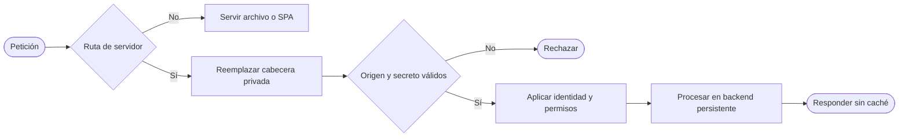

# Web de cuentas en Vercel

La web Vite se publica como archivos estáticos. Las API, OAuth, MCP y las ejecuciones NOVA permanecen en un backend .NET persistente con PostgreSQL. Las aprobaciones y controles de una ejecución viven en su proceso: no se trasladan a una Function ni a un Daemon sin entrada HTTP.



Algoritmo: servir GET de confirmación, recuperación y verificación con el mismo build de la SPA; enviar sus POST y las rutas del servidor al origen HTTPS fijo; Vercel reemplaza `X-QP-Origin-Secret`; el backend valida el secreto y el Host físico antes de usar el origen público configurado. Los controles de cuenta, CSRF, biblioteca y recurso siguen siendo obligatorios.

## Configuración

| Lugar | Nombre | Contenido |
| --- | --- | --- |
| Vercel, privado | `ORIGIN_SECRET` | Secreto aleatorio de 64 caracteres hexadecimales; jamás usar `VITE_` |
| Backend, privado | `QuickPrompt:Hosting:OriginSecret` | El mismo secreto, sin imprimirlo ni incluirlo en archivos publicados |
| Backend | `QuickPrompt:Hosting:IngressOrigin` | Origen HTTPS físico del backend |
| Backend | `QuickPrompt:Accounts:Origin` | Origen HTTPS público real de Vercel |
| Build Vite | `QUICKPROMPT_WEB_MODE=accounts` | Selecciona la aplicación de cuentas mediante una única meta HTML |

El modo predeterminado de Vite sigue siendo local. No se cambia `main.tsx` ni se añade configuración privada al código del navegador. Las cookies y CSRF usan el origen público único; no habilitar CORS global ni confiar en cabeceras forwarded del cliente.

La plantilla [vercel.json.template](../../apps/web/vercel.json.template) contiene un marcador de backend y no se despliega directamente. Generar una configuración nueva en staging privado (fuera del árbol versionado o dentro de `.playwright` ignorado):

```powershell
node deploy/vercel/prepare-config.mjs --backend-origin https://BACKEND_REAL --output C:/PRIVATE_STAGING/web/vercel.json
```

Copiar a ese staging sólo las fuentes necesarias del frontend; raíz de build `apps/web`, comando `QUICKPROMPT_WEB_MODE=accounts npm run build`, salida `dist`. El generador rechaza sobrescrituras, credenciales en URL, HTTP y rutas/query/fragmento. Conserva la referencia privada `$ORIGIN_SECRET` del transform en vez de resolver su valor. Vercel usa `op: set`, de modo que reemplaza una cabecera aportada por el cliente.

## Rutas y descubrimiento

`/api`, `/account`, `/connect`, `/signin-google`, `/mcp` y `/health` se envían al backend, con caché desactivada. GET/HEAD de `/account/confirm`, `/account/reset` y `/connect/verify` sirven la SPA; sus POST llegan al servidor. Archivos estáticos preceden al fallback SPA.

La primera regla global de cabeceras continúa hacia el enrutado y aplica también al HTML y los archivos estáticos la política exacta de `AccountHost`: CSP (incluido `frame-ancestors 'none'` y el destino de formularios Google), `Referrer-Policy: strict-origin`, `X-Content-Type-Options: nosniff` y `Cache-Control: no-store`. Las cabeceras de una respuesta API no protegen el documento HTML servido por Vercel. La prueba de configuración contrasta estos valores con su dueño .NET; después de desplegar hay que verificarlos en respuestas HTTP reales.

Vercel reserva `/.well-known` y no permite reescribirla. El despliegue debe incluir documentos públicos estáticos de discovery obtenidos de la configuración real y validados contra el origen público exacto. Las claves JWKS siguen siendo dinámicas mediante `/connect/jwks`; `/.well-known/jwks` permanece disponible en el backend para compatibilidad. Una metadata ausente devuelve 404, nunca HTML de la SPA.

Con el backend ya configurado con el origen público, cargar `ORIGIN_SECRET` en el entorno privado del operador y ejecutar, sin escribir el secreto en el comando:

```powershell
node deploy/vercel/prepare-metadata.mjs --backend-origin https://BACKEND_REAL --public-origin https://WEB_REAL --output C:/PRIVATE_STAGING/web/public/.well-known
```

El generador obtiene tres documentos públicos, no sigue redirecciones y limita tamaño/tiempo. Valida issuer/endpoints del origen exacto, JWKS dinámico, scopes anunciados por su dueño y bearer por cabecera; no inventa permisos ni captura claves. Rechaza staging existente y no escribe en `apps/web/public` versionado. Esos archivos se copian al build mediante el directorio `public` de Vite. Regenerarlos al cambiar origen o capacidades anunciadas; una rotación de claves no requiere publicar otra instantánea porque JWKS permanece dinámico. La prueba HTTP pública sigue pendiente: no se ha certificado el plugin en Vercel por validar la plantilla o el generador local.

## Renovación de actividad

El proxy externo tiene un límite documentado de 120 segundos. El feed de observación NOVA renueva a los 30 segundos; esto no modifica la duración de la ejecución ni de su aprobación. El `EventSource` existente reconecta con su cursor; el servidor prioriza `Last-Event-ID` sobre `after`. Una renovación no crea otra tarea ni aprueba contenido. Los huecos y duplicados se gestionan por secuencia. El backend debe permanecer activo mientras espera a la persona; PostgreSQL conserva auditoría y aislamiento, pero no reconstruye controles/TCS de otro proceso.

## Comprobaciones antes de publicar

- Ejecutar `node --test Tests/tooling/vercel-deployment.test.cjs` desde la raíz; tests de modo de entrada y actividad en `apps/web`.
- Construir con modo `accounts`; comprobar una sola meta `quickprompt-mode=accounts` y ausencia del secreto en `dist`.
- Validar el JSON contra el [schema oficial](https://openapi.vercel.sh/vercel.json).
- Con URL y backend reales: comprobar cookies, CSRF, login Google, JSON discovery/JWKS, desafío MCP y rechazo del acceso directo sin secreto.
- Probar una ejecución con revisión pendiente durante una renovación SSE y reconectar desde el cursor sin repetir efectos.

Los tests locales de configuración no demuestran que Vercel haya servido una cabecera o metadata. No se da por publicado un dominio ni por conectado ChatGPT hasta la prueba HTTP real y la autorización de su conexión.

Fuentes primarias: [rewrites y secreto de origen](https://vercel.com/docs/routing/rewrites), [límites](https://vercel.com/docs/limits), [límites de Daemons](https://vercel.com/docs/daemons/limits). Para el backend y sus secretos, ver [deploy/cloud](../cloud/README.md).
