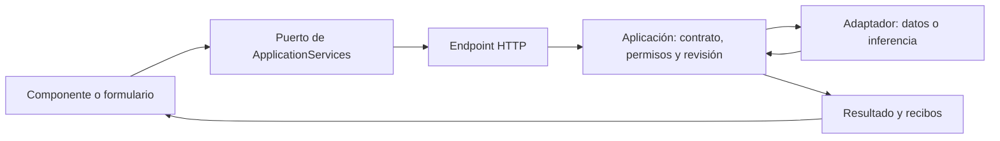

# Arquitectura vigente

Referencia: NOVA 1.0.0 y composición actual del repositorio. Los informes fechados anteriores se conservan como [historial](archive/README.md).

## Topología de despliegue acordada — 01/11/2026

Actualización posterior: el usuario aceptó **Render Free para la aplicación y
Neon Free para PostgreSQL**. Mantiene una imagen y un origen para UI/API/MCP;
permite dos proveedores de alojamiento para conservar $0. El principio de un
único proveedor de la revisión anterior queda sustituido para este destino.
No es un corte ejecutado: la preparación y aceptación siguen R1–R6 en
[GO_TO_MARKET](development/GO_TO_MARKET.md). Los contratos internos no cambian.

En la revisión anterior, por petición del usuario: maximizar lo existente en **una aplicación desplegable,
un origen HTTPS y un proveedor de alojamiento**. La propuesta repartida entre
Netlify, Render y Neon queda retirada como destino. Esta decisión no modifica
el despliegue público ni acredita un plan gratuito definitivo.

El producto ya admite un monolito modular: `deploy/cloud/Dockerfile` construye
React y publica un único runtime .NET, copiando el frontend a `wwwroot`.
`AccountHost.MapAccountPage` sirve esa web en modo cuentas; la misma composición
monta cuentas, biblioteca, colecciones, compartir, memoria, ejecución, NOVA y
`AccountMcpModule` en `/mcp`. `ExecutionWorker` y `AccountNovaCoordinator`
son servicios alojados dentro del proceso .NET, no otros servicios cloud.

Los proyectos de dominio, aplicación, inferencia y cuentas conservan sus contratos.
No introducir otra API, sistema de identidad, Redis, broker, microservicio de NOVA
ni servicio MCP dedicado para esta consolidación. Las conexiones Accounts y
Executions ya exigen la misma base; sus roles diferentes mantienen menor privilegio.

PostgreSQL necesita almacenamiento durable: sería un recurso privado del mismo
proveedor, con su propio proceso y ciclo de respaldo. Una aplicación desplegable
no equivale a un único proceso con base incrustada. No mover PostgreSQL al
filesystem efímero del contenedor web para aparentar un único servicio.

Companion y Qwen3:8b/DMR siguen en el equipo emparejado por la configuración elegida.
La propuesta concentra alojamiento web/dominio/datos, no ofrece inferencia GPU
gratuita en cloud. Google, ChatGPT y el transporte de correo conservan sus contratos
externos; no son nuevos backends de QuickPrompt ni se retiran por esta decisión.

Antes de ejecutar el corte, R5/R6 deben comprobar:

- Ingreso HTTPS del proveedor con confianza explícita. El perfil actual
  `OriginProxy` exige secreto del proxy; abrir directamente el backend sin preparar
  una frontera equivalente devolvería 403. `TrustedProxy` exige IP/red comprobada,
  sin comodines ni auto-forwarding. No desactivar validaciones para unificar.
- Origen único para HTML, assets, API, callbacks Google, OAuth/discovery, MCP y SSE.
  Cambiar origen/base afecta cookies y key ring; conservar claves previas, preparar
  rollback y verificar las conexiones que requieran renovar consentimiento.
- Persistencia, roles/FORCE RLS, TLS SQL VerifyFull y recuperación en ese mismo
  proveedor, con cuota y duración compatibles con la oferta y presupuesto $0.
- Aceptación pública del candidato exacto antes de retirar Vercel/proxy o recetas
  legacy. Una lectura del Dockerfile o una prueba con TestServer no prueba el corte.

Render ya permite contenedores y PostgreSQL, pero su base Free caduca a los 30 días:
la cuenta existente no resuelve por sí sola el alojamiento comercial persistente.
Fuentes y límites vigentes: [evaluación cloud](research/CLOUD_FREE_REVIEW_20261101.md).
No se ha contratado, migrado ni publicado otro entorno.

## Ensamblaje, fábricas y conexiones — análisis del 01/11/2026

Petición vigente: estructura tipo fábrica, base operativa Docker y piezas
sustituibles. El diseño conserva el monolito modular y un proveedor de alojamiento.
**No exige cero dependencias:** núcleo y adaptadores dependen de contratos
estables; un caso de uso no debe conocer la clase concreta del proveedor. Docker
ejecuta y distribuye la aplicación; no es propietario de reglas de negocio,
identidad, aprobaciones o datos del usuario.

La composición ya tiene propietarios: `AccountHost` para cuentas,
`ApplicationModules` para el host local, `AccountNovaInference` para capacidades
ligadas a una conversación, `AccountMailRegistration` para correo y
`createApplicationServices` para conexiones de UI. Extender esos puntos antes de
crear una fábrica universal. No introducir service locators en el dominio,
reflexión para descubrir plugins, otros contenedores DI ni un registro global
de conexiones de usuarios.

### Qué falta alinear

| Frontera | Evidencia actual | Cambio necesario y límite |
| --- | --- | --- |
| Perfil de inferencia local | Se reprodujo en RC2 que la fábrica ignoraba Provider/Endpoint/PhysicalModel explícitos: 8 FAIL/1 PASS antes. Ahora `NovaAgentSettings` captura el binding y `ApplicationModules` lo valida/congela en `AdaptiveCoreOptions`. | Corrección local verificada con 73 regresiones y una petición real DMR; todavía no integrada/publicada. Se conserva compatibilidad cuando falta el perfil nuevo; no hay selección por texto del usuario ni cambio de permisos. |
| Embeddings | `Infrastructure/OllamaEmbeddings` fija `nomic-embed-text-v2-moe:latest`, consulta `api/tags` y usa `api/embed`; la composición reutiliza el endpoint de chat. | Perfil y adaptador de embeddings propios sobre `ILocalEmbeddings`, con modelo/digest/dimensión explícitos y una llamada real antes de sustituir. Inventariar cachés/índices por identidad; no descargar otra copia ni tratar vectores de modelos distintos como equivalentes. |
| Composición de capacidades NOVA | Host local y `AccountNovaInference` construyen generador, selector y extractores sobre el puerto existente. El local usa singleton; cuentas liga actor/biblioteca/conexión. | Compartir sólo construcción pura cuando haya duplicación real. Conservar scopes y disposición del editor prestado: una fábrica singleton con actor o grant mezclaría usuarios. No fusionar sus reglas de autorización. |
| Contrato de inferencia | `Application/AgentModelTransport.cs` posee el puerto; `AdaptiveCoreModelTransport.CreateRequest` adapta el paquete de compatibilidad a `adaptive-inference/1`. | Mantener la adaptación del protocolo en ese dueño. Un futuro puerto tipado puede reutilizar el contrato canónico; no cambiar silenciosamente `Send(object,...)` ni copiar esquemas por página o proveedor. |
| Modelo y autorización | `LocalModelPolicy`, `LocalWorkProtocol` y delegación limitan el modelo/perfil admitidos; DMR conserva un mapping físico inmutable. | Cambiar transporte no concede permiso para otro modelo, modo de razonamiento o alcance. Una sustitución exige capacidades compatibles y aceptación; no basta editar una URL. |
| Datos y correo | PostgreSQL, cola, roles/RLS y `IAccountMail` tienen propietarios existentes. La fábrica de correo ya selecciona un único proveedor explícito. | Cambiar host PostgreSQL exige migración, TLS, roles y restauración; cambiar motor no es una sustitución trivial. La activación/entrega real de correo no se resuelve añadiendo otra fábrica. |
| Base Docker | El Dockerfile cloud incluye React + .NET; `deploy/postgres/compose.yml` es infraestructura sintética de desarrollo. Companion/Python corren en Windows y DMR es administrado por Docker Desktop. | No presentar el Compose QA como despliegue comercial ni afirmar que todo está contenerizado. Contenerizar Companion exigiría otro almacenamiento de secretos y revisar endpoints/red; DPAPI CurrentUser y loopback no se trasladan sin ese contrato. |

### Contrato de una conexión sustituible

Separar configuración técnica del operador (proveedor, endpoint permitido,
alias/digest, límites y referencia privada a credencial) de identidad/consentimiento
por usuario (actor, biblioteca, conexión, scopes, vigencia y revocación).
La fábrica valida y ensambla; el dominio conserva autoridad. Estado de salud o
presencia es observación, nunca un permiso. Un secreto no entra en Docker build,
imagen, frontend, catálogo de herramientas o prompt.

Flujo de construcción propuesto: leer configuración → validar perfil y recursos
→ construir adaptadores registrados → inyectar puertos en sus scopes → comprobar
capacidades ofrecidas. Un proveedor desconocido falla explícitamente, sin fallback.
La falta de inferencia no debe activar otro modelo o impedir la biblioteca manual.
Una dependencia indispensable de datos puede bloquear esa capacidad; no se simula.

### Aceptación y secuencia dentro de R1–R6

Primero fijar este inventario de contratos/perfiles; después alinear la composición
local y sus conexiones DMR/embeddings, preservando cuentas. Sólo extraer una
construcción compartida si los dos consumidores prueban su equivalente y sus
lifetimes. Finalmente validar el mismo artefacto en la topología única acordada.
No reescribir módulos funcionales ni implementar una fábrica por cada clase.

La sustitución se acredita cuando cambia un adaptador/configuración compatible
sin editar dominio ni páginas, se verifica una llamada real y se mantienen
cancelación, aislamiento, permisos y persistencia. Probar también ausencia/fallo,
MCP deshabilitado con biblioteca disponible y rechazo de conexiones no autorizadas.
Los controles de fidelidad NOVA siguen separados: una fábrica correcta no hace
correcta una propuesta semántica.

Verificación de este análisis: `Check-ModuleBoundaries.cjs` **40 PASS**, sin errores;
`AdaptiveCoreContractTests` **58 PASS**, cero FAIL/SKIP, en RC2. Recibos:
`.playwright/priority-closure-20261101/factory-architecture/module-boundaries.json`
y `core-composition-contracts.trx`. Son arquitectura estática y contratos/composición,
no una nueva campaña con proveedor, despliegue, sustitución universal o certificación.
El análisis no implementó estas extracciones ni cambió Docker, perfiles o accesos.
Referencia: [guías de DI de .NET](https://learn.microsoft.com/dotnet/core/extensions/dependency-injection-guidelines).

### Incremento implementado: conexión explícita de Core local

En RC2, `ApplicationModules` extiende su composición existente. No se añadió
otra fábrica global. `NovaAgentSettings` lee una vez estas claves de operador:

| Configuración local | Contrato |
| --- | --- |
| `QuickPrompt:AdaptiveCore:Provider` | `docker-model-runner` explícito; ausencia conserva el proveedor de compatibilidad anterior |
| `QuickPrompt:AdaptiveCore:Endpoint` | Raíz HTTP loopback; DMR exige puerto 12434. Ausencia conserva el endpoint heredado y no elude su validación |
| `QuickPrompt:AdaptiveCore:PhysicalModel` | Referencia OCI inmutable por `@sha256:` para DMR; no cambia el alias lógico ni sus permisos |
| Python / Worker / SdkRoot | Prerrequisitos existentes; no se instalan ni se arrancan al componer |

El perfil DMR actual requiere también `QuickPrompt:Preparation:SemanticThinking=false`
para conservar el modo configurado. `QuickPrompt:Ollama` mantiene la conexión
de compatibilidad para disponibilidad y embeddings; puede corresponder a un
adaptador sin pesos hacia Docker, cuya operación real sigue por verificar.
Configurar Core no autoriza instalar otro runtime nativo o descargar otra copia.

Se conserva `OllamaClient.CreateOwned(..., modelTransport: Core)`: inferencia
pasa por Core y ese cliente todavía posee HTTP para `Available()`. Sustituirlo
por el wrapper prestado eliminaba disponibilidad local; la regresión de lifetime
lo detectó (72 PASS/1 FAIL en el intento retirado). Se restauró el contrato
funcional, sin modificar su prueba. Separar descubrimiento/embeddings queda
pendiente de sus adaptadores y aceptación, no se da por hecho por tener un puerto.

Verificación posterior: 73 PASS/0 FAIL; una petición opt-in de la fábrica real
con Qwen3:8b/DMR devolvió `device=Sensor Alpha, count=7`, una llamada,
16.376 ms totales. Son valores sintéticos sin cuenta/DB/UI/Companion instalado.
Recibos RC2: `.playwright/priority-closure-20261101/factory-connection/`.
La compilación opt-in inicial chocó con otro testhost (MSB3027), antes de inferir;
se preserva como fallo de arnés. El opt-in posterior usó el binario integrado
sin recompilar ni repetir una respuesta del modelo.

## Propietarios

| Responsabilidad | Propietario y frontera |
| --- | --- |
| Montar la API | `backend/QuickPrompt.Api/QuickPromptHost.cs` y `ApplicationModules.cs` |
| Candidato de cuentas autenticadas | `backend/QuickPrompt.Cloud/AccountHost.cs`; composición explícita loopback, separada del host local; todavía no sustituye la aplicación instalada |
| Identidad y bibliotecas privadas PostgreSQL | `backend/QuickPrompt.Accounts`; ASP.NET Identity/EF Core/Npgsql, transacción con actor y FORCE RLS, sin acceso a LocalStore |
| Creación idempotente por cuenta | `Accounts/Libraries/LibraryAccess.Capture.cs`; cuerpo literal, hash de entrada/destino, versión inicial y recibo privado en una transacción. Consumidores reales HTTP de cuentas y MCP, sin segundo escritor |
| Colecciones por cuenta/biblioteca | `Accounts/Libraries/LibraryAccess.Collections.cs` posee nombres, revisiones, pertenencias y eliminación; `CollectionModel` comparte filtro/proyección entre HTTP y `Memory/AccountCollectionReader`/catálogo del agente. Dos tablas FORCE RLS y relaciones compuestas impiden mezclar bibliotecas. La publicación pertenece a `SharingAccess` |
| Publicaciones e invitaciones del candidato de cuentas | `QuickPrompt.Accounts/Sharing/SharingAccess.cs`; snapshots, aceptación, revocación y recibos; importa mediante el escritor de `LibraryAccess` dentro de la misma transacción |
| Snapshots de colecciones | `SharingAccess.Collections.cs` reutiliza invitación/revocación y escritores de biblioteca; copia la revisión revisada de todos los miembros, con recibo inmutable y rollback del conjunto. No expone IDs privados del origen ni amplía permisos MCP existentes |
| Contexto conservado por cuenta/biblioteca | `QuickPrompt.Accounts/Memory`; adapta `IAgentSessionStore`, `IPreparationPreferences` y `IPromptCatalog`, reutiliza `EditorDraftPreparation.Compile`; revisión de almacenamiento independiente, retención y FORCE RLS; nunca restaura aprobación o acciones pendientes |
| Conversación activa por cuenta/biblioteca | `AccountAgentMemory.ActiveSessions` adapta el mismo `AgentSessions`; `AccountActiveSessions` posee transiciones atómicas entre instancias, reloj SQL, caducidad de dos horas y límite separado de 100 por propietario. `SessionSourceBinding` comparte la transición de contexto con el host local. HTTP de cuentas exige conversación inactiva antes de reemplazarla; no restaura aprobaciones |
| Biblioteca privada para puertos de aplicación | `AccountPromptStore` y `AccountPromptCatalog` comparten mapeo y consultas; `LibraryAccess` sigue siendo el escritor de registro/versión. Conserva descripción, categoría y defaults privados; favoritos/archivo/uso no se confunden con publicación. `RecordUse` registra hash idempotente y contador, no historial de resultados. Borrado definitivo aún no habilitado |
| Cola y resultados de cuentas | `QuickPrompt.Accounts/Executions`; admisión idempotente, cuotas, leases cercados y commit de resultado/estado. `Cloud/ExecutionWorker` procesa fuera de transacciones; primer consumidor `CompileExecutionHandler` reutiliza `EditorTools.Compile`, sin inferencia ni efectos externos |
| Puerto de inferencia por cuenta | `Application/AgentModelTransport.cs` posee los contratos puros con identidad pública conservada. `AccountModelProposals.ForConnection` enlaza `PairedModelTransport` a actor/biblioteca/conexión; espera acotada, cancelación propia y autorización fresca sobre la cola existente, sin ejecutar proveedor en Cloud. `Inference/ForwardedModelContracts.cs` mantiene compatibilidad binaria |
| Autoría y selección de contenido compartidas | `QuickPrompt.Inference` posee generador, revisor de fidelidad, extracción, selección, edición y codec de respuestas existentes; no referencia almacenamiento. Infrastructure reenvía sus tipos públicos. `Cloud/AccountNovaInference` los compone con `ForConnection` y `OllamaClient.ForTransport`, sin cliente HTTP, proceso o endpoint de inferencia en Cloud. `AccountNovaCoordinator` monta el motor visible existente en HTTP autenticado con acción elegida, biblioteca, conexión y superficie; el workspace privado integra crear/abrir/actualizar con driver real de React. Falta su campaña conjunta en navegador y companion |
| Referencias literales del encargo | `Application/AuthoringReferenceCoverage` captura enlaces fuera de los valores del caso. `Inference/DraftFidelityReviewer.References` interpreta sus roles desde el origen; el objetivo fija el contrato. Autoría `future-content-only/2` sólo redacta contenido futuro, sin declarar controles de sesión. Compilación y evaluación nativas comprueban URI/rol antes de aceptar |
| Turno visible privado y efectos atómicos | `Accounts/Executions/AccountLiveRunStore` adapta `ILiveRunStore` y la extensión opcional `ILiveRunCommitStore`. Serializa por propietario, conserva eventos, limita admisiones y valida host/conexión. Reutiliza `AccountPromptStore`/`LibraryAccess` en la misma transacción para guardar versión y consumir aprobación. El coordinador renueva su lease; no ocupa plazas de inferencia ni restaura controles tras expirar. API y React/driver comprobados por separado; recorrido real conjunto aún pendiente |
| Propuestas del companion | `AccountModelProposals` prepara inferencia sólo en servidor; `ExecutionQueue.Proposals` comparte cuotas/turnos y conserva propuestas privadas con FORCE RLS. OAuth exige `companion:proposals` y otro consentimiento. `QuickPrompt.Companion` reutiliza el SDK y ciclo de cancelación; el orquestador HTTP usa esta frontera. La campaña real con dispositivo Windows/DPAPI sigue pendiente |
| Recuperación de prompts compartida | `Application/CatalogPromptRetriever` conserva la política acotada de candidatos; SQLite y `AccountAgentMemory.Retriever` aportan los puertos de catálogo/colecciones. PostgreSQL usa la función SQL invoker `search_text_latin` para coincidencia sin marcas diacríticas latinas; conserva texto original, alcance y RLS |
| Inspección privada del editor | `AccountEditorMemory.Inspect` autoriza biblioteca/origen/revisión y reutiliza `EditorTools.Compile`/`TemplateCompiler.Names`, sin memoria, aprobación o inferencia. `useAccountEditorInspection` descarta snapshots tardíos y mantiene campos al cambiar valores; `AccountPromptEditor` y `AccountPromptFocus` reutilizan `PromptVariableFields` y marcadores del driver |
| Transporte NOVA privado | `services/accountNova` adapta `createLiveClient`/`createVisibleSessionClient` con rutas de biblioteca, cookie/CSRF y superficie en RAM; sólo el runId se conserva con clave cuenta/biblioteca/conexión. `AccountNovaBoundary` compone esos puertos mediante `AgentRuntimeServiceProvider`, sin servicios locales de sustitución; cookie vencida vuelve al acceso |
| Workspace y memoria visual privada | `AccountNovaActions` emite opciones explícitas con `LiveCommand`/`PromptInputNames`; `AccountPromptLibrary` compone biblioteca, editor y detalle. Reutiliza `SameTabAgent`, `NovaLive`, `AgentUiProvider` y `AgentControl`. Al retirar la conexión limpia capacidades y campos del journal; conserva hasta tres identidades recientes. La recarga recupera sólo metadatos, nunca aprobación o ejecución UI |
| Respuesta incierta de guardado | `services/accountNovaCommit` hace un único commit. Ante error de transporte/5xx consulta el mismo recibo y la versión privada exacta en un máximo de cuatro segundos; exige efecto consumido, identidad, revisión, título y cuerpo coincidentes. Rechazo conocido, cambio de contexto o resultado distinto no se convierten en éxito ni repiten la escritura |
| Actividad privada NOVA | `AccountNovaFeed` emite eventos nativos SSE con cursor ligado al run; `AccountCookieReadScope` comparte vigencia de cookie/sello y cerco de revocación con `AccountExecutionFeed`. Una observación no concede ejecución ni revive controles |
| Estados privados de ejecuciones | `Cloud/AccountExecutionFeed` proyecta los estados existentes mediante SSE; revalida cookie/stamp y biblioteca en scopes nuevos bajo el cerco de la cola. No emite contenido, resultados ni etapas inferidas. `services/accountExecutionStream` posee snapshots y renovación acotada; `serverEvents` comparte sólo framing con preparación y ejecución local |
| Olvido y caducidad de ejecuciones | `AccountExecutionAccess.Forget` enlaza actor/biblioteca; funciones PostgreSQL limitadas retiran entrada/resultado bajo el cerco de la cola. El dispatcher procesa lotes de hasta 100 contenidos terminales de siete días; el recibo mantiene identidad y cuota. No afecta al host SQLite |
| HTTP, cabeceras y transporte de DTO | `backend/QuickPrompt.Api`; no duplica casos de uso |
| Catálogo MCP, transporte y proyección de DTO | `backend/QuickPrompt.Mcp`; consume la API loopback, sin acceso directo a datos ni inferencia |
| MCP por cuenta/biblioteca | `Cloud/Delegation/AccountMcpModule`, `McpConsent` y herramientas de lectura/captura/sharing/colecciones; OpenIddict valida código/PKCE, `ConnectionAccess` posee el permiso limitado, `LibraryAccess` conserva autorización/RLS y `SharingAccess` publicación/importación/recibo. Colecciones exige `collections:import` explícito y no amplía grants anteriores. Composición optativa; no reenvía tokens al MCP local |
| Captura externa idempotente | `Application/PromptCapture.cs` y `Infrastructure/PromptCaptureStore.cs`; prompt, versión y recibo en una transacción |
| Variables para clientes externos | `PromptLibrary.Render` reutiliza `EditorTools.Compile`; revisión y valores explícitos, sin defaults ni instrucciones generales |
| Plan, contratos, revisiones y efectos de NOVA | `backend/QuickPrompt.Application` |
| Campos pedidos al autor del prompt | `LiveCommand.InputNames` recoge la selección del usuario; `Application/PromptInputContract.cs` la fija en `TaskGoal`; el binder de dominio compone los marcadores |
| Definición de nombres en la interfaz | `features/prompts/PromptInputNames.tsx`, compartido por la acción inicial y la aclaración; no rellena valores |
| Adaptadores de persistencia y modelo | `backend/QuickPrompt.Infrastructure` |
| Dominio compartido y almacenamiento local | `src/QuickPrompt.Domain` y servicios existentes usados por los puertos de aplicación |
| Inferencia externa local | `agents/nova-core/nova_worker.py` y SDK Adaptive-AI-Core configurado |
| Composición de la interfaz | `apps/web/src/app/App.tsx` |
| Espacio del candidato de cuentas | `features/accounts/AccountPage`, `AccountPromptLibrary`, `AccountRememberedDrafts` y `AccountSharing`; transporte/CSRF en `services/accounts.ts`, presentación cancelable sobre `useBoundOperation`; campos compartidos de `PromptVariableFields`; no resuelve servicios locales como fallback |
| Puertos de servicios del frontend | `services/application.ts` y `components/ServiceContext.tsx` |
| HTTP/serialización del frontend | `services/api.ts` y clientes de capacidad en `services/` |
| Estado visual ligado a una operación | `services/useBoundOperation.ts` |
| Campos de valores de prompts | `features/prompts/PromptVariableFields.tsx` |
| Diagnóstico de mecanismos retirados | `backend/QuickPrompt.Evaluation`; fuera de las dependencias del producto |

## Flujo y autoridad

NOVA recibe una acción explícita `LiveCommand`; `UserActionRequest` y `TaskIntentContract` fijan los resultados y límites. Sin elección, `ActionChoiceInterpreter` pide elegir, antes de recuperar candidatos o llamar al modelo. La IA no concede permisos y sus propuestas no prueban que se cumplió el objetivo.

La consulta de búsqueda original llega al buscador; no se obliga a un intérprete a regenerarla. Recuperación y selección conservan sus propietarios actuales. El proveedor local de referencia es Qwen3:8b mediante Core; los perfiles anteriores y el consumidor Blazor son compatibilidad, no un fallback automático.

En una búsqueda ambigua, `LiveView.sourceChoices` expone hasta seis candidatos reales con identidad/revisión. Elegir uno obtiene su revisión actual y abre una acción explícita `OPEN_PROMPT`; no hereda ejecución ni escritura.

La autoría vigente usa `DraftProposalContract` y `AuthoringBrief`: la petición original, fuente elegida, campos y aclaraciones conservan su procedencia. El host exige establecer la tarea antes de componer contenido. Por decisión expresa del usuario, `CREATE_DRAFT` pasa a `AuthoringBriefs.ReviewEstablished`: copia profundamente el contrato humano, sin descubrimiento ni redacción de IA, y exige una segunda confirmación de contenido. La aprobación para guardar o ejecutar sigue separada. La extracción opcional de valores de un caso, si fue solicitada, conserva su puerto y permisos; no redacta el contrato.

Sólo `PROPOSE_ADAPTATION` permite reescritura. `PromptDraftGenerator` envía la procedencia completa al descubrimiento y sólo los campos futuros establecidos al escritor mediante `FieldRevisionMaterial`. Ambas vistas se limitan antes de inferir, sin truncar. El esquema del escritor contiene una clave fija por campo humano; el host valida las claves y reconstruye el mismo orden. Sus paquetes son de contenido (`contentOnly`): mensajes y esquema de salida, sin catálogo de herramientas ni permisos de aplicación. La sugerencia permanece separada del contrato y se aplica por elección humana. El revisor semántico legado no es una segunda autoridad activa de este camino. Una clave conservada no acredita que su significado se haya conservado.

El modo `LITERAL` sólo puede seleccionar una cita cuyo texto completo coincida
exactamente con la tarea establecida. `RevisionMaterial` limita el catálogo y el
schema a esas citas; `CompileDefinition` revalida la ligadura y conserva pasos,
restricciones, entregables y referencias. Otras citas permanecen en el contexto
de descubrimiento, sin convertirse por existir en autoridad para sustituir la
tarea. La propuesta sigue separada y requiere confirmación; esta validación no
certifica el significado de una paráfrasis `INSTRUCTION`.

### Capacidades y prerrequisitos de autoría

Esta matriz describe los dueños existentes; no es otro registro ejecutable ni una
lista de herramientas enviada al modelo. Separar capacidad, datos y autoridad
evita atribuir una decisión semántica errónea a un orden de herramientas que no
se ha observado.

| Etapa / dueño | Entrada y prerrequisito real | Salida y límite |
|---|---|---|
| Acción / `LiveCommand`, `TaskGoal` | Acción elegida, origen/revisión y campos explícitos del usuario | Contrato de trabajo; no aprueba contenido o persistencia |
| Establecimiento / `AuthoringBriefs.Establish` | Acción, fuente/revisión y campos explícitos | Tarea y requisitos confirmados por humano antes de inferir; sin efectos |
| Creación / `AuthoringBriefs.ReviewEstablished` | `CREATE_DRAFT` y tarea establecida | Copia literal independiente para revisión final, sin discovery/escritor ni sugerencia de IA; no guarda |
| Contexto / `GenerateDraftProposal`, `ContentMaterial`, `RevisionMaterial` | Contrato humano y fuente vigentes; cada proyección completa de hasta 26000 bytes | Procedencia para descubrimiento; campos futuros para escritor; rechaza exceso antes de inferir, sin truncar |
| Aclaración / `DiscoverCurrentAuthorDecision` | Petición original, aclaraciones y contenido autorizado | ASK con cita literal o READY; una cita sólo acredita procedencia, READY sólo es una decisión del modelo |
| Redacción / `GenerateDraftProposal`, `CompileDefinition` | Tarea establecida, READY y sin cancelación | INSTRUCTION con claves exactas o LITERAL con cita igual a la tarea establecida, conservando los demás requisitos; sugerencia separada, sin efectos ni nueva ronda de preguntas |
| Revisión / `AuthoringBriefs.Confirm` | Respuesta humana ligada al hash del contrato, campos y referencias | Contenido confirmado; no autoriza guardar o ejecutar |
| Composición / `ConfirmedAuthoringBrief.Render` | Brief confirmado y base vigente | Composición literal sin otra redacción del modelo; conserva campos autorizados |
| Efecto / aplicación, dominio y persistencia | Aprobación específica, identidad, biblioteca/recurso y revisión vigentes | Escritura autorizada y recibo; ninguna etapa anterior concede este permiso |

El orden se controla en código: Crear sigue `establecer tarea → revisión literal → confirmar contenido → componer`.
Mejorar/Adaptar sigue `establecer tarea → descubrir → ASK: devolver pregunta` o
`establecer tarea → descubrir → READY: proponer por campo → revisión humana`.
Si se cancela antes del escritor, no se inicia esa llamada. Confirmar el contenido
final ya revisado evita ambas inferencias. Establecer la tarea no registra un
borrador final; sólo habilita una sugerencia en la acción explícita de adaptación.

**Frontera abierta de adaptación:** READY puede ser semánticamente incorrecto. El escritor
recibe entonces la premisa de que las decisiones previas se aclararon, aunque la
petición aún no defina la tarea. El host controla la secuencia, pero no comprueba
por ello la comprensión. La revisión humana posterior protege el guardado; no
evita una propuesta prematura. Los experimentos de tarea/citas/decisiones no
superaron la evaluación y no son un reemplazo activo. Véanse los recibos y el
estado R2 en [el único checklist](development/GO_TO_MARKET.md). No añadir un
catálogo, un juez o una regla por frase sin demostrar qué carencia resuelve.

Los nombres de campos son datos explícitos de `LiveCommand.InputNames`, separados del título, contenido y valores de un caso. `null` significa que falta definirlos: NOVA abre una aclaración antes de llamar al modelo. `[]` expresa crear sin variables o conservar las existentes en una actualización. Se retiró el intérprete automático de nombres tras fallos reproducidos con Qwen3:8b; no queda como fallback. El formulario de aclaración conserva el encargo original y vuelve a validar la revisión del origen. La selección se puede hacer desde la acción inicial para evitar esa pregunta.

El contrato permanece fijo durante la corrección acotada. El dominio incorpora los marcadores elegidos y rechaza campos extra; añadir campos autorizados puede conservar la instrucción original sin forzar una reescritura. El editor deriva sus metadatos después de componer el cuerpo. La revisión compara con el encargo completo y el cierre comprueba los campos reales: una lista vacía derivada del mismo borrador no acredita cumplimiento. Qwen sigue redactando el contenido con el SDK y proveedor configurados. Este contrato no concede aprobación de escrituras ni certifica fidelidad universal de la redacción.

La revisión desde NOVA y desde Guardar usan el mismo snapshot actual del editor. La aprobación vincula propuesta/hash/revisión; `approval.apply` pertenece al editor estable y al run aprobado, no al portal de actividad. La aprobación humana exacta de un cuerpo editado tiene procedencia propia; no se registra como una evaluación semántica del modelo. Cambiar el cuerpo invalida esa aprobación.

Los formularios de ejecución muestran los valores que enviarán; vaciar un campo requerido bloquea el envío. La selección visual del proveedor espera la carga del catálogo. La evidencia textual del comando excluye valores y citas; la autoridad sigue procediendo de la acción explícita y su contrato, nunca de instrucciones incluidas en los datos.

## Estado y modularidad

Cada formulario conserva sus valores y decisiones. Los componentes de campo presentan valores controlados y emiten cambios; no parsean plantillas, escriben registros ni deciden defaults de dominio. El servidor conserva esas invariantes.

La fuente persistente es el registro con identidad/revisión. Un borrador, una vista previa, una respuesta y un recibo de portapapeles son objetos diferentes. Cambiar el origen o los valores invalida el resultado asociado; las operaciones visuales usan snapshots y cancelación para no aplicar respuestas tardías.

Antes de extraer lógica se compara extender al propietario, compartir una capacidad pequeña o aislar una nueva. Código visual parecido no implica el mismo contrato: copiar un borrador no registra el uso de un prompt guardado ni abre un proveedor externo. [Reglas de UI y análisis de duplicación](development/UI_COMPONENTS.md).

## Verificación y límites

En el candidato de cuentas, OpenIddict posee el protocolo de autorización por
dispositivo y `ConnectionAccess` el consentimiento privado/revocable. El límite
`DelegationBoundary` abre una unidad de trabajo de dominio independiente de las
entidades de protocolo pendientes; no limpiar el ChangeTracker de OpenIddict desde
las transacciones del actor. La aprobación vincula el grant original del par de
códigos y sólo devuelve un principal autorizado. API y UI consultan vigencia de
conexión/grant/sello; Cookie y bearer no intercambian autoridad. El alcance actual
es perfil local, no inferencia, bibliotecas MCP ni permisos del sistema operativo.

El incremento del companion añade trabajos dirigidos sobre la misma cola. El SDK
del modelo y observación se alojan en `backend/QuickPrompt.Inference`, compartido
por infraestructura local y el cliente Windows; no referencian persistencia.
`QuickPrompt.Companion` consume el contrato de trabajos de Application y OAuth,
con credencial DPAPI local. Cloud no depende del ejecutable del cliente.
Cloud compone las capacidades de autoría compartidas con un transporte privado;
no instancia el SDK/Python ni un endpoint Ollama del servidor. La autorización y
turno se comprueban de nuevo antes de guardar respuesta; el
resultado del modelo no puede sustituir la instrucción compilada ni decidir actor.

La revalidación de identidad de la UI pertenece a `AccountPage`: conserva los
nodos del espacio al confirmar la misma cuenta y lo retira al cambiar de actor.
`UiPortalScope` coordina únicamente la visibilidad de diálogos/overlays y la pausa
del driver nativo durante esa consulta. No añade un almacén de identidad ni
autoridad del cliente; los endpoints siguen validando el actor vigente. Las
respuestas tardías y los recibos de una superficie retirada se descartan. Ver
[el contrato de UI](development/UI_COMPONENTS.md) y el expediente SaaS para la
reproducción y sus límites de prueba.

`Check-ModuleBoundaries.cjs` comprueba dependencias y composición estática; las pruebas de componentes y navegador comprueban comportamiento. Ninguno sustituye la aceptación semántica o humana. La versión inicial y sus límites están en el [acta](releases/NOVA_1.0.0.md). No se añaden dependencias del runtime al evaluador ni escrituras directas entre módulos.
