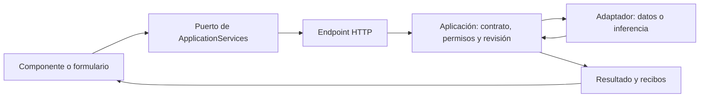

# Arquitectura vigente

Referencia: NOVA 1.0.0 y composición actual del repositorio. Los informes fechados anteriores se conservan como [historial](archive/README.md).

## Propietarios

| Responsabilidad | Propietario y frontera |
| --- | --- |
| Montar la API | `backend/QuickPrompt.Api/QuickPromptHost.cs` y `ApplicationModules.cs` |
| Candidato de cuentas autenticadas | `backend/QuickPrompt.Cloud/AccountHost.cs`; composición explícita loopback, separada del host local; todavía no sustituye la aplicación instalada |
| Identidad y bibliotecas privadas PostgreSQL | `backend/QuickPrompt.Accounts`; ASP.NET Identity/EF Core/Npgsql, transacción con actor y FORCE RLS, sin acceso a LocalStore |
| Creación idempotente por cuenta | `Accounts/Libraries/LibraryAccess.Capture.cs`; cuerpo literal, hash de entrada/destino, versión inicial y recibo privado en una transacción. Consumidores reales HTTP de cuentas y MCP, sin segundo escritor |
| Colecciones por cuenta/biblioteca | `Accounts/Libraries/LibraryAccess.Collections.cs` posee nombres, revisiones, pertenencias y eliminación; `CollectionModel` comparte filtro/proyección entre HTTP y `Memory/AccountCollectionReader`/catálogo del agente. Dos tablas FORCE RLS y relaciones compuestas impiden mezclar bibliotecas. La publicación pertenece a `SharingAccess` |
| Publicaciones e invitaciones del candidato de cuentas | `QuickPrompt.Accounts/Sharing/SharingAccess.cs`; snapshots, aceptación, revocación y recibos; importa mediante el escritor de `LibraryAccess` dentro de la misma transacción |
| Snapshots de colecciones | `SharingAccess.Collections.cs` reutiliza invitación/revocación y escritores de biblioteca; copia la revisión revisada de todos los miembros, con recibo inmutable y rollback del conjunto. No expone IDs privados del origen ni amplía permisos MCP existentes |
| Contexto conservado por cuenta/biblioteca | `QuickPrompt.Accounts/Memory`; adapta `IAgentSessionStore`, `IPreparationPreferences` y `IPromptCatalog`, reutiliza `EditorDraftPreparation.Compile`; revisión de almacenamiento independiente, retención y FORCE RLS; nunca restaura aprobación o acciones pendientes |
| Conversación activa por cuenta/biblioteca | `AccountAgentMemory.ActiveSessions` adapta el mismo `AgentSessions`; `AccountActiveSessions` posee transiciones atómicas entre instancias, reloj SQL, caducidad de dos horas y límite separado de 100 por propietario. `SessionSourceBinding` comparte la transición de contexto con el host local. HTTP de cuentas exige conversación inactiva antes de reemplazarla; no restaura aprobaciones |
| Biblioteca privada para puertos de aplicación | `AccountPromptStore` y `AccountPromptCatalog` comparten mapeo y consultas; `LibraryAccess` sigue siendo el escritor de registro/versión. Conserva descripción, categoría y defaults privados; favoritos/archivo/uso no se confunden con publicación. `RecordUse` registra hash idempotente y contador, no historial de resultados. Borrado definitivo aún no habilitado |
| Cola y resultados de cuentas | `QuickPrompt.Accounts/Executions`; admisión idempotente, cuotas, leases cercados y commit de resultado/estado. `Cloud/ExecutionWorker` procesa fuera de transacciones; primer consumidor `CompileExecutionHandler` reutiliza `EditorTools.Compile`, sin inferencia ni efectos externos |
| Puerto de inferencia por cuenta | `Application/AgentModelTransport.cs` posee los contratos puros con identidad pública conservada. `AccountModelProposals.ForConnection` enlaza `PairedModelTransport` a actor/biblioteca/conexión; espera acotada, cancelación propia y autorización fresca sobre la cola existente, sin ejecutar proveedor en Cloud. `Inference/ForwardedModelContracts.cs` mantiene compatibilidad binaria |
| Autoría y selección de contenido compartidas | `QuickPrompt.Inference` posee generador, revisor de fidelidad, extracción, selección, edición y codec de respuestas existentes; no referencia almacenamiento. Infrastructure reenvía sus tipos públicos. `Cloud/AccountNovaInference` los compone con `ForConnection` y `OllamaClient.ForTransport`, sin cliente HTTP, proceso o endpoint de inferencia en Cloud. `AccountNovaCoordinator` monta el motor visible existente en HTTP autenticado con acción elegida, biblioteca, conexión y superficie; el workspace privado integra crear/abrir/actualizar con driver real de React. Falta su campaña conjunta en navegador y companion |
| Referencias literales del encargo | `Application/AuthoringReferenceCoverage` captura enlaces fuera de los valores del caso. `Inference/DraftFidelityReviewer.References` interpreta sus roles desde el origen; el objetivo fija el contrato. Autoría `future-content-only/2` sólo redacta contenido futuro, sin declarar controles de sesión. Compilación y evaluación nativas comprueban URI/rol antes de aceptar |
| Turno visible privado y efectos atómicos | `Accounts/Executions/AccountLiveRunStore` adapta `ILiveRunStore` y la extensión opcional `ILiveRunCommitStore`. Serializa por propietario, conserva eventos, limita admisiones y valida host/conexión. Reutiliza `AccountPromptStore`/`LibraryAccess` en la misma transacción para guardar versión y consumir aprobación. El coordinador renueva su lease; no ocupa plazas de inferencia ni restaura controles tras expirar. API y React/driver comprobados por separado; recorrido real conjunto aún pendiente |
| Propuestas del companion | `AccountModelProposals` prepara inferencia sólo en servidor; `ExecutionQueue.Proposals` comparte cuotas/turnos y conserva propuestas privadas con FORCE RLS. OAuth exige `companion:proposals` y otro consentimiento. `QuickPrompt.Companion` reutiliza el SDK y ciclo de cancelación; el orquestador HTTP usa esta frontera. La campaña real con dispositivo Windows/DPAPI sigue pendiente |
| Recuperación de prompts compartida | `Application/CatalogPromptRetriever` conserva la política acotada de candidatos; SQLite y `AccountAgentMemory.Retriever` aportan los puertos de catálogo/colecciones. PostgreSQL usa la función SQL invoker `search_text_latin` para coincidencia sin marcas diacríticas latinas; conserva texto original, alcance y RLS |
| Inspección privada del editor | `AccountEditorMemory.Inspect` autoriza biblioteca/origen/revisión y reutiliza `EditorTools.Compile`/`TemplateCompiler.Names`, sin memoria, aprobación o inferencia. `useAccountEditorInspection` descarta snapshots tardíos y mantiene campos al cambiar valores; `AccountPromptEditor` y `AccountPromptFocus` reutilizan `PromptVariableFields` y marcadores del driver |
| Transporte NOVA privado | `services/accountNova` adapta `createLiveClient`/`createVisibleSessionClient` con rutas de biblioteca, cookie/CSRF y superficie en RAM; sólo el runId se conserva con clave cuenta/biblioteca/conexión. `AccountNovaBoundary` compone esos puertos mediante `AgentRuntimeServiceProvider`, sin servicios locales de sustitución; cookie vencida vuelve al acceso |
| Workspace y memoria visual privada | `AccountNovaActions` emite opciones explícitas con `LiveCommand`/`PromptInputNames`; `AccountPromptLibrary` compone biblioteca, editor y detalle. Reutiliza `SameTabAgent`, `NovaLive`, `AgentUiProvider` y `AgentControl`. Al retirar la conexión limpia capacidades y campos del journal; conserva hasta tres identidades recientes. La recarga recupera sólo metadatos, nunca aprobación o ejecución UI |
| Respuesta incierta de guardado | `services/accountNovaCommit` hace un único commit. Ante error de transporte/5xx consulta el mismo recibo y la versión privada exacta en un máximo de cuatro segundos; exige efecto consumido, identidad, revisión, título y cuerpo coincidentes. Rechazo conocido, cambio de contexto o resultado distinto no se convierten en éxito ni repiten la escritura |
| Actividad privada NOVA | `AccountNovaFeed` emite eventos nativos SSE con cursor ligado al run; `AccountCookieReadScope` comparte vigencia de cookie/sello y cerco de revocación con `AccountExecutionFeed`. Una observación no concede ejecución ni revive controles |
| Estados privados de ejecuciones | `Cloud/AccountExecutionFeed` proyecta los estados existentes mediante SSE; revalida cookie/stamp y biblioteca en scopes nuevos bajo el cerco de la cola. No emite contenido, resultados ni etapas inferidas. `services/accountExecutionStream` posee snapshots y renovación acotada; `serverEvents` comparte sólo framing con preparación y ejecución local |
| Olvido y caducidad de ejecuciones | `AccountExecutionAccess.Forget` enlaza actor/biblioteca; funciones PostgreSQL limitadas retiran entrada/resultado bajo el cerco de la cola. El dispatcher procesa lotes de hasta 100 contenidos terminales de siete días; el recibo mantiene identidad y cuota. No afecta al host SQLite |
| HTTP, cabeceras y transporte de DTO | `backend/QuickPrompt.Api`; no duplica casos de uso |
| Catálogo MCP, transporte y proyección de DTO | `backend/QuickPrompt.Mcp`; consume la API loopback, sin acceso directo a datos ni inferencia |
| MCP por cuenta/biblioteca | `Cloud/Delegation/AccountMcpModule`, `McpConsent` y herramientas de lectura/captura/sharing/colecciones; OpenIddict valida código/PKCE, `ConnectionAccess` posee el permiso limitado, `LibraryAccess` conserva autorización/RLS y `SharingAccess` publicación/importación/recibo. Colecciones exige `collections:import` explícito y no amplía grants anteriores. Composición optativa; no reenvía tokens al MCP local |
| Captura externa idempotente | `Application/PromptCapture.cs` y `Infrastructure/PromptCaptureStore.cs`; prompt, versión y recibo en una transacción |
| Variables para clientes externos | `PromptLibrary.Render` reutiliza `EditorTools.Compile`; revisión y valores explícitos, sin defaults ni instrucciones generales |
| Plan, contratos, revisiones y efectos de NOVA | `backend/QuickPrompt.Application` |
| Campos pedidos al autor del prompt | `LiveCommand.InputNames` recoge la selección del usuario; `Application/PromptInputContract.cs` la fija en `TaskGoal`; el binder de dominio compone los marcadores |
| Definición de nombres en la interfaz | `features/prompts/PromptInputNames.tsx`, compartido por la acción inicial y la aclaración; no rellena valores |
| Adaptadores de persistencia y modelo | `backend/QuickPrompt.Infrastructure` |
| Dominio compartido y almacenamiento local | `src/QuickPrompt.Domain` y servicios existentes usados por los puertos de aplicación |
| Inferencia externa local | `agents/nova-core/nova_worker.py` y SDK Adaptive-AI-Core configurado |
| Composición de la interfaz | `apps/web/src/app/App.tsx` |
| Espacio del candidato de cuentas | `features/accounts/AccountPage`, `AccountPromptLibrary`, `AccountRememberedDrafts` y `AccountSharing`; transporte/CSRF en `services/accounts.ts`, presentación cancelable sobre `useBoundOperation`; campos compartidos de `PromptVariableFields`; no resuelve servicios locales como fallback |
| Puertos de servicios del frontend | `services/application.ts` y `components/ServiceContext.tsx` |
| HTTP/serialización del frontend | `services/api.ts` y clientes de capacidad en `services/` |
| Estado visual ligado a una operación | `services/useBoundOperation.ts` |
| Campos de valores de prompts | `features/prompts/PromptVariableFields.tsx` |
| Diagnóstico de mecanismos retirados | `backend/QuickPrompt.Evaluation`; fuera de las dependencias del producto |

## Flujo y autoridad

NOVA recibe una acción explícita `LiveCommand`; `UserActionRequest` y `TaskIntentContract` fijan los resultados y límites. Sin elección, `ActionChoiceInterpreter` pide elegir, antes de recuperar candidatos o llamar al modelo. La IA no concede permisos y sus propuestas no prueban que se cumplió el objetivo.

La consulta de búsqueda original llega al buscador; no se obliga a un intérprete a regenerarla. Recuperación y selección conservan sus propietarios actuales. El proveedor local de referencia es Qwen3:8b mediante Core; los perfiles anteriores y el consumidor Blazor son compatibilidad, no un fallback automático.

En una búsqueda ambigua, `LiveView.sourceChoices` expone hasta seis candidatos reales con identidad/revisión. Elegir uno obtiene su revisión actual y abre una acción explícita `OPEN_PROMPT`; no hereda ejecución ni escritura.

La autoría vigente usa `DraftProposalContract` y `AuthoringBrief`: la petición original, fuente elegida, campos y aclaraciones conservan su procedencia. El host exige establecer la tarea antes de llamar al modelo. `PromptDraftGenerator` envía la procedencia completa al descubrimiento y sólo los campos futuros establecidos al escritor mediante `FieldRevisionMaterial`. Ambas vistas se limitan antes de inferir, sin truncar. El esquema del escritor contiene una clave fija por campo humano; el host valida las claves y reconstruye el mismo orden. Sus paquetes son de contenido (`contentOnly`): mensajes y esquema de salida, sin catálogo de herramientas ni permisos de aplicación. El revisor semántico legado no es una segunda autoridad activa de este camino. Una clave conservada no acredita que su significado se haya conservado.

El modo `LITERAL` sólo puede seleccionar una cita cuyo texto completo coincida
exactamente con la tarea establecida. `RevisionMaterial` limita el catálogo y el
schema a esas citas; `CompileDefinition` revalida la ligadura y conserva pasos,
restricciones, entregables y referencias. Otras citas permanecen en el contexto
de descubrimiento, sin convertirse por existir en autoridad para sustituir la
tarea. La propuesta sigue separada y requiere confirmación; esta validación no
certifica el significado de una paráfrasis `INSTRUCTION`.

### Capacidades y prerrequisitos de autoría

Esta matriz describe los dueños existentes; no es otro registro ejecutable ni una
lista de herramientas enviada al modelo. Separar capacidad, datos y autoridad
evita atribuir una decisión semántica errónea a un orden de herramientas que no
se ha observado.

| Etapa / dueño | Entrada y prerrequisito real | Salida y límite |
|---|---|---|
| Acción / `LiveCommand`, `TaskGoal` | Acción elegida, origen/revisión y campos explícitos del usuario | Contrato de trabajo; no aprueba contenido o persistencia |
| Establecimiento / `AuthoringBriefs.Establish` | Acción, fuente/revisión y campos explícitos | Tarea y requisitos confirmados por humano antes de inferir; sin efectos |
| Contexto / `GenerateDraftProposal`, `ContentMaterial`, `RevisionMaterial` | Contrato humano y fuente vigentes; cada proyección completa de hasta 26000 bytes | Procedencia para descubrimiento; campos futuros para escritor; rechaza exceso antes de inferir, sin truncar |
| Aclaración / `DiscoverCurrentAuthorDecision` | Petición original, aclaraciones y contenido autorizado | ASK con cita literal o READY; una cita sólo acredita procedencia, READY sólo es una decisión del modelo |
| Redacción / `GenerateDraftProposal`, `CompileDefinition` | Tarea establecida, READY y sin cancelación | INSTRUCTION con claves exactas o LITERAL con cita igual a la tarea establecida, conservando los demás requisitos; sugerencia separada, sin efectos ni nueva ronda de preguntas |
| Revisión / `AuthoringBriefs.Confirm` | Respuesta humana ligada al hash del contrato, campos y referencias | Contenido confirmado; no autoriza guardar o ejecutar |
| Composición / `ConfirmedAuthoringBrief.Render` | Brief confirmado y base vigente | Composición literal sin otra redacción del modelo; conserva campos autorizados |
| Efecto / aplicación, dominio y persistencia | Aprobación específica, identidad, biblioteca/recurso y revisión vigentes | Escritura autorizada y recibo; ninguna etapa anterior concede este permiso |

El orden se controla en código: `establecer tarea → descubrir → ASK: devolver pregunta` o
`establecer tarea → descubrir → READY: proponer por campo → revisión humana`.
Si se cancela antes del escritor, no se inicia esa llamada. Confirmar el contenido
final ya revisado evita ambas inferencias; establecer la tarea sólo habilita pedir
una sugerencia y no registra un borrador final.

**Frontera abierta:** READY puede ser semánticamente incorrecto. El escritor
recibe entonces la premisa de que las decisiones previas se aclararon, aunque la
petición aún no defina la tarea. El host controla la secuencia, pero no comprueba
por ello la comprensión. La revisión humana posterior protege el guardado; no
evita una propuesta prematura. Los experimentos de tarea/citas/decisiones no
superaron la evaluación y no son un reemplazo activo. Véanse los recibos y el
estado R2 en [el único checklist](development/GO_TO_MARKET.md). No añadir un
catálogo, un juez o una regla por frase sin demostrar qué carencia resuelve.

Los nombres de campos son datos explícitos de `LiveCommand.InputNames`, separados del título, contenido y valores de un caso. `null` significa que falta definirlos: NOVA abre una aclaración antes de llamar al modelo. `[]` expresa crear sin variables o conservar las existentes en una actualización. Se retiró el intérprete automático de nombres tras fallos reproducidos con Qwen3:8b; no queda como fallback. El formulario de aclaración conserva el encargo original y vuelve a validar la revisión del origen. La selección se puede hacer desde la acción inicial para evitar esa pregunta.

El contrato permanece fijo durante la corrección acotada. El dominio incorpora los marcadores elegidos y rechaza campos extra; añadir campos autorizados puede conservar la instrucción original sin forzar una reescritura. El editor deriva sus metadatos después de componer el cuerpo. La revisión compara con el encargo completo y el cierre comprueba los campos reales: una lista vacía derivada del mismo borrador no acredita cumplimiento. Qwen sigue redactando el contenido con el SDK y proveedor configurados. Este contrato no concede aprobación de escrituras ni certifica fidelidad universal de la redacción.

La revisión desde NOVA y desde Guardar usan el mismo snapshot actual del editor. La aprobación vincula propuesta/hash/revisión; `approval.apply` pertenece al editor estable y al run aprobado, no al portal de actividad. La aprobación humana exacta de un cuerpo editado tiene procedencia propia; no se registra como una evaluación semántica del modelo. Cambiar el cuerpo invalida esa aprobación.

Los formularios de ejecución muestran los valores que enviarán; vaciar un campo requerido bloquea el envío. La selección visual del proveedor espera la carga del catálogo. La evidencia textual del comando excluye valores y citas; la autoridad sigue procediendo de la acción explícita y su contrato, nunca de instrucciones incluidas en los datos.

## Estado y modularidad

Cada formulario conserva sus valores y decisiones. Los componentes de campo presentan valores controlados y emiten cambios; no parsean plantillas, escriben registros ni deciden defaults de dominio. El servidor conserva esas invariantes.

La fuente persistente es el registro con identidad/revisión. Un borrador, una vista previa, una respuesta y un recibo de portapapeles son objetos diferentes. Cambiar el origen o los valores invalida el resultado asociado; las operaciones visuales usan snapshots y cancelación para no aplicar respuestas tardías.

Antes de extraer lógica se compara extender al propietario, compartir una capacidad pequeña o aislar una nueva. Código visual parecido no implica el mismo contrato: copiar un borrador no registra el uso de un prompt guardado ni abre un proveedor externo. [Reglas de UI y análisis de duplicación](development/UI_COMPONENTS.md).

## Verificación y límites

En el candidato de cuentas, OpenIddict posee el protocolo de autorización por
dispositivo y `ConnectionAccess` el consentimiento privado/revocable. El límite
`DelegationBoundary` abre una unidad de trabajo de dominio independiente de las
entidades de protocolo pendientes; no limpiar el ChangeTracker de OpenIddict desde
las transacciones del actor. La aprobación vincula el grant original del par de
códigos y sólo devuelve un principal autorizado. API y UI consultan vigencia de
conexión/grant/sello; Cookie y bearer no intercambian autoridad. El alcance actual
es perfil local, no inferencia, bibliotecas MCP ni permisos del sistema operativo.

El incremento del companion añade trabajos dirigidos sobre la misma cola. El SDK
del modelo y observación se alojan en `backend/QuickPrompt.Inference`, compartido
por infraestructura local y el cliente Windows; no referencian persistencia.
`QuickPrompt.Companion` consume el contrato de trabajos de Application y OAuth,
con credencial DPAPI local. Cloud no depende del ejecutable del cliente.
Cloud compone las capacidades de autoría compartidas con un transporte privado;
no instancia el SDK/Python ni un endpoint Ollama del servidor. La autorización y
turno se comprueban de nuevo antes de guardar respuesta; el
resultado del modelo no puede sustituir la instrucción compilada ni decidir actor.

La revalidación de identidad de la UI pertenece a `AccountPage`: conserva los
nodos del espacio al confirmar la misma cuenta y lo retira al cambiar de actor.
`UiPortalScope` coordina únicamente la visibilidad de diálogos/overlays y la pausa
del driver nativo durante esa consulta. No añade un almacén de identidad ni
autoridad del cliente; los endpoints siguen validando el actor vigente. Las
respuestas tardías y los recibos de una superficie retirada se descartan. Ver
[el contrato de UI](development/UI_COMPONENTS.md) y el expediente SaaS para la
reproducción y sus límites de prueba.

`Check-ModuleBoundaries.cjs` comprueba dependencias y composición estática; las pruebas de componentes y navegador comprueban comportamiento. Ninguno sustituye la aceptación semántica o humana. La versión inicial y sus límites están en el [acta](releases/NOVA_1.0.0.md). No se añaden dependencias del runtime al evaluador ni escrituras directas entre módulos.
