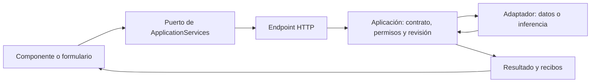

# Arquitectura vigente

Referencia: NOVA 1.0.0 y composición actual del repositorio. Los informes fechados anteriores se conservan como [historial](archive/README.md).

## Propietarios

| Responsabilidad | Propietario y frontera |
| --- | --- |
| Montar la API | `backend/QuickPrompt.Api/QuickPromptHost.cs` y `ApplicationModules.cs` |
| HTTP, cabeceras y transporte de DTO | `backend/QuickPrompt.Api`; no duplica casos de uso |
| Plan, contratos, revisiones y efectos de NOVA | `backend/QuickPrompt.Application` |
| Adaptadores de persistencia y modelo | `backend/QuickPrompt.Infrastructure` |
| Dominio compartido y almacenamiento local | `src/QuickPrompt.Domain` y servicios existentes usados por los puertos de aplicación |
| Inferencia externa local | `agents/nova-core/nova_worker.py` y SDK Adaptive-AI-Core configurado |
| Composición de la interfaz | `apps/web/src/app/App.tsx` |
| Puertos de servicios del frontend | `services/application.ts` y `components/ServiceContext.tsx` |
| HTTP/serialización del frontend | `services/api.ts` y clientes de capacidad en `services/` |
| Estado visual ligado a una operación | `services/useBoundOperation.ts` |
| Campos de valores de prompts | `features/prompts/PromptVariableFields.tsx` |
| Diagnóstico de mecanismos retirados | `backend/QuickPrompt.Evaluation`; fuera de las dependencias del producto |

## Flujo y autoridad

NOVA recibe una acción explícita `LiveCommand`; `UserActionRequest` y `TaskIntentContract` fijan los resultados y límites. Sin elección, `ActionChoiceInterpreter` pide elegir, antes de recuperar candidatos o llamar al modelo. La IA no concede permisos y sus propuestas no prueban que se cumplió el objetivo.

La consulta de búsqueda original llega al buscador; no se obliga a un intérprete a regenerarla. Recuperación y selección conservan sus propietarios actuales. El proveedor local de referencia es Qwen3:8b mediante Core; los perfiles anteriores y el consumidor Blazor son compatibilidad, no un fallback automático.

En una búsqueda ambigua, `LiveView.sourceChoices` expone hasta seis candidatos reales con identidad/revisión. Elegir uno obtiene su revisión actual y abre una acción explícita `OPEN_PROMPT`; no hereda ejecución ni escritura.

La creación explícita compila un contrato de tarea: `taskInstruction` y `requirements` forman la instrucción futura; `currentSessionControls` conserva los controles de esta edición fuera del cuerpo. La revisión de fidelidad recibe el encargo completo. Esta separación reduce contaminación de sesión; no demuestra fidelidad universal del modelo ni sustituye revisión humana.

La revisión desde NOVA y desde Guardar usan el mismo snapshot actual del editor. La aprobación vincula propuesta/hash/revisión; `approval.apply` pertenece al editor estable y al run aprobado, no al portal de actividad. La aprobación humana exacta de un cuerpo editado tiene procedencia propia; no se registra como una evaluación semántica del modelo. Cambiar el cuerpo invalida esa aprobación.

Los formularios de ejecución muestran los valores que enviarán; vaciar un campo requerido bloquea el envío. La selección visual del proveedor espera la carga del catálogo. La evidencia textual del comando excluye valores y citas; la autoridad sigue procediendo de la acción explícita y su contrato, nunca de instrucciones incluidas en los datos.

## Estado y modularidad

Cada formulario conserva sus valores y decisiones. Los componentes de campo presentan valores controlados y emiten cambios; no parsean plantillas, escriben registros ni deciden defaults de dominio. El servidor conserva esas invariantes.

La fuente persistente es el registro con identidad/revisión. Un borrador, una vista previa, una respuesta y un recibo de portapapeles son objetos diferentes. Cambiar el origen o los valores invalida el resultado asociado; las operaciones visuales usan snapshots y cancelación para no aplicar respuestas tardías.

Antes de extraer lógica se compara extender al propietario, compartir una capacidad pequeña o aislar una nueva. Código visual parecido no implica el mismo contrato: copiar un borrador no registra el uso de un prompt guardado ni abre un proveedor externo. [Reglas de UI y análisis de duplicación](development/UI_COMPONENTS.md).

## Verificación y límites

`Check-ModuleBoundaries.cjs` comprueba dependencias y composición estática; las pruebas de componentes y navegador comprueban comportamiento. Ninguno sustituye la aceptación semántica o humana. La versión inicial y sus límites están en el [acta](releases/NOVA_1.0.0.md). No se añaden dependencias del runtime al evaluador ni escrituras directas entre módulos.
