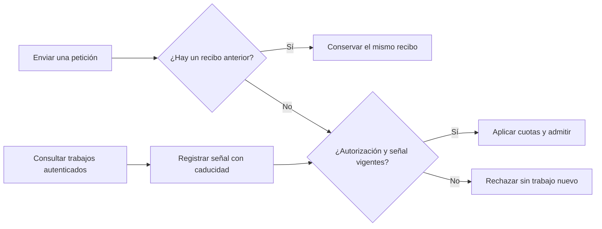

# Presencia del componente local

La autorización y el proceso local son estados independientes. `ConnectionView.Active`
conserva su significado: consentimiento, vigencia, sello de seguridad y autorización
del protocolo válidos. No significa que haya un worker abierto ni que Qwen genere.

## Señales y propietarios

`ConnectionAccess.Presence` persiste una observación por conexión en
`qp_operations.companion_presence`. Las rutas autenticadas de claim y heartbeat
reutilizan el fence de la cola: el principal determina cuenta, conexión y capacidad.
El cliente no envía dueño, fechas, TTL, perfil ni un estado de «modelo listo».

| Estado | Significado |
| --- | --- |
| `NOT_OBSERVED` | No existe observación del worker. Vincular o consultar `/profile` no la crea. |
| `POLLING` | El componente realizó una consulta autenticada de trabajos. |
| `WORKING` | Se asignó un turno o se recibió un pulso de lease válido. No acredita una respuesta correcta. |
| `STALE` | La observación caducó según el reloj de PostgreSQL. |
| `STOPPED` | El componente retiró su última observación mediante CAS. |

El TTL es **20 segundos**; el sondeo existente continúa cada cinco segundos. No se
añaden consultas periódicas, llamadas al catálogo de Ollama ni inferencias de
comprobación. La presencia no mide instalación, disponibilidad del endpoint,
memoria del modelo, calidad o fidelidad. `dispatchReady` en `/profile` sigue
describiendo compatibilidad del protocolo, no presencia ni generación comprobada.

Cada señal obtiene un `ObservationId` nuevo y el servidor lo devuelve en
`X-QP-Companion-Observation`. El componente conserva sólo el último y, al terminar
su bucle, intenta `POST /api/companion/v1/presence/stop` con `{ observationId }`.
La retirada usa un presupuesto de cancelación de cinco segundos y no revoca credenciales. Un ID antiguo
no retira una observación posterior ni la de otra conexión. Si falla la retirada,
se conserva el resultado original del bucle y la señal caduca naturalmente.

Los lotes y la inactividad no cambian: NOVA usa el lote configurado de doce, la
ejecución de prompts el de uno, y ambos terminan tras cinco minutos sin trabajo.
No se inicia un Companion u Ollama desde la web ni se añade un servicio automático.

## Admisión y recuperación

Algoritmo: validar identidad y autorización; localizar el recibo de la operación;
si existe, conservar su identidad y semántica sin otra inferencia. Para una
operación nueva, comprobar la señal dentro del fence y transacción del actor antes
de registrar el trabajo o consumir su admisión. Ausencia produce
`CompanionUnavailableException`/HTTP 503, no revocación. La autorización inválida
mantiene su rechazo anterior. Un worker puede desaparecer después de admitir: ese
caso conserva leases, plazos, cancelación y recibos existentes, sin reintento nuevo.

Si la señal desaparece entre etapas de un run existente, el puerto de inferencia
traduce la ausencia a `LlmUnavailableException` con código
`COMPANION_NOT_OBSERVED`. No la clasifica como fallo del navegador ni afirma que
los efectos anteriores no ocurrieron. Esta etapa no admite un nuevo hijo y no
añade reintentos. La retirada al terminar contiene fallos esperables de red,
protocolo, cancelación y persistencia local (E/S, acceso o criptografía); un fallo
inesperado permanece visible. Ninguna excepción privada se imprime.

`AccountLiveRunStore`, `AccountModelProposals`, ejecución local y revisión factual
aplican esa regla en sus respectivos límites. Una revisión factual cuyo componente
desaparece antes de admitir al hijo termina explícitamente, sin dejar `ADMITTED`
inaccesible. Un resultado de commit incierto sigue sus reglas de recuperación.

En React, `AccountNovaBoundary` vuelve a leer conexiones al enviar y cancela el
preflight si cambia el contexto. Una señal caducada no cambia la identidad de los
servicios, no desmonta el run existente ni restaura permisos de una pestaña anterior.
La interfaz etiqueta por separado consentimiento y señal; la biblioteca manual
sigue disponible.

## Persistencia y límites de seguridad

La migración aditiva `20261029151628_CompanionOperationalPresence` crea sólo estado
operativo: cuenta/conexión, ID de observación, señal y dos fechas. No guarda
instrucciones, tokens, resultados, rutas del equipo ni datos de Ollama. La FK
compuesta exige que conexión y cuenta coincidan, y elimina la observación cuando
se elimina la conexión. Hay como máximo una fila por grant; no es un historial de
actividad ni una memoria del agente. Revocar no prueba que el proceso haya parado:
la autorización deja de permitir trabajo independientemente de la última señal.

FORCE RLS aísla el actor. La aplicación tiene SELECT/INSERT y UPDATE sólo de los
cuatro campos mutables; no puede cambiar la cuenta/conexión ni borrar filas. El
dispatcher carece de privilegios. Los guardas de arranque comprueban RLS, ACL,
constraints y las dos políticas exactas, incluida ausencia de políticas adicionales.
El digest del predicado actor corresponde al contrato de catálogo probado en PG18;
un cambio de expresión o versión requiere revisar ese contrato, no aceptar el
nombre de una política como prueba de aislamiento.

Este incremento requiere migrar y validar el candidato antes de arrancarlo. No
modifica planes privados de respaldo ni sus huellas históricas. El comparador y
restore público incluyen la nueva tabla; sus pruebas usan sólo bases sintéticas.
`Down` rechaza el rollback destructivo antes de emitir SQL: no puede eliminar la
dependencia de admisión y fallar después al alcanzar una migración privada anterior.
La recuperación conserva el procedimiento de respaldo/restauración revisado.

## Evidencia y alcance

Los recibos de desarrollo están en `.playwright/companion-presence-20261029/`.
Las pruebas separan grant sin worker, polling autenticado, TTL y retirada CAS,
aislamiento, revocación, replay y admisión sin señal, además de React con preflight
tardío. Las derivas de catálogo se revierten al cerrar su transacción; un error de
setup no cuenta como rechazo del guarda. El baseline de dos políticas alteradas
aceptadas se conserva por separado de la corrección.

Estas pruebas no certifican inferencia o disponibilidad universal de Qwen, ni
sustituyen una prueba manual del Companion publicado. No se arrancaron workers
reales ni Ollama para obtener una señal de presencia durante esta implementación.
