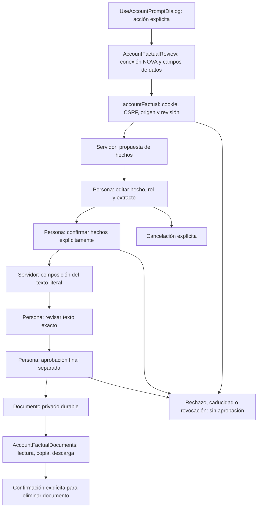

# Transformación factual con revisión

La capacidad se elige explícitamente desde «Usar prompt». No analiza palabras de la petición para decidir si debe entrar a este flujo. Una instrucción compilada, una respuesta libre del modelo y un documento aprobado son recursos distintos.



```text
si el usuario elige transformación factual:
    pedir título, conexión vigente de propuestas y campos seleccionados
    conservar valores literales; no tomar la plantilla como evidencia
    iniciar con operationId estable para la misma petición
    consultar estado con cancelación y contexto biblioteca/origen/conexión
    mostrar cada hecho, rol, campo y extracto como valores editables
    exigir revisión humana aunque exista una cita literal
    cualquier edición retira la confirmación de hechos
    confirmar hechos con versión vigente; mostrar preview del servidor
    exigir otra aprobación del texto exacto para guardar el documento
    leer el historial sin llamar al modelo ni registrar otro uso
ante error o respuesta perdida:
    no presuponer éxito; ofrecer consultar el estado autoritativo
al desmontar o cambiar contexto:
    abortar transporte y descartar respuestas tardías
```

## Propietarios y límites

- `services/accountFactual.ts` posee rutas y DTO, recibe el mutador cookie/CSRF de `accounts.ts` y rechaza biblioteca, recurso, prompt o conexión discordantes. No cambia el actor del servidor.
- `AccountFactualReview.tsx` posee sólo el formulario, la revisión editable, sus confirmaciones y el sondeo abortable. El servidor conserva autorización, caducidad, cuotas, validación contractual y composición. Una cita literal no demuestra que su rol sea correcto.
- `AccountFactualDocuments.tsx` compone una lista paginada y un lector de documentos aprobados. Reutiliza fechas, exportación y `Dialog`; no convierte `HistoryResult` en un motor por flags ni cambia sus resultados locales.
- `PromptVariableFields` conserva el renderizado y valores controlados. La selección de fuentes es independiente del resto de variables.
- La interfaz avisa del límite de 4000 bytes UTF-8 de fuentes, usa los límites contractuales de campos y nunca recorta contenido para enviar. El servidor valida además el paquete estructurado completo.
- La propuesta vacía exige que la persona añada al menos un hecho. Una afirmación sin campo ni extracto se identifica como «Sin fuente documental» y requiere la misma confirmación explícita; esa ausencia no identifica quién redactó la afirmación.
- La eliminación permanente del prompt avisa que también desaparecen documentos y revisiones factuales derivados. Las ejecuciones libres conservan su política independiente.
- Antes de aprobar, la persona ve que se conservarán el documento, los hechos y las fuentes seleccionadas hasta eliminarlos. El lector presenta estas fuentes originales en un disclosure como texto escapado, sin recuperar el prompt ni consultar al modelo. Un hecho sin campo ni extracto se rotula «Sin fuente documental; confirmado en revisión». La propuesta original se conserva en una sección rotulada como IA. `edited` informa modificaciones durante la revisión; no atribuye autoría humana por fila. Una cita presente nunca se presenta como verificación automática.
- «Corregir hechos» desde la vista previa vuelve a los hechos ya confirmados con la versión vigente. Retira ambas confirmaciones, vuelve a componer sin consultar al modelo y exige aprobar el nuevo texto; no cambia fuente, conexión ni operación, y no está disponible después de guardar.
- El sondeo inicia a los dos segundos y continúa cada tres segundos, sin solicitudes paralelas. Cualquier error, incluido 429, detiene el sondeo y conserva la revisión para una consulta explícita; no reenvía la propuesta ni aumenta la cuota del servidor.

## Aceptación y límites de evidencia

Las pruebas React con cliente HTTP real y transporte de fixture verifican dos aprobaciones independientes, texto exacto, corrección de roles, selección de fuentes, citas inválidas, revocación, caducidad, cancelación, lectura sin escritura y borrado explícito. No demuestran por sí solas inferencia, PostgreSQL ni aislamiento en el servidor. La aceptación completa requiere los tests de backend/PG y el recorrido de navegador que coordina el propietario de entrega. No se ejecutan modelos ni se modifica producción desde las pruebas de esta interfaz.
