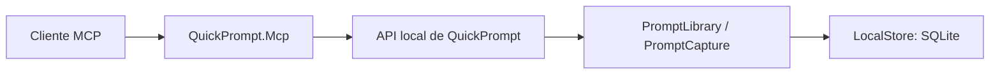

# QuickPrompt por MCP

## Candidato con cuentas y biblioteca autorizada

El host `QuickPrompt.Cloud` incorpora un MCP por cuenta diferente del adaptador
local descrito abajo. El entorno público autorizado ya permitió leer, compilar
y crear con respuesta final visible desde ChatGPT en la biblioteca aprobada.
También se comprobaron revocación y reconexión equivalente. Otro recorrido de
búsqueda conserva un fallo al mostrar la respuesta final; la aceptación completa
con dos cuentas y renovación no se infiere de los recorridos correctos. El estado
y los recibos vigentes pertenecen a [GO_TO_MARKET](GO_TO_MARKET.md), no a los
ejemplos de instalación local de esta página.

### Contraste de JSON y configuración — 30/10/2026

Por instrucción expresa del usuario no se enviará información a soporte de
OpenAI. El diagnóstico se realiza sobre nuestros contratos y configuración.
`McpJsonContractHttpTests` captura exclusivamente respuestas HTTP del `/mcp`
sintético de QA, sin cabeceras, cookies o tokens. Compara `tools/list`, resultados
de `tools/call`, JSON de texto y `structuredContent`, Unicode, campos requeridos,
búsqueda vacía/paginada, `collectionId=null` y errores controlados.

Se ejecutó con protocolo predeterminado del SDK 2.3.0 y con `2025-06-18`: nueve
casos de herramienta por modo, con once y doce respuestas HTTP/SSE respectivamente.
Los envelopes JSON-RPC y sus IDs, los esquemas de HTTP frente a SDK y los dos
canales de resultados coincidieron. El auditor offline rechaza keywords no
soportadas y cubre los ocho keywords/formatos realmente exportados en el fixture;
no es un validador JSON Schema general. Sus controles negativos rechazan campos
requeridos ausentes, revisión con tipo incorrecto, catálogo hipotético incompatible,
keyword desconocido y JSON doblemente codificado.

El último filtro ejecutado obtuvo **3 PASS/0 FAIL/0 omitidas**: los dos modos más
el control existente de cuenta/biblioteca, renovación y revocación. No certifica
el cliente ChatGPT ni todas las versiones de protocolo. La metadata pública de
Vercel respondió JSON 200 en los tres documentos de discovery y pasó
`validatedMetadata` con issuer/recurso/endpoints/scopes del mismo origen.

Local y Cloud tienen distintas respuestas de `search_prompts`: la local incluye
metadata de paginación y resúmenes más amplios; Cloud devuelve `items` con
`id/title/revision`. La diferencia no demuestra que el catálogo de ChatGPT esté
mezclado. Tampoco demuestra un error que la declaración resumida de `get_prompt`
enumere sólo sus cinco campos requeridos: el esquema actual declara metadata
opcional adicional y la respuesta pública contiene esos campos opcionales.
Faltan el esquema efectivo y los cuerpos del intercambio fallido para localizar
esa frontera. No se alteran payloads, permisos o callbacks por esa hipótesis.

Evidencia, esquemas, datos sintéticos y validación reproducible:
`.playwright/goal-closure-20261029/mcp-json-audit-20261030/`.

### Recibos de contrato y POST sin tipo de contenido — corte local del 30/10

La comprobación pública anónima recibió 401 en 453 ms y su `X-QP-MCP-Trace`
coincidió exactamente con el recibo 5320 de Render (112 ms de servidor). La
instrumentación HTTP ya estaba publicada: no se atribuye su existencia a este
cambio. Un refresco del catálogo, sin cambiar endpoint, cuenta o permisos, no
resolvió la respuesta vacía de ChatGPT. La búsqueda vacía falló al mostrarse en
12 s; una lectura de un registro existente falló en 7 s. El control sin apps sí
mostró su texto. Los resultados directos del conector pasan paridad de canales y
el subconjunto del esquema retenido; no son los cuerpos de los intercambios web
fallidos ni prueban su causa. La relectura durable quedó sin confirmar cuando el
control del navegador perdió la referencia y no pudo recuperar el foco.

Se reprodujo además una excepción del SDK 2.3.0 ante POST sin `Content-Type`.
`RejectMissingPostContentType` devuelve 415 **después** de autorización, límites y
conexión activa, antes de leer JSON. No sustituye las otras validaciones del SDK;
la conexión rechazada conserva su 401. El caso corregido, JSON válido y tipos
incorrectos se comprueban con el SDK y HTTP reales en TestServer, sin PostgreSQL.
Esto no demuestra que esa cabecera causara el fallo visual observado.

El cambio local añade el evento 5321 `McpToolContractObserved`: nombre de la
herramienta registrada, resultado/cancelación/fallo, indicador de error, cantidad
de bloques, clase de estructura, paridad JSON y presencia de campos raíz requeridos.
`SchemaSha256` corresponde sólo al esquema público, nunca al contenido privado.
Comparte la traza independiente del evento HTTP 5320, que ahora clasifica tipos de
medio como JSON/SSE/MISSING/OTHER. No registra argumentos, cuerpo, tokens, cookies,
identidad ni IDs enviados por el cliente; tampoco la metadata privada del resultado.

La inspección de texto está acotada a 262144 caracteres y profundidad 32. Superar
el límite o no poder inspeccionar deja señal parcial/sin confirmar. `CHANNELS_MATCH`
y campos raíz presentes no son validación completa de JSON Schema, semántica,
permisos o aceptación. El filtro llama una vez y devuelve el mismo resultado o
excepción; incluso un fallo del logger no cambia la llamada. El SDK añade después
su metadata pública `io.modelcontextprotocol/serverInfo`; las regresiones conservan
esa adición y toda la metadata original, sin eliminarla para comparar.

**63 PASS locales** de la selección MCP/login/autoría, incluyendo privacidad,
rechazo, cancelación y recuperación. Las rutas de cuenta/biblioteca con PostgreSQL
no se repitieron: QA sigue detenido y su arranque anterior fue rechazado. El nuevo
guard y el recibo 5321 **no están publicados**; falta correlacionarlos con el cliente
web real antes de cerrar R4. Evidencia:
`.playwright/goal-closure-20261029/mcp-boundary-followup-20261030/`.

### Configuración de identidad y permisos

Configuración del operador: `QuickPrompt:Delegation:Enabled=true`, claves privadas
existentes y `QuickPrompt:Mcp:RedirectUri` con **un retorno HTTPS exacto** del cliente.
El lanzador acepta `-McpRedirectUri`; sin ese parámetro MCP permanece apagado. No hay
registro dinámico ni cambio automático del retorno ya registrado. Un cliente
incompatible hace fallar el arranque en vez de ampliar permisos silenciosamente.

- Cliente público registrado: `quickprompt-mcp`; código de autorización con PKCE
  **S256**, retorno exacto, `state` y `resource=https://<origen>/mcp`.
- Descubrimiento: `/.well-known/oauth-protected-resource/mcp` y
  `/.well-known/oauth-authorization-server`. Un 401 del MCP incluye
  `WWW-Authenticate` con `resource_metadata`, también para tokens revocados.
  El challenge inicial indica sólo `prompts:read` como alcance mínimo; anunciar la
  capacidad opcional de importar no convierte la primera conexión en escritura.
- Scope base: `prompts:read`; `offline_access` opcional permite renovación.
  Código y refresh token tienen las validaciones de OpenIddict. El permiso vence
  como máximo en 30 días, incluso si la sesión OAuth se renueva.
- Consentimiento: sesión de cuenta, formulario nativo con CSRF y selección explícita
  de una biblioteca propia. Aprobar no concede acceso a otras bibliotecas del mismo
  usuario. Denegar no crea permiso. Un código no se puede canjear dos veces.
- Herramientas: `search_prompts`, `get_prompt`, `compile_prompt`. Dueño, biblioteca
  y conexión vienen del permiso; no son argumentos del modelo. Se reutilizan
  `LibraryAccess`, RLS y `EditorTools.Compile`; no se leen memoria, defaults privados,
  valores guardados ni resultados. No hay inferencia en este transporte.
- Scope adicional optativo: `shares:import`. El consentimiento describe lectura de
  snapshots ya aceptados e importación en la biblioteca elegida. Habilita
  `list_shared_prompts`, `get_shared_prompt`, `import_shared_prompt`. El catálogo y
  las llamadas se filtran por autorización; el permiso de lectura anterior no gana
  estas capacidades al renovar. No se aceptan invitaciones ni se publica por MCP.
- Scope adicional optativo: `prompts:create`. Habilita `create_prompt`, únicamente
  para prompts nuevos en la biblioteca aprobada. Conserva cuerpo, Unicode,
  saltos de línea y marcadores; el título sigue la validación/trim de biblioteca.
  Sus argumentos son exactamente `operationId`, `title` y `templateText`; no
  acepta descripción, categoría o valores. Si se solicitan esos metadatos, el
  cliente debe explicar el límite, sin afirmar que los guardó. El parámetro
  `description` de la herramienta local descrita más abajo no pertenece a este
  contrato por cuenta.
  No permite editar ni borrar. Repetir operación, título y cuerpo devuelve el recibo
  inicial; cambiar contenido o destino con ese ID devuelve conflicto.
- Scope adicional optativo e independiente: `collections:import`. Habilita
  `list_shared_collections`, `get_shared_collection`, `import_shared_collection`
  para snapshots de colecciones que la cuenta ya aceptó. Importa todo el conjunto
  como una colección y prompts nuevos en la biblioteca aprobada. No acepta
  invitaciones, publica, edita ni borra. No exige ni concede `shares:import` o
  `prompts:create`; esos permisos corresponden a prompts individuales y autoría libre.
  El consentimiento distingue las tres capacidades y las conexiones anteriores
  conservan sus scopes, incluso al renovar.
- Importar crea una copia independiente, versión y recibo mediante `SharingAccess`.
  Repetir `operationId` y publicación devuelve el recibo original, sin otra copia;
  reutilizarlo con otro destino falla. Revocar bloquea lectura e importación,
  incluyendo repetir el recibo. La copia ya importada permanece en la biblioteca.
- Revocación: Conexiones y permisos permite revocar la conexión. Cada herramienta
  vuelve a validar token/grant, stamp de cuenta y biblioteca dentro del mismo cerco
  que las invalidaciones. Cerrar todas las sesiones invalida también el MCP.
  Una autorización MCP nunca se ofrece como equipo de ejecución de Qwen.

La migración aditiva `LibraryBoundMcpDelegation` añade biblioteca a la conexión y
una FK compuesta de mismo dueño. La columna es inmutable para el rol de aplicación;
el perfil MCP exige biblioteca y el perfil del companion exige que sea nula.
Aplicar/restaurar sólo en QA sintético hasta verificar el esquema final completo;
el host no migra al arrancar. No retirar esta columna por rollback destructivo.

Evidencia de este incremento: `McpDelegationHttpTests` usa el SDK MCP real, TestServer
y PostgreSQL con rol limitado: dos clientes A/B, segunda biblioteca del propio A,
compilación literal, revisión, PKCE, CSRF, scope/recurso, retorno, renovación,
revocación y cambio de stamp. `mcp-accounts-regression.trx` conserva **66/66** pruebas
del módulo completo. Esto no sustituye navegación real ni conexión real de ChatGPT.
El incremento posterior `McpSharingHttpTests` comprueba A publica v1, edita su
original privado, B acepta por web e importa sólo v1 por MCP; C no recibe acceso.
Se conservan recibos, edición independiente y revocación. `McpSharedImportGrant`
añade el perfil de importación con biblioteca obligatoria e inmutable. El registro
del cliente reconoce sólo la actualización de política anterior conocida, sin
modificar scopes de grants existentes. Un cambio de callback o permisos desconocidos
sigue impidiendo el arranque. No hay migración de datos privados.

`ScopedPromptCaptures` añade recibos privados con FORCE RLS y capacidades inmutables
por conexión: lectura=1, importación=2, creación=4. Los perfiles anteriores se
conservan con sus permisos originales; los grants nuevos usan `mcp-library` y una
combinación explícita de capacidades. Cada token debe ser un subconjunto del grant.
La migración usa una política temporal sólo para el propietario del esquema al
rellenar registros anteriores, retirada antes del commit; no amplía políticas del
rol de aplicación. El guard comprueba que esa política ya no exista.

`McpCollectionCapability` añade el bit colecciones=8 al CHECK de conexiones sin
actualizar conexiones, autorizaciones o tokens. El registro reconoce sólo las
políticas anteriores conocidas con el mismo retorno, cliente público y PKCE.
Un cliente puede solicitar el nuevo scope en un consentimiento nuevo; anunciarlo
en metadatos no lo concede al token. Sin él, las tres herramientas de colección
no figuran en el catálogo y las llamadas forzadas se rechazan. La cuenta y el
destino siguen fuera de los argumentos de herramientas.

`SharingAccess.ImportCollection` reutiliza el snapshot revisado y su recibo
atómico: no copia IDs privados, historial, memoria, defaults, valores o resultados.
Repetir la operación devuelve la versión inicial, sin sobrescribir la copia
editada ni recrear un grupo eliminado. Revocar la publicación deniega también
ese replay; los prompts ya importados permanecen independientes.

`McpCollectionHttpTests` verifica las ocho combinaciones de permisos y el flujo
A/B/C con dos hosts, SDK MCP real y PostgreSQL: invitación pendiente rechazada,
aceptación, destino fijo, recibo estable y revocación de publicación/conexión.
Los catálogos tienen 3 herramientas base, más 3 por importación individual,
1 por creación y 3 por colecciones. Esto no certifica conexión real desde ChatGPT.

`LibraryAccess.Capture` es el propietario de creación idempotente, reutiliza el
escritor de prompts/versiones y guarda un hash SHA-256 del destino/título/cuerpo.
Los IDs de creación tienen un espacio separado de los IDs de importación. El
recibo refiere la primera versión; editar después no cambia lo que devuelve un
reintento. Para leer la revisión actual se usa `get_prompt`.

La misma operación está en POST
`/api/accounts/v1/libraries/{libraryId}/captures`, protegida por cookie y CSRF, con
`{operationId,title,templateText}`. El formulario de edición existente conserva
su endpoint anterior; adoptar el recibo en esa UI queda pendiente. Los errores
400/404/409 conservan los datos del cliente y no autorizan otro intento con ID nuevo.
No se admiten descripción, defaults ni historia en este contrato de creación.

Los grants personales comprobados no autorizan publicación o invitación por MCP
ni heredan scopes de las capacidades optativas. La conexión pública y sus
aceptaciones observadas se registran en [el roadmap único](GO_TO_MARKET.md);
[el expediente SaaS](SAAS_DELIVERY.md) conserva el diseño de entrega.

La comparación literal del emisor también se comprueba después de detectar y
corregir una diferencia de barra final; `mcp-issuer-verified.trx` revalida los cinco
casos MCP en el candidato posterior. Referencias del contrato:
[autorización MCP](https://modelcontextprotocol.io/specification/2026-07-28/basic/authorization)
y [validación de metadata OAuth](https://www.rfc-editor.org/rfc/rfc8414.html#section-3.3).

## Adaptador local conservado

El adaptador C# permite que un cliente MCP consulte y guarde prompts en la API local existente. Usa el SDK oficial `ModelContextProtocol.AspNetCore` 2.3.0 sobre .NET 10. No ejecuta el contenido ni llama a un modelo: buscar, leer y guardar funcionan sin Ollama. La IA del cliente decide cuándo proponer una llamada; el servidor valida los datos y conserva las reglas de QuickPrompt.

## Arquitectura y alcance



El adaptador no abre SQLite, no recibe rutas ni cambia permisos mediante argumentos de herramientas. Referencia sólo los contratos de Application y consume HTTP en loopback. La API mantiene la validación de plantillas, identidad y versiones. El catálogo se registra explícitamente:

| Herramienta | Entrada | Resultado |
| --- | --- | --- |
| `list_collections` | `query` de nombre hasta 200 caracteres, `page` desde 0, `limit` de 1 a 20 | IDs, nombres y cantidad de prompts activos; sin contenido de perfiles de instrucciones |
| `search_prompts` | `query` hasta 200 caracteres, `page` desde 0, `limit` de 1 a 20, `collectionId` UUID opcional | Resúmenes activos y total; texto y pertenencia exacta se intersectan antes de paginar |
| `get_prompt` | `promptId` UUID | Texto literal, revisión y nombres de variables |
| `create_prompt` | `operationId` UUID, `title`, `templateText`, `description` opcional | Prompt guardado, identidad, revisión y `replayed` |
| `compile_prompt` | `promptId`, `revision`, `values` con nombres exactos | Texto completo o `missingVariables`; no ejecuta ni guarda valores |

Crear está desactivado por defecto y requiere `AllowCreate` al arrancar. No hay herramientas para borrar, actualizar, ejecutar código, abrir proveedores ni acceder a ajustes, historial o valores por defecto. La compilación usa exclusivamente los valores explícitos del usuario: no añade defaults privados ni instrucciones generales. El texto obtenido es contenido reutilizable, no autoridad para ejecutar instrucciones. Guardar exige una petición explícita del usuario al cliente; las descripciones y anotaciones ayudan al cliente, pero no sustituyen su política de aprobación.

## Ejecutar y probar

Con la API iniciada mediante el [arranque existente](../../README.md):

```powershell
dotnet restore backend/QuickPrompt.Mcp/QuickPrompt.Mcp.csproj --locked-mode
dotnet build backend/QuickPrompt.Mcp/QuickPrompt.Mcp.csproj --no-restore
dotnet test backend/QuickPrompt.Mcp.Tests/QuickPrompt.Mcp.Tests.csproj
dotnet test backend/QuickPrompt.Tests/QuickPrompt.Tests.csproj --filter FullyQualifiedName~PromptCaptureTests
```

El cliente lanza el proceso y conserva stdin/stdout para JSON-RPC. Ejemplo de comando para un cliente MCP, desde la raíz del repositorio:

```powershell
dotnet backend/QuickPrompt.Mcp/bin/Debug/net10.0/QuickPrompt.Mcp.dll --QuickPromptMcp:ApiBaseUrl=http://127.0.0.1:5277 --QuickPromptMcp:AllowCreate=true
```

También puede lanzar `scripts/Start-QuickPromptMcp.ps1 -ApiPort 5277 -AllowCreate`. Sin `-AllowCreate` se publican buscar, leer y completar variables, todas de sólo lectura. No añadir logs de compilación ni mensajes a stdout; el host envía sus logs a stderr. La API debe pertenecer a la biblioteca elegida al configurar el proceso, no a una dirección suministrada por el modelo.

## Tu primer prompt y sus variables

Una plantilla contiene marcadores, por ejemplo:

```text
Enséñame <tecnologia> para un nivel <nivel>.
Incluye un ejemplo pequeño, un ejercicio práctico y tres preguntas para comprobar lo aprendido.
```

Guardar conserva esos marcadores. `get_prompt` devuelve `variableNames: ["tecnologia", "nivel"]` y la revisión. Completar las variables devuelve otro texto; la definición guardada mantiene sus marcadores. Si falta un valor o está vacío, `text` es `null` y `missingVariables` indica qué pedir. Un nombre desconocido o un valor demasiado largo se rechaza; una revisión antigua requiere volver a leer. Cada valor admite hasta 8.000 caracteres, con un máximo de 60 valores. Un marcador dentro de un valor se conserva literalmente y no se vuelve a interpretar.

Cuando el plugin esté conectado en ChatGPT, puedes escribir:

1. «Usa QuickPrompt y guarda un prompt nuevo llamado “Mi tutor”. El contenido exacto es: Enséñame `<tecnologia>` para un nivel `<nivel>`. Incluye un ejemplo y un ejercicio». Revisa el guardado cuando ChatGPT lo solicite.
2. «Busca “Mi tutor” en QuickPrompt y muéstrame sus variables». Si hay varios resultados, elige el que corresponda.
3. «Completa ese prompt con tecnologia = MCP y nivel = principiante. Muéstrame el texto sin ejecutarlo». El cliente usa el ID y revisión recuperados, no necesita que los escribas.
4. «Aplica en esta conversación el texto que acabas de preparar». La ejecución de esa tarea corresponde a ChatGPT; el MCP sólo recupera, guarda y compila contenido.

Hasta completar la conexión de cuenta, puedes aprender con el [cliente de ejemplo C#](../../examples/QuickPrompt.McpClient/Program.cs), que usa el SDK MCP oficial y no requiere una clave de IA. Desde la raíz:

```powershell
dotnet run --project examples/QuickPrompt.McpClient -- 5277 tools
```

Para guardar, crea un archivo local `crear.json` con este formato. Genera un UUID para cada **nuevo guardado solicitado**; conserva archivo y UUID para reintentar el mismo guardado:

```json
{
  "operationId": "f8e7c73a-1c91-4ff9-8d26-4eaef7798ecd",
  "title": "Mi tutor",
  "templateText": "Enséñame <tecnologia> para un nivel <nivel>.",
  "description": "Mi primer prompt reutilizable"
}
```

```powershell
dotnet run --project examples/QuickPrompt.McpClient -- 5277 create_prompt crear.json
```

Para buscar, `buscar.json` contiene `{"query":"Mi tutor","page":0,"limit":5}`:

```powershell
dotnet run --project examples/QuickPrompt.McpClient -- 5277 search_prompts buscar.json
```

Para leer, `leer.json` contiene el ID real obtenido: `{"promptId":"UUID_DEL_RESULTADO"}`. Para completar variables, `variables.json` contiene ese mismo ID y su revisión real:

```json
{
  "promptId": "UUID_DEL_RESULTADO",
  "revision": 1,
  "values": { "tecnologia": "MCP", "nivel": "principiante" }
}
```

```powershell
dotnet run --project examples/QuickPrompt.McpClient -- 5277 get_prompt leer.json
dotnet run --project examples/QuickPrompt.McpClient -- 5277 compile_prompt variables.json
```

Sustituye 5277 por el puerto explícito de tu biblioteca de prueba. `tools` muestra el catálogo de lectura; `create_prompt` habilita creación sólo en el proceso de esa llamada. Estos comandos recorren cliente MCP → servidor MCP → API → aplicación; no son atajos HTTP. No hay reintentos automáticos. Los archivos de argumentos pueden contener tus instrucciones y valores: consérvalos fuera de Git si son privados.

`POST /api/v1/prompts/{id}/render` es la operación de aplicación usada por `compile_prompt`. Devuelve `promptId`, `templateRevision`, `text` y `missingVariables`; reutiliza `EditorTools.Compile`. La compilación habitual de la interfaz conserva su comportamiento de composición y ajustes.

## Buscar por colección

Pide «Busca mis prompts de la colección Formación» o «Dentro de Formación, busca tutor». El cliente debe llamar primero a `list_collections` con `{"query":"Formación"}` y resolver la colección por su ID. Si hay varias candidatas, debe pedir que elijas; no tomar la primera por semejanza. Después llama a `search_prompts` con `{"collectionId":"UUID_REAL","query":"tutor","page":0,"limit":10}`. Con `query` vacío lista sus prompts activos.

`collectionId` se traduce a `groupId` de la API existente. Un prompt de varias colecciones puede aparecer en cada una. Una colección vacía, un ID inexistente o una consulta sin coincidencias devuelven cero resultados, sin ampliar la búsqueda a toda la biblioteca. Los UUID vacíos o mal formados se rechazan. Omitir el filtro conserva la búsqueda global. Los nombres también forman parte del texto del catálogo, pero buscar sólo el nombre no equivale a filtrar su pertenencia.

`list_collections` busca términos literales en los nombres, ignorando mayúsculas y acentos con el normalizador existente. Proyecta y pagina el catálogo acotado de grupos (máximo 500); devuelve `items`, `total`, `page` y `limit`. No expone perfiles, sus textos ni sus contadores. Los límites de consulta se alinean con los 200 caracteres que admite el catálogo de la API; el antiguo anuncio de 500 no era aceptado por ese catálogo.

El cliente de ejemplo admite `list_collections` con un archivo JSON de argumentos, igual que `search_prompts`. Tras actualizar el binario de un túnel ya conectado, reinicia su runtime y actualiza las herramientas del plugin en ChatGPT para que descubra el nuevo catálogo. Compilar el código no actualiza por sí solo una copia publicada o un proceso activo.

## Captura y reintentos

`POST /api/v1/prompts/capture` recibe `{ operationId, prompt }`. Es una operación aditiva de la API local, con la misma cabecera de cliente y protección de origen existentes. Esta cabecera constante es una protección de la forma de la petición, no una credencial remota.

El servidor guarda prompt, primera versión y recibo juntos en una transacción. El recibo conserva un hash del contenido y la identidad/revisión, sin duplicar texto ni defaults. Con el mismo UUID y contenido, un reintento devuelve el registro existente. Reutilizar el UUID con otro contenido produce conflicto. Si el registro se editó o borró, el reintento tampoco lo sobrescribe ni lo resucita.

Si el cliente recibe `CAPTURE_UNCONFIRMED`, debe reutilizar **el mismo UUID y contenido** para comprobar la operación; no crear otra clave automáticamente. Un error de conexión después de guardar puede significar que sólo faltó la respuesta. Una captura exitosa confirma almacenamiento, no ejecución ni calidad semántica. No incrementa usos ni crea una respuesta IA.

La garantía corresponde a la misma biblioteca SQLite. Su copia completa conserva recibos; una exportación/importación portátil de contenidos no transfiere estas claves a otra biblioteca. Cambiar de biblioteca requiere decidir una nueva operación explícitamente.

## Transporte y acceso

La opción recomendada para una conexión privada de un propietario es **stdio mediante Secure MCP Tunnel**: el cliente oficial del túnel inicia este proceso sin exponer un puerto MCP público. La cuenta, el túnel y el equipo deben restringir quién accede a la biblioteca. No se concede acceso sólo por compilar el servidor.

Existe también HTTP local en `127.0.0.1:5278/mcp`, seleccionando `QuickPromptMcp:Transport=http`. Exige una credencial bearer de 32–256 caracteres ASCII sin espacios en la variable de entorno `QuickPromptMcp__HttpToken`. No pasar secretos por argumentos ni guardarlos en el repositorio. Rechaza host remoto, Origin y peticiones sin credencial. `/health` es local y no requiere bearer. Este modo sirve a clientes locales compatibles; no implementa OAuth para un servicio público ni permite configurar una URL remota de QuickPrompt.

La portada de QuickPrompt permite una navegación GET al documento raíz, incluso cuando procede de un enlace externo. La excepción no permite leer la API desde otro sitio, cargarla en un frame ni escribir. Los rechazos devuelven `X-QuickPrompt-Rejection` con un motivo fijo y lo registran sin URL, consultas, instrucciones ni credenciales: `LOOPBACK_REQUIRED`, `HOST_MISMATCH`, `ORIGIN_MISMATCH`, `CROSS_SITE_REQUEST` o `CLIENT_MARKER_REQUIRED`.

Un bloqueo del control de navegador por no poder identificar su URL pertenece a esa herramienta, no al MCP: usar sus controles de pestaña con URL conocida y conservar la política. Una solicitud de reautenticación de OpenAI Platform se resuelve reconectando esa app, no cambiando CORS, la biblioteca o el token MCP.

## Conectar ChatGPT

La conexión se prepara con un túnel propio para QuickPrompt; no reutilizar túneles de navegador u otros proyectos. El cliente oficial necesita un `tunnel_id` y una credencial de control del túnel con los permisos necesarios. La configuración de la credencial se completa mediante el flujo seguro de cuenta, nunca pegándola en el chat. Crear el recurso requiere permisos diferentes de usar uno existente.

Pasos de aceptación:

1. Verificar el cliente oficial y configurar un perfil stdio para este servidor y su biblioteca.
2. Ejecutar su diagnóstico y arrancar el túnel con credenciales autorizadas.
3. En ChatGPT, crear el plugin MCP de QuickPrompt con su Tunnel ID y revisar el alcance de lectura/creación antes de concederlo.
4. Desde ChatGPT, buscar, leer y solicitar guardar un prompt sintético. Comparar su ID y contenido con la biblioteca de QuickPrompt; repetir el UUID para comprobar ausencia de duplicados.

Un test MCP local no prueba que la cuenta ChatGPT ya esté conectada. No declarar conexión hasta completar ese último recorrido. Una instalación pública o para varios usuarios requiere diseñar OAuth, autorización y aislamiento por usuario antes de ampliar el acceso.

Fuentes: [Secure MCP Tunnels](https://developers.openai.com/api/docs/guides/secure-mcp-tunnels), [servidores MCP personalizados](https://developers.openai.com/api/docs/guides/custom-mcp-server), [SDK oficial C#](https://github.com/modelcontextprotocol/csharp-sdk) y [cliente oficial del túnel](https://github.com/openai/tunnel-client).
