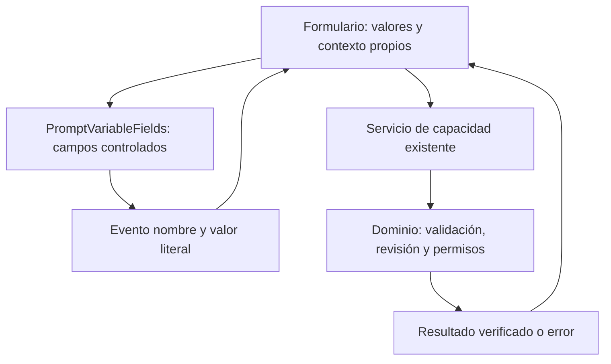

# Formularios y componentes modulares

## Contrato de cambio

Capacidad: mostrar y editar valores de variables en detalle, preparación de borrador y acciones de NOVA sin copiar su renderizado y fallback. Propietario: `features/prompts/PromptVariableFields.tsx`. Es una capacidad de prompts; no se convierte en un generador universal de formularios.

Invariantes: valores controlados por el consumidor; un valor vacío explícito no se sustituye por default; entrada Unicode y saltos de línea preservados; etiquetas e IDs existentes; campos de comandos no se exponen como destinos del workspace del agente. No hay nuevos permisos, persistencia, parseo, efectos de portapapeles o inferencia.

Alternativas consideradas: mantener tres implementaciones duplica fallback/etiquetas; un motor por schemas añade configuración sin variación demostrada; un componente pequeño compartido conserva las diferencias reales de los tres consumidores. Se elige este último. Rollback: volver a los renderizados anteriores; sin migración de datos o API.



```text
para cada variable declarada por el propietario:
    crear etiqueta e ID con el prefijo del consumidor
    mostrar valor explícito; si falta, default ofrecido; si falta, vacío
    al editar: emitir nombre y valor; no mutar los objetos recibidos
    marcar como campo del workspace sólo cuando el consumidor sea workspace
al enviar formulario:
    usar su capacidad existente con identidad/revisión y cancelación
    no conceder permisos por lo que diga un campo o una plantilla
```

## Capas de UI

`features/nova/NovaWelcome` muestra un recorrido previsto en reposo y el mapa
real de `AgentRuntimePanel` durante la ejecución. Sustituye el retrato grande;
el mapa queda compacto y sticky mientras el agente enfoca el editor.
`NovaLive` conserva la única lectura/SSE del runtime y publica su snapshot
por identidad de ejecución; el mapa no crea otro polling ni interpreta texto.
`AgentDock` conserva apertura, foco, contexto y estado visual del runtime.
Su launcher muestra sólo el icono; mientras `SameTabAgent` posee la pestaña,
se suspende todo el dock. `NovaLive` oculta también su trigger y parada flotantes;
el mapa conserva una entrada explícita a la actividad. El portal no usa un dock
suspendido como host, pero conserva el comportamiento previo al cerrar su panel.
`design/agent-presence.css` compone mapa, dock y degradado azul de control,
sin modificar el arte oficial.

`components/WorkspaceSidebar` y `WorkspaceFooter` son presentación del shell.
Reciben callbacks existentes de navegación/configuración y no poseen E/S,
persistencia o reglas de prompts. La barra permanece lateral, compacta a iconos
en pantallas pequeñas. `design/workspace-shell.css` define su composición;
`tokens.css` conserva la paleta solicitada y sus alias semánticos compartidos.

`features/prompts/LibraryToolbar` reúne búsqueda, filtros, colecciones y selector
de vista como presentación controlada. `App` conserva consulta, paginación,
preferencias y navegación; el componente no duplica servicios ni estado.
`design/library.css` comparte jerarquía de tarjetas, filas y editor. Los nombres
accesibles y marcadores del driver se conservan al cambiar la composición.

En reposo, `NovaWelcome` distingue explícitamente el recorrido previsto de los
hechos del runtime. La entrada principal abre las acciones existentes; no elige
una intención ni simula etapas. En móvil, el sidebar conserva el logo oficial
y las acciones por icono mantienen nombre accesible y foco visible. La tipografía
usa fuentes locales, sin nuevas dependencias ni solicitudes externas.

### Control exclusivo de comandos

`SameTabAgent` informa la posesión real del driver. `AgentControl` reserva los
eventos humanos de ratón, teclado, escritura y pegado mientras exista esa
posesión, incluyendo pausa/desconexión. No marca el workspace como `inert`
ni deshabilita sus destinos: las acciones programáticas del driver deben seguir
funcionando. El degradado azul tiene extremos oscuros y se disuelve hacia el
centro; no tiene línea de borde, no captura punteros y no simula actividad.

Se permiten las superficies de control del agente, el mapa de lectura y las
aprobaciones existentes. El borrado requiere además coincidencia del runId;
estos marcadores no conceden autorización al dominio. Tab conserva acceso a
Detener y a las decisiones dentro del diálogo activo. `useAgentOverlayHost`
mantiene el control de parada dentro de su focus scope accesible.

Al esperar aprobación, `AgentControl` muestra una alerta con «Revisar y aprobar»
y «No aprobar». La primera delega en el propietario existente de revisión de
`NovaLive`: actualiza la propuesta y abre el diálogo antes de la confirmación.
La segunda cancela mediante el propietario existente; no llama a approve/commit.
Las revisiones de borrado se enfocan sólo al coincidir el runId. La alerta
informativa lleva un marcador propio: `readUiState` la distingue de errores
reales, que siguen interrumpiendo al driver. Ningún marcador concede permiso.

```text
al adquirir el driver: reservar comandos humanos y mostrar borde/mapa
al recibir runtime: comprobar runId/secuencia y mostrar hechos públicos
al recibir un comando humano: permitir sólo control/lectura/aprobación vinculada
al recibir una acción programática: conservar validaciones y recibos del driver
al detener: parar driver, liberar capability y descartar polls tardíos
           solicitar cancelación mediante NovaLive, sin esperar para liberar la UI
al observar fin: devolver comandos y retirar borde; conservar el resultado real
```

El guard es arbitraje de interacción, no seguridad ni prueba de éxito del modelo.
No se simulan etapas al perder la conexión. El snapshot antiguo no puede cancelar
una ejecución nueva. No hay cambios de API, almacenamiento o proveedor.

Comprobaciones: pruebas de política/diálogo, cancelación con poll tardío,
identidad de snapshot y runtime desconectado; navegador con Qwen3 real en una
biblioteca aislada, escritura humana bloqueada, escritura del driver preservada,
detención y aprobación humana. Consultar la evidencia de la consulta para los
resultados y límites concretos.

| Capa | Contiene | No contiene |
| --- | --- | --- |
| `components/ui` | Diálogo accesible, marca, iconos y feedback | Casos de uso, API o reglas de prompts |
| `features/prompts` | Editor, valores, previews e historial del dominio | Otro parser de plantillas o autorización local |
| `features/nova` | Acciones elegidas y superficie visible del agente | Clasificación de intención por palabras o escrituras directas |
| Hooks/servicios de capacidad | Ciclo de una operación, contratos y adaptación | Estado persistente duplicado o permisos nuevos |
| `app/App.tsx` | Composición, navegación y estado de la pantalla | Copias de algoritmos que ya poseen otras capacidades |

`Dialog`, `TemplateCopyPreview`, `ClipboardReceipt`, `useBoundOperation`, `useEditorHistory`, `usePromptDeletion`, `ApplicationServices` y los clientes de servicios ya son propietarios reutilizables. Consultarlos antes de añadir otro wrapper o hook.

## Análisis observado

- **Corregido:** tres renderizados de campos y su fallback en `PromptFocus`, `EditorPreparation` y `QuickActions` consumen `PromptVariableFields`.
- **Conservado:** límites y presentación pueden variar por consumidor. El detalle/editor siguen siendo destinos del workspace; el diálogo de acción no lo es. El padre conserva layout, envío, estado y feedback.
- **Pendiente de diseño si se amplía:** los ciclos de copiar en detalle, borrador y proveedor comparten operaciones de bajo nivel, pero tienen efectos diferentes: registro de uso, copia temporal o apertura externa. No se fusionan bajo un helper genérico sin acordar sus contratos y negativos.
- **Composición grande:** `App.tsx` reúne navegación y montaje de capacidades. El tamaño por sí solo no prueba una violación; extraer sólo responsabilidades con cambios y consumidores identificados.

## Antes de crear una pantalla o formulario

Buscar el propietario existente y sus consumidores. Separar controles visuales, estado temporal, estado del servidor y reglas del dominio. Reutilizar el componente o caso de uso apropiado; compartir el algoritmo cuando su contrato realmente sea el mismo. Evitar copiar validación, cancelación, navegación o recibos para otra página.

Los schemas pueden describir campos que realmente comparten comportamiento. Mantener explícitas las excepciones de dominio; no llenar un componente universal de flags por cada pantalla. No introducir librerías de formularios ni estado global para esta reutilización.

## Pruebas de aceptación

Tests del componente: entrada literal sin mutación, vacío frente a default, etiquetas distintas y separación entre workspace y diálogo. Regresiones de consumidores: detalle, preparación del editor, acciones NOVA, copia e interacción del agente. Navegador: completar valores en el detalle y el editor sin perder el preview; completar una acción sin añadir campos del diálogo a los destinos del workspace. Las pruebas estructurales y de tipos no sustituyen este recorrido.

Verificación ejecutada el 2026-10-23: **255/255 tests React**, build TypeScript/Vite y **4/4 comprobaciones de navegador** en `Tests/nova/prompt-variable-fields.cjs`, con API y SQLite sintéticas propias. Se conservaron el origen guardado y los límites de los tres consumidores. El comprobador de arquitectura pasa **36 controles**, incluido el propietario único del markup de campos del workspace. Estos resultados no califican inferencia nueva ni cambian la aceptación de 1.0.0.
