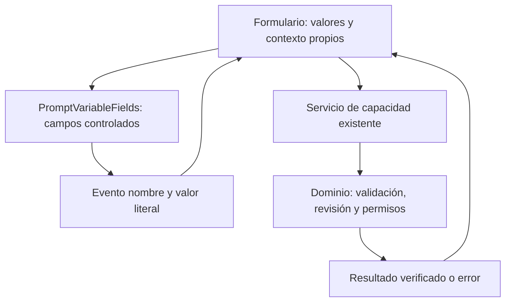

# Formularios y componentes modulares

## Contrato de cambio

Capacidad: mostrar y editar valores de variables en detalle, preparación de borrador y acciones de NOVA sin copiar su renderizado y fallback. Propietario: `features/prompts/PromptVariableFields.tsx`. Es una capacidad de prompts; no se convierte en un generador universal de formularios.

Invariantes: valores controlados por el consumidor; un valor vacío explícito no se sustituye por default; entrada Unicode y saltos de línea preservados; etiquetas e IDs existentes; campos de comandos no se exponen como destinos del workspace del agente. No hay nuevos permisos, persistencia, parseo, efectos de portapapeles o inferencia.

Alternativas consideradas: mantener tres implementaciones duplica fallback/etiquetas; un motor por schemas añade configuración sin variación demostrada; un componente pequeño compartido conserva las diferencias reales de los tres consumidores. Se elige este último. Rollback: volver a los renderizados anteriores; sin migración de datos o API.



```text
para cada variable declarada por el propietario:
    crear etiqueta e ID con el prefijo del consumidor
    mostrar valor explícito; si falta, default ofrecido; si falta, vacío
    al editar: emitir nombre y valor; no mutar los objetos recibidos
    marcar como campo del workspace sólo cuando el consumidor sea workspace
al enviar formulario:
    usar su capacidad existente con identidad/revisión y cancelación
    no conceder permisos por lo que diga un campo o una plantilla
```

## Capas de UI

| Capa | Contiene | No contiene |
| --- | --- | --- |
| `components/ui` | Diálogo accesible, marca, iconos y feedback | Casos de uso, API o reglas de prompts |
| `features/prompts` | Editor, valores, previews e historial del dominio | Otro parser de plantillas o autorización local |
| `features/nova` | Acciones elegidas y superficie visible del agente | Clasificación de intención por palabras o escrituras directas |
| Hooks/servicios de capacidad | Ciclo de una operación, contratos y adaptación | Estado persistente duplicado o permisos nuevos |
| `app/App.tsx` | Composición, navegación y estado de la pantalla | Copias de algoritmos que ya poseen otras capacidades |

`Dialog`, `TemplateCopyPreview`, `ClipboardReceipt`, `useBoundOperation`, `useEditorHistory`, `usePromptDeletion`, `ApplicationServices` y los clientes de servicios ya son propietarios reutilizables. Consultarlos antes de añadir otro wrapper o hook.

## Análisis observado

- **Corregido:** tres renderizados de campos y su fallback en `PromptFocus`, `EditorPreparation` y `QuickActions` consumen `PromptVariableFields`.
- **Conservado:** límites y presentación pueden variar por consumidor. El detalle/editor siguen siendo destinos del workspace; el diálogo de acción no lo es. El padre conserva layout, envío, estado y feedback.
- **Pendiente de diseño si se amplía:** los ciclos de copiar en detalle, borrador y proveedor comparten operaciones de bajo nivel, pero tienen efectos diferentes: registro de uso, copia temporal o apertura externa. No se fusionan bajo un helper genérico sin acordar sus contratos y negativos.
- **Composición grande:** `App.tsx` reúne navegación y montaje de capacidades. El tamaño por sí solo no prueba una violación; extraer sólo responsabilidades con cambios y consumidores identificados.

## Antes de crear una pantalla o formulario

Buscar el propietario existente y sus consumidores. Separar controles visuales, estado temporal, estado del servidor y reglas del dominio. Reutilizar el componente o caso de uso apropiado; compartir el algoritmo cuando su contrato realmente sea el mismo. Evitar copiar validación, cancelación, navegación o recibos para otra página.

Los schemas pueden describir campos que realmente comparten comportamiento. Mantener explícitas las excepciones de dominio; no llenar un componente universal de flags por cada pantalla. No introducir librerías de formularios ni estado global para esta reutilización.

## Pruebas de aceptación

Tests del componente: entrada literal sin mutación, vacío frente a default, etiquetas distintas y separación entre workspace y diálogo. Regresiones de consumidores: detalle, preparación del editor, acciones NOVA, copia e interacción del agente. Navegador: completar valores en el detalle y el editor sin perder el preview; completar una acción sin añadir campos del diálogo a los destinos del workspace. Las pruebas estructurales y de tipos no sustituyen este recorrido.

Verificación ejecutada el 2026-10-23: **255/255 tests React**, build TypeScript/Vite y **4/4 comprobaciones de navegador** en `Tests/nova/prompt-variable-fields.cjs`, con API y SQLite sintéticas propias. Se conservaron el origen guardado y los límites de los tres consumidores. El comprobador de arquitectura pasa **36 controles**, incluido el propietario único del markup de campos del workspace. Estos resultados no califican inferencia nueva ni cambian la aceptación de 1.0.0.
