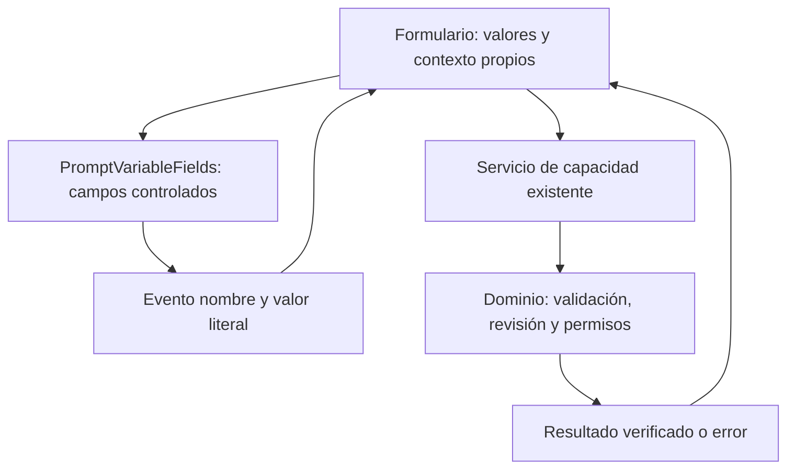

# Formularios y componentes modulares

## Contrato de cambio

Capacidad: mostrar y editar valores de variables en detalle, preparación de borrador y acciones de NOVA sin copiar su renderizado y fallback. Propietario: `features/prompts/PromptVariableFields.tsx`. Es una capacidad de prompts; no se convierte en un generador universal de formularios.

Invariantes: valores controlados por el consumidor; un valor vacío explícito no se sustituye por default; entrada Unicode y saltos de línea preservados; etiquetas e IDs existentes; campos de comandos no se exponen como destinos del workspace del agente. No hay nuevos permisos, persistencia, parseo, efectos de portapapeles o inferencia.

Alternativas consideradas: mantener tres implementaciones duplica fallback/etiquetas; un motor por schemas añade configuración sin variación demostrada; un componente pequeño compartido conserva las diferencias reales de los tres consumidores. Se elige este último. Rollback: volver a los renderizados anteriores; sin migración de datos o API.



```text
para cada variable declarada por el propietario:
    crear etiqueta e ID con el prefijo del consumidor
    mostrar valor explícito; si falta, default ofrecido; si falta, vacío
    al editar: emitir nombre y valor; no mutar los objetos recibidos
    marcar como campo del workspace sólo cuando el consumidor sea workspace
al enviar formulario:
    usar su capacidad existente con identidad/revisión y cancelación
    no conceder permisos por lo que diga un campo o una plantilla
```

## Capas de UI

### Candidato de cuentas

`features/accounts/AccountPage` identifica la sesión y monta su espacio con clave de
usuario; vuelve a comprobar la identidad al recuperar foco/visibilidad. El modo local
mantiene su composición existente. `AccountPromptLibrary` compone el contrato privado
de título/cuerpo/revisión y `AccountSharing` presenta publicaciones e invitaciones.
La composición NOVA actual ofrece crear, abrir y actualizar con revisión. Las otras
acciones del workbench no se ofrecen hasta tener sus capacidades privadas completas.

El editor privado consulta `AccountEditorMemory.Inspect` por medio de
`services/accounts.inspectEditor`. `useAccountEditorInspection` conserva dos
identidades: definición (cuenta montada, biblioteca, origen/revisión, estado activo y cuerpo) y
snapshot de valores. Sólo el servidor descubre variables y compila; una respuesta
tardía se descarta. Cambiar un valor conserva los campos y su foco mientras invalida
la vista previa; cambiar cuerpo, origen o biblioteca invalida también los nombres.
El hook pausa la inspección de una fuente archivada tanto en detalle como en el
editor: aborta la consulta, descarta su respuesta y conserva los valores locales.
Recuperar el prompt reanuda la inspección con su revisión vigente. Un texto sin
origen mantiene la inspección normal. El editor explica la pausa e impide conservar
contexto ligado al archivo; la edición manual de título/cuerpo permanece disponible.
Esta pausa no amplía permisos del servidor.
Se reutiliza `PromptVariableFields`. Inspeccionar no conserva memoria ni solicita IA;
«Conservar borrador» y «Guardar prompt» mantienen sus efectos explícitos separados.
El guardado manual sigue disponible ante un fallo de preview, sujeto a validación
del servidor. Un borrador restaurado obsoleto puede inspeccionarse como texto sin
origen; no recupera el permiso de sobrescribir la revisión guardada.

`services/accountNova` fija cuenta/biblioteca/conexión al componer el transporte
nativo. No cambia el actor del servidor (siempre cookie), no usa rutas locales y no
guarda cuerpos, valores o capacidades de superficie en sessionStorage. Sólo conserva
el UUID del run bajo una clave específica. `AccountNovaBoundary` elige una conexión
vigente del perfil de propuestas y monta `SameTabAgent`/`NovaLive` mediante el puerto
estrecho `AgentRuntimeServiceProvider`; el modo local conserva `ApplicationServices`.
El driver y la suscripción se retiran también si cambia su servicio. Los callbacks
tardíos de una conexión no publican estado en la nueva.

Al volver a la ventana, `AccountPage` comprueba de nuevo `/me` sin desmontar el
espacio de la misma cuenta. `UiPortalScope` conserva los nodos de formularios y
diálogos, oculta sus hijos privados y traslada overlays a un host oculto mientras
la identidad está pendiente. Los diálogos presentan sólo una explicación genérica
y reintento dentro de su foco modal; no se conserva un botón de aprobación visible.
La comprobación se agrupa y vence a los cuatro segundos; error o respuesta tardía
no exponen el contenido. Una identidad diferente o anónima recarga el acceso,
retira el driver, sus capacidades y actividad, y descarta peticiones antiguas.

`SameTabAgent` pausa su driver y sondeo durante esa comprobación, conservando las
pausas del usuario, servidor y conexión como motivos independientes. La
confirmación de la misma cuenta no crea otra superficie ni otra ejecución. Los
recibos terminados esperan a la verificación; una sesión retirada no los envía.
`AgentControl` retira temporalmente su guardia para que el reintento público sea
accesible. Este alcance de presentación no sustituye cookie/sello, CSRF, revisión,
conexión o aprobación comprobados por el servidor. El modo local sin proveedor de
alcance conserva el comportamiento anterior.

`AccountNovaActions` reutiliza `LiveCommand` y `PromptInputNames`: la acción, origen
y nombres de entrada viajan separados del texto. `AccountPromptEditor` y
`AccountPromptFocus` exponen los controles y marcadores nativos con identidad y
revisión; las escrituras siguen pasando por eventos de sus formularios controlados.
Una aprobación habilita el botón estable `approval.apply` sólo para el run y origen
actuales. El guardado aprobado conserva los metadatos de la propuesta revisada y
usa commit transaccional; el guardado manual conserva su servicio anterior.

Se reutilizan el mapa compacto, perímetro, parada y diálogo de revisión existentes.
El historial sólo ofrece otro acceso cuando no hay control activo. Al desmontar
cuenta/biblioteca/conexión se retiran capacidades y entradas del journal de sus
últimos tres runs; no se almacenan contenidos o valores en el navegador. Una
recarga ofrece leer el borrador pendiente y detener, sin recuperar aprobación ni
acciones. Un inicio incierto espera una vista autoritativa antes de operar.

`accountNovaCommit` resuelve una respuesta de guardado perdida con lecturas acotadas
del recibo y su recurso exacto. No vuelve a enviar commit; no acepta otro run,
versión posterior, cuerpo distinto, aprobación pendiente o efecto sin confirmar.
El reemplazo del contexto aborta esta recuperación. Las pruebas React usan HTTP
simulado; su resultado no sustituye el recorrido real con navegador y companion.

`services/accounts.ts` posee DTOs, rutas y CSRF; `useAccountOperation` comparte el
ciclo de vida visual sobre `useBoundOperation`. Cancelar o cambiar contexto descarta
respuestas tardías. No hay tokens, prompts, borradores o valores en localStorage.
Los permisos y revisiones pertenecen a los módulos Accounts/Sharing del servidor.
Dialog, AppBrand, Icon y tokens se reutilizan; no se crea un segundo kit visual.
Las invitaciones pendientes no cargan contenido. La importación requiere destino
propio explícito y conserva su clave al reintentar un error de transporte; una
denegación limpia la vista compartida. Revocar explica las copias ya importadas.

### Nombres de campos y valores de uso

`features/prompts/PromptInputNames.tsx` es el propietario del control de nombres: lista por líneas, sin valores ni defaults. Lo consumen `QuickActions` y `PromptInputQuestion`; no duplican su parseo ni sus etiquetas. El modal de aclaración se muestra cuando NOVA devuelve `INPUT_FIELDS_NEED_CONFIRMATION` y ya liberó el control de la pestaña. `App` conserva en memoria la petición, acción y origen de esa ejecución para continuar con los nombres elegidos; el servicio vuelve a comprobar la revisión del origen. No se persiste el texto privado en el almacenamiento del navegador.

Los nombres se envían en `LiveCommand.inputNames`, por separado de `values`. Ausencia/null pide aclaración; una lista vacía confirmada crea sin variables o conserva las existentes al actualizar. Application copia la selección en el contrato y el dominio valida los nombres y compone los marcadores. Los campos para completar valores siguen perteneciendo a `PromptVariableFields`; esta capacidad no sustituye ese propietario ni concede guardado.

`features/nova/NovaWelcome` presenta la entrada en reposo y se retira cuando
existe actividad. El mapa real de `AgentRuntimePanel`, la etapa actual y la
parada se reúnen en un único panel compacto de `AgentControl`, en la esquina
inferior derecha. No existe otro mapa o stepper sobre el editor. El documento
reserva espacio inferior para permitir desplazar sus últimos controles fuera
del panel. «Ver actividad de NOVA» abre el mapa y los hechos completos bajo
demanda. La etapa mostrada procede del mismo propietario de presentación de
`NovaLive`, para evitar etiquetas divergentes entre ambas vistas.
`NovaLive` conserva la única lectura/SSE del runtime y publica su snapshot
por identidad de ejecución; el mapa no crea otro polling ni interpreta texto.
`AgentDock` conserva apertura, foco, contexto y estado visual del runtime.
Al montar tarde un observador (por ejemplo, al elegir un equipo tras abrir el
asistente), `NovaLive` lee la visibilidad actual del panel antes de escuchar sus
cambios. El historial recuperado sigue siendo consultable sin reactivar controles
de ejecución, aprobaciones ni otra solicitud.
Su launcher muestra sólo el icono; mientras `SameTabAgent` posee la pestaña,
se suspende todo el dock. `NovaLive` oculta también su trigger y parada flotantes;
el mapa conserva una entrada explícita a la actividad. El portal no usa un dock
suspendido como host, pero conserva el comportamiento previo al cerrar su panel.
`design/agent-presence.css` compone mapa, dock y degradado azul de control,
sin modificar el arte oficial.

`components/WorkspaceSidebar` y `WorkspaceFooter` son presentación del shell.
Reciben callbacks existentes de navegación/configuración y no poseen E/S,
persistencia o reglas de prompts. La barra permanece lateral, compacta a iconos
en pantallas pequeñas. `design/workspace-shell.css` define su composición;
`tokens.css` conserva la paleta solicitada y sus alias semánticos compartidos.

`features/prompts/LibraryToolbar` reúne búsqueda, filtros, colecciones y selector
de vista como presentación controlada. `App` conserva consulta, paginación,
preferencias y navegación; el componente no duplica servicios ni estado.
`design/library.css` comparte jerarquía de tarjetas, filas y editor. Los nombres
accesibles y marcadores del driver se conservan al cambiar la composición.

`features/groups/GroupSelector` sirve tanto Home como el detalle de un prompt.
Carga catálogo y pertenencias con resultados independientes y cancelación por
contexto: una lectura fallida no descarta la otra. Carga, vacío y error son
estados distintos; el error ofrece reintento. No permite alternar pertenencias
hasta disponer de ambas lecturas vigentes. La asignación sigue usando la revisión
del prompt y el servicio existente; no se sustituye la autorización del dominio.

`features/prompts/PromptDetailHeader` presenta identidad, revisión, fecha y
acciones de gestión mediante callbacks. No posee consultas, persistencia ni
permisos. `PromptFocus` conserva compilación cancelable, valores, navegación y
recibos de copia; `PromptVariableFields` sigue siendo el único renderizador de
campos. `design/prompt-detail.css` compone contexto y texto preparado en dos
columnas, con una columna en pantallas compactas. La vista previa expresa texto
compilado, no una respuesta generada ni una validación semántica del modelo.
El acceso a NOVA permanece en la burbuja fija inferior derecha, sin otra tarjeta
de entrada dentro del detalle. IDs, etiquetas, controles opt-in y marcadores de
compilación/portapapeles siguen siendo contratos del driver.

En reposo, `NovaWelcome` distingue explícitamente el recorrido previsto de los
hechos del runtime. La entrada principal abre las acciones existentes; no elige
una intención ni simula etapas. En móvil, el sidebar conserva el logo oficial
y las acciones por icono mantienen nombre accesible y foco visible. La tipografía
usa fuentes locales, sin nuevas dependencias ni solicitudes externas.

### Control exclusivo de comandos

`SameTabAgent` informa la posesión real del driver. `AgentControl` reserva los
eventos humanos de ratón, teclado, escritura y pegado mientras exista esa
posesión, incluyendo pausa/desconexión. No marca el workspace como `inert`
ni deshabilita sus destinos: las acciones programáticas del driver deben seguir
funcionando. El halo azul tiene esquinas redondeadas, un contorno fino y sombras
interiores que se disuelven hacia el centro. Su pulso suave de 3,6 segundos sólo
acompaña ejecución conectada; se detiene en pausa, desconexión, aprobación y
estados terminales. Con movimiento reducido permanece estático. No captura
punteros ni concede permisos.

Se permiten las superficies de control del agente, el mapa de lectura y las
aprobaciones existentes. El borrado requiere además coincidencia del runId;
estos marcadores no conceden autorización al dominio. Tab conserva acceso a
Detener y a las decisiones dentro del diálogo activo. `useAgentOverlayHost`
mantiene el control de parada dentro de su focus scope accesible.

Al esperar aprobación, `AgentControl` muestra una alerta con «Revisar y aprobar»
y «No aprobar». La primera delega en el propietario existente de revisión de
`NovaLive`: actualiza la propuesta y abre el diálogo antes de la confirmación.
La segunda cancela mediante el propietario existente; no llama a approve/commit.
Las revisiones de borrado se enfocan sólo al coincidir el runId. La alerta
informativa lleva un marcador propio: `readUiState` la distingue de errores
reales, que siguen interrumpiendo al driver. Ningún marcador concede permiso.

```text
al adquirir el driver: reservar comandos humanos y mostrar borde/mapa
al recibir runtime: comprobar runId/secuencia y mostrar hechos públicos
al recibir un comando humano: permitir sólo control/lectura/aprobación vinculada
al recibir una acción programática: conservar validaciones y recibos del driver
al detener: parar driver, liberar capability y descartar polls tardíos
           solicitar cancelación mediante NovaLive, sin esperar para liberar la UI
al observar fin: devolver comandos y retirar borde; conservar el resultado real
```

El guard es arbitraje de interacción, no seguridad ni prueba de éxito del modelo.
No se simulan etapas al perder la conexión. El snapshot antiguo no puede cancelar
una ejecución nueva. No hay cambios de API, almacenamiento o proveedor.

Comprobaciones: pruebas de política/diálogo, cancelación con poll tardío,
identidad de snapshot y runtime desconectado; navegador con Qwen3 real en una
biblioteca aislada, escritura humana bloqueada, escritura del driver preservada,
detención y aprobación humana. Consultar la evidencia de la consulta para los
resultados y límites concretos.

| Capa | Contiene | No contiene |
| --- | --- | --- |
| `components/ui` | Diálogo accesible, marca, iconos y feedback | Casos de uso, API o reglas de prompts |
| `features/prompts` | Editor, valores, previews e historial del dominio | Otro parser de plantillas o autorización local |
| `features/nova` | Acciones elegidas y superficie visible del agente | Clasificación de intención por palabras o escrituras directas |
| Hooks/servicios de capacidad | Ciclo de una operación, contratos y adaptación | Estado persistente duplicado o permisos nuevos |
| `app/App.tsx` | Composición, navegación y estado de la pantalla | Copias de algoritmos que ya poseen otras capacidades |

`Dialog`, `TemplateCopyPreview`, `ClipboardReceipt`, `useBoundOperation`, `useEditorHistory`, `usePromptDeletion`, `ApplicationServices` y los clientes de servicios ya son propietarios reutilizables. Consultarlos antes de añadir otro wrapper o hook.

### Borradores conservados del candidato de cuentas

`AccountRememberedDrafts` posee carga cancelable, recuperación y confirmación de
olvido. `AccountPromptLibrary` conserva el editor y compone `PromptVariableFields`
para nombres devueltos por el compilador del servidor. No hay parser duplicado ni
almacenamiento privado en localStorage. Cambiar contenido descarta valores/preview
anteriores; cambiar valores invalida sólo la compilación mostrada hasta conservar.
`services/accounts.ts` posee DTOs, CSRF y revisiones; `useAccountOperation` descarta
respuestas tardías por cuenta/biblioteca. Un origen obsoleto exige copia explícita.
Guardar el prompt y conservar contexto son elecciones distintas; el último no
autoriza una ejecución. El flujo real A/B y sus límites se documentan en
[el expediente SaaS](SAAS_DELIVERY.md).

### Preparaciones privadas del candidato

`UseAccountPromptDialog` obtiene variables del servidor y compone los campos
existentes; no analiza marcadores en React. Sólo el botón explícito envía la
preparación. Un fallo de transporte conserva el operationId para el mismo contenido;
el usuario puede reintentar el descubrimiento de variables sin crear una ejecución.
`AccountExecutions` consulta sólo la biblioteca montada, sondea mientras hay trabajo
y detiene ese sondeo ante error o desmontaje. Cambiar cuenta/biblioteca descarta
respuestas tardías mediante el ciclo existente. El servidor decide cuota y estado.

El resultado reutiliza `SavedText` del historial, con texto literal, copia sin otro
uso y descarga mediante `downloadPreparedText` (nombre opcional; default conservado).
El dueño del lector carga su CSS; los contratos locales del historial permanecen.
La UI distingue instrucción compilada de respuesta IA y no reenvía trabajos perdidos.
La cancelación solicita detener el ID seleccionado; cerrar un diálogo no declara
que la ejecución haya terminado. Los tokens de turno nunca llegan al frontend.

### Historial de resultados

`CompilationHistory` conserva el ciclo de carga, cancelación, paginación y borrado
con el snapshot revisado. La selección es local a la página y se descarta al
cambiarla; durante la carga no quedan destinos de copia de la página anterior.
`HistoryResult` presenta un único registro original y compone `SavedText` para
instrucción y respuestas: texto literal sin HTML, copia sin registrar otro uso y
descarga UTF-8 con nombres distintos. No genera respuestas ni modifica el prompt.

`design/history.css` pertenece a esta capacidad y se carga con su diálogo. En
escritorio separa la lista del panel de lectura; en móvil apila ambos y mantiene
el cierre y la paginación fuera del área desplazable. Sus capas 70/71 sitúan el
scrim y el diálogo por encima de la barra lateral (40), sin cambiar otros modales.
La revisión de borrado recibe foco y al cancelarla lo devuelve a su botón. El
borrado sigue requiriendo consentimiento explícito y validación del servidor.

## Análisis observado

- **Corregido:** tres renderizados de campos y su fallback en `PromptFocus`, `EditorPreparation` y `QuickActions` consumen `PromptVariableFields`.
- **Conservado:** límites y presentación pueden variar por consumidor. El detalle/editor siguen siendo destinos del workspace; el diálogo de acción no lo es. El padre conserva layout, envío, estado y feedback.
- **Pendiente de diseño si se amplía:** los ciclos de copiar en detalle, borrador y proveedor comparten operaciones de bajo nivel, pero tienen efectos diferentes: registro de uso, copia temporal o apertura externa. No se fusionan bajo un helper genérico sin acordar sus contratos y negativos.
- **Composición grande:** `App.tsx` reúne navegación y montaje de capacidades. El tamaño por sí solo no prueba una violación; extraer sólo responsabilidades con cambios y consumidores identificados.

## Antes de crear una pantalla o formulario

`AccountExecutions` sigue snapshots de la biblioteca mediante
`AccountService.watchExecutions`, en lugar de mantener polling de HTTP en la
vista. El servicio verifica identidad de biblioteca, schemas y recibo terminal.
Sólo renueva ante `renew` del servidor, hasta 40 conexiones de 30 segundos; una
desconexión o error exige Actualizar preparaciones y nunca repite la ejecución.
Cambiar biblioteca/servicio aborta el lector e invalida inmediatamente el snapshot
anterior. Cerrar el seguimiento no cancela trabajo; Detener preparación conserva
su endpoint con sesión y CSRF. Un flujo no contiene texto de prompts o respuestas.

`serverEvents` es dueño del framing SSE, UTF-8, CRLF/LF, límites y cierre/cancelación
del reader. Tiene tres consumidores: preparación local, respuesta local y estados
de cuentas. Cada uno conserva sus schemas, identidad y criterios de finalización;
compartir transporte no concede permisos ni convierte un EOF en resultado correcto.

`AccountConnections` compone consentimiento, listado y revocación con
`useAccountOperation` y `Dialog`. El servicio de cuentas es propietario del
formato OAuth form-urlencoded y del acuse de verificación local del SDK; la vista
no interpreta tokens ni guarda códigos en almacenamiento web. Revisar un código
no concede acceso; editarlo descarta la revisión. Se distinguen autorización
vigente e inferencia disponible; el candidato todavía no ejecuta el companion.
Los controles no sustituyen el actor, CSRF, perfil, recurso ni vigencia del servidor.

El listado muestra también permisos MCP de lectura y su biblioteca autorizada.
El perfil de importación se presenta por separado: añade lectura de snapshots
aceptados e importación en esa biblioteca; no se interpreta como equipo de IA.
Los grants nuevos describen capacidades por `scopes`; la vista presenta las
etiquetas de lectura/importación/creación/colecciones y conserva el fallback para perfiles
anteriores. No deriva autoridad de esas etiquetas ni ofrece MCP como destino Qwen.
Colecciones significa leer snapshots ya aceptados e importar su conjunto; no
implica permiso de autoría libre o importación de prompts individuales.
`UseAccountPromptDialog` ofrece como destino de IA únicamente conexiones activas
con perfil `ollama-qwen3-8b`; una conexión MCP no es un worker. El consentimiento
OAuth de MCP lo sirve `Cloud/Delegation/McpConsent`: formulario nativo de primera
parte con sesión, CSRF y biblioteca explícita, sin exponer tokens a React.

Buscar el propietario existente y sus consumidores. Separar controles visuales, estado temporal, estado del servidor y reglas del dominio. Reutilizar el componente o caso de uso apropiado; compartir el algoritmo cuando su contrato realmente sea el mismo. Evitar copiar validación, cancelación, navegación o recibos para otra página.

Los schemas pueden describir campos que realmente comparten comportamiento. Mantener explícitas las excepciones de dominio; no llenar un componente universal de flags por cada pantalla. No introducir librerías de formularios ni estado global para esta reutilización.

## Pruebas de aceptación

`PublicationManager` conserva un solo flujo de publicar, invitar y revocar para
`PublishPromptDialog` y `PublishCollectionDialog`. El segundo revisa los miembros
y envía sus versiones explícitas; compartir desde un filtro no amplía la colección.
Las invitaciones distinguen prompt individual de colección antes de aceptar.
El diálogo receptor muestra sólo el snapshot, selecciona biblioteca propia y
conserva una operación de importación al reintentar. La revocación retira el
contenido visible tras un rechazo del servidor. El cliente no convierte una
colección en una importación individual ni decide su autoridad.

`CollectionManager` conserva una sola implementación del diálogo de organización.
`GroupSelector` compone el cliente local desde `ApplicationServices`;
`AccountCollectionDialog` compone `AccountService.collections(libraryId)` y gestiona
sesiones caducadas. Ambos usan `CollectionClient`, las mismas cargas independientes
de catálogo/pertenencias y el mismo manejo de revisiones/errores. El cliente de
cuentas sólo llama rutas de su biblioteca y añade CSRF; no cae al host local.

`AccountPromptLibrary` permite abrir el gestor desde la biblioteca y desde un prompt.
El filtro se envía al servidor, que también lo usa en el catálogo del agente.
Crear un prompt mientras hay filtro no lo asigna automáticamente: la vista se
recarga con ese filtro y distingue selección vacía de biblioteca vacía. Una colección
eliminada o ajena devuelve error, sin ampliar silenciosamente la selección.

`AccountExecutions` permite olvidar el contenido de una ejecución terminada mediante
el `Dialog` existente y una confirmación explícita. Abrir/cancelar no llama al servidor;
se conserva el destino al reintentar. El cliente comprueba biblioteca, ID y `forgottenAt`
del recibo antes de mostrar éxito. La vista conserva el estado terminal, muestra
«Contenido olvidado» y deja de ofrecer el resultado. Los trabajos activos sólo se
pueden detener, no olvidar. La autorización y la retirada atómica pertenecen al
servidor, no al diálogo. La caducidad de siete días y la conservación del recibo se
explican junto al historial; no se promete eliminar copias descargadas ni backups.

Tests del componente: entrada literal sin mutación, vacío frente a default, etiquetas distintas y separación entre workspace y diálogo. Regresiones de consumidores: detalle, preparación del editor, acciones NOVA, copia e interacción del agente. Navegador: completar valores en el detalle y el editor sin perder el preview; completar una acción sin añadir campos del diálogo a los destinos del workspace. Las pruebas estructurales y de tipos no sustituyen este recorrido.

Verificación ejecutada el 2026-10-23: **255/255 tests React**, build TypeScript/Vite y **4/4 comprobaciones de navegador** en `Tests/nova/prompt-variable-fields.cjs`, con API y SQLite sintéticas propias. Se conservaron el origen guardado y los límites de los tres consumidores. El comprobador de arquitectura pasa **36 controles**, incluido el propietario único del markup de campos del workspace. Estos resultados no califican inferencia nueva ni cambian la aceptación de 1.0.0.
