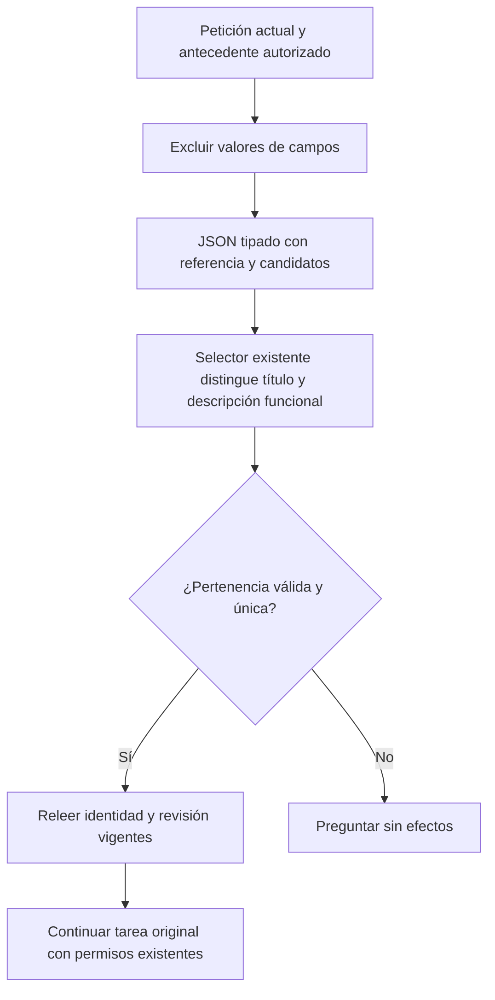
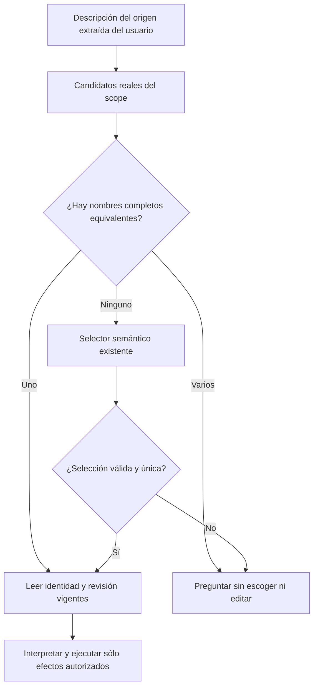

## Incremento de recuperación por propósito (en validación)

La auditoría anterior permanece como FAIL. No se incorporan los dos cambios de
instrucciones de referencia probados: el primero recupera campos pero confunde
creación; renombrar sus códigos perjudica además reuse/ejecución. El primer probe
leyó evidencia con encoding Windows implícito: no es comparación válida, se
conserva separado. La repetición UTF-8 y sus paquetes quedan en
`docs/evidence/agent-purpose-recovery-20261020`. Persistencia por identidad supera
cinco contrastes sin efectos, pero también el baseline; no se declara mejora ni
aceptación de UI por ese resultado.

Contrato del candidato:

- `SemanticPlanCompiler.RequiresSource` conserva la única regla de dependencia
  del dominio; la composición usa esa misma regla para reconciliar la declaración
  sin fuente antes de pedir al usuario el origen ya nombrado. Se reutilizan los
  dos intentos existentes; no hay handler por frase ni comparación de títulos.
- `PromptDraftGenerator.GenerateAuthoredDefinition` sirve también creación del
  perfil actual. El autor devuelve sólo título, descripción y cuerpo. La
  petición completa sigue siendo autoridad; desaparece del camino activo la
  partición semántica del propio generador que rechazaba «No inventes información».
  Inputs salen del parser y valores del extractor existente; reviewer conserva
  el original completo y los efectos quedan fuera del autor.
- `SemanticIntentInterpreter` proyecta su eje privado de persistencia a identidad
  actual/nueva/eliminada mediante un enum y atributos reflejados. Los atributos
  producen esquema y descripción y se cachean. El mapeo público SaveObjective,
  dominio, hash, revisión, aprobación, SQLite y HTTP no cambian. No es un árbitro.
- La reparación visible corrige el fallo comunicado; no exige convertir temas o
  outputs en inputs. Máximo de correcciones, cancelación y permisos se conservan.

Alternativas: ampliar guías de referencia no pasó sus contrastes; otra capa de
juicio duplicaría autoridad y coste. Se extienden los propietarios actuales. La
representación por identidad no amplía acciones; un schema/enum no acredita
comprensión. Fuentes previas guardadas para rollback sin migración ni descargas.

Predicción falsable: creación no se rechaza por sus propios rangos; una operación
que necesita origen no termina sin reconciliarlo dentro del mismo presupuesto;
versión/copia mantienen su identidad en UI, hash/aprobación y SQLite. Pruebas de
transporte sólo acreditan contratos: deben pasar los mismos casos originales con
Qwen y Edge y las familias positivas/negativas antes de conservar el candidato.


# Cierre dirigido: preservar la referencia al seleccionar el origen

## Contrato vigente: contexto del selector existente

La igualdad de la frase de búsqueda con un título no prueba que el usuario haya
nombrado ese título: puede estar describiendo un tema general. Se retiró el atajo
por igualdad antes de cualificarlo con Qwen. Sus fuentes y pruebas se conservan en
`.playwright/agent-closure-navigation-20261020/rejected-name-shortcut`; su tanda
controlada `navigation-after.trx` fue 77/78 y no es evidencia del candidato actual.
No se mantienen sus cambios de expectativas en los tests existentes.

El cambio activo extiende el puerto `ICandidateSelector` con `SourceLookupContext`:
`SourceDescription`, `UserDirective`, `AuthorizedEarlierDirective`. La firma previa
se conserva con adaptación por defecto para consumidores existentes. La
implementación productiva serializa los tres campos de forma tipada, junto con
los candidatos reales; interpreta la referencia en la petición, no sólo su query.

Propietarios: `TaskSourceResolver` proyecta el contexto y excluye datos de campos
con el parser existente; `SemanticCandidateSelector` determina pertenencia de
cada candidato; el resolvedor conserva autorización, pertenencia, revisiones,
duplicados y aclaración. No hay otro clasificador, estado, búsqueda, llamada,
permiso, árbitro o dependencia. El modelo no recibe puntuaciones como autoridad.

Alternativas: otra etapa aumentaría coste y duplicaría interpretación; la igualdad
perdería el rol semántico; se amplía el contexto del propietario existente. JSON
serializado desde el tipo C#, respuesta validada por el esquema existente, límite
de bytes y cancelación iguales. Sin cambios HTTP, SQLite, modelo o configuración.
Rollback: retirar sobrecarga/contexto e instrucciones nuevas; no hay migración.



```text
obtener candidatos reales del scope existente
proyectar petición y antecedente autorizado excluyendo valores de campos
mantener la descripción de búsqueda como campo independiente
serializar el contexto tipado y validar tamaño/cancelación
clasificar todos los candidatos en una sola consulta semántica existente
validar pertenencia, contradicción y duplicados con las guardas actuales
releer revisión vigente; no usar igualdad de query como decisión de identidad
comparar los recorridos reales con peticiones y oráculos originales
```

Verificación dirigida de contexto/transporte, máscara de datos y límites actuales:
`reference-context.trx`, **76/76 PASS**. Es controlada y no acredita significado.
Los recorridos reales y la aceptación del candidato siguen pendientes aquí.

## Resultado de navegación y siguiente corrección acotada

`navigation-review.json` adjudica **3/3 PASS** de Qwen real y Edge:
`latency-1792545159985`. El original `readOnly` fallaba; ahora abre únicamente el
registro nombrado. Ambigüedad y ausencia conservan preguntas sin efectos. No es
cierre de todas las referencias ni del desarrollo/holdout.

`latency-1792545278053` ejecuta siete recorridos originales con el mismo candidato.
Completar/copiar en dos formulaciones y ejecución local pasan. Creación y adaptación
sin guardar fallan ANTES de autoría: el rol inicial interpreta el tema futuro como
una fuente guardada. El guardado de versión devuelve texto fiel pero propone y
persiste una COPIA; se conserva como FAIL, nunca como aprobación correcta. La
siguiente copia encuentra el duplicado creado y queda bloqueada aguas arriba.

La siguiente hipótesis cambia sólo recursos de entrada de los propietarios:
el rol de referencia debe decidir primero SI se necesita una instrucción existente,
sin presuponerla; workflow recibe las opciones de persistencia con sus efectos
reales desde los atributos del catálogo. Se reutiliza el mapeo del compilador de
objetivos, sin otro árbitro ni decisiones por frases. Esquemas y validadores de
respuesta, presupuestos, revisiones, confirmación y dominio siguen vigentes.

Verificación: contrato de la guía contra el mismo mapeo ejecutado, regresiones de
referencia y workflow; creación/adaptación originales y versión/copia en fixtures
independientes. Si no mejora, no se amplía la hipótesis con variantes indefinidas.

## Auditoría posterior: contrato de entradas y retiro de guía rechazada

La variante `latency-1792545751556` permitió crear y continuar, pero la creación
añadió agenda/objetivos/acuerdos como campos desde metadatos. `Canonicalize` y dos
expectativas de `PreparationTests` admitían esa autoría implícita. El texto se
considera autoridad de variables en este dominio: `TemplateCompiler.Names` ya
controla compilación, formularios y recibos. La normalización valida declaraciones
opcionales contra las variables reales y deja el cuerpo intacto. No se infiere
qué palabras son resultados ni se agregan reglas por nombre de campo.

Los tests anteriores que esperaban introducir campos se sustituyen deliberadamente
por rechazo de declaración incompatible y un positivo con placeholders explícitos;
se conservan la prueba de campos legítimos y la igualdad revisión/compilado/UI.
La única reparación existente del orquestador semántico se admite también para
creación sin el perfil experimental Goal; conserva petición, permisos y presupuesto.
La creación visible ya dispone de esa única reparación y no amplía sus límites.

Predicción: declaraciones incompatibles no añaden cuerpo; una propuesta coherente
conserva campos/valores; fallo persistente termina después de dos generaciones.
Alternativa descartada: ignorar los metadatos ocultaría el desacuerdo; reescribir el
cuerpo inventaría contenido. No se añade módulo, árbitro, esquema HTTP o migración.

La guía de persistencia de esa variante volvió a elegir `REVIEW_PERSIST_COPY` para
una versión del mismo registro. Se retiran `persistenceReviewOptions`, su mapeo
auxiliar y descripciones experimentales; su fuente y evidencia congeladas permanecen.
No se cuenta ese experimento como mejora ni se incorpora otra variante de texto.

### Contraste causal del modo de inferencia del workflow

El workflow forzaba `think=false` aunque el perfil `SemanticThinking` estuviera
activo. Un probe sintético reutiliza los hechos conservados y obtiene instrucciones
y esquema por reflexión del propietario compilado, sin ejecutar efectos. En cuatro
contrastes (versión original, copia original, prohibición de persistencia y misma
identidad), `false` acierta 2/4 y `true` 4/4, con JSON válido en todos y el mismo
límite de 1000 tokens. No se conserva razonamiento privado del modelo. Es diagnóstico
de componente, no aceptación de UI ni estimación general de precisión o latencia.

El cambio mínimo respeta `SemanticThinking` y la capacidad real del modelo en esa
etapa. Esquemas, peticiones, recursos, llamadas, presupuestos y validación no se
amplían. Debe pasar la regresión completa y los efectos reales antes de aceptarse.
La fachada de evaluación ahora propaga `SourceLookupContext`; su adaptación por
defecto anterior perdía el contexto y no podía cualificar fielmente esa frontera.

### Resultado y retiro del cambio de inferencia

La campaña UI real `latency-1792547669499` invalida la promoción del contraste:
`create` bloqueado y `unsavedAdapt` solicita guardar una versión sin que el usuario
lo haya pedido. En la repetición inicial del segundo recorrido se aceptó además
el mismo cuerpo que mezcla la orden actual de crear con la tarea futura. La
mejora 4/4 del componente NO se convierte en mejora general ni en aceptación.
La variante queda congelada con sus fuentes/ensamblados y fallos. Se restaura
`think=false` del workflow; las dos configuraciones del test verifican que no se
promueve razonamiento por un contraste insuficiente. No se atribuye causalidad
exclusiva a ese flag: el contexto del borrador también difiere; la aceptación
simplemente falló. No se propone otra variante de prompts en esta auditoría.

La primera creación permite seguir la divergencia: la evidencia del generador
clasifica «No inventes información.» como contenido externo y el binder rechaza
su repetición en el cuerpo. El feedback genérico de la corrección insiste en
placeholders aunque ese no era el fallo. El siguiente cuerpo mezcla autoría y
tarea; el revisor produce ACCEPT con citas de workflow en una ocasión y permite
el cuerpo en la otra. Anotaciones del modelo y JSON válido no prueban fidelidad.
El rechazo de metadatos incompatibles sigue siendo una corrección determinista
separada; no resuelve esta interpretación. No hay escritura en ambos recorridos.

## Aprobación visible y candidato de auditoría

`NovaLive` presentaba como versión toda propuesta, incluida una copia con
`promptId=null`. Se extiende la presentación existente usando esa identidad
aportada por el dominio; no se interpreta la petición, no se agregan permisos,
estado, endpoints o dependencias. La revisión y confirmación anuncian copia
separada o nueva versión del mismo registro. El payload conserva id/hash/revisión.
Una abstracción o clasificador adicional duplicaría una decisión ya autoritativa.
Rollback: retirar sólo las etiquetas derivadas; no hay migración.

Algoritmo: leer el destino de la propuesta vigente → mostrar el efecto real →
mostrar cuerpo exacto → confirmar sólo esa propuesta con su hash/revisión.
El harness sintético ahora retiene la aprobación si el destino no coincide con
el efecto solicitado. No se acepta una copia por mostrar una etiqueta de versión.

Backend completo del candidato: **960/960 PASS, cero omitidas** en
`docs/evidence/agent-input-authority-20261020/tests/backend-candidate-final.trx`.
Presentación de actividad y ambas aprobaciones: **20/20 PASS**. TypeScript encontró
una opción de test no soportada (`exact` en Testing Library); se retiró esa opción
sin cambiar las expectativas. Build web posterior correcto, aviso de bundle
579.66 kB conservado. Estos controles no sustituyen los recorridos reales ni
cierran la matriz de 88 requisitos.

## Dictamen de la auditoría web del candidato conservado

**NO CERRADA.** `retained-source-freeze.json` identifica 285 fuentes, los cuatro
ensamblados API iguales a los probados y el mismo build web. Tras retirar la
variante, backend **960/960**, frontend **211/211** y actividad/aprobación
**20/20** pasan. La compilación API/evaluador es correcta; el bundle conserva su
aviso de tamaño. El guard de límites modulares pasa. No es fiabilidad semántica.

| Recorrido Qwen real / Edge visible | Resultado | Tiempo observado |
|---|---|---|
| Crear reunión | FAIL, autoría/verificación bloqueadas | 87,216 s |
| Completar/copiar con valor en frase | PASS, valor/preview/copia exactos | 24,892 s |
| Completar/copiar con valor en línea separada | FAIL, pierde origen y pide el ya nombrado | 29,520 s |
| Sólo abrir, sin cambiar contenido | PASS, sin efectos adicionales | 19,937 s |
| Ejecutar local | PASS, respuesta exacta LISTO | 23,708 s |
| Guardar versión del mismo registro | FAIL, propone copia; aprobación retenida | 109,881 s |
| Guardar copia separada | FAIL, cuerpo contiene aprobación/guardado actuales | 81,184 s |
| Rechazar guardado solicitado como versión | FAIL antes del rechazo UI, propone copia | 127,065 s |

UI manual del mismo API/web: `workspace-1792548853797/validation.json`, **7/7
PASS**, Edge visible, sin Qwen y sin errores del navegador: cards/rows/favoritos,
editar/versionar/duplicar/eliminar, cancelar eliminación sin navegar, compositor
persistente, ajustes y móvil. No equivale al CRUD del agente.

La matriz canónica conserva los 88 requisitos. Se reabre **CTX-02 a FALLA** por
la regresión reproducida en una de sus dos peticiones originales y **SAV-01 a
PARCIAL** porque la creación común falla y el flujo completo de guardado no se
revalida. Sus éxitos anteriores permanecen explícitamente históricos. Queda
**32 CERRADO / 56 abiertos**, sin recortar requisitos ni reducir criterios.

**3/8 PASS, 5/8 FAIL** del candidato conservado. La variante retirada es otra
campaña (2/6); no se suma ni se usa como aceptación final. Las cuatro campañas
conservadas tienen revisión Codex independiente del self-verdict, ligada al hash
de measurements y combinada con los controles reales. No es revisión humana.
El cuerpo de versión y el final reparado de rechazo son fieles, pero eso no
supera su efecto incorrecto. Ningún guardado se aprueba; biblioteca y originales
intactos salvo el contador de uso autorizado de la copia de texto correcta.

Aprobación exitosa, persistencia tras guardar, reinicio y rechazo UI de propuesta
válida quedan **NOT_REACHED** en este candidato. No se ejecuta el arnés de reinicio
sobre una escritura inexistente ni se cuentan los PASS históricos como actuales.
La latencia sigue abierta: muestras únicas, distintos contextos y sin p95 ni
comparación cualificada. No se abre validation/holdout tras estos fallos.

Núcleo observado, sin adjudicar causas por nombres de clases:

1. El rol del origen y el rol de uso de campos pueden contradecir la petición
   literal conservada: en `boundVariables`, `NO_SOURCE_REQUIRED` precede a una
   reinterpretación de completar como reescribir. El llenado nunca se alcanza.
2. Autoría asigna una prohibición sustantiva a `outsideRanges`; el binder trata
   esa anotación semántica del modelo como motivo de rechazo. La corrección
   genérica insiste en placeholders y la propuesta siguiente mezcla autoría y
   tarea. El revisor también presenta aceptaciones falsas o contratos incoherentes.
3. Workflow conoce y hasta explica «nueva versión del mismo prompt», pero emite
   `REVIEW_PERSIST_COPY`. El dominio no ha elegido mal un ID: recibió otro efecto.
   Los controles de aprobación evitan persistirlo; no prueban comprensión correcta.

Estas familias siguen abiertas. JSON, reflection, módulos y pruebas de transporte
son estructura y límites; no sustituyen la comprobación de petición, contenido y
efectos. Se conservan fallos, sin nuevas variantes de prompts ni otro árbitro.
El resumen estructurado y las campañas exactas están en
`docs/evidence/agent-input-authority-20261020/audit-summary.json`.

## Propuesta inicial retirada (histórico, no comportamiento activo)

## Alcance y evidencia inicial

El objetivo es completar los bloqueos del agente web. No continúa la extracción
de la ejecución HTTP a otra clase: esa separación no demuestra ni corrige el fallo
semántico pendiente. Se mantienen los requisitos de cierre y los módulos actuales.

La campaña Qwen/UI `docs/evidence/latency-1792544611040` reproduce `readOnly`:
la extracción devuelve exactamente `Reescribir anuncios`; el selector posterior
incluye también `Anuncios A` y `Anuncios B`. El resolvedor convierte la identidad
ya nombrada en una pregunta de tres opciones. El origen y la biblioteca quedan
intactos. `ambiguity` y `notFound` conservan preguntas pertinentes, pendientes de
adjudicación independiente del contenido de la pregunta.

## Contrato del cambio

- Propietario: `TaskSourceResolver.LookupSource`, llamado por la planificación
  existente. El intérprete conserva la extracción del origen y la interpretación
  del trabajo; el dominio conserva permisos, revisiones y efectos.
- Entrada: descripción de origen ya extraída, candidatos reales dentro del scope,
  contexto y cancelación. Salida: identidad vigente única, candidatos ambiguos o
  selección semántica existente cuando no hay un nombre completo equivalente.
- Invariantes: un nombre completo no se amplía por afinidad temática; los nombres
  completos duplicados no se desempatan; sólo se usan candidatos ofrecidos; lectura
  vigente y validación de revisión posteriores siguen siendo obligatorias; no se
  modifica ningún prompt al resolverlo. No inferir acciones del nombre.
- La equivalencia de nombres usa la normalización de catálogo existente. No añade
  keywords de intención, regex, frases particulares, nuevas capacidades ni reglas
  por título concreto. Una descripción parcial o funcional sigue siendo semántica.
- Alternativas: ajustar instrucciones del selector repetiría una hipótesis
  probabilística para una identidad ya exacta; otra interfaz/módulo duplicaría el
  propietario. Se extiende el resolvedor actual con el caso de identidad general.
- Contratos públicos, SQLite, atributos reflejados y configuración sin cambios.
  Sin dependencias ni recursos nuevos. Cancelación propagada antes del trabajo.
  Rollback: retirar el bloque de resolución por nombre completo, sin migración.
- Verificación: regresión del fallo antes/después, duplicados, incertidumbre,
  selector inválido/ausente, lectura vigente y efectos; mismos tres recorridos con
  Qwen real e interfaz. No repetir matrices de frontend/backend ajenas al cambio.



```text
comprobar cancelación y obtener candidatos del scope existente
rechazar una descripción de origen vacía
comparar la descripción completa con los nombres completos del catálogo
si hay equivalencia:
    devolver únicamente esos candidatos, identidad sólo cuando es única
si no:
    conservar selección semántica, pertenencia, contradicción y ambigüedad actuales
el consumidor relee la revisión vigente y conserva el trabajo original
no crear, editar, guardar ni ejecutar como efecto de resolver un nombre
```

## Resultados

Pendientes de ejecución del candidato. El baseline es FAIL; no hay cierre global
ni cambio de estado canónico por disponer de un cambio propuesto.
