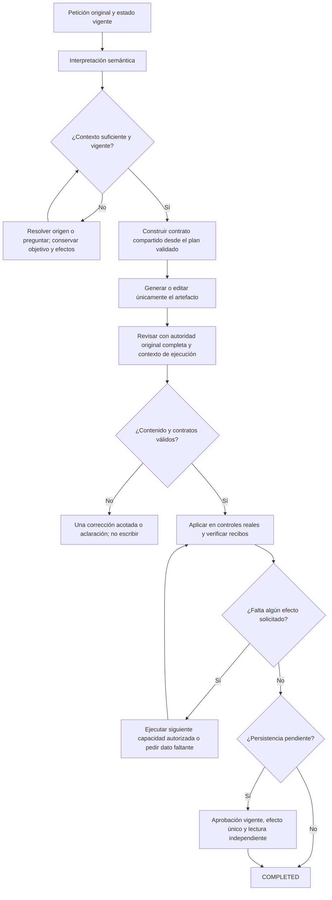

# Núcleo del agente — revisión y solución compartida

2026-10-19, America/La_Paz. **Versión no cerrada.** Revisión solicitada por el usuario: concentrarse en el agente y sus fallos existentes, sin ampliar funciones ni abrir otra auditoría general del producto. Los 88 requisitos de la matriz no se reducen. Los éxitos de UI/dominio no acreditan comprensión semántica general.

## Arquitectura real y viabilidad

| Responsabilidad | Implementación existente | Estado observado |
| --- | --- | --- |
| Entrada libre y acciones rápidas | `LiveEndpoints`, `LiveStartInput`, `LiveCommand`, `NovaAssist` | PRESENTE; llegan al mismo runtime, pero construyen contratos distintos |
| Interpretación y contexto | `SemanticInference`, `SemanticPlanning`, `SemanticContext`, `AgentSessions` | PRESENTE; múltiples inferencias y refinamiento al cargar el origen |
| Objetivo/compilación de efectos | `SemanticInterpretation`, `SemanticPlanCompiler`, `TaskGoal` | PRESENTE; `TaskGoal` es opcional y su intérprete experimental está desactivado |
| Generación/adaptación | `PreparationInference`, `OllamaClient` | PRESENTE; el writer recibe instrucciones distintas según exista `TaskGoal` |
| Revisión de contenido | `DraftFidelity`, rangos de autoría, compilador | PRESENTE, INSUFICIENTE; selección del generador puede recortar la autoridad del revisor |
| Herramientas y ejecución | `UiToolCatalog`, `AgentOrchestrator.Visible`, `SameTabUiDispatcher`, `AgentUiDriver` | PRESENTE; controles nativos y recibos comprobables |
| Autoridad, revisión y persistencia | `LiveRuns`, `LiveApproval`, `LiveDeletion`, `PromptLibrary`, SQLite | PRESENTE; escrituras con aprobación/revisión, resultados verificables |
| Observabilidad/evaluación | SSE, métricas, evaluador, Edge y fixtures sintéticos | PRESENTE; separar calidad semántica, contrato, UI y persistencia |
| Más modelos, nube, vectores o un framework agentic nuevo | Ninguno requerido por las causas observadas | INNECESARIO para corregir estas fronteras |

La base de dominio, herramientas y UI es reutilizable. La viabilidad del agente completo **todavía no está probada con Qwen3 8B y los umbrales actuales**. No basta con elegir un framework distinto o llamar «agente» a otra cadena de inferencias. La intervención necesaria es consolidar responsabilidades y demostrar que el modelo puede cumplir el contrato compartido; si no supera sus contrastes, no se incorporará ese candidato.

## Causas agrupadas, no una solución por petición

### A. El contexto de ejecución depende de un perfil opcional

`Program.cs` conserva `TaskGoals=false` y `TaskResultContract=false`, porque sus campañas anteriores no cualificaron. Las acciones rápidas, en cambio, sí construyen `TaskGoal` mediante código. En `PreparationInference.cs`, la existencia de ese objeto decide si se usa el sistema de editor de instrucciones futuras o el sistema genérico que vuelve a escoger entre reutilizar/adaptar/crear. También decide si se transmiten los efectos de aplicación al editor.

**Hecho:** las dos rutas ya tienen `SemanticInterpretation` validada. El generador no necesita volver a decidir esas operaciones. La presencia de un experimento de interpretación no debería determinar si un componente conoce su tarea o los actores de la sesión.

**Síntomas relacionados:** cuerpo que describe crear/adaptar el prompt; aprobación de guardado introducida como tarea futura; nuevas entradas inventadas para una orden de edición; correcciones que no conservan el mismo significado. La traza `latency-1792428725596` conserva una copia cuyo cuerpo dice que el futuro lector debe adaptar el prompt y pedir aprobación; se rechazó sin escribir. La relación causal general del nuevo contrato debe demostrarse, no asumirse por ver esta rama de código.

### B. Afirmaciones del generador se convierten en autoridad

`TaskGoal.ContentRequest` selecciona citas. `ReviewDraftFidelity` sustituía la petición original por `bodyRequestClauses` cuando había selección de rangos. La selección es una afirmación del generador; no demuestra que sus fragmentos omitidos sean irrelevantes.

**Hecho reproducido:** el revisor anterior aceptó dos omisiones en cuerpos controlados: una restricción factual y una aprobación futura. Una cita correcta del requisito omitido podía considerarse inválida porque no estaba en el subconjunto seleccionado. Evidencia en `AUTHORING_AUTHORITY_DIAGNOSTIC.md` y sus TRX/contrastes.

**Corrección necesaria:** conservar la petición original íntegra como autoridad en generación y revisión. El cambio interpretado y las particiones sirven para orientar o comprobar estructura, nunca para eliminar requisitos del usuario. Los cuatro ensayos de paquetes/cobertura y el predicado único anteriores fallaron; no se presentan como soluciones. El candidato nuevo cambia el contrato de ejecución compartido, además de restaurar la autoridad; se cualifica como conjunto y no sólo porque compile.

### C. Validaciones y acciones ocurren fuera de su estado correcto

Dos causas ya reproducidas: extracción/grounding de cláusulas antes de disponer del origen que permite clasificarlas, y clic programático sin transferir foco al control real antes del layout del dock. No son problemas de una frase particular.

**Conservado:** `CONTENT_CONSTRAINTS_REQUIRE_SOURCE` fuerza carga/refinamiento y revisión fresca antes de editar; un refinamiento insuficiente no permite efectos. El clic da foco al control antes de desplazamiento/progreso/espera, manteniendo cancelación y visibilidad.

**Evidencia acotada:** backend 522/522, React 103/103; actualización/guardado real `latency-1792428556555` completó y persistió tras reiniciar. Rechazo `latency-1792428950706` terminó CANCELLED y la biblioteca se mantuvo tras reiniciar. No se convierten en aceptación de creación ni copia, que sigue fallando.

### D. Coste y recuperación se acumulan sobre las mismas decisiones

La actualización correcta necesitó 19 llamadas y unos 143 s; la copia fallida, 19 llamadas y unos 140 s. Son observaciones dirigidas, no p95. Reinterpretar una tarea y reparar contratos puede volver a introducir discrepancias aunque las partes anteriores fueran correctas.

**Conservado:** reparación de campos local al contrato, expulsión de respuestas semánticamente rechazadas de caché y snapshot de workflow durante refinamiento. **Pendiente:** reducir decisiones semánticas duplicadas con una especificación estable; no eliminar verificaciones ni declarar éxito parcial para reducir tiempo. Los perfiles que ya fallaron permanecen desactivados.

## Contrato compartido propuesto y candidato rechazado

No se habilita el intérprete experimental. Se parte de la `SemanticInterpretation` existente, una vez validada, y se transmite el mismo contexto de autoría a generación, edición y revisión:

| Campo | Dueño y autoridad |
| --- | --- |
| Petición original completa | Turno literal del usuario / tarea pendiente autorizada; no resumen ni selección del generador |
| Origen y revisión | Dominio y lectura real; borrador temporal conserva su identidad distinta de un ID guardado |
| Cambio interpretado | Orientación revisable; subordinada a la petición original |
| Operación del artefacto | Plan validado: crear, revisar o reutilizar una instrucción |
| Workflow de aplicación | Acciones del plan con su propósito: abrir, completar campos, preparar destino, ejecutar después, revisar/guardar, eliminar |
| Actor y fase | Este paso prepara un artefacto para quien lo utilice; no ejecuta la tarea futura ni puede guardar |
| Evaluación y resultado | El modelo propone un juicio; código valida evidencia, cuerpo exacto, revisiones y recibos |

El contexto no es una herramienta, no concede permisos y no admite ejecución arbitraria. No se incorporan keywords/regex de intención, ejemplos de frases del fallo, servicios, nuevas dependencias ni modelos.



```text
conservar petición literal, referencias, revisiones, valores y efectos pedidos
interpretar semánticamente; no autorizar por palabras o parecido de títulos
si falta contexto: leer el origen o formular una pregunta concreta sin perder tarea
validar el plan contra dominio y estado actual
construir un único contexto de autoría, independiente del perfil de interpretación
enviar el mismo contexto a writer/editor/revisor; conservar autoridad original
rechazar selecciones o citas inválidas; no usar una selección como petición nueva
si falla contenido: corregir dentro del límite existente o detener sin efectos
aplicar en la UI y exigir igualdad entre propuesta, formulario, preview y hash
completar sólo efectos autorizados y solicitados
guardar/eliminar únicamente con aprobación vigente y comprobación independiente
si cualquier postcondición falta: comunicar tarea incompleta, nunca COMPLETED
```

## Qué se conserva y qué se sustituye

**Conservar:** compilador de variables, identidad/revisión, confirmaciones, hash de propuesta, lectura fresca, recibos nativos, cancelación, clasificación de coincidencias cero/una/varias y reparaciones acotadas. Son invariantes o correcciones de estado; retirarlas reintroduce errores demostrados.

**Sustituir tras cualificar el candidato:** instrucciones genéricas que hacen al writer redecidir la operación; omisión del workflow en peticiones libres; selección del generador presentada como autoridad íntegra. El DTO de contexto evita mantener correcciones por cada formulación o botón.

**Pendiente en el mismo núcleo:** recibo de evaluación ligado al cuerpo/origen/revisión que no dependa de `TaskGoal`; validación de finalización y persistencia que tampoco use la presencia de un perfil experimental como sustituto de hechos. La auditoría observa esas ramas, pero no autoriza borrar sus controles sin una sustitución ejecutada y probada.

## Criterios de incorporación y cierre

1. Congelar y conservar el candidato anterior, hashes y corpus. Un candidato fallido se restaura sin retirar las correcciones de estado verificadas.
2. Componente de revisión: los seis contrastes existentes deben coincidir, incluidos cuerpos correctos, omisiones y contaminación; una salida inválida es inconcluyente, nunca un rechazo semántico correcto.
3. Si supera desarrollo, ejecutar los doce contrastes independientes previamente congelados; no retocar el holdout ni las expectativas para conseguir PASS.
4. Contratos de transporte y regresión: ambas entradas reciben el mismo contexto; las citas omitidas siguen siendo autoridad; el juicio no concede efectos y un cuerpo cambiado invalida la evaluación.
5. Generación y UI real: creación desde cero, copia desde origen, actualización, campos, varios turnos, navegación, ejecución pedida, aprobación, rechazo y reinicio en el mismo candidato; conservar todos los fallos.
6. Completar los umbrales originales y criterios de la matriz antes de cerrar la versión. Una biblioteca funcional, 522 pruebas de código o un caso de guardado correcto no prueban fiabilidad del agente.

## Resultado del candidato y consecuencias

**RECHAZADO:** [seis contrastes reales](../evidence/agent-contract-core-20261019/review-development.json), **1/6 juicios correctos válidos y cinco revisiones inconcluyentes**. Varias devolvieron el título propuesto como si se hubiera solicitado literalmente, incluso tras la reparación. La primera decisión también aceptó la omisión factual; el resultado final inválido de esa fila no se cuenta como rechazo correcto. El único rechazo válido y coincidente fue la omisión de aprobación futura. No se ejecutaron los doce casos de validación ni generación/UI con este candidato.

La prueba confirma que **uniformar el contexto no basta**. Corregir la autoridad es necesario, pero la revisión global sigue confundiendo metadatos, controles de sesión y contenido futuro. No se sustituye un fallo de fidelidad por un bloqueo universal, ni se cambian los contrastes. El siguiente diseño debe separar la validación de metadatos literales, la especificación de la tarea futura y las postcondiciones de aplicación; demostrar sus relaciones sin depender de varias etiquetas correlacionadas emitidas por el mismo juicio. Antes de integrar otra arquitectura debe probar esa capacidad con las expectativas congeladas. No repetir este paquete, las coberturas o el predicado anterior variando sólo su redacción.

Se archivó el prototipo en `.playwright/agent-contract-core-20261019/rejected-v1/` y se restauraron exactamente los tres archivos de producto modificados; se retiraron los dos DTO/factory nuevos del proyecto activo. [Decisión y hashes](../evidence/agent-contract-core-20261019/decision.json). No se habilitó `TaskGoals`, `TaskResultContract` ni otro perfil. El contexto compartido de este documento permanece **DISEÑO NO CUALIFICADO**, no solución implementada.

Tras restaurar: **522/522 backend PASS**, cero omitidas, [TRX](../evidence/agent-contract-core-20261019/tests/backend-restored.trx). Se conservaron la espera al origen, su revisión fresca y el foco nativo verificados. Las 103 pruebas React y los recorridos de versión/rechazo pertenecen a ese frontend sin cambios posteriores. Matriz **21 cerrados/67 abiertos**.

Artefactos: `docs/evidence/agent-contract-core-20261019/`. No se modificó el servidor previo de 5190, no se usaron datos privados, no se descargaron modelos y no se hizo commit/push. No se declara completada la solución del agente ni la versión.
