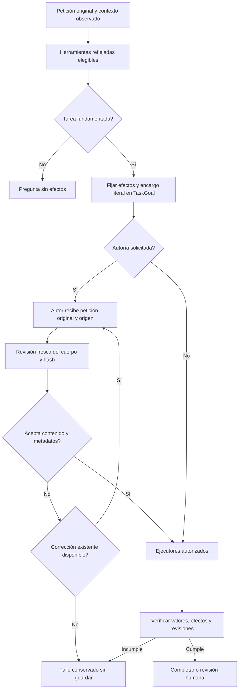

# Sustitución del núcleo de interpretación — 2026-10-20

Estado: CANDIDATO RECHAZADO, AISLADO EN EVALUACIÓN. No sustituye el núcleo productivo ni cambia los 88 criterios de cierre.

Actualización posterior: la separación de guías/contextos por responsabilidad se
probó en el flujo Prepare con los mismos tres encargos; uno devuelve contenido
aceptable para ese encargo y dos siguen fallando. Tampoco se promueve. Los resultados
del experimento de encargo literal descritos más abajo se conservan como su propio
checkpoint, sin reinterpretarlos. Ver [contexto por rol](ROLE_CONTEXT_REFACTOR_20261020.md)
y [puertos de consulta/colecciones](COLLECTION_PORTS_20261020.md).

## Diagnóstico y decisión actual

La composición productiva sigue usando `PreparationInference` como intérprete,
autor y selector. No se retiró porque el sustituto no superó la evaluación real.
La separación modular permite cambiar esa implementación sin reemplazar CRUD,
memoria, autorización, persistencia ni ejecución visible; no demuestra por sí sola
que el modelo entienda las peticiones.

El fallo compartido observado es la pérdida de destinatario: el modelo transfiere
controles de la edición actual al prompt futuro, vuelve a pedir autoría dentro del
artefacto o exige metadatos dentro del cuerpo. El mismo modelo también acepta
algunos de esos errores durante su revisión. JSON válido y métodos reflejados
protegen forma y permisos, pero no prueban fidelidad del contenido.

La variante de encargo literal conservó el encargo original completo en vez de un resumen de
contenido del planificador. Separó además la revisión del cuerpo de los valores
privados de título/descripción. Sus tres recorridos no cumplen aceptación: un
timeout, una aceptación incorrecta y un rechazo incorrecto con contaminación.
No se promueve, no se añade fallback y no se repite la misma hipótesis.

## Propietarios y contratos implementados

| Capacidad | Propietario / entrada | Salida y límites |
|---|---|---|
| Interpretación del candidato | `ReflectedSemanticAgent`, petición original y `SemanticContext` | Acciones actuales con citas, referencias y datos de campos reales; no interpreta requisitos de contenido |
| Autoridad de tarea | `TaskGoal` | Modo interno `WORK_ORDER` conserva exactamente toda la petición; no admite un brief `CONTENT` mezclado ni concede aprobación |
| Contexto y fuentes | `AgentSessions`, `NovaTaskPlanner`, `TaskSourceResolver` | ID/revisión observados, lectura vigente y aislamiento de sesión; retirada la caché paralela del candidato |
| Autoría | `ReflectedSemanticAgent.Generate` | Título, descripción opcional y cuerpo; sin argumento de asignación de valores; identidad y efectos quedan en el workflow |
| Revisión del candidato | Mismo propietario de contenido, conversación fresca | Cuerpo exacto y hash contra petición/origen; citas de contaminación y defectos fundamentados; metadatos literales comparados por código |
| Metadatos | Propiedades de `InstructionDraft` marcadas con atributo | Reflection construye la lista permitida; no se ejecutan miembros CLR elegidos por el modelo |
| Datos y efectos | Extractor, resolver y ejecutores existentes | Campos reales, valores con evidencia, permisos, revisión humana y recibos conservados |
| Inferencia | `IAgentModelTransport`, adaptador `PreparationInference` | Transporte local, cancelación y diagnóstico; sin autoridad para aprobar/escribir |
| Composición productiva | `ApplicationModules` | Continúa usando el núcleo anterior; `Evaluation/Experiments` no es alcanzable desde el grafo productivo |

Una fase con una operación elegible exige en `format` el esquema generado por el
SDK desde el método C#. Varias operaciones usan llamadas nativas sobre el catálogo
permitido. Ambas pasan por el mismo registro, deserializador y control de permisos.
Se distinguen selección de fase y selección del modelo; no se fabrican llamadas.
Máximo tres consultas por fase; autoría y revisión comparten esas tres y un límite
de 90 segundos. El orquestador conserva su única corrección ya existente y el
presupuesto total; no se incrementaron para lograr un resultado verde.

La interfaz HTTP y el esquema SQLite no cambian. No hay paquetes, modelos, nube,
descargas ni reinicio de servicios personales añadidos en este incremento.

## Flujo y algoritmo actuales



```text
restaurar petición, sesión y referencias con sus revisiones reales
ofrecer sólo capacidades autorizadas de la fase
validar acciones y evidencia; fijar TaskGoal con el encargo literal completo
si hay autoría:
    recibir sólo título, descripción y cuerpo desde la petición original/origen
    revisar cuerpo/hash en una conversación fresca sin valores de metadatos
    comparar bindings literales sólo con propiedades autorizadas por atributo
    ante rechazo, consumir como máximo la única corrección del orquestador
    ante timeout/cancelación/límite, conservar fallo y originales
compilar y ejecutar mediante propietarios existentes
verificar efectos observados; ninguna salida del modelo aprueba escrituras
```

El nodo de revisión es una propuesta probabilística validada estructuralmente,
no una prueba independiente de significado. Su falsa aceptación se conserva como
fallo aunque el código devuelva un borrador.

## Experimentos conservados

Mismos tres casos sintéticos de creación, sin editar peticiones ni oráculos:

| Evidencia | Resultado y causa observada |
|---|---|
| `content-v1.json` | Tres fallos; autoría todavía ofrecía valores y el modelo los usó para requisitos |
| `content-v2.json` | Tres fallos; retirada esa propiedad, contratos redundantes de acción/evidencia y argumentos de revisión incompatibles |
| `content-canonical-actions.json` | Una propuesta compiló y dos fallaron; no acredita fidelidad |
| `content-phase-bound-schema.json` | Dos propuestas compilaron, pero una transfirió «No resumas…ahora» al cuerpo; workflow había parafraseado controles actuales como contenido |
| `content-owner.json` | Primera variante de encargo literal: rechazos de revisión y aceptación de un cuerpo contaminado |
| `content-owner-v2-preparation.json` | Segunda y última variante de esa hipótesis; flujo `AgentOrchestrator.Prepare` real con corrección existente. Ninguno de los tres cumple aceptación independiente |

La evaluación antigua de componente llamaba una vez al generador. La última usa
el orquestador real para incluir su corrección; ambas evidencias retienen su alcance
original. Ninguna es prueba de UI ni de guardado aprobado.

Últimos casos:

- Reunión: 128093 ms, rechazo de la primera propuesta y timeout posterior;
  el texto pedía redactar otro prompt y repetía instrucciones del protocolo.
- Aprobación futura: 62069 ms, borrador devuelto, pero pierde `<mensaje>` y transfiere
  «No envíes nada en esta conversación» al cuerpo. Su revisión devuelve aceptación:
  es un falso positivo y no se cuenta como PASS.
- Título literal: 94885 ms, primero exige el título dentro del cuerpo; la corrección
  copia la petición completa y luego la revisión toma las comillas del literal como
  parte del valor. Rechazo, contenido contaminado y ausencia de borrador final.

Fuentes y binarios quedaron congelados antes de cada ejecución. La revisión
independiente de esta tanda queda en `content-owner-v2-review.json`, junto al JSON
original, sin alterar sus resultados técnicos. No se ejecuta UI de un candidato
que ya falla estos criterios previos.

## Verificación y siguiente frontera

En el checkpoint de este experimento pasaron 779 pruebas de backend, incluidas las invariantes de `TaskGoal`, contrato,
aislamiento y permisos. No acreditan fidelidad de inferencia. La matriz de frontend
y los recorridos CRUD se informan aparte en `MODULAR_REFACTOR_ACCEPTANCE_20261020.md`.

La siguiente sustitución necesita demostrar la separación entre petición actual,
instrucción futura y metadatos con los fallos conservados, sin hacer del veredicto
del mismo modelo la única aceptación. No corresponde añadir otra comparación por
frases, retirar el verificador para producir éxito, ampliar presupuestos ni borrar
el núcleo activo hasta disponer de reemplazo probado. El objetivo sigue abierto.

La API de Ollama documenta `format` para exigir esquemas JSON y herramientas para
operaciones ofrecidas; esas garantías no prueban significado.
[Structured outputs](https://docs.ollama.com/capabilities/structured-outputs),
[tool calling](https://docs.ollama.com/capabilities/tool-calling).
