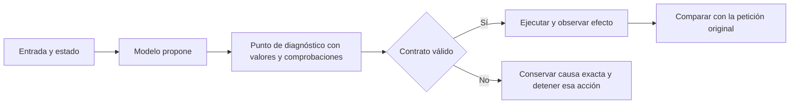

# Diagnóstico del flujo de NOVA

Instrumentación del 20 de octubre de 2026. No modifica la autorización, selección
semántica, reintentos, modelos ni configuración productiva. La versión permanece
abierta según la matriz de cierre. El candidato de release anterior conserva sus
resultados; el nuevo código instrumentado necesita su propia validación.

## Propietario y contrato

Se extiende `NovaTelemetry.Activities`, propietario existente de trazas y
correlación por ejecución. `SemanticDiagnostic` conserva su responsabilidad sobre
contratos sintéticos. Frente a un logger adicional o un nuevo servicio de
diagnóstico, un `ActivityListener` estándar reutiliza el propietario y permite
desconectar la captura sin sustituir ninguna capacidad del agente.

- Entrada: frontera del flujo, resultado de su validación y fábrica diferida de
  metadatos explícitos; identificador de ejecución desde el contexto existente.
- Salida: `NovaDebugPoint`, con frontera, rechazo, archivo/método/línea y valores
  técnicos. Sólo operaciones, índices, conteos, identidades, revisiones, estados y
  hash del borrador. No cuerpos, valores de campos, secretos ni razonamiento.
- Invariantes: ningún punto autoriza acciones ni cambia los resultados. No añade
  llamadas al modelo, operaciones a las métricas ni escrituras de dominio.
- Ciclo de vida: listener descartable, hasta 256 puntos por captura, límite
  configurable entre 1 y 4096, contador de descartados. Los errores del consumidor
  de diagnóstico no interrumpen la ejecución de dominio y se cuentan en
  `ObserverErrors`.
- Desactivación: llamadas compiladas fuera de Release; en Debug sin listener ni
  depurador no se evalúan los valores. La captura de consola exige habilitación
  explícita y base QA dentro de `.playwright`. Release rechaza esa habilitación.
- Cancelación y errores: no cambia los presupuestos/reintentos existentes. El
  consumidor debe descartar el listener al terminar incluso por error.



```text
en cada frontera ya existente:
    calcular validación con las reglas del propietario actual
    en DEBUG con listener o depurador:
        obtener metadatos explícitos y correlación de ejecución
        si rechazo y depurador adjunto y pausa diagnóstica habilitada:
            detener en breakpoint para inspeccionar la pila y variables locales
        publicar Activity de diagnóstico
    continuar con el resultado original de la validación
al terminar captura: cerrar listener, conservar puntos y número descartado
```

## Puntos disponibles

| Frontera | Valores inspeccionables | Propietario |
|---|---|---|
| `reference.role` | roles ofrecidos/elegido, identidad/revisión, borrador temporal, candidatos | `ResolveReference` |
| `instruction.scope.evidence` | operaciones, índices disponibles/citados, entradas inválidas y duplicados | `ReviewAuthoringScope` |
| `model.http.response` | propósito, código HTTP y éxito | `PreparationInference.Chat` |
| `fidelity.review` | veredicto, incidencias, citas de workflow, intento y hash | `DraftFidelity` |
| `ui.tool.context` | herramienta, modo, identidad visible/pedida, borrador y objetivo | `AgentOrchestrator` |
| `ui.target.validation` | destino nulo, coincidencia visible, elegibilidad del temporal | `UiToolCatalog` |

## Depurador del IDE

Seleccionar **NOVA: depurar agente en base sintética** en Run and Debug y pulsar
F5. Usa las dependencias ya instaladas, genera Debug y web en `.playwright`, abre
`http://127.0.0.1:5260` y conserva una base sintética separada. No copiar allí la
base privada. Usa Qwen local ya instalado; no descarga modelos ni paquetes.

Con el depurador adjunto, `NOVA_DEBUG_BREAK_ON_FAILURE=1` detiene la ejecución
en `NovaTelemetry.DebugPoint` cuando la frontera informa rechazo. Inspeccionar
`values` y subir un frame en Call Stack para ver el contrato completo, `context`,
`selected`, `state` o `control` del propietario. Un breakpoint de función en
`NovaTelemetry.DebugPoint` permite inspeccionar también decisiones aceptadas.
Continuar con F5; quitar la variable evita pausas automáticas.

Estos breakpoints son de desarrollo; no equivalen a la pausa manual del agente.
Las trazas automáticas no implican que un depurador IDE estuviera adjunto.

## Reproducción automatizada

En evaluación sintética: `NOVA_EVAL_DEBUG_POINTS=1` añade los puntos al reporte.
En `Tests/nova/agent-deletion.cjs`: `NOVA_QA_DEBUG_POINTS=1` los añade a
`results.json`. En `Tests/nova/latency.cjs`: `NOVA_SYNTHETIC_DEBUG_POINTS=1` exige
`NOVA_PERF_FIXTURE` y guarda `debug-points.json` al terminar. Usar un build Debug
actual mediante `NOVA_TEST_BUILD` y conservar modelo, escenarios y opciones.

La consola de QA serializa sólo metadatos y puede alterar tiempos. Las mediciones
con esta captura habilitada sirven para diagnóstico, **no para certificar
latencia**. No se escribe un archivo por acción en el proceso del agente.
El coste normal apagado y la ausencia de contenido se verifican por pruebas;
un benchmark comparativo de overhead no está ejecutado.

Rollback: deshabilitar las variables/flag y cerrar listener; no hay migraciones
ni cambios en APIs o datos persistentes.

## Evidencia ejecutada y diagnóstico

Build instrumentado final: `.playwright/debug-points-20261020-a6`. El
[manifiesto](../evidence/debug-points-20261020-a6/manifest.json) registra fuentes,
ensamblados iguales entre API/evaluador, modelo, perfiles y límites. No cambia
la composición semántica productiva ni convierte las pruebas históricas del
candidato anterior en pruebas del nuevo build.

| Comprobación | Resultado real |
|---|---|
| Tests relevantes de telemetría, alcance, referencias y UI | 37 PASS, 0 fallos, 0 omitidas; `boundary-tests.trx` |
| API en proceso frío, captura apagada y ruta ajena a QA | 3 PASS; `debug-startup-1792489881827/results.json` |
| Build Release y rechazo del flag antes de crear base | PASS; `release-guard.json` |
| Builds Debug API/evaluador y tareas API/web del perfil F5 | PASS; Vite conserva aviso de chunk grande |
| Dos referencias fallidas originales, Qwen real | 2 FAIL reproducidos, sin puntos descartados; `reference.json` |
| Seis escenarios originales de eliminación en UI | 5 PASS / 1 FAIL; 54 puntos observados |
| Crear y continuar borrador temporal en UI | FAIL en continuación; creación previa alcanza COMPLETED; 27 puntos en la tanda de dos escenarios |
| Error transitorio original en UI | FAIL; 503 y parada tras 1 llamada |
| Breakpoints con depurador IDE adjunto | NOT_TESTED; perfil F5 preparado y compilado, sin afirmar una sesión IDE ejecutada |

Las rutas completas están en el manifiesto. La captura de pantalla de la
continuación fallida se inspeccionó: el formulario conserva el contenido creado;
no recibe la adaptación solicitada. No se revisaron visualmente todas las
capturas de esta tanda.

### Primeras divergencias observadas

1. **Origen:** en desarrollo 05 y 14 el modelo selecciona
   `NAMED_LIBRARY_SOURCE` con `CURRENT_UI_INSTRUCTION` ofrecido y el ID/revisión
   actual presentes. No llega al módulo de autoría. La reparación pertenece a
   resolución de referencias/contexto, no al escritor de campos.
2. **Consulta explicativa:** ambos intentos emiten `EXPLAIN` dos veces con índices
   `[0,1]`, ambos válidos; `invalidEntryIndices=[]`,
   `duplicatedOperations=[EXPLAIN]`. La guardia rechaza duplicación de capacidades.
   El mensaje genérico de evidencia ocultaba este predicado. El flujo conserva el
   registro y no ofrece/aplica borrado. El siguiente incremento debe resolver en
   el propietario actual cómo representar una capacidad con varias evidencias,
   conservar todas las citas y validar su autoridad. No relajar la validación de
   pasajes ni interpretar palabras de la petición en código.
3. **Temporal:** antes de `ui_load_active_draft`, el orquestador tiene
   `hasWorkingDraft=true` y un ID temporal real. La validación recibe
   `argumentIsNull=true`, `creates=false`, `hasWorkingTarget=false`,
   `restoresTemporary=false`, `unsavedAccepted=false`. El perfil tiene
   `TaskGoals=false`. La reparación debe transmitir la referencia temporal del
   propietario de sesión al límite de validación, con revisión/vigencia y
   pertenencia verificadas; no aceptar cualquier ID nulo ni activar otro planificador.
4. **Transporte:** `ResolveReference` recibe 503; el flujo termina
   `MODEL_UNAVAILABLE` tras una llamada. La recuperación acotada pertenece al
   adaptador de transporte para lecturas/inferencia, conservando cancelación y
   presupuesto. No reintentar escrituras ni duplicar efectos.

`Rejected` es el resultado del predicado local observado, no un oráculo de
corrección semántica. Una referencia puede tener JSON válido y ser equivocada;
un revisor puede declarar ACCEPT y omitir contaminación. Las comparaciones con
la petición y los efectos finales siguen siendo necesarias. Los tags nulos se
omiten en Activity; los booleanos explícitos distinguen ausencia/inelegibilidad.
Los valores completos permanecen inspeccionables en las variables del IDE.

### Capturas rechazadas

Las campañas `1792489548409` y `1792489750868` conservaron el fallo de eliminación
pero no capturaron puntos en la API. No sirven para atribuir un predicado. La
prueba del proceso frío mostró `listeners=False`: registrar el listener antes
del primer acceso a la fuente estática hacía comparar contra un campo aún no
asignado durante su constructor. La corrección pasa la fuente ya inicializada
al constructor del capturador. También se prueban ambos formatos de identidad de
Activity; eso protege compatibilidad, pero no fue la causa final del arranque
vacío. La prueba de arranque independiente evita que el calentamiento de otros
tests esconda esta regresión.

No se aplicó todavía una reparación semántica ni se cerró ningún requisito por
añadir diagnósticos. La matriz sigue en **30 CERRADO / 58 abiertos**. Los fallos de
fidelidad anteriores siguen conservados y requieren su corrección y validación.
