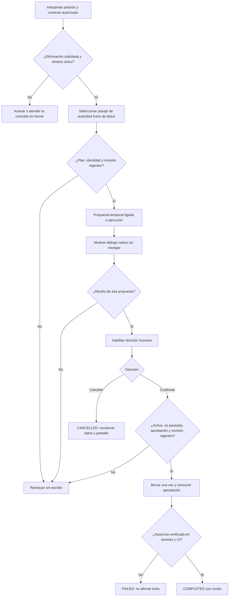

# SAV-04 — Eliminación revisada en la misma pestaña

2026-10-19. **SAV-04 cerrado en su alcance funcional:** seis recorridos semánticos/UI y cuatro controles de ciclo de vida pasan en el mismo candidato. La versión sigue abierta; fidelidad de autoría, fiabilidad general y rendimiento siguen pendientes. Datos de prueba exclusivamente sintéticos; Qwen3 8B existente, sin descargas, nube ni cambios de modelo/configuración del servicio 5190.

## Diagnóstico y contrato

Existía eliminación manual con confirmación, pero no una operación semántica de eliminación ni un ciclo de aprobación del agente para ella. Se añade `REQUEST_DELETE` y el objetivo de workflow `REVIEW_DELETE_EXISTING`. El modelo solicita una revisión; nunca recibe una herramienta para confirmar o ejecutar el borrado.

La propuesta temporal contiene ejecución, ID de aprobación, hash, prompt, título y revisión. El diálogo nativo consulta la propuesta y el registro vigente antes de mostrarlos. El recibo de esa misma pestaña vincula ejecución/ID/revisión; sólo después se habilita la confirmación humana. `POST /api/v1/nova/live/{id}/deletion` aplica la decisión con las protecciones locales existentes. No hay cambio de esquema SQLite.



```text
interpretar la operación y resolver el origen con los mecanismos existentes
si la petición requiere aclaración: preguntar sin preparar una eliminación
si solicita eliminación:
    exigir revisión confirmable y un único origen guardado vigente
    exigir pasaje de autoridad de la petición fuera de títulos y datos de campos
    rechazar combinación con generación, edición, llenado, ejecución o guardado
    conservar borradores sin guardar: impedir descartarlos para este flujo
    construir propuesta temporal ligada a ejecución, identidad y revisión
    presentar diálogo nativo; cancelar no abre el detalle ni modifica registros
    validar recibo de presentación antes de habilitar Confirmar
    esperar decisión humana bajo el plazo finito de la ejecución existente
    al cancelar/abortar: invalidar decisión pendiente y no escribir
    al confirmar: validar hash/ID/revisión, estado activo, pausa y cancelación
    borrar con revisión optimista; consumir la aprobación una sola vez
    comprobar ausencia real en SQLite y controles visibles
    limpiar contexto del registro eliminado y declarar éxito sólo tras verificar
```

Invariantes: una cita no concede confirmación; datos del prompt no conceden operaciones; abrir sólo ocurre cuando se solicitó explícitamente; una versión cambiada no se elimina usando aprobación anterior; cancelar no navega; repetir confirmación no repite el efecto. El dominio comprueba también el plazo monotónico de ocho minutos: una transición tardía del coordinador no permite confirmar después de vencer. `PreserveOriginal` continúa protegiendo sobrescrituras de contenido: la eliminación tiene su operación y autorización propias. Las rutas de preparación sin control visual rechazan esta operación.

## Trazabilidad

| Frontera | Implementación | Verificación |
|---|---|---|
| Intención y autoridad | `SemanticDecision`, `SemanticStages`, `SemanticInference`, `SemanticPlanCompiler`, `SemanticPlanValidator` | Transporte real del adaptador con respuestas HTTP sintéticas; campaña Qwen real separada |
| Aprobación y escritura | `LiveDeletion`, `LiveRuns`, `PromptLibrary.Delete` | SQLite real: revisiones, cancelación, pausa, timeout, repetición y concurrencia |
| Observación de pestaña | `SameTabUiDispatcher`, `AgentUiDriver` | Identidad de diálogo ligada a ejecución/prompt/revisión; recibos nativos |
| Decisión humana | Diálogo existente en `App.tsx`; endpoint `LiveEndpoints` | Cancelar/Cerrar/Escape, habilitación y endpoint revisado en React; Edge real pendiente de cualificación |
| Resultado | Rama de eliminación en `AgentOrchestrator.Visible`; `GoalCompletionValidator` | No delega confirmación al modelo; sólo completa tras ausencia comprobada |

## Evidencia y fallos conservados

- Backend del candidato previo de eliminación: **486/486 PASS**, cero omitidas, incluido el vencimiento independiente del estado publicado por el coordinador. [TRX](../evidence/agent-deletion-20261019/tests/backend-final-v4.trx).
- Contratos de eliminación: **20/20 PASS** en ejecución dirigida anterior y **21 casos de eliminación PASS** en el backend final, incluido el vencimiento adicional. Cubren transporte del adaptador, aprobación concurrente, orquestación confirmada/cancelada y conservación del contexto tras cancelar. [TRX dirigido](../evidence/agent-deletion-20261019/tests/deletion-contract-v5.trx). Los modelos de esas pruebas son controlados; no miden precisión semántica.
- Seis pruebas React del diálogo/driver: **6/6 PASS** en ejecución dirigida, también incluidas en el 103/103 final. [Resultado dirigido](../evidence/agent-deletion-20261019/tests/react-deletion-native.json).
- Regresión React completa: **103/103 PASS** en el candidato final. Antes hubo **102 PASS / 1 timeout**, **99 PASS / 4 fallos** y fallos aislados. Esperar sólo `library-ready` no bastó; ese intento se rechazó y archivó. La corrección conservada espera la existencia del ítem real antes de comprobar su rol accesible y acota las búsquedas de botones al diálogo; no cambia expectativas ni timeout. El módulo pasa **7/7** y luego la tanda completa pasa **103/103**. [Final](../evidence/agent-deletion-20261019/tests/react-all-final.json), [ítem real](../evidence/agent-deletion-20261019/tests/react-workspace-item.json), [inicial](../evidence/agent-deletion-20261019/tests/react-all-v1.json), [repetición fallida](../evidence/agent-deletion-20261019/tests/react-all-v2.json), [intento de ready rechazado](../evidence/agent-deletion-20261019/tests/react-workspace-ready.json).
- Primer intento Edge no llegó al modelo por una ruta de health incorrecta del nuevo arnés; se corrigió sólo el arnés. [Resultado](../evidence/agent-deletion-20261019/1792419460861/results.json).
- Dos ejecuciones Qwen reales rechazaron antes de escribir una cita de eliminación que abarcaba un título entre comillas. La captura sintética muestra `REVIEW_DELETE_EXISTING` correcto pero una cita incompatible con `DirectEvidence`. [Primer fallo](../evidence/agent-deletion-20261019/1792419505711/results.json), [captura causal](../evidence/agent-deletion-20261019/1792419620378/results.json). No se debilitó la validación: el nuevo contrato selecciona un índice de pasaje construido por código, como los otros contratos fundamentados existentes.
- Qwen/Edge tras corregir la selección de pasajes: **1 PASS / 1 FAIL / 4 NOT_TESTED** en la campaña interrumpida. Revisar y cancelar desde biblioteca pasó sin navegar ni escribir. La segunda formulación terminó en `UNGROUNDED_CASE_APPLICATION`, sin presentar eliminación ni escribir. [Resultado](../evidence/agent-deletion-20261019/1792420348832/results.json). La primera ejecución de ese candidato había llegado a cancelar correctamente pero el arnés falló al archivar el resultado; se conserva [ese intento](../evidence/agent-deletion-20261019/1792420002914/results.json).
- Recorridos manuales Edge del candidato final: **7/7 PASS**, incluidos cancelar/cerrar/Escape en tarjetas y filas, edición, duplicación y borrado confirmado. [Resultado](../evidence/workspace-1792420857772/validation.json). El primer recorrido detectó una carrera del arnés: `library-ready` ya existía antes de terminar DELETE; el registro 204 llegó después de consultar el total. Se corrigió esperando respuesta, cierre y ausencia visible, conservando [el fallo](../evidence/workspace-1792420763528/failure.txt).
- Candidato previo de eliminación: API `.playwright/agent-deletion-20261019/api-v4`, React `.playwright/agent-deletion-20261019/web-v2`. API sin warnings/errores; React compila con aviso de chunk principal de 561 kB. La cualificación Qwen inicial correspondía a API-v3, anterior a la protección monotónica adicional; no equivalía a campaña semántica completa de API-v4.

Reproducir con `node Tests/nova/agent-deletion.cjs`; `NOVA_TEST_BUILD` y `NOVA_TEST_WEBROOT` permiten apuntar a los artefactos revisados. `NOVA_QA_CAPTURE=1` añade un proxy exclusivamente de QA hacia el Ollama local para conservar contenido estructurado del workflow sintético, sin reasoning del modelo. El arnés cierra su Edge y su servidor aislado. No utiliza la base privada ni la instancia 5190.

Actualización de la misma segunda petición: tres candidatos de reparación de fase conservaron **1 PASS / 1 FAIL / 4 NOT_TESTED**. En el último, el error de campos ya se repara sin inventar autoría, pero el refinamiento posterior del origen añade una copia al portapapeles no solicitada; se rechaza con `DELETE_EFFECT_CONFLICT`, antes de escribir. [Resultado actual API semantic-retry-v3/web-v2](../evidence/agent-deletion-20261019/1792422395011/results.json). Backend actual **493/493 PASS**; no se repitió React porque no cambió el frontend. No equivale a cierre de SAV-04.

Actualización posterior: se conservan los objetivos de workflow durante el refinamiento del origen sin omitir la segunda interpretación de contenido/campos. Backend **501/501 PASS**, cero omitidas, [TRX](../evidence/workflow-refinement-20261019/tests/backend-v1.trx). API workflow-refinement-v1 sin warnings/errores; web-v2 conservado. La misma campaña de seis mensajes pasa **6/6 con Qwen real y Edge visible**: [resultado del candidato](../evidence/agent-deletion-20261019/1792422883612/results.json). La segunda petición ya revisa/confirma/elimina con ausencia real verificada y conserva el otro prompt. No se cambiaron expectativas ni corpus; se mantiene toda la evidencia fallida previa.

**Ciclo de vida final: 4/4 PASS**, Qwen local, Edge visible y la misma API/web. [Resultado](../evidence/agent-deletion-20261019/1792423632740/results.json). Se inicia desde el prompt abierto: cambiar el registro tras mostrar revisión impide usar la aprobación obsoleta (409), conserva la nueva versión y Cancelar mantiene el detalle; la pausa por API de control impide confirmar desde el diálogo real (409); la revisión vigente se elimina sólo tras confirmar; después de reiniciar el servidor sobre la misma SQLite, el ID sigue ausente, el otro registro conserva texto/revisión y la aprobación antigua recibe 409. Los hashes de las cuatro DLL y del índice web coinciden entre ambas campañas. [Manifiesto de aceptación acotada](../evidence/workflow-refinement-20261019/validation.json).

Fallos adicionales conservados: el primer intento de ciclo de vida desde biblioteca agotó el plazo de interpretación antes de revisar o escribir ([TIMEOUT](../evidence/agent-deletion-20261019/1792423219902/results.json)); la primera tanda desde detalle pasó tres controles pero el arnés no reconoció la terminación por señal del proceso y no llegó a verificar el reinicio ([fallo del arnés](../evidence/agent-deletion-20261019/1792423395917/results.json)). La corrección espera `exitCode` **o** `signalCode`; la repetición final verifica `SIGTERM` y el reinicio real. No se ampliaron presupuestos ni se cambió producto para esa repetición. El timeout no se borra ni se contabiliza como éxito: sigue abierto en EXE-07/PER; estas tandas no constituyen baseline de latencia ni prueba sostenida de recursos.

`NOVA_QA_LIFECYCLE=1` ejecuta los controles adicionales desde detalle en otra base sintética; sin ese parámetro, los seis mensajes congelados conservan su ejecución original. [Causa, regresiones, reparaciones y fronteras](SEMANTIC_RETRY_DIAGNOSTIC.md). No se cambia el criterio de cierre de la matriz ni se interpreta este cierre como CRUD autónomo completo: SAV-01/02/03 y AUT siguen abiertos. La campaña integral del candidato final permanece en REL-04/05.

## Revalidación tras recuperar selección de origen

Candidato actual de esta mejora: `.playwright/source-selection-20261019/api-v5`, mismo frontend web-v2. Backend **517/517 PASS**. Se repitieron [los seis mensajes](../evidence/agent-deletion-20261019/1792426762145/results.json) y [los cuatro controles de ciclo de vida](../evidence/agent-deletion-20261019/1792427200425/results.json), todos PASS, en DLLs/frontend idénticos a los recorridos dirigidos de selección. [Manifiesto](../evidence/source-selection-20261019/validation-v5.json). SAV-04 conserva su cierre funcional; no cierra creación, contexto o guardado.

Se conserva [la carrera del primer intento](../evidence/agent-deletion-20261019/1792426585462/results.json): el arnés retornaba `AWAITING_APPROVAL` inmediatamente después de pulsar Confirmar, antes de esperar la verificación terminal. La captura muestra el registro eliminado, pero no se contabilizó como PASS. Se corrigió exclusivamente la espera: revisión pendiente se observa sólo cuando el llamador la solicita; después de confirmar se espera el estado terminal original, y los negativos siguen detectando una revisión inesperada. No cambian mensajes, criterios ni timeout de 240 s.
