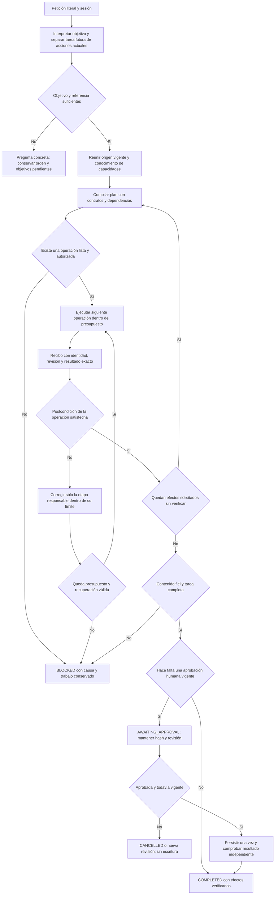

# NOVA — fábrica de tareas con contratos y propósito

2026-10-19, America/La_Paz. Análisis solicitado durante la implementación experimental de conocimiento vectorial. **Diseño del conjunto: PROPUESTO, no implantado ni versión cerrada.** El catálogo con atributos ya existe; el índice nuevo sigue desactivado por defecto. No se añaden requisitos a los 88 de cierre.

## Diagnóstico

El producto que NOVA entrega es una tarea cumplida: una instrucción fiel, campos concretos completos, una navegación correcta o un cambio revisado y persistido. Recuperar una descripción, devolver JSON válido o abrir un formulario son resultados intermedios. No equivalen al producto terminado.

La arquitectura actual tiene servicios, herramientas, estado de sesión, validadores, compilador y recibos. El problema compartido está en la coordinación del significado y sus contratos. Se interpreta por separado referencia, destino, autoría, uso de entradas, controles y guardado; después se compone un plan que puede refinarse al cargar el origen. Writer y revisor vuelven a tomar decisiones, y varias instrucciones dependen de que exista `TaskGoal`, aunque ambas entradas ya poseen `SemanticInterpretation`. La selección de fragmentos del generador puede además sustituir la petición original como autoridad del revisor. Se conservan los fallos reproducidos en `AGENT_CORE_ARCHITECTURE_REVIEW.md`.

Ejemplo de una frontera incorrecta: el esquema de destino admite por separado `action=PREPARE` y `providerId=null`, pero `DestinationGoal.Objective()` rechaza esa combinación. El mensaje existente de completar campos y dejar listo para copiar se bloqueó antes de escribir en builds anterior y posterior a Reflection. El subcontrato puede ser JSON válido y todavía no representar una operación realizable. Cambiar su almacenamiento a vectores no elimina esa contradicción.

El experimento vectorial confirma otra ruptura entre estaciones con la misma petición existente. `ResolveReference` eligió correctamente `CATALOG_ENTRY_1`, cuyo título real es **Proyecto técnico**. Posteriormente, el selector recibió ese registro entre sus candidatos y respondió `NO_MATCH`: comparó el contenido del caso («catálogo de productos con búsqueda») con la tarea futura de la plantilla, en vez de verificar la identidad del origen. La capacidad recuperada en primer lugar fue `COPY_PROMPT`, pero el clasificador de destino propuso `PREPARE/ollama`. La tarea terminó `BLOCKED/NEEDS_CLARIFICATION`, sin completar campos ni escribir, en 60300 ms y ocho llamadas. [Traza sintética](../evidence/latency-1792431141001/measurements.json). Esto no es un éxito de la tarea ni prueba que la recuperación vectorial haya resuelto el núcleo.

Una búsqueda vectorial también mide similitud, en un espacio numérico. Puede mejorar el acceso a conocimiento multilingüe; no decide qué pidió el usuario, cuál era el antecedente, si una negación autoriza algo ni si el prompt producido conserva sus requisitos. Un grafo representa relaciones declaradas; no demuestra por sí mismo que un plan se haya cumplido. Reflection descubre la descripción y el contrato de operaciones implementadas, sin entrenar ni corregir automáticamente el modelo.

## Propósito de cada parte

| Parte | Entrada | Responsabilidad y salida verificable | Implementación / estado |
| --- | --- | --- | --- |
| Recepción de la orden | Petición literal y sesión | Conservar petición, referencias y autoridad; diferenciar orden actual y tarea futura | `LiveStartInput`, `SemanticContext`, `AgentSessions`: PRESENTE; contrato semántico compartido PARCIAL |
| Catálogo de máquinas | Código con atributos y esquemas | Describir capacidades reales, versiones, argumentos y permisos | `UiCapabilities`, `SemanticCapabilityCatalog`, Reflection: PRESENTE y probado |
| Almacén de conocimiento | Catálogo vigente y embeddings locales | Recuperar contexto relevante con versión/procedencia; sin seleccionar ni autorizar efectos | `CapabilityGraph`, `CapabilityVectorStore`, `VectorCapabilityKnowledge`: EXPERIMENTAL, desactivado por defecto |
| Preparación de materiales | Identidades, revisiones y valores autorizados | Leer el origen vigente, entradas reales y borrador; detectar faltantes y obsolescencia | `SemanticPlanning`, `ReadSource`, resolutor de variables: PRESENTE; comprensión contextual PARCIAL |
| Orden y plan de producción | Significado confirmado, materiales y capacidades | Organizar sólo operaciones necesarias con dependencias; conservar objetivos pendientes | `SemanticInterpretation`, `SemanticPlanCompiler`, `WorkflowGoalSnapshot`: PRESENTE; continuidad de significado PARCIAL |
| Producción del artefacto | Requisitos futuros y origen, separados del workflow actual | Crear/adaptar la instrucción solicitada; no copiar órdenes de sesión a su cuerpo | `PreparationInference`, editor local, compilador: PRESENTE; fidelidad FALLA |
| Ejecución | Próxima operación lista, argumentos y autoridad | Interactuar con el control real y emitir observación; cancelar cuando se solicita | Orquestador, dispatcher, `AgentUiDriver`: PRESENTE; escenarios funcionales ya comprobados |
| Control de calidad | Orden original, artefacto exacto y recibos | Comprobar significado y efectos solicitados; diferenciar fallo, falta de evidencia y éxito | Validadores, `DraftFidelity`, pruebas reales: PRESENTE, revisión semántica INSUFICIENTE |
| Entrega | Artefacto válido y revisión humana cuando corresponda | Guardar/ejecutar sólo lo autorizado y verificar la lectura posterior | `LiveApproval`, `LiveDeletion`, `PromptLibrary`: PRESENTE; versión/rechazo probados, copia aún falla antes de guardar |
| Trazabilidad | Estados, errores, hashes y tiempos | Mostrar lo ocurrido sin bloquear ejecución ni declarar éxito incompleto | SSE, telemetría, evidencias: PRESENTE; usar hechos, no narración del modelo |

El plan activa las estaciones necesarias según la orden y el estado. No todas las peticiones deben recorrer una secuencia fija de inferencias. Un registro ya identificado necesita una lectura vigente; no volver a buscarlo por parecido. Una compilación con valores conocidos usa el compilador; no necesita que el LLM reescriba el texto.

## Flujo propuesto



La recuperación opcional de conocimiento no concede autoridad ni excluye automáticamente capacidades que no aparecieron entre los vecinos. Una operación no disponible no se habilita porque su descripción se parezca a la petición. Si cambia la revisión del origen o el usuario corrige la orden, se invalida la parte dependiente del plan y de la aprobación.

## Pseudocódigo y contrato de la orden

Especificación conceptual; reutilizar los tipos y servicios existentes antes de crear otra capa o un nuevo framework:

```text
entrada = petición original, tarea pendiente autorizada, sesión, estado actual
conservar literalmente la petición y su procedencia
interpretar objetivo: contenido futuro, acciones actuales, referencias y restricciones
si falta un dato esencial: formular una pregunta y conservar la orden pendiente
leer fuentes por identidad y revisión; recuperar descripciones de capacidades
validar que cada operación propuesta tenga un contrato realizable y autoridad
compilar dependencias sin añadir objetivos que el usuario no pidió

pendientes = efectos solicitados menos efectos con recibos válidos
repetir dentro del límite de pasos, llamadas y tiempo de la ejecución existente:
    respetar cancelación y pausa explícitas
    elegir una operación pendiente con requisitos y dependencias satisfechos
    revalidar origen, argumentos, permisos y aprobación cuando corresponda
    ejecutar mediante herramientas registradas
    comprobar el resultado exacto y registrar su recibo
    retirar sólo el efecto demostrado de pendientes
    ante fallo: identificar la primera transición incorrecta
    corregir esa etapa dentro de su presupuesto, sin reinterpretar decisiones válidas

comprobar fidelidad contra la petición original íntegra y el origen real
si falta contenido, efecto, dato o evidencia: no declarar COMPLETED
para persistencia: revisión humana del cuerpo exacto, hash, destino y versión
después del efecto: lectura independiente e idempotencia
salida = resultado verificado, revisión pendiente, pregunta concreta o fallo conservado
```

Invariantes:

- La petición íntegra conserva autoridad; una selección o resumen del generador no puede suprimir requisitos.
- Los requisitos del prompt futuro y los controles de la sesión son campos con responsabilidades distintas.
- Un destino ejecutable tiene proveedor real y capacidad compatible. No completar un proveedor ausente por cercanía vectorial.
- Los campos completados corresponden a entradas reales y valores autorizados, con evidencia.
- La descripción de una capacidad, su recuperación y el permiso de ejecutarla son hechos diferentes.
- Un recibo se liga al artefacto, origen/revisión y efecto exactos. Cambiar el cuerpo invalida su revisión/aprobación.
- Sólo se declara finalización después de observar todos los efectos pedidos y ningún efecto adicional.

## Orden de corrección del núcleo

1. Cerrar la frontera entre interpretación y operación realizable: contratos relacionales de argumentos construidos desde capacidades reales, sin combinaciones que el siguiente componente no pueda consumir. Conservar la comprobación de dominio.
2. Estabilizar la orden entre planificación, generación y revisión. La existencia del perfil experimental `TaskGoal` no debe cambiar la tarea del writer. No reactivar los candidatos rechazados: el contexto compartido anterior dio 1/6 juicios válidos y fue retirado.
3. Probar la calidad del artefacto contra autoridad original y fuente completa. El revisor actual aceptó omisiones y confundió metadatos; más contexto o JSON válido no bastan. Mantener los seis contrastes y su validación independiente, sin cambiar expectativas.
4. Consolidar finalización por recibos: campos visibles, contenido generado, formulario, preview y guardado deben corresponder. Reusar el control de revisión/hash y las pruebas de persistencia ya existentes.
5. Optimizar después de comprobar corrección: eliminar decisiones semánticas duplicadas, reutilizar catálogo/vectores por versión y decisiones vigentes dentro de la misma orden. Medir llamadas y tiempo, sin retirar validaciones para aparentar rapidez.

Este orden concentra las causas conocidas de campos omitidos, destino inválido, contaminación de autoría y pérdida de contexto. No crea manejadores por frase, otro modelo ni nuevas funciones de producto. La migración se acepta por tareas reales cumplidas; no por número de nodos, tests o clases.

## Evidencia del conocimiento vectorial y límites actuales

La primera ejecución usa Nomic ya instalado, 40 nodos y 22 relaciones `IMPLEMENTED_BY` derivados del catálogo, sin datos de biblioteca ni peticiones persistidas. [Comparación congelada](../evidence/vector-knowledge-20261019/retrieval.json): Recall@5 de 0,80 en desarrollo y 0,90 en validación; comparador léxico de las mismas descripciones: 0,40 y 0,30. La consulta inicial agotó 25 s y quedaron dos omisiones de recuperación. Resultado global **FAIL**, no se descarta la muestra fría ni se afinan frases contra validación.

Este benchmark mide recuperación de conocimiento, no reconocimiento de intención. En solicitudes negativas se mide si se recuperó la capacidad sobre la que se habla, sin otorgar permiso para usarla. No es comparación con la búsqueda SQL de prompts, que conserva su implementación. El nuevo índice no se activa por defecto ni acredita rapidez del agente.

La integración y sus pruebas se detallan en [VECTOR_KNOWLEDGE.md](VECTOR_KNOWLEDGE.md). Los recorridos de UI y la decisión de incorporación quedan en el manifiesto de esa intervención. El diseño completo de fábrica permanece propuesto. **Versión NO CERRADA; los criterios existentes no cambian.**
