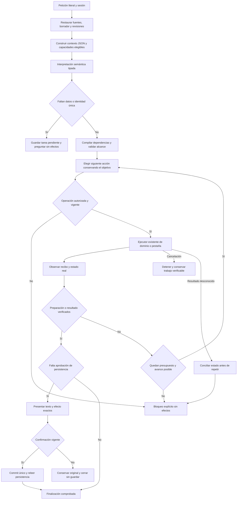

# Cómo cerrar NOVA: petición, contrato, herramientas y resultado

Fecha de referencia: 2026-10-20, America/La_Paz. Autor: Codex.
Modalidad: ANALYZE; sin cambios de código de producto, modelo, permisos ni datos personales.
Este documento complementa la matriz canónica; no sustituye sus 88 requisitos ni modifica sus estados.

## Dictamen

La aplicación tiene capacidades de dominio y una superficie de ejecución aprovechables. El cierre pendiente está en conseguir que el agente preserve el significado de la petición desde su interpretación hasta el contenido y los efectos finales. Reflection y JSON ya existen parcialmente; por sí solos no prueban comprensión.

La matriz leída contiene **32 CERRADO, 33 PARCIAL, 13 FALLA, 7 PENDIENTE y 3 SIN_VERIFICAR**: 56 requisitos obligatorios abiertos. Esto es inventario documental, no porcentaje de funcionalidad. La aceptación general sigue **NO CERRADA**.

El estado de trabajo actual difiere de las últimas fuentes calificadas. La ejecución de esta revisión obtuvo **967/972 backend, cinco fallos, cero omitidas**, **211/211 frontend** y compilaciones API/web correctas. La repetición dirigida reprodujo los mismos cinco fallos en 30 casos. No se rebaja el criterio para obtener verde.

## 1. Qué sistema está conectado realmente

La composición productiva es `backend/QuickPrompt.Api/ApplicationModules.cs`, no el prototipo de conversación reflejada del evaluador:

| Capacidad | Propietario actual | Responsabilidad y límite |
|---|---|---|
| Entrada libre/acción explícita | `LiveStartInput`, `LiveCommand`, `LiveEndpoints` | Petición, sesión, selección y revisión; una acción rápida ya aporta una elección tipada |
| Restaurar y planificar | `NovaTaskPlanner`, `TaskConversationContext`, `TaskSourceResolver` | Recuperar contexto, resolver fuentes y conservar tarea pendiente |
| Interpretación | `SemanticIntentInterpreter` y sus parciales | Referencia, destino, uso del contenido, campos, workflow y restricciones |
| Dependencias y política del plan | `SemanticPlanCompiler`, `SemanticPlanValidator` | Compilar operaciones válidas y restringir herramientas; no escribir por respuesta del modelo |
| Autoría | `PromptDraftGenerator`, editor y `DraftFidelityReviewer` | Proponer texto reutilizable; no ejecutar la tarea futura ni decidir aprobación |
| Orquestación visible | `AgentOrchestrator.RunVisible` | Estado, presupuesto, selección/ejecución y verificación de efectos |
| Control de la pestaña | `SameTabUiDispatcher`, `SameTabAgent`, `AgentUiDriver`, `AgentUiCommands` | Acciones secuenciadas en controles reales, recibos, cancelación e intervención |
| Persistencia | `PromptLibrary`, stores, `LiveRuns.ProposeSave/Approve/Commit` | Identidad/revisión, aprobación ligada al contenido y escritura |
| Continuidad temporal | `AgentSessions`, `DraftRef`, `PendingPlan`, `PendingRequest` | Referencias y borradores verificados; no es entrenamiento ni memoria permanente |

La API configura por defecto `TaskGoals=false`, `TaskResultContract=false`, `AuthoringUseContract=false`, conocimiento vectorial desactivado y navegación/fin deterministas habilitados. Esos valores vienen de `NovaAgentSettings.Read`; deben distinguirse de overrides de experimentos. Un éxito en otro perfil no califica automáticamente el actual.

La interpretación productiva contiene varias consultas semánticas. `UiDecisionModel.Decide` reconstruye mensajes system/user con plan, observación y memoria; no mantiene en ese método una conversación nativa acumulada assistant/tool. Esto es una proyección de estado deliberada, no evidencia automática de un defecto. Su suficiencia debe medirse. Que varias etapas discrepen sobre referencia, contenido o persistencia sí está documentado en campañas conservadas.

## 2. Qué aporta reflection y qué falta

Hay tres mecanismos distintos:

1. `CapabilityDiscovery` lee atributos de operaciones, representaciones y capacidades UI. Descubre nombres, descripciones, herramientas relacionadas y `Writes/Requires` desde tipos confiables.
2. `PreparationToolDiscovery` + `ReflectedPreparationToolFactory` ligan métodos reales. `AIFunctionFactory` y `AIJsonUtilities.CreateJsonSchema` generan contratos de argumentos/resultados; la deserialización estricta y `PreparationTools` conservan permisos, cancelación y presupuesto. `PreparationReadTools` registra tres lecturas: prompt, revisión y grupos.
3. `UiCapabilities`, varios contratos semánticos y el autor de tres campos todavía construyen esquemas con `ContractSchema`. Reflection descubre esas declaraciones; no genera automáticamente todos sus argumentos desde un DTO. OpenAPI también conserva una generación parcialmente manual.

Por tanto, no hace falta crear otro registro ni escanear todo el sistema. Conviene completar gradualmente los contratos en los propietarios existentes, con tipos y metadatos como fuente única y pruebas que comparen lo anunciado con lo ejecutado.

Los atributos **describen**. Los servicios **aplican** reglas. El modelo **propone**. Ni similitud, ni un atributo de permiso, ni una salida JSON conceden autoridad para escribir.

El catálogo de la aplicación tampoco es aprendizaje de pesos: es contexto operativo. Una nueva operación real requiere implementación y registro; una paráfrasis de una petición existente debe reutilizar la misma capacidad. No corresponde crear handlers por frase ni otro clasificador de keywords.

## 3. Dos contratos JSON y un recibo

La idea del contrato es adecuada con una distinción: antes de consultar al modelo, el sistema conoce la petición literal y los hechos, pero aún no puede afirmar qué significa una petición libre.

| Artefacto | Quién lo produce | Qué contiene | Qué no demuestra |
|---|---|---|---|
| Contexto enviado al LLM | Aplicación | Petición literal, estado vigente, fuentes con identidad/revisión, guía y capacidades elegibles | Que el objetivo ya fue entendido |
| Propuesta de tarea/acción | LLM, validada y compilada por aplicación | Operaciones, objeto, alcance, datos citados, restricciones, resultado esperado y dudas | Permiso de escritura ni éxito |
| Recibo y comprobación | Ejecutor y dominio | Identidad real, acción, estado posterior, contenido/hash, revisión y persistencia observada | Que un plan inicial equivocado representaba al usuario |

Se deben extender `SemanticContext`, `SemanticInterpretation`/`TaskGoal`, `UiDecisionContext` y los recibos existentes. No se propone un `prepare_task` paralelo ni un nuevo JSON gigantesco que vuelva a interpretar toda la petición en cada etapa.

Ejemplo conceptual de resultado esperado para completar y preparar copia de una plantilla existente — **especificación ilustrativa, no payload HTTP nuevo ni ID inventado**:

```json
{
  "source": { "reference": "NAMED", "name": "Proyecto técnico", "id": null, "revision": null },
  "contentChange": "NONE",
  "caseValues": { "proyecto": "un catálogo de productos con búsqueda" },
  "requestedEffects": ["OPEN_PROMPT", "FILL_VARIABLES", "COMPILE_PROMPT", "COPY_PROMPT"],
  "saveReview": "NONE",
  "execution": "NONE",
  "completion": "Los valores y el compilado coinciden; el texto guardado permanece intacto"
}
```

La identidad/revisión se resuelven después contra fuentes reales. El compilador verifica dependencias y citas. `COPY_PROMPT` hoy significa preparar texto para copiar: el catálogo no ofrece una llamada que demuestre por sí sola la escritura exacta en el portapapeles nativo. Esa aceptación sigue separada.

Invariantes del contrato de cierre:

- La petición original no se reemplaza por una explicación, resumen o texto redactado por el modelo.
- Definición reutilizable, datos del caso y texto compilado son objetos distintos.
- Una fuente y sus datos no autorizan guardar, enviar, ejecutar ni eliminar.
- Crear, revisar el mismo registro y crear una copia conservan identidades distintas.
- Un borrador temporal mantiene `DraftRef`; no recibe un ID persistido ficticio.
- Cambiar revisión, contenido aprobado o contexto invalida la aprobación correspondiente.
- Una pregunta o reparación conserva efectos pendientes y prohibiciones; no amplía autoridad.
- `COMPLETED` requiere efectos observados. `AWAITING_APPROVAL` no significa guardado.
- Timeout, cancelación o resultado desconocido no reejecutan ciegamente una escritura.

## 4. Navegación, escritura y Playwright

**Ruta normal:** `SAME_TAB` → dispatcher → polling autenticado por documento → driver React → controles reales → recibo → validación independiente del backend.

El agente recibe herramientas lógicas; el código traduce sus nombres a controles. No recibe autoridad para inventar selectores, JavaScript, SQL o shell. `BoundNavigation`, `BoundInput` y `BoundGoal` ejecutan transiciones derivadas de un plan ya validado. Esto es una parte apropiada para código determinista; no exige consultar al modelo por cada clic.

`AgentUiDriver.write` usa el setter nativo, evento input y `flushSync`, comprueba nodo/visibilidad/valor entre fragmentos y se detiene ante intervención. `SameTabAgent` guarda recibos por ActionId: reintentar su entrega no repite el efecto DOM. El backend verifica secuencia, superficie, observación y postcondiciones. Hay límites de etapa, acción y ejecución global; no un bucle autónomo ilimitado.

**Playwright:** el worker de navegador separado existe para QA y `BROWSER` exige habilitación explícita. Los arneses de `Tests/nova` observan los controles y la API con Edge. Migrar el agente normal a otro navegador no corrige una referencia mal interpretada ni una copia confundida con una versión. La primera corrección debe dirigirse al primer desacuerdo observado.

Pruebas necesarias de navegación: inicio y detalle de otro registro; fuente única, duplicada e inexistente; búsqueda y apertura del ID correcto; borrador con cambios; pantalla móvil; control reemplazado; pausa/cancelación; pérdida de conexión/recarga; recibo duplicado; revisión obsoleta. Una captura o el movimiento del cursor no prueba que la tarea se completó.

## 5. CRUD y comandos: cobertura real

Inventario estático de esta revisión: **75 operaciones OpenAPI, 20 herramientas UI y 20 operaciones semánticas**. No existe una equivalencia uno a uno entre esos números.

| Resultado | Existe en dominio/UI | Ruta del agente | Condición de aceptación |
|---|---|---|---|
| Crear | Formulario y creación de biblioteca | Abrir formulario → autoría → revisión → aprobación → commit | Texto fiel; nuevo ID sólo después de guardar; reapertura tras reinicio |
| Leer/buscar/abrir | Biblioteca y consultas | Resolución de fuente + navegación visible | ID/revisión correctos, sin editar ni ejecutar |
| Actualizar | Editor y versionado | Propuesta + revisión del mismo registro | Mismo ID, revisión siguiente, texto exacto y confirmación vigente |
| Guardar copia | Creación con origen preservado | Rama `REQUEST_SAVE_COPY` + propuesta de copia | ID distinto, original intacto; no confundir «versión» con «copia» |
| Eliminar | Servicio y diálogo de confirmación | Review/confirmación/verificación de ausencia | Identidad/revisión ligadas; rechazar conserva todo; efecto único |
| Completar/compilar | Parser y compilador existentes | Valores literales + campos vigentes | Sin reescritura del template ni permisos tomados de datos |
| Preparar destino/ejecutar local | Proveedores y ejecución local | Operaciones independientes | Preparar no envía; ejecutar exige alcance actual y compilado correcto |
| Favoritos, archivo/restauración, grupos, versiones históricas, importación/respaldo | Endpoints y servicios propios | No figuran como operaciones explícitas del catálogo semántico inspeccionado | Si el agente debe cubrirlas, exponer cada capacidad real y sus guardas mediante el registro existente |

No se recomienda habilitar todos los endpoints como herramientas genéricas. Priorizar sólo capacidades incluidas en el alcance exigido, reutilizando servicios y contratos. Importar/restaurar, eliminar y ejecutar conservan sus revisiones, revisión previa y autorizaciones. No hay que crear una operación por sinónimo ni delegar transacciones al modelo.

## 6. Hallazgos y causas con atribución

| Prioridad | Hallazgo | Estado de evidencia | Acción mínima |
|---|---|---|---|
| P0 | El candidato de trabajo no supera la suite backend | CONFIRMADO: cinco fallos reproducidos | Conciliar contratos y fixtures sin eliminar las invariantes del oráculo |
| P0 | La última campaña calificada conservaba 3/8 éxito real y divergencias de referencia/autoría/persistencia | HISTÓRICO CONFIRMADO, no medición del candidato actual | Repetir casos congelados con fuentes/artefactos identificados |
| P0 | La capacidad de validar un plan no prueba que éste entendió el encargo | CONFIRMADO como límite de arquitectura y evidencia conservada | Aceptación independiente contra petición y estado original |
| P1 | Distintas etapas semánticas pueden reinterpretar el mismo alcance | Código CONFIRMADO; contribución causal por familia requiere traza | Extender el contexto compartido y eliminar una decisión redundante sólo tras demostrarlo |
| P1 | Reflection y schemas no cubren uniformemente todas las herramientas | CONFIRMADO por código | Migrar una capacidad por vez desde su DTO/método real |
| P1 | Continuidad temporal no equivale a reanudación completa tras reinicio | CONFIRMADO: `AgentSessions` en memoria, caducidad de dos horas y límite de 100 | Declarar límites; probar recuperación existente antes de diseñar nueva memoria |
| P1 | CRUD manual no acredita CRUD semántico ni cobertura de todas las funciones | CONFIRMADO por catálogos distintos | Matriz capacidad → petición → efecto → prueba |

Desglose de los cinco fallos deterministas actuales:

- `WorkflowRefinementTransportTests`, caso delete: el servidor simulado devuelve `REVIEW_DELETE_EXISTING`; el contrato privado actual anuncia `DELETE_CURRENT_RECORD`. El parser rechaza el enum. La exigencia de preservar el objetivo de borrado sigue siendo correcta.
- `GroundedConstraintTransportTests`, dos casos de revisión de versión: la fixture devuelve `REVIEW_PERSIST_EXISTING`, mientras el contrato anuncia `UPDATE_CURRENT_RECORD`. La prueba acaba esperando una etapa que no se alcanza; se observa timeout. No es evidencia de lentitud de Qwen: estas pruebas simulan HTTP.
- `TaskGoalSourceTransportTests`, dos casos legacy_profile: la prueba espera `requestUnits`; la rama actual entra a `GenerateAuthoredDefinition`, cuyo paquete tiene `originalAuthoringRequest` y `sourceDefinition/workingDefinition`. Falla `GetProperty`. Al migrar la fixture se debe seguir comprobando fuente completa, fidelidad y ausencia de escritura; no basta aceptar el nuevo JSON.

No se ha corregido producto ni pruebas en esta consulta de análisis. Estos desajustes no demuestran por sí solos una regresión funcional de usuario, pero impiden declarar que el candidato supera su regresión.

### Primera divergencia reproducida con Qwen actual

En la campaña limpia `../evidence/latency-1792551544794`, el caso `boundVariables` pide completar **Proyecto técnico** con el valor literal y prepararlo para copiar. El paquete de referencia ofrece ese registro, su cuerpo y su campo real. El modelo responde `NO_SOURCE_REQUIRED` en las dos oportunidades observadas. La interpretación posterior elige `REVISION_REQUEST` y llega a describir una revisión del contenido, aunque también reconoce `FILL_CASE_FIELDS`. El dominio termina preguntando qué origen usar, sin alcanzar el llenado.

**CONFIRMADO:** la primera salida incorrecta observada está en la resolución semántica de referencia; le siguen una autoría añadida y el bloqueo. No es una pérdida del valor causada por el driver ni una escritura incorrecta en React: esas etapas no se alcanzan. La hipótesis «basta aportar el título o el catálogo» no está respaldada aquí: ya estaban en el paquete. Falta determinar mediante contraste si la representación del contrato, la descomposición o la capacidad del modelo explica esa elección; no se adjudica causalidad exclusiva sin experimento.

La creación de la campaña limpia reproduce el mismo cuerpo de la primera campaña: `COMPLETED` y coincidencia DOM/observación, pero el texto empieza «Crea un prompt que incluya…». Transfiere al futuro asistente la tarea actual de redactar el artefacto, en vez de instruirlo para organizar la reunión. El revisor devuelve `ACCEPT` y `FUTURE_TASK_ONLY`, con issues vacíos. Es un fallo de fidelidad revisado por Codex contra la petición, independiente del autoveredicto del modelo; no es una revisión humana ni un segundo agente. La captura `../evidence/latency-1792551544794/create-1.png` fue inspeccionada y muestra ese cuerpo en el editor real. No se guardó el borrador.

Por ello, el siguiente experimento semántico debe congelar estos casos y sus contrastes antes de probar un contrato más compacto en el mismo propietario. Comparar operación, referencia, ausencia de efectos extra y contenido, con la misma información y configuración. Rechazar el candidato si empeora apertura legítima, edición real, ambigüedad, fuente ausente, instrucciones futuras sobre prompts o versión/copia. Si no alcanza los umbrales, mantenerlo sin promoción y evaluar la capacidad del modelo como componente. No seguir agregando guías, reintentos o árbitros hasta obtener una tanda favorable.

## 7. Algoritmo de cierre propuesto

**Elegido:** extender los propietarios actuales y consolidar sus contratos, mediante incrementos verticales. **Descartado:** reemplazo total inmediato, otro planificador paralelo, nuevas capas de jueces, multiagentes o vector DB adicional. El prototipo alternativo ya tiene fallos conservados; cambiar su estructura sin ejecución no acredita mejora.



```text
entrada: petición original, sesión, selección/revisión, capacidades registradas
restaurar contexto desde AgentSessions y propietarios de dominio
si revisión obsoleta: detener sin efectos
si entrada es LiveCommand explícito: conservar operación y compilarla
si entrada es libre: obtener propuesta tipada con el contexto real
validar estructura, fuentes, datos citados, alcance y dependencias
si falta información esencial: guardar tarea pendiente y preguntar
repetir sólo dentro de los límites existentes de pasos, llamadas y tiempo:
    observar estado actual; invalidar referencias que cambiaron
    elegir siguiente transición válida del plan o herramienta elegible
    validar argumentos, autoridad y revisión en su propietario
    ejecutar una vez; registrar recibo real o resultado desconocido
    si cancelado: detener y conservar estado confirmado
    si resultado desconocido: conciliar; no repetir escritura
    si faltan efectos: continuar sólo con evidencia de avance
    si hace falta guardar:
        presentar contenido, identidad, efecto y revisión exactos
        esperar aprobación; rechazo no escribe
        revalidar hash/revisión; commit único; releer estado persistido
    si se verifican todas las postcondiciones: terminar
si presupuesto agotado: fallo o pregunta explícitos; nunca éxito inferido
salida: resultado parcial/completo, efectos observados, pendientes y errores
```

Correspondencia: restauración → `TaskConversationContext`; interpretación → `ITaskPlanner`/intérprete; compilación/política → compilador/validador; elección/observación → `RunVisible`; ejecución → dispatcher/driver y dominio; aprobación/commit → `LiveRuns`; fin → verificación visible y `GoalCompletionValidator`. No exige nuevos módulos para cada nodo.

El esquema puede garantizar estructura; la comprobación semántica independiente permanece en las evaluaciones. Tampoco se propone contar la palabra `finish` como resultado.

## 8. Orden de trabajo y aceptación

1. **Congelar candidato y conciliar regresiones.** Identificar fuentes, ensamblados, web, configuración y modelo; resolver los cinco desajustes con los mismos resultados de negocio exigidos. Sin otra refactorización general.
2. **Cerrar lectura y campos.** Apertura desde biblioteca/otro detalle; referencia única/ambigua/ausente; las dos formulaciones originales de completar/copiar; fuente, valores y compilado exactos. Contrastes: sólo leer, no ejecutar, dato que contiene órdenes, cambio de selección/revisión.
3. **Cerrar autoría.** Creación simple y basada en fuente/borrador; tarea futura separada del workflow actual; restricciones, cantidades, título, idioma y entradas correctos; revisor no acepta contaminación ni rechaza material válido. Corrección acotada conserva el encargo.
4. **Cerrar persistencia e identidad.** Versión del mismo ID, copia de ID distinto, borrador nuevo, rechazo y propuesta obsoleta; comprobar SQLite después de reinicio y que no hay efectos extra. El arnés debe retener una aprobación cuyo efecto sea incorrecto.
5. **Cerrar continuidad y fallos.** Crear → adaptar → completar → ejecutar → revisar/guardar; pausa, cancelación, recarga, caída de transporte y recibos repetidos. Verificar aislamiento entre sesiones y borradores.
6. **Completar cobertura funcional exigida.** Relacionar cada comando requerido con un propietario, contrato y prueba. Las capacidades de organización/archivo/respaldo que el agente deba manejar se incorporan por el registro actual, con sus guardas existentes.
7. **Calificar un candidato único.** Development → validation → holdout sin tuning; campaña UI integral del mismo artefacto, latencia comparable y piloto humano. Sólo cerrar cuando todas las filas obligatorias tengan aceptación vigente.

Umbrales existentes, sin inventar otros: `REL-05` exige intención ≥90%; planes/destino/finalización/herramientas ≥95%; fidelidad/éxito/metamórficas ≥90%; contaminación, efectos no autorizados, IDs inventados y cierre prematuro =0. `PER-01` exige frío/caliente, recursos y tres baselines comparables antes de afirmar mejora. «100% de funcionalidad» debe referirse a todas las capacidades y requisitos obligatorios aceptados, no a una garantía sobre cualquier frase futura.

Cambios de contrato internos deben conservar consumidores o migrarse explícitamente. No se propone cambiar HTTP/SQLite ni retirar Blazor como efecto de esta auditoría. La reversión de un incremento debe restaurar su fuente/artefacto anterior sin borrar evidencia; ninguna etapa no alcanzada cuenta como PASS.

## 9. Verificación ejecutada en esta consulta

| Comprobación | Resultado |
|---|---|
| Inspección de composición, contratos, memoria, herramientas y ejecutores | Ejecutada; referencias de código anteriores |
| Backend completo, `dotnet test ... --no-restore --verbosity quiet` | FAIL: 967 PASS, 5 FAIL, 0 omitidas, total 972 |
| Reproducción dirigida de tres métodos/familias, sin rebuild | FAIL: 25 PASS, mismos 5 FAIL; `../evidence/agent-closure-audit-20261020/targeted-failures.trx` |
| Frontend, `npm test --prefix apps/web -- --reporter=dot` | PASS: 34 archivos, 211 pruebas |
| API, `dotnet build ... --no-restore` | PASS: cero avisos/errores |
| Web, `npm run build --prefix apps/web` | PASS; aviso conservado de chunk principal 579,66 kB |
| Campaña limpia Qwen/Edge actual, cinco peticiones originales | FAIL: 2 PASS / 3 FAIL tras revisar contenido y efectos; detalle debajo |
| Validación/holdout, seguridad global, piloto humano y cierre de los 88 requisitos | NOT RUN en esta consulta |

La campaña histórica `agent-input-authority-20261020/audit-summary.json` registra 3/8 PASS y 5/8 FAIL con otro candidato. No se sumará a los resultados nuevos. Tampoco se presentará el éxito del CRUD manual como éxito del agente.

### Campañas reales de esta revisión

Ambas usan Qwen3:8b local existente, Ollama 0.40.6, Edge visible y una API/SQLite de QA en 5236; proxy de evidencia en 5237. No se instalaron modelos o dependencias. Las instancias personales y sus datos no se modificaron. Se conserva el digest del modelo, cuatro hashes de ensamblados y hashes del build web en cada `environment.json`.

Primera campaña: `../evidence/latency-1792551161486`, cinco casos completos. El caso de apertura no califica como fuente única: la fixture reutilizada ya tenía `Reescribir anuncios` y el arnés insertó otro del mismo título. La pregunta ante dos IDs es coherente con ese estado; no se cuenta como defecto de navegación. Se conserva como diagnóstico y no se mezcla con la repetición limpia. No hubo tuning ni cambio de código entre campañas.

Campaña limpia: `../evidence/latency-1792551544794`, fixture vacía nueva, cinco casos completos. Fuentes y web copiados por el arnés; perfiles experimentales sin activar. Cada caso conserva su estado inicial. La secuencia de guardado cambia el correo de revisión 1 a 2 antes de pedir la copia; no se presenta como cinco pruebas aisladas ni como estimación estadística de fiabilidad.

| Petición | Resultado revisado | Tiempo observado | Evidencia y límite |
|---|---|---|---|
| Sólo abrir Reescribir anuncios | PASS | 34,033 s | ID correcto, contenido y biblioteca sin cambios; corrige la invalidez de fixture de la primera campaña |
| Completar Proyecto técnico con valor en línea separada | FAIL | 73,513 s | `NO_SOURCE_REQUIRED` pese a fuente ofrecida; autoría añadida; termina preguntando por el origen ya nombrado |
| Crear prompt para organizar reunión | FAIL de contenido | 52,320 s | Arnés deja `correct=null` para revisión. Cuerpo «Crea un prompt…», revisor ACCEPT, UI idéntica y run COMPLETED; no guardado |
| Adaptar y guardar versión del mismo correo | PASS en alcance probado | 95,767 s | Contenido revisado fiel; aprobación automatizada sintética; mismo ID 1→2, cuerpo aprobado exacto y resto de biblioteca intacto. Reinicio NOT RUN |
| Adaptar y guardar copia separada | FAIL | 59,725 s | `UNGROUNDED_CONTENT_CLAUSE` antes de aprobación; no hay copia persistida ni una prueba de aprobación/rechazo alcanzada |

Los 2/5 son la adjudicación de **Codex en esta consulta**, independiente de la autoevaluación del modelo, no de un segundo agente o una persona. El `correct=null` original se conserva: no se reescriben measurements ni validation. La adjudicación separada incluye sus hashes en `../evidence/agent-closure-audit-20261020/audit-results.json`. Se comprobó además que las 295 fuentes del manifiesto seguían idénticas. Esos hashes establecen identidad de fuente; no equivalen a aceptación de producción.

La creación demuestra un cierre semántico incorrecto aunque pase la igualdad técnica del texto. La copia bloqueada demuestra ausencia de la funcionalidad pedida en ese recorrido; por sí sola no localiza toda su causa ni indica que la transacción de copia esté averiada. No se atribuyen a etapas no alcanzadas fallos de UI, aprobación o SQLite.

No se calculan p95 ni mejoras de latencia a partir de estas muestras únicas. No se ejercitan aquí eliminación, toda la continuidad multivuelta, destinos externos, reanudación tras reinicio, portapapeles nativo, validation/holdout ni piloto humano. Sus evidencias históricas conservan su alcance. El análisis solicitado está completo; la versión permanece **NO CERRADA**, sin cambios a la matriz canónica.

## 10. Fuentes y alcance de la recomendación

- Código actual citado y [matriz canónica](VERSION_CLOSURE_MATRIX.md).
- [Arquitectura productiva y prototipos no calificados](PRODUCTION_AGENT_ARCHITECTURE.md).
- [Evidencia histórica de primera divergencia y campañas conservadas](AGENT_CLOSURE_NAVIGATION_20261020.md).
- [Ollama: protocolo nativo de llamadas y resultados](https://docs.ollama.com/capabilities/tool-calling), consultado también mediante Context7: preservar mensajes/llamadas/resultados en un bucle es un patrón soportado; no prueba que cambiar el protocolo resuelva por sí solo NOVA.
- [Anthropic: workflows y agentes](https://www.anthropic.com/research/building-effective-agents): respalda empezar con componentes simples y herramientas bien delimitadas. Sus modelos, entrenamiento y productos no son evidencia de capacidad de Qwen.

Recomendación principal: cerrar primero una familia completa de petición → contrato → herramienta → resultado observado sobre el runtime actual. Retirar decisiones redundantes sólo cuando una traza y un contraste demuestren su responsabilidad. No continuar acumulando contratos, prompts o refactors sin superar los casos originales y sus contrastes.
