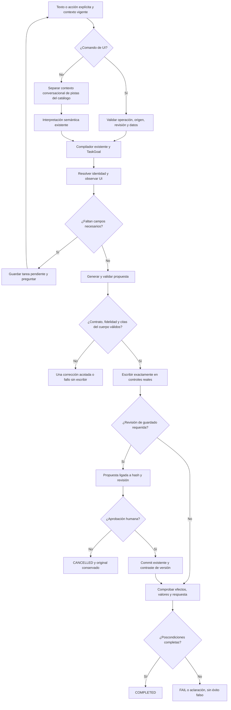
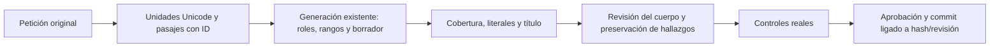

# Recuperación del agente a partir de la auditoría UI — 2026-10-18

Estado: RECUPERACIÓN PARCIAL. Modificación, aprobación y persistencia verificadas con UI/Qwen; creación autónoma todavía NO ACEPTADA. Los 3/11 de la auditoría anterior se conservan como referencia. Esta validación dirigida no equivale a repetir ni aprobar las once peticiones originales.

## Causas observadas

- Las acciones rápidas convertían una elección ya explícita en texto para volver a clasificarla. El modelo podía omitir ejecución o guardado y el ejecutor terminaba el plan reducido.
- La revisión del destino pedía un índice de pasaje y otra cita libre de ese mismo pasaje. Qwen interpretó REQUESTED/AI_DESTINATION correctamente, pero convirtió “Qwen local” en “Ollama local”; el segundo chequeo descartó la operación. La evidencia ahora se vincula al pasaje original por índice, conservando origen, postura, rol y capacidad del destino.
- Las conversaciones sintéticas insertadas en cada etapa competían con la petición actual. La traza devolvió literalmente una explicación de una demostración y eligió el origen anterior. Se retiran esas conversaciones de referencia/autoría y se mantiene el contrato semántico general.
- La extracción rellenaba campos vacíos con instrucciones/destinos. Una acción rápida ya ofrece valores estructurados: el agente no debe reconstruirlos a partir del texto generado por el botón.
- La actualización escribía en React y después verificaba. Se reutiliza la misma generación/validación del dominio antes de transmitir título y cuerpo al adaptador UI.
- El verificador exigía VALUES_APPLIED incluso para ejecución de instrucciones sin entradas, por una dependencia añadida por el compilador. Se distingue un resultado solicitado de sus dependencias.
- El editor de actualización sí produjo el cambio exacto en el diagnóstico aislado; el revisor lo rechazaba por no incluir instrucciones de aprobación en el cuerpo. La creación presentaba ambos defectos: generación con workflow y revisión que exigía o aceptaba ese workflow.
- El contrato de generación ahora explica el rol de cada campo: título como metadato, cuerpo para el futuro asistente y valores solo de datos reales. El revisor recibe el título y cita fragmentos de workflow realmente presentes en el cuerpo. Una cita ausente invalida la revisión; una revisión rechazada se elimina de la caché. No se añade otro intérprete ni una etapa adicional de extracción de contenido.
- La navegación preguntaba al modelo por argumentos de una transición ya determinada por el origen resuelto. Se vinculan navegación y acciones a ese origen, al catálogo permitido y al estado real, también con el intérprete de producción.
- La preparación local mostraba ChatGPT por no incluir Ollama en el selector. Se conserva el destino local y se exige verlo abierto antes de terminar una preparación sin ejecución.
- La autoría validada perdía `promptId` al transmitir título/cuerpo al adaptador UI. El formulario rechazaba correctamente el objetivo nulo. El mensaje interno conserva el ID; se prueba que otra identidad no puede sobrescribir ese editor.
- El recall interno no es una conversación previa. `CatalogCandidates` ofrece pistas de títulos sin agregarlas a `Candidates` ni a `Ids`: no crea el antecedente “otro resultado” ni autoriza una identidad. El lookup existente sigue leyendo y verificando la revisión real.
- Los fallos de evidencia de restricciones volvían al intérprete completo y podían repetir la respuesta inválida desde caché. La corrección vuelve al extractor de restricciones con autoridad inmutable y el error concreto, como máximo una vez. Agotar ese intento termina el fallo; no reinicia la interpretación.
- `preserveOriginal` se infería otra vez al extraer contenido, contradiciendo REVIEW_PERSIST_EXISTING ya interpretado. El contrato de extracción fija ese booleano desde la política de guardado existente. Sin revisión de versión mantiene la protección; ninguna variante concede commit ni aprobación.
- La revisión exige que un título nuevo citado exista literalmente en la petición y coincida con el título propuesto, incluso cuando el cuerpo usa otro idioma. El workflow destinado al asistente futuro sigue siendo contenido válido; no hay un filtro de verbos de navegación/guardado.
- La autoría interpretaba correctamente una edición, pero otro clasificador la reinterpretaba como valores para campos. La etapa existente de autoría decide conjuntamente la transformación y la aplicación de datos de un caso; cita autoridad real y omite esa segunda clasificación. Los datos concretos siguen admitidos cuando sí fueron solicitados. La extracción de contenido no puede cambiar la política de guardado ya resuelta.
- El cierre del intérprete de producción solicitaba aprobación por detectar un borrador cambiado, incluso sin operación de guardado. Ahora esa transición exige REQUEST_SAVE_VERSION/REQUEST_SAVE_COPY o los requisitos de aprobación del objetivo. La regresión reproduce la espera indebida antes del cambio y verifica su eliminación.
- La revisión no recibía el título del origen y podía confundirlo con un nuevo nombre aportado. Ahora recibe título y cuerpo originales, sin el catálogo de operaciones del ejecutor. Decide conjuntamente el destinatario del cuerpo y sus citas; una clasificación de tarea futura con citas de workflow es una contradicción. Cada objeción cita evidencia literal del usuario o del origen. Una revisión inválida se corrige una vez en la misma etapa, con autoridad/artifacto intactos y diagnóstico en el mensaje de sistema; agotar esa corrección detiene la tarea sin regenerar un artefacto cuya revisión no pudo comprobarse.
- Las citas libres de autoría podían traducirse o parafrasearse. La generación existente recibe unidades Unicode y límites de pasajes con ID. Devuelve rangos de requisitos del cuerpo, datos/metadatos externos y soporte del título. El código reconstruye los textos originales, exige cobertura completa sin solapamientos y liga el título a un literal real; no interpreta palabras de la petición ni añade otra llamada de clasificación. El revisor del cuerpo recibe los requisitos de ese campo y no reinterpreta el título ya ligado.
- El idioma de los identificadores `<nombre>` se confundía con el idioma de la prosa. El parser existente proporciona identificadores opacos y una muestra de prosa para la revisión; no se traducen nombres de campos ni se detectan intenciones por expresiones regulares.
- Una referencia aislada a un marcador se aceptaba como valor de negocio porque su cita existía en la petición. El resolvedor omite sugerencias cuyo valor y evidencia son exclusivamente un marcador declarado. Las entradas explícitas de UI, asignaciones literales y datos con evidencia contextual conservan su prioridad.
- Una revisión contradictoria podía borrar una cita real de workflow al corregir sus etiquetas. Una cita de contaminación presente en el cuerpo ahora rechaza la propuesta directamente. El reintento de generación recibe la propuesta rechazada; las referencias de autoría solo pueden apuntar a la petición original.
- Los errores de referencias se corrigen una vez sin reescribir el borrador. Si solo falla la cobertura y tampoco puede repararse, se descarta esa proyección y se revisa contra la petición original completa; los índices inexistentes siguen rechazados. Este respaldo no declara válido el contenido ni concede permisos.

## Flujo



```text
recibir la elección y datos del usuario
si hay comando UI:
    validar operación permitida, contenido literal, origen y revisión
    compilar el objetivo; no reclasificar el significado del botón
si es una respuesta con campos de una tarea suspendida:
    conservar su operación, destino y origen
en otro caso:
    consultar pistas del catálogo sin convertirlas en resultados conversacionales ni identidades autorizadas
    usar el intérprete existente con el contexto real
    decidir juntos la autoría y la aplicación de datos; no reclasificar una edición como llenado
    fijar la política de preservación desde su objetivo de guardado; no inferirla de nuevo al extraer contenido
    si el extractor falla en evidencia: expulsar respuesta rechazada y corregir solo esa etapa una vez
para cada paso permitido:
    observar identidad/revisión y límites de cancelación
    completar solo valores autorizados; preguntar por los faltantes
    generar contenido y verificarlo antes de tocar el formulario
    verificar que cada cita de workflow pertenece al cuerpo propuesto
    comprobar coherencia entre destinatario y citas; cada objeción debe citar su autoridad real
    si la revisión es inválida: corregir solo esa etapa una vez, sin convertir diagnóstico en petición ni regenerar el artefacto
    descartar de caché toda revisión rechazada
    aplicar el texto validado y comprobar su igualdad
si hay persistencia:
    esperar aprobación de la propuesta exacta o cancelar
    guardar y comprobar cuerpo, identidad y revisión
comprobar las poscondiciones antes de completar
```

## Contratos y trazabilidad



```text
numerar unidades del texto sin asignarles intención
pedir en la generación los rangos del cuerpo y del contenido externo
exigir que cada unidad pertenezca exactamente a un rol
reconstruir la evidencia desde el original; nunca desde una copia del modelo
ligar el título literal y mantenerlo fuera de la revisión del idioma del cuerpo
conservar todo hallazgo de contaminación que cite texto realmente presente
omitir marcadores propuestos como datos, salvo asignación explícita del usuario
comparar campos y propuesta antes de solicitar aprobación
```

| Frontera | Implementación | Invariante / prueba |
|---|---|---|
| Elección UI | QuickActions → App → startVisible → LiveCommand | Operación y valores viajan tipados; ninguna escritura sin aprobación |
| HTTP | LiveStartInput.Command, opcional | Compatibilidad con peticiones existentes; operación, origen, destino y contenido validados |
| Compilación | LiveCommand.Compile → SemanticPlanCompiler → TaskGoal | No inferir de nuevo lo seleccionado, no conceder ejecución a preparación |
| Continuación | AgentSession.PendingCommand y SemanticPlanning | Conservar tarea pendiente ante respuesta de campos del mismo origen |
| Evidencia de ejecución | ReviewExecutionScope | Índice solo de pasajes autorizados; REQUESTED y AI_DESTINATION, origen literal y proveedor compatible |
| Propuesta | PromptPreparationPipeline antes de AgentUiDriver | No publicar en el formulario contenido rechazado por el dominio |
| Guardado | LiveRuns, aprobación y commit existentes | Hash, revisión, consentimiento y coincidencia entre propuesta/formulario/persistencia |
| Finalización | GoalCompletionValidator | Una dependencia de llenado no inventa entradas en instrucciones sin variables |
| Revisión semántica | DraftFidelity | Metadatos separados, evidencia literal del cuerpo, sin reutilizar revisiones rechazadas |
| Autoría y datos | InterpretTextGoal → InputApplication | Una decisión conjunta con evidencia; mantener datos del caso cuando corresponda, sin inferirlos de restricciones o placeholders |
| Revisión opcional | RunVisible → reviewRequested | Un borrador cambiado no concede por sí mismo permiso para solicitar persistencia |
| Navegación | BoundNavigation / BoundGoal | Fuente real, argumentos de catálogo y transiciones de estado, sin inferir cada clic |

La propiedad opcional `command` contiene `operation`, `content` y `providerId`. Solo admite crear, proponer cambio, abrir, completar, preparar local/proveedor o ejecutar local. No acepta escritura directa, scripts ni aprobación. Para crear requiere origen ausente; las demás acciones requieren un origen explícito vigente. El contenido debe formar parte del mensaje real. Los comandos de autoría preparan revisión de guardado; la escritura continúa requiriendo aprobación del usuario.

No se activa el perfil experimental TaskGoals/TaskResultContract rechazado ni se añaden clasificadores por keywords/regex, modelos, paquetes o motores de ejecución.

## Verificación

- Base anterior: 407 pruebas backend PASS.
- Candidato de UI actual: **447 backend, 150 legacy y 92 React PASS (689 pruebas)**. API: 0 errores y 0 avisos; build web PASS con el aviso previo de chunk mayor de 500 kB. Resultados TRX locales en `.playwright/agent-recovery-20261018-161804/test-results/`; backend `backend-complete-context-final.trx`.
- Ejecución real por botón: LISTO, 1 llamada, 1493 ms; identidad correcta y respuesta completa. El primer intento de desarrollo detectó y conservó el defecto de entradas vacías antes de corregirlo.
- Continuación real con dos campos: cliente y problema exactos, destino Ollama visible, ninguna ejecución ni escritura, 0 llamadas; 1206 ms observados. Es una medida de este recorrido, no un benchmark estable.
- Creación UI aprobada: `e07fe5c9-1b0b-4f68-8003-766504cc4966`, título y cuerpo reales, `<notas>` conservado, propuesta exacta persistida como registro nuevo revisión 1; COMPLETED, CONSUMED, effectCommitted=true. 2 llamadas, 30,5 s hasta revisión.
- Actualización por acción rápida aprobada: `ce33d4ae-7f57-48ed-b8a3-652cb97421c5`, cambio exacto de tres a dos mejoras sin eliminar restricciones ni `<proyecto>`; revisión 2 persistida, COMPLETED/CONSUMED. 2 llamadas, 31,6 s hasta revisión.
- Actualización libre desde otro prompt: `1873d005-1bd7-4cca-baaf-9d1d148df99b`, origen resuelto por nombre, cambio exacto de dos a cuatro mejoras. Antes de aprobar: formulario y propuesta coinciden y SQLite/API sigue en revisión 2. Tras aprobar mediante el diálogo real: revisión 3 exacta, COMPLETED/CONSUMED y effectCommitted=true. 17 llamadas, 91,8 s hasta revisión; el tiempo posterior esperando aprobación no es latencia del modelo.
- Repetición con revisión conjunta del build final: `cbdff677-5c7d-4d7f-b2f4-ac5681b025ce`, cambio exacto de cuatro a cinco mejoras y conservación de título/resto/variable. Antes de aprobar permanece la revisión 3; después se guarda exactamente la revisión 4, COMPLETED/CONSUMED, effectCommitted=true. 2 llamadas, 31,4 s hasta revisión. El intento anterior `5826cb0f-eb03-4589-9e5e-b2032a32c279` bloqueado por evidencia inválida del revisor se conserva como FAIL y motivó el contrato conjunto.
- Petición libre de abrir por nombre y ejecutar: `76601258-2c89-43da-b8d0-01e14b4f3eb3`, navegó desde Proyecto al registro Local solicitado, ejecutó Ollama y devolvió exactamente LISTO, sin modificar el origen; COMPLETED. 16 llamadas, 52,9 s observados. Los intentos previos fallidos permanecen registrados.
- Rechazo de propuesta: CANCELLED, effectCommitted=false; el contenido original se conserva. La nueva versión aprobada también se verificó después de reiniciar la API con el build final.
- Comprobación adicional con tarea futura de lectura, escritura y aprobación: `c89303c8-6d0c-40ff-8fba-42a8e2fac261`. La primera propuesta contaminada fue detectada y corregida dentro del único reintento. El formulario conservó `Facturas sintéticas` literalmente y un cuerpo en inglés con `<factura>`, `<hoja>`, `<cliente>`, aprobación futura y prohibición de inventar, sin instrucciones de esta sesión de autoría. Se rechazó desde el diálogo real; CANCELLED y sin persistencia. 4 llamadas, 127,3 s hasta revisión: la recuperación es correcta, pero lenta.

Evidencia de desarrollo y fallos conservados: `docs/evidence/agent-recovery-20261018-161804/`. `08-ui-checkpoint.json` conserva los recorridos iniciales; `09-natural-revision-approval.png` y `10-ui-natural-revision-checkpoint.json` verifican la aprobación libre. `11-title-role-review-failure.json` conserva una propuesta rechazada por contaminación de workflow; `12-future-task-clean-review.png` muestra la corrección. Los diagnósticos indican expresamente GENERATION_COMPONENT_ONLY o PLANNING_COMPONENT_ONLY; no prueban UI ni persistencia.

Ambos puertos usan ahora el build `api-complete-context/QuickPrompt.Api.dll`: 5191 conserva la base sintética de recuperación y 5190 conserva la base sintética de auditoría anterior. `/health` responde ok con schemaVersion=2 en ambos. Sin cambios de biblioteca personal, commit ni push en este trabajo.

## Límites de aceptación

Última verificación del build activo: `84e8797b-109b-4c23-b0f5-ca6031a62d03`, modificación exacta de cinco a seis mejoras. Antes de aprobar, formulario/propuesta coinciden y el registro permanece en revisión 4. Tras confirmar desde UI: revisión 5 exacta, COMPLETED/CONSUMED, effectCommitted=true; 2 llamadas y 31,5 s hasta revisión. Cero `pageerror` en este tramo. Evidencia: `19-current-build-approval.png` y `20-current-build-ui-checkpoint.json`. Esta verificación acepta modificación/aprobación/guardado, no creación autónoma.

No se repitió la campaña completa de once peticiones ni un holdout semántico independiente. La eliminación por frase libre y la calidad factual general de las respuestas del modelo no quedan aceptadas por estos recorridos. La eliminación manual/por botón conserva su confirmación nativa. La petición libre todavía necesita numerosas inferencias y puede tardar alrededor de un minuto o más; los tiempos observados no son un benchmark estable de rendimiento. No se probaron MAUI/Android ni servicios externos.

**Límite semántico observado, NO ACEPTADO:** el diagnóstico adicional `future-joint-review-result.json` todavía produjo una propuesta con título traducido y sugerencias de valores sin evidencia al pedir título literal español y cuerpo inglés. La revisión no pudo comprobarse y la propuesta se rechazó; ese diagnóstico no prueba un recorrido UI ni un guardado. El PASS UI anterior de esa petición en otro candidato se conserva, pero no establece fiabilidad general del candidato final. No declarar al agente universalmente fiable ni convertir el fallo en PASS por los resultados unitarios.

Las comprobaciones posteriores de componente (`localized-authoring-repair-result.json`) ya produjeron título literal, cuerpo inglés directo y valores vacíos. Sin embargo, la repetición UI de creación sigue fallando: `c805d206-a526-4c79-87f9-f29dbda4bc2a` terminó incompleta; `4da60073-b0a2-4e66-a714-a6f91dfa6156` se detuvo mediante UI por superar 120 s sin respuesta completa; `bfa426db-8f83-4fe7-affd-2ebd1df5d60f` bloqueó por referencias; `8bc7647a-0776-40e2-8355-aad413d8ba85` alcanzó revisión en 72 s pero todavía incluyó «No resumir una reunión ahora». Esta última propuesta se rechazó desde el diálogo real, sin guardar. Capturas/checkpoints 16–18 conservan fallos y contexto. Por tanto, **creación y fidelidad general permanecen FAIL**, aunque pasen las pruebas de contratos y algunos recorridos anteriores.
