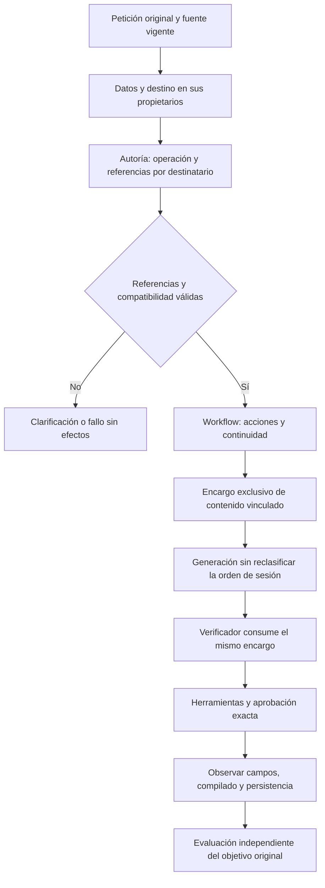
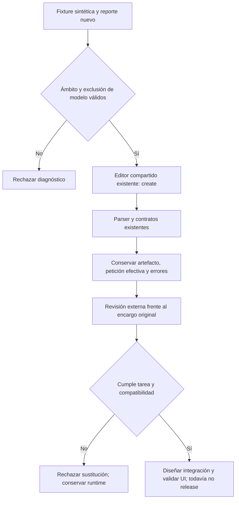

# Fiabilidad del agente: causa, pruebas y límites

2026-10-20. Candidato no promocionado; versión abierta. Guías: Universal Modular Architecture, Adaptive AI Systems y Algorithmic Engineering.

## Qué prueban las ejecuciones

Las campañas `latency-1792471535010`, `latency-1792472800973` y `latency-1792474435293` usan Edge visible, React, API, SQLite sintética y Qwen3 8B real. No son respuestas simuladas. El manifiesto v3 conserva 383 fuentes sin cambios durante la ejecución y hashes de ensamblados compartidos con sus tests. La captura de copia verifica el texto entregado al navegador; **no prueba el portapapeles nativo de Windows**.

Las 652 pruebas del backend incluyen transporte con respuestas controladas. Prueban contratos, aislamiento y efectos, no comprensión de peticiones nuevas. Los 13 contratos de autoría tampoco son 13 peticiones comprendidas por Qwen. Los experimentos de protocolo son pruebas de componente; no equivalen a generación, navegación o guardado completos. Un `COMPLETED` del agente no es un oráculo externo.

El arnés anterior devolvía código 0 aun con `validation.json=FAIL`. Sus aserciones de creación verificaban formulario, identidad y cambios de texto, pero no bastaban para probar la fidelidad del contenido. Desde esta revisión el arnés separa `controlCorrect`, `contentAcceptance` y `correct`; una generación necesita revisión independiente. FALLA devuelve 2, falta de revisión 3. También se comprueba que no falten casos ni existan duplicados. No se recalifican fallos históricos como éxitos.

## Primera transición incorrecta observada

| Familia retenida | Resultado v3 | Primer error y propietario |
|---|---|---|
| Completar/copiar con valor inline | FAILED, 89602 ms, 13 llamadas | Autoría declara CREATE_TEMPLATE y toma la tarea del cuerpo guardado como nueva tarea; la cita seleccionada sólo pide dejar listo para copiar. El posterior STALE_OR_UNVERIFIED es posterior al error semántico. |
| Completar/copiar con valor separado | COMPLETED, 25620 ms, 9 llamadas | No se observa error en este recorrido: ID/revisión/cuerpo conservados, valores y compilado comprobados. No demuestra generalización. |
| Crear y adaptar borrador | BLOCKED, 49833 ms, 8 llamadas; no alcanza adaptación | El encargo de autoría dice generar una plantilla; el generador escribe otra orden de crear un prompt, y vuelve a clasificar las unidades originales. Se rechaza el borrador. |

Evidencia: [mediciones v3](../evidence/latency-1792474435293/measurements.json), [manifiesto v3](../evidence/closure-20261020/authoring-identity-candidate-v3.json).

No hay evidencia para atribuir todo a aleatoriedad del modelo. Con temperatura 0 cambian los paquetes entre candidatos. No se midió estabilidad de repetición del mismo paquete, y diferencias de recursos invalidan conclusiones de rendimiento comparativo. Los ratios pequeños son diagnósticos, no una estimación de fiabilidad.

## Núcleo y límites del diagnóstico

1. **Dos propietarios efectivos de la separación de actores.** La declaración inventa `futureTask`; el generador vuelve a clasificar petición original, cuerpo y metadatos mediante `authoringEvidence`. El segundo puede contradecir al primero. El hash conserva una decisión, pero no demuestra que esa decisión represente al usuario.
2. **Contrato que permite sustituir el encargo.** Una cita auténtica junto a una paráfrasis inventada no prueba que la paráfrasis se deduzca de ella. Los controles actuales comprueban procedencia y compatibilidad de tipos, no esa implicación semántica.
3. **Recursos con alcance excesivo.** Autoría recibe el catálogo completo aunque no es propietaria de navegación, campos, aprobación ni ejecución. Se deben ofrecer sólo los contratos relevantes y los hechos de otros propietarios como contexto. La reflexión aporta herramientas; no convierte datos en autoridad ni interpreta al destinatario de una orden.
4. **Aceptación insuficiente.** La igualdad propuesta→formulario→guardado puede preservar fielmente una propuesta incorrecta. Debe comprobarse además petición→encargo→contenido con evidencia independiente.

La inferencia de que una referencia literal con roles separados mejorará a Qwen sigue siendo **hipótesis**. Un probe de referencias literales conserva las tres identidades correctas, pero en creación selecciona toda la petición, incluida la orden al editor: **falla la separación de contenido**. No se incorpora por acertar sólo la identidad. Evidencia: `authoring-grounded-brief-probe-v1.json`, componente sin efectos.

## Hipótesis inicial de referencias y alternativas

Extender `InstructionUseInference`, propietario existente. Declarar una operación y referencias verificables a la orden dirigida al editor y al contenido futuro. La decisión vinculada es la única que alimenta encargo y verificador. Para creación los destinatarios son distintos; una revisión puede citar la misma orden que expresa su delta. Las referencias se validan contra el texto autorizado; no hay filtros de vocabulario. Datos conserva valores/campos, workflow conserva acciones/continuidad y dominio conserva ID/revisión/aprobación. Un fallo no activa silenciosamente el intérprete antiguo.

Esta hipótesis se prueba antes de incorporar producto: ambas variantes de rangos quedan **rechazadas**. Los índices garantizan procedencia, pero Qwen sigue asignando mal los roles. No corresponde construir un compilador de permisos sobre esas etiquetas incorrectas. La [adjudicación de los cuatro controles](../evidence/closure-20261020/authoring-protocol-adjudication.json) conserva resultados y límites; la revisión la realiza Codex, no una persona ni el propio Qwen evaluado.

Alternativas rechazadas: agregar otro crítico (duplicaría autoridad y latencia), cortar prefijos por frases/regex (no generaliza), copiar el contrato conjunto rechazado (mezcla campos y autoría), incorporar otra infraestructura o modelo sin evidencia. Primero se cualifica el contrato como componente; no se modifica el producto sólo por una mejora parcial del ratio.



```text
mantener original, fuente/revisión y ámbito de datos como hechos verificables
obtener uso de datos y destino sin pedir a autoría que los decida
declarar una vez operación e índices de evidencia según destinatario
validar rangos, procedencia, separación y hashes; no deducir permisos del contenido
dejar acciones y continuidad al propietario de workflow
generar y revisar desde el mismo encargo; no reclasificar la petición mezclada
mantener presupuestos, cancelación y aprobación existentes
comparar petición original, efectos solicitados y resultado observado externamente
conservar cada fallo; no promover hasta superar la matriz específica del agente
```

## Corrección seleccionada v4: eliminar la sustitución del encargo

El control de aislamiento mantiene modelo, temperatura y esquema de contenido pequeños, cambiando la petición original por la paráfrasis que produjo el sistema. Con la original, Qwen redacta una instrucción para organizar la reunión y conserva no inventar. Con la paráfrasis, produce una plantilla de reunión y omite esa restricción. Es evidencia de una transformación perjudicial del encargo, no prueba universal de capacidad del modelo.

La corrección conserva el mismo módulo y la misma decisión vinculada, pero elimina `futureTask/templateChange` generados por el modelo. Autoría declara sólo operación e índice de evidencia; el código conserva la proyección literal de la petición fuera de asignaciones de datos. El encargo ya no puede añadir requisitos mediante una paráfrasis libre. Su límite pasa de los 1000 caracteres de un resumen a los 16000 ya admitidos por la petición, sin truncar. `directiveStructure` mantiene la relación alrededor de datos ocultos; sus marcadores no son evidencia ni permisos.

El recurso reflejado de autoría contiene únicamente las dos operaciones cuyo propietario es autoría. Fuente, definición, representaciones y hechos de datos/destino conservan su procedencia. No se añade otro catálogo, revisor, árbitro, vector store ni modelo.

El redactor de creación devuelve **sólo title, description y templateText**. El código fija CREATE_NEW/sourceId=null desde la decisión validada y obtiene nombres de campos del parser real. Los valores los obtiene `ExtractInputs`, capacidad de datos ya existente, después de conocer los campos del artefacto. El generador ya no elige identidad, valores, metadatos de campos, permisos o acciones. La revisión semántica existente contrasta el resultado con la petición original; no recibe una paráfrasis inventada ni se añade otra revisión.

En esta ruta se elimina la segunda clasificación `authoringEvidence/bodyRanges` del generador. El encargo literal sigue pudiendo contener órdenes de sesión: es el trabajo original dirigido al **redactor**, no el cuerpo que recibirá el futuro asistente. No se afirma que la selección de índices haya demostrado separar los roles. La separación se exige al artefacto y se contrasta por el verificador y la evaluación externa. La ruta antigua conserva exactamente su bloque de generación previo para aislar compatibilidad mientras el selector permanezca desactivado.

```mermaid
flowchart LR
 A[Petición y contexto verificados] --> B[Datos y destino: propietarios existentes]
 B --> C[Autoría: operación y cita; sin paráfrasis]
 C --> D[Código conserva encargo literal vinculado]
 D --> E[Workflow: acciones y continuidad]
 E --> F[Redactor: sólo contenido editable]
 F --> G[Parser de campos y extractor de datos existentes]
 G --> H[Verificador: petición original, fuente y artefacto]
 H --> I[UI y efectos autorizados]
 I --> J[Matriz del agente e inspección independiente]
```



```text
interpretar identidad sin pedir que el modelo reescriba la tarea
conservar encargo original fuera de valores de caso y ligarlo a petición/fuente
redactar únicamente campos de contenido, sin nueva identidad o workflow
calcular campos desde el cuerpo y extraer valores en la capacidad de datos
revisar fidelidad contra la petición original y comprobar efectos observados
mantener rechazo, cancelación, presupuestos y aprobación exacta
validar sólo la matriz afectada y dependencias; no promover por componente
```

Compatibilidad: no cambia HTTP, SQLite, estado de aprobación ni frontend. Sigue desactivado por defecto. Se ejecutan **21 contratos dirigidos de agente**, cero omitidos, y build API sin advertencias/errores. Las primeras cuatro incompatibilidades del arnés de transporte fueron fixtures que todavía emitían los campos privados retirados; se conservan como incompatibilidad de protocolo, no se presentan como reproducción semántica antes/después. La UI Qwen del v4 y la cualificación del desarrollo siguen separadas de estos controles. No se ha repetido la suite general de backend/frontend en este incremento.

Resultado UI v4: se corrigen los dos recorridos retenidos de completar/copiar en su alcance exacto. La creación y el seguimiento escriben los campos y conservan continuidad, pero el cuerpo inicial todavía pide crear un prompt. Se rechaza por contenido. El [gate externo compuesto](../evidence/latency-1792475525468/acceptance.json) es FAIL, con revisión atribuida a Codex, no humana, ligada al SHA256 de las mediciones. La [captura de creación](../evidence/latency-1792475525468/unsavedAdapt-1-created.png) fue inspeccionada: el error está en el contenido real del campo y de la vista previa. El [manifiesto v4](../evidence/closure-20261020/authoring-identity-candidate-v4.json) conserva fuentes, hashes y gate; no promoción.

## Recursos y controles rechazados después de v4

La [adjudicación conservada](../evidence/closure-20261020/authoring-contract-diagnostics.json) diferencia las hipótesis, no sólo cuenta aciertos. Ninguno de esos controles modifica producto:

- Añadir la petición literal como último turno no elimina el error; la repetición mantiene el mismo cuerpo incorrecto.
- Cambiar el orden de propiedades JSON tampoco lo elimina. No se adopta una supuesta dependencia título→descripción→cuerpo sin evidencia.
- Acortar instrucciones cambia algunos resultados, pero no garantiza nombres/sintaxis de campos o requisitos fieles. Una mejora en reunión no compensa contaminación en resumen/aprobación futura.
- Activar razonamiento sólo en creación no basta: omite una restricción y conserva órdenes de sesión en otros encargos. El perfil de producción no cambia.
- Dos demostraciones fijas de destinatarios, en dominios distintos de los casos evaluados, tampoco bastan. No se incorporan ni se agrega otra demostración por cada fallo.

Los casos de resumen/aprobación/SQL reutilizan **mensajes de desarrollo** de la matriz de autoridad, sin suministrar al generador sus cuerpos rechazados u oráculos. Son controles del contrato de creación, no nuevas pruebas de CRUD, frontend, envío o ejecución SQL. No se consulta validation/holdout ni se sustituye el modelo. Ningún control de componente se presenta como campaña UI.

Estos resultados acotan la causa: el transporte, los campos y las referencias pueden estar correctos mientras la interpretación del destinatario sigue siendo incorrecta. La tipificación preserva el encargo y evita que otros módulos ganen autoridad; no demuestra por sí sola esa interpretación. Es un error trasladar la conclusión de un ejemplo a toda la familia, o declarar éxito porque el propio revisor de Qwen acepta lo que redactó.

El siguiente incremento debe demostrar separación de destinatarios en el contrato de contenido con oráculos de la matriz del agente, manteniendo los propietarios existentes. No corresponde continuar acumulando cambios de prompt de un ejemplo, activar estos controles rechazados ni cambiar el modelo sin una propuesta nueva y justificada. El criterio de cierre no se rebaja para acomodar la capacidad observada.

## Continuación: comprobar capacidades y compatibilidad antes de sustituir

La [revisión de esta continuación](../evidence/closure-20261020/authoring-capability-boundary-review.json) conserva cinco controles. No se incorporan sus contratos rechazados ni se modifica la ruta de producción:

| Control | Evidencia observada | Decisión |
|---|---|---|
| Proyección con predicados actual/futuro y rangos | Coinciden los predicados o el rango futuro incluye la acción del editor. Inline vuelve a declarar revisión. | Rechazada; no construir el encargo desde etiquetas que no pasan el oráculo. |
| Calibración de referencias | El mismo modelo copia correctamente IDs ordinales y legibles para los tokens suministrados. | No atribuir el defecto semántico a un supuesto fallo suficiente del transporte numérico. |
| Capacidad `create` del editor compartido | Se ejecuta el **OllamaClient real**, con su contrato, parser, límites y muestreo propios. El resumen vuelve a incluir `Prepara un prompt... No resumas las notas ahora`. | Rechazada como sustitución directa; reutilización de código no equivale a fiabilidad demostrada. |
| Documento natural sin decoder JSON | El resumen pide preparar otro prompt y no resumir; SQL prohíbe obtener datos adicionales cuando se pidió solicitar los faltantes. | El formato de transporte no resuelve por sí solo la asignación del destinatario. |
| Parámetros del propietario de contenido con operación ya fijada | Hay citas inventadas; en otros casos cita correctamente una aprobación/prohibición, pero omite la tarea principal de redactar/explicar. | Una referencia válida tampoco demuestra cobertura de la petición. |

El evaluador incorpora `--shared-authoring` para ejecutar únicamente esa capacidad con una fixture sintética explícita. Rechaza rutas ajenas al espacio QA y sobrescrituras, conserva identidad del modelo y hash del ensamblado, usa una exclusión local de evaluaciones y nunca retiene reasoning. No abre SQLite, navegador ni herramientas de aplicación. Devuelve estado de revisión pendiente, no PASS por obtener un `AiProposal` válido.



```text
validar fixture sintética y salida nueva dentro de QA
adquirir exclusión, registrar modelo y ensamblado real
por cada encargo congelado: llamar create del editor compartido sin revisión automática
conservar respuesta pública y resultado del parser, nunca reasoning
no convertir validez del objeto en aceptación de contenido
contrastar propósito, restricciones y compatibilidad antes de elegir sustitución
liberar cliente y exclusión aunque haya fallo
```

La revisión de fronteras encuentra una incompatibilidad concreta: el editor compartido exige al menos una variable en creación, mientras NOVA permite tareas sin entradas. Se amplía la prueba de transporte existente para verificar ambas clases de artefacto, con y sin inyección de una decisión ajena. Un control adicional demuestra que el editor compartido rechaza el cuerpo sin variables. [**24 comprobaciones dirigidas, cero omitidas**](../evidence/closure-20261020/tests/authoring-zero-input-and-owner-compatibility.trx). Son contratos controlados, no 24 peticiones comprendidas por Qwen.

Alternativas UMA: extender el creador actual exige cualificar su comprensión de destinatarios; reutilizar el editor compartido exige resolver además metadatos y la diferencia de parámetros obligatorios; introducir otra capacidad no tiene evidencia que justifique duplicar propietario. No se selecciona una sustitución que falle fidelidad o elimine capacidades de NOVA. API, frontend y los cuatro archivos centrales del candidato v4 conservan sus hashes durante esta continuación. No se repiten sus recorridos UI como si fueran un candidato nuevo.

El contrato de contenido aún debe representar el destinatario, el objeto, la cobertura del propósito y la vigencia de las restricciones, además de su procedencia. Actualmente esas distinciones quedan en instrucciones al modelo; las referencias y hashes sólo preservan la interpretación obtenida. El siguiente trabajo debe aportar esa representación dentro del propietario actual y cualificarla con las mismas peticiones, sin añadir otro árbitro ni deducir autorización por semejanza. La evidencia disponible **no demuestra** que cambiar etiquetas, formato, rangos o sustituir el generador por el editor existente complete esa capacidad.

## Impacto y pruebas dirigidas

| Contrato protegido | Qué podría romperse | Comprobación dirigida |
|---|---|---|
| Valores separados de instrucciones | Aplicar workflow como dato o perder el valor inline | Ámbito de entrada + UI variables/boundVariables; ID/revisión/cuerpo/valor/compilado exactos |
| Autoría/identidad | Crear por rellenar o perder una revisión compuesta | Contratos de autoría, desarrollo congelado y revisión de contenido; efectos extra/faltantes |
| Fuente y revisión | Cambiar de origen al refinar | Contratos de refinamiento e identidad; sin repetir CRUD manual ajeno |
| Continuidad | Olvidar delta actual o heredar efectos de otra tarea | Hashes actual/pendiente y borrador→adaptación del mismo candidato |
| Verificador | Aceptar un encargo sustituido o lenguaje de sesión | Invalidez de assessment tras cambiar encargo; contenido revisado contra el original |
| Aprobación | Escribir antes de aprobar o guardar otro texto | Sólo tras tocar ese contrato: guardado/rechazo con revisión y texto exactos |

Frontend no cambia por mejorar el intérprete. Los tests de transporte de este contrato pertenecen a la matriz del agente aunque estén escritos en el proyecto backend. Las suites generales de backend/frontend se ejecutan al afectar sus contratos o al preparar el candidato final; no son la aceptación semántica de este incremento.
## Recuperación del revisor: una causa común reproducida y corregida

El contraste de creación detectó un defecto que no depende de la frase concreta: una cita de título inválida abría otra revisión completa, aunque el grupo del cuerpo ya hubiera emitido una declaración válida. En el resumen fiel, Qwen pasó de ACCEPT a REVISE durante esa reparación porque convirtió «No resumas las notas ahora» en un requisito del prompt futuro. El rechazo falso no se debió a un nuevo cuerpo: el artefacto no cambió. La recuperación ampliaba indebidamente el alcance de la decisión.

Se corrige dentro de `PreparationInference.ReviewDraftFidelity`, sin nuevo árbitro. Cuerpo y metadato tienen schemas de reparación separados y propiedades cerradas; se conserva el grupo independiente válido. Si ambos grupos son inválidos se repara el contrato completo, sin ampliar las dos llamadas permitidas. Un defecto real del cuerpo o un título literal distinto siguen rechazándose. Los fallos de formato pertenecen al revisor y no deben disparar otro intento del generador. [Contrato, workflow y pseudocódigo](FIDELITY_REPAIR_CONTRACT.md).

La reproducción controlada anterior dio seis fallos y dos aciertos en ocho casos. La selección final pasa 78 controles: esas ocho regresiones, dos intentos adicionales de sobrescribir campos bloqueados y sus consumidores directos. Son pruebas de contrato con respuestas controladas: demuestran aislamiento, presupuesto, rechazo y ausencia de assessment inválido; **no demuestran comprensión del lenguaje natural**. La API y el evaluador finales compilan sin advertencias/errores; fuentes congeladas y tres ensamblados compartidos coinciden entre pruebas/API/evaluador. [Fuentes y acta verificable](../evidence/closure-20261020/fidelity-independent-repair/review.json).

### Qué ocurrió con el modelo real

Se ejecuta el propietario real del revisor de creación con seis cuerpos sintéticos congelados y Qwen3:8b local, sin sustituir el generador ni llamar a UI/SQLite. Cada expectativa procede del corpus fijado antes de ejecutar; la respuesta del revisor no define su propio éxito. La revisión externa de contenido y motivos la realiza Codex y se atribuye como tal, **no como revisión humana**.

| Dimensión | Resultado observado | Consecuencia |
|---|---|---|
| Recuperación de título | Respuesta parcial `requestedTitleQuote=null`; cuerpo conservado, con recibo separado de la combinación | Corrección mecánica corroborada con modelo real |
| Restricción omitida | ACCEPT pese a faltar «No inventes datos» | Fallo semántico de cobertura abierto |
| Control de sesión en el cuerpo | ACCEPT pese a incluir una orden de esta edición | Fallo semántico de destinatario/vigencia abierto |
| Aprobación futura omitida | REVISE con evidencia de esa obligación real | Diagnóstico correcto en ese contraste |
| Resto de cuerpos fieles | ACCEPT | Acierto acotado al corpus de desarrollo |

Cuatro de seis etiquetas coinciden y todas las declaraciones finales cumplen el contrato, pero los dos falsos ACCEPT mantienen **FAIL**. En el contraste de producción anterior, una etiqueta REJECT coincidía por el motivo equivocado: exigía una orden de sesión; no se presenta como acierto semántico. El perfil alternativo de muestreo tampoco calificó y no se activa. La diferencia agregada antes/después no permite atribuir toda mejora al código, pues también cambiaron los primeros juicios del modelo. No se repiten inferencias buscando una tanda favorable.

El defecto de recuperación está resuelto en su límite; la causa semántica restante es que el juicio libre sigue sin demostrar cobertura completa del encargo y separación de sus destinatarios. Referencias literales y JSON válido no prueban ninguna de las dos. No se añade routing por frases, excepciones de los ejemplos, otro revisor ni el contrato conjunto rechazado. La sustitución pendiente debe permanecer en los propietarios actuales de autoría/identidad, ofrecer recursos explícitos del encargo al generador y al verificador y conservar datos/workflow/autorización. Sólo podrá promocionarse con el mismo candidato en desarrollo, validación independiente y holdout, sin abrir estos dos últimos para ajustar el diseño.

### Selección de pruebas y cierre

Esta corrección pertenece al bloque **authoring de la matriz del agente**, aunque sus pruebas estén en un proyecto C#. Backend/frontend conservan su evidencia histórica; no se repiten sus recorridos generales ni se los cuenta como prueba de este cambio. La matriz incluye el filtro de los consumidores afectados y las rutas de los contrastes reales. El comprobador de matrices valida trazabilidad y ejecuta cero workflows; no es otro PASS funcional. La UI retenida del v4 no se transfiere a este binario sin volver a ejecutarla cuando califique semánticamente.

Los tiempos de estas revisiones son de componente, no de creación completa, guardado ni p95. No se declara mejora de latencia aceptada ni se cierra ningún criterio. Continúan **29 requisitos cerrados en su alcance y 59 abiertos**, goal activo y versión NO CERRADA.

## Cierre del canal de autoridad recortada y contraste de protocolo nativo

Se verifica que la ruta previa todavía permitía `GeneratedArtifact.BodyRequestClauses` como sustituto del encargo original. Las cuatro regresiones nuevas reproducen la pérdida de una condición real, la sustitución del objetivo al continuar, una cita inventada que adquiere procedencia y la evasión del presupuesto de contexto. Se elimina ese argumento del contrato privado y de su resultado interno. El revisor usa siempre `TaskGoal.UserRequest` o `PrepareInput.TaskRequest`, sin depender del selector de generación. No se reincorpora el paquete rechazado con `generationRequirements`, ni un nuevo revisor o una política por frases. [Contrato y acta](REVIEW_AUTHORITY_BINDING.md).

Final **82 controles dirigidos PASS**, incluidas las cuatro regresiones antes fallidas y los 78 controles previos; API/evaluador compilan y tres ensamblados compartidos coinciden con las pruebas. No es una suite general ni comprensión semántica acreditada. La ruta v4 ya recibía el encargo completo: su paquete semántico no cambia y no se repite la misma campaña buscando verde.

Se comprueba además una hipótesis distinta de cambiar el prompt: entregar contenido con el protocolo nativo de herramientas de Qwen. El evaluador captura el paquete del autor real y transforma sólo el transporte; usa el mismo sistema, petición y opciones, más la instrucción de entrega por función. No ejecuta funciones ni llama al revisor/UI. Los argumentos cumplen el esquema, pero los tres encargos retenidos de reunión/resumen/mensaje siguen contaminados por autoría o controles actuales. El protocolo queda rechazado, no incorporado. [Diseño y resultados](NATIVE_CONTENT_PROTOCOL_DIAGNOSTIC.md).

Estas observaciones descartan tratar el formato de salida como solución del error de destinatario. La procedencia ahora queda protegida independientemente de la selección del generador; la producción y la evaluación del significado todavía necesitan cualificación. Se mantienen las matrices separadas, los criterios originales y **29 cerrados/59 abiertos**; no se transfieren resultados históricos de UI a este binario.
