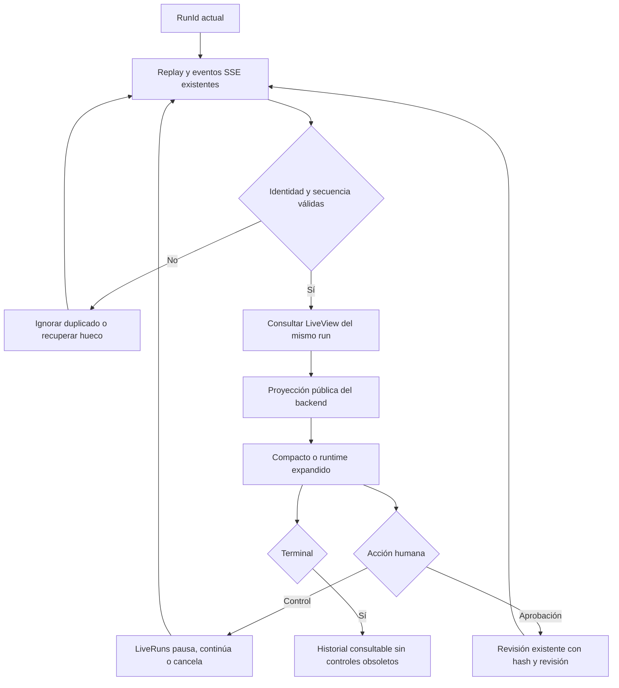
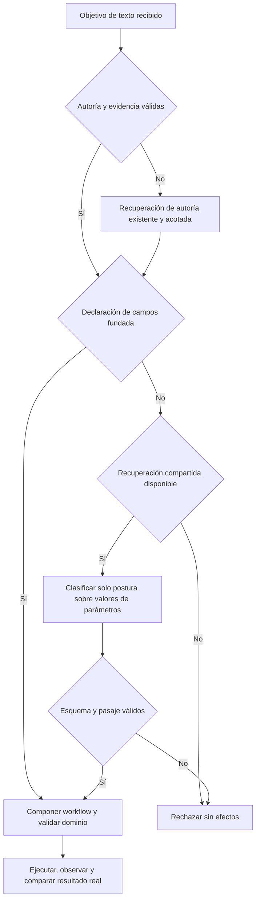
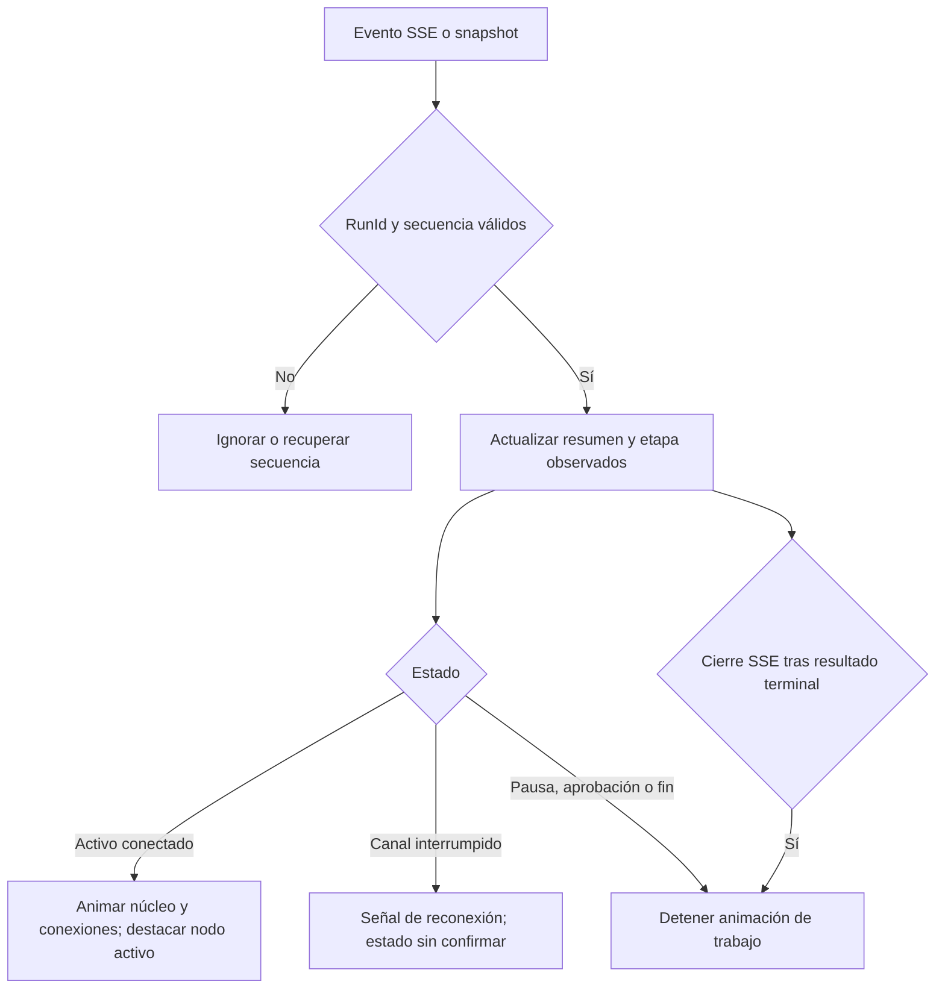

# NOVA Runtime View

## Contrato del cambio

Capacidad: representar la ejecución visible existente, en la misma pestaña. `LiveRuns` sigue siendo propietario del estado, secuencias, pausa, cancelación y aprobación. `AgentOrchestrator.RunVisible` publica el conjunto exacto de herramientas elegibles; `NovaLive` conserva la suscripción SSE y los controles existentes. `AgentRuntimePanel` solo presenta datos públicos.

Se extiende el módulo existente (alternativa A). Una abstracción compartida (B) o un segundo runtime/event bus (C) duplicaría propiedad sin otro consumidor que lo justifique. El único punto nuevo es `PublishRuntimeTools`, invocado después de los filtros actuales. No decide ni autoriza herramientas. No hay nuevos paquetes, almacenamiento, endpoints o ventanas de producto.

Entrada: `LiveView.runtime`, opcional para compatibilidad, versión `nova-runtime-1`, con `RunId` y secuencia idénticos al registro. Salida: vista compacta mientras hay un run activo y vista expandida por petición del usuario. El estado terminal queda consultable en la última actividad. Si un servidor anterior omite el resumen, siguen disponibles los controles existentes.

Invariantes: no reconstruir autorización en React; ninguna escritura sin revisión vinculada a propuesta/hash/revisión; no completar etapas que no se observaron; ignorar eventos ajenos o duplicados; cerrar la suscripción previa y descartar respuestas tardías al cambiar de run. Desconexión SSE significa estado sin confirmar, nunca que el ejecutor está necesariamente pausado.

El resumen usa una lista permitida: objetivo genérico derivado del resultado semántico, origen del contexto, modelo real del registro, nombres públicos del catálogo, estados, cantidades de variables y restricciones fijas. Excluye petición literal, título/contenido de prompts, valores, argumentos, decisiones privadas y razonamiento. La actividad detallada preexistente y su descarga siguen siendo acciones explícitas independientes del resumen.

`LastInferenceMs` mide la última decisión del modelo registrada o la etapa de generación/ejecución local observada (incluye su presentación). Si todavía no existe, mide la etapa entre `SemanticInterpretation` y `SemanticPlan` (incluye resolución de contexto), salvo cuando la intención procede de un comando explícito. La UI dice «Última etapa de IA». Una acción explícita sin inferencia omite la medida. No inventa tokens ni latencia instantánea. `ElapsedMs` termina en el primer evento terminal; durante ejecución avanza solo con observaciones del servidor. Un reinicio conserva eventos y bloquea reejecución; catálogo y memoria temporales ausentes se indican expresamente.

## Flujo



```text
publicar catálogo(run, herramientas elegibles):
  conservar nombres del catálogo confiable
  si cambió y el run no terminó: emitir ToolCatalogReady
proyectar(run, control temporal opcional):
  leer eventos hasta la secuencia del registro
  derivar actividad y efectos solo de sus recibos
  resumir contexto y memoria mediante campos permitidos
  congelar duración al terminar; no inferir etapas omitidas
recibir SSE(evento):
  validar identidad, deduplicar y recuperar huecos
  consultar resumen coalesciendo peticiones (120 ms, sin polling)
control humano:
  delegar al propietario actual
  descartar respuesta si cambió RunId
  conservar errores y permitir detener
```

| Nodo | Propietario/contrato | Verificación |
| --- | --- | --- |
| Catálogo | `RunVisible` → `PublishRuntimeTools` | Catálogo exacto, cambios sin duplicar eventos |
| Proyección | `LiveRuns.RuntimeView` → `LiveRuntime` | Privacidad, memoria, tiempos, terminales y recuperación |
| Transporte | SSE `activity` existente | Identidad, replay, huecos, cleanup |
| Representación | `AgentRuntimePanel`, `runtime.css` | Tarjetas, timeline, móvil, temas, reduced motion |
| Control | `NovaLive` → endpoints actuales | Pausa, continuación, cancelación, aprobación y respuestas tardías |

La nomenclatura del canal se conserva: inicio=`CREATED`; interpretación=`SemanticInterpretation`; contexto=`SemanticPlan`; memoria=`Observation`/`UiActionReceipt`; catálogo=`ToolCatalogReady`; selección=`Decision`; ejecución=`TOOL_RUNNING`; resultado=`UI_UPDATED`; fallo=`FAILED`/`BLOCKED`; aprobación=`AWAITING_APPROVAL`; pausa=`PAUSED`; continuación=`INTERPRETING` o `AWAITING_APPROVAL`; cierre=`COMPLETED`/`CANCELLED`. No se introduce un segundo flujo con nombres equivalentes.

Compatibilidad: campo HTTP aditivo, parser React opcional; sin migraciones ni cambios en permisos. Reversión: retirar la proyección y componente, manteniendo SSE y controles anteriores. No se cambia la lógica central de negocio.

## Evidencia

Validación ejecutada el 2026-10-21, mediante los mismos propietarios productivos, sobre datos sintéticos. Proveedor Ollama local `http://127.0.0.1:11434`, `qwen3:8b`, contexto 12288, etapa 90 s, presupuesto global del run de ocho minutos; sin modificar modelos ni configuración productiva. No se afirma portabilidad a otro proveedor ni fiabilidad semántica general.

| Comprobación | Resultado |
| --- | --- |
| `npm test --prefix apps/web -- --maxWorkers=2` | 217/217, 35 archivos |
| `dotnet test ... --filter LiveRuntimeTests\|LiveExecutionTests\|SameTabUiTests\|AgenticRuntimeTests` | 118/118 |
| `npm run build --prefix apps/web` | TypeScript y Vite correctos; se conserva aviso de bundle de aproximadamente 590 kB |
| `dotnet build backend/QuickPrompt.Api/QuickPrompt.Api.csproj ...` | Correcto, cero errores/advertencias |
| `node scripts/Check-ModuleBoundaries.cjs` | PASS estático, sin atribuirle fiabilidad de runtime |
| `NOVA_RUNTIME_QUICK_ACTIONS=1 node Tests/nova/runtime-view.cjs` | PASS con Qwen real: navegación, generación, revisión, contenido guardado exactamente igual a la propuesta aprobada, original conservado, cancelación, pausa/continuación, historial terminal, una pestaña, cero errores de consola |
| `node Tests/nova/runtime-view-offline.cjs` | PASS con proveedor apuntando a puerto inaccesible: creación manual intacta, sin runtime fantasma, error de IA sin escrituras e historial sin controles obsoletos |

La pasada de navegador comprueba escritorio, 375×812 y paisaje 812×375, temas claro/oscuro, gutters, ausencia de desbordamiento horizontal y `reduced-motion` mediante estilo computado. Las capturas se inspeccionaron visualmente. No se afirma una auditoría completa de WCAG, lector de pantalla o zoom del sistema.

Evidencia de la lógica final: [aceptación con Qwen](../evidence/runtime-view/1792561817308/acceptance.json), [hashes y configuración](../evidence/runtime-view/1792561817308/environment.json), [modelo público recuperado](../evidence/runtime-view/1792561817308/completed-runtime.json), [proveedor inaccesible](../evidence/runtime-view/offline-1792561706194/acceptance.json). Las carpetas de evidencia local están excluidas de Git según la configuración existente.

## Incidentes y alcance pendiente

- Reproducción móvil: abrir actividad, cambiar viewport y ocultar el asistente. El estado expandido quedaba verdadero con el detalle invisible; pulsar el compacto invertía ese valor y lo cerraba. Corregido usando la visibilidad real como origen del toggle, con regresión y repetición en navegador.
- El contenedor animado/scrollable recortaba el panel y el foco en sus controles se trataba como intervención externa. El detalle se ancla al documento cuando procede del dock; conserva el host de diálogos. `AgentDock` reconoce el foco en `.nova-live`. Prueba de reapertura/foco y recorridos reales posteriores correctos.
- Durante desarrollo se detectaron tamaños de icono incompatibles y una referencia tardía de aprobación incorrecta; ambos corregidos antes de las pruebas finales. Un intento de recompilar sobre la API de QA activa encontró DLL bloqueada: se conservó el error y se continuó con pruebas sin compilación; compilación final secuencial correcta.
- Los primeros runners tenían selectores o sincronización incompletos; las aceptaciones fallidas permanecen en sus carpetas. No se reclasifican como PASS.
- **Texto libre pendiente:** [primer timeout](../evidence/runtime-view/1792560898859/acceptance.json) y [repetición](../evidence/runtime-view/1792561189587/acceptance.json) terminan `FAILED/TIMEOUT` a los 90 s durante `SemanticInterpretation`. Herramientas y guardado de ese recorrido: NOT_REACHED. Una consulta mínima directa a Qwen respondió, pero no prueba ese clasificador; su carga inicial de aproximadamente 49 s tampoco demuestra por sí sola la causa del timeout. No se cambiaron prompts, routing, límites ni lógica semántica para aprobar la función. La aceptación con Qwen corresponde a acciones rápidas explícitas y no cierra la fiabilidad del texto libre.

Estado del cierre inicial (histórico): implementación y aceptación del runtime con acciones explícitas verificadas; aceptación del recorrido libre no cerrada entonces. La vista también representa su fallo real. No se desplegó ni se modificó la biblioteca personal. Los resultados posteriores se documentan a continuación.

## Cierre del recorrido libre — investigación 2026-10-21

El estado anterior se conserva como evidencia histórica. Esta continuación mantiene Qwen3:8b, 12288 tokens de contexto, 90 s por fase de planificación y ocho minutos por run, sin cambiar permisos, esquema HTTP, almacenamiento ni dependencias.

Diagnóstico reproducido en [mediciones originales](../evidence/runtime-view/1792562041149/performance.json): `ResolveReference` respondió en 18,1 s (10,0 s reportados como carga); destino en 1,1 s, revisión de alcance en 2,9 s y objetivo de texto en 17,3 s. `RepairTextGoal` añadió 40,6 s; `InterpretWorkflow` recibió solo 9,5 s antes de cancelarse la fase de 90 s. No era una única llamada inicial sin respuesta.

La [captura sintética](../evidence/runtime-view/1792562209425/inference.json) excluye instrucciones de sistema y razonamiento privado. El productor reconoció `REVISION_REQUEST`, pero además propuso `FILL_CASE_FIELDS` citando la petición entera con el nombre entre comillas. La guarda de evidencia rechazó correctamente esa aplicación. El propietario de recuperación volvía a generar el contrato completo de texto, aun congelando gran parte de él, para corregir únicamente una declaración de campos. Esa recuperación costosa es la primera corrección causal.

Primera variante: recuperar solo campos mediante `InterpretInputUse`, conservando autoría, contenido y continuidad; se llegó a herramientas en 51,3 s. Resultado global **rechazado**: el clasificador volvió a confundir la finalidad editada con valores y pidió un destinatario no solicitado. Se conserva [la ejecución parcial](../evidence/runtime-view/1792562440069/performance.json), sin declararla aceptación.

Pruebas discriminantes del mismo paquete y proveedor, sin persistir pensamiento: añadir el resumen de autoría, añadir las capacidades observadas, activar razonamiento en esa llamada o cambiar solo descripciones/esquema no separó correctamente los casos. La clasificación por objeto principal corrigió la adaptación sola, pero perdió el llenado en una petición compuesta; se rechazó también. Se conservan los archivos `input-*-probe.json` en esa carpeta. La consulta a [documentación oficial de salidas estructuradas de Ollama](https://docs.ollama.com/capabilities/structured-outputs) se usó como contexto para el experimento de esquema en el mensaje; no constituye evidencia de corrección semántica.

Variante actual: `InterpretInputUse` juzga solo `INPUT_VALUES`, la representación que posee. Ya no elige entre la definición reutilizable y el objeto principal de la petición. Su postura sigue siendo solicitada/prohibida/no solicitada, con índice de pasaje permitido. El [contraste acotado](../evidence/runtime-view/1792562440069/input-fixed-object-probe.json) devuelve NOT_REQUESTED para adaptar y REQUESTED para añadir llenado independiente; no es por sí solo aceptación integral.

Contrato: `SemanticIntentInterpreter.InterpretInstructionUse` mantiene el objetivo de texto validado y delega solo la declaración rechazada al clasificador existente. Una única recuperación compartida; si esta falla, conserva el rechazo de dominio y no reinicia referencia, destino, texto o workflow. No se deriva permiso de una palabra, título, similitud o ausencia de campos. El compilador y los validadores conservan autoridad y revisión.

Alternativas: extender estos propietarios existentes es suficiente. Otro revisor o abstracción compartida añadiría llamadas y estado sin un consumidor adicional demostrado; otro planificador duplicaría autoridad. No se adoptaron los resúmenes, prompts por frase ni aumentos del límite como soluciones.



```text
validar el objetivo de texto y conservar sus campos independientes
si la declaración de valores usa evidencia inválida:
  si se consumió la única recuperación: rechazar
  invalidar la inferencia rechazada y consumir recuperación
  preguntar al propietario de valores solo postura/pasaje de INPUT_VALUES
  validar esquema y pertenencia del pasaje; no regenerar texto ni continuidad
componer con los demás objetivos y aplicar guardas de identidad/autoridad
verificar borrador visible, valores aplicados, aprobación y persistencia exacta
```

Verificación determinista del candidato: `free-text-final.trx` conserva 987/987 pruebas del backend aprobadas. El caso original debe adaptar para entrevista, dejar todos los valores sin asignar y no guardar. El escenario separado de creación solicita ahora explícitamente revisión de guardado como copia: el runner anterior esperaba una propuesta sin solicitarla, lo que era una suposición del oráculo. Se verifica también el llenado independiente, rechazo de pasajes inventados y la conservación de prohibiciones de guardado/ejecución. La aceptación con el proveedor real se registra por separado.

## Actividad animada y conexión — 2026-10-21

`NovaLive` conserva el único canal SSE y su recuperación de snapshots. `AgentRuntimePanel` deriva presentación de la misma ejecución/secuencia: anillo y conexiones en movimiento durante actividad confirmada; borde e indicador en contexto no resuelto, inferencia activa o herramienta en ejecución. En pausa, aprobación y fin cesa el movimiento de trabajo. La pérdida del canal muestra una señal ámbar distinta y «Reconectando · estado sin confirmar», sin afirmar que el modelo continúa. `prefers-reduced-motion` y la preferencia de movimiento reducido de la aplicación desactivan las animaciones y conservan los estados textuales.

El fin normal de SSE después de un resultado terminal confirmado ya no se presenta como interrupción. El marcador terminal pertenece a la generación de la suscripción; callbacks tardíos de otra ejecución se ignoran. No se añaden sondeos, ejecuciones de herramientas ni un segundo propietario de estado. Las duraciones siguen siendo observadas, sin avance sintético.



```text
aceptar solo eventos de esta ejecución, nuevos y consecutivos
recuperar snapshot del propietario existente
si terminal confirmado: conservar resultado y no marcar EOF como desconexión
si canal perdido: indicar reconexión sin actividad confirmada
si pausa o espera de aprobación: no animar trabajo
si actividad confirmada: animar y destacar capacidades efectivamente activas
si movimiento reducido: conservar texto y bordes; desactivar animación
al cambiar ejecución o desmontar: cancelar consulta y cerrar suscripción
```

Validación de interfaz: 239/239 pruebas en 38 archivos y compilación de producción aprobadas. Incluye cambios de herramientas por eventos, aislamiento entre ejecuciones, reconexión, pausa/aprobación/fin y cierre terminal normal. La advertencia existente del paquete principal mayor de 500 kB continúa. Las capturas y comprobaciones de animación CSS real se conservan con la aceptación de navegador.

Aceptación completa con acciones rápidas, versión animada: [PASS](../evidence/runtime-view/1792574057605/acceptance.json). Verifica estilos animados reales, movimiento reducido, pausa/continuación, escritorio y móvil, detención terminal, revisión y guardado con aprobación vinculada, cancelación, una pestaña y cero errores de consola. Proveedor inaccesible: [PASS](../evidence/runtime-view/offline-1792573968688/acceptance.json), con creación manual y biblioteca preservadas.

La [ejecución libre ampliada](../evidence/runtime-view/1792573706067/acceptance.json) conserva resultado global FAIL: el caso original de búsqueda/adaptación sí completó, con borrador para entrevista, valores vacíos, original intacto y cero guardados; la creación independiente con solicitud de revisión de copia terminó `BLOCKED/INVALID_DECISION`. La captura muestra que el generador trasladó instrucciones del flujo de edición al cuerpo del prompt y que las dos respuestas del crítico de autoría agotaron 1800 tokens con salida vacía/incompleta (`done_reason=length`, 66,3 y 68,8 s). Este fallo pertenece a generación/crítica, después de interpretación; no es el timeout original de 90 s ni un fallo de animación. Se mantiene el bloqueo seguro sin escrituras, no se habilitan rutas experimentales ni se amplían límites para ocultarlo. La aceptación de texto libre de todos los escenarios sigue sin acreditarse.

Repetición independiente del caso original, sin acciones rápidas: [PASS de adaptación libre](../evidence/runtime-view/1792574129194/acceptance.json), con [configuración y hashes](../evidence/runtime-view/1792574129194/environment.json) y [resumen terminal](../evidence/runtime-view/1792574129194/completed-runtime.json). Comando: `$env:NOVA_RUNTIME_SCENARIO='adapt'; $env:NOVA_RUNTIME_DIAGNOSTICS='1'; node Tests/nova/runtime-view.cjs` (retirar ambas variables al terminar). El selector limita explícitamente el alcance al caso original; el runner sin selector conserva el recorrido completo y su fallo adicional. Esta repetición cierra el pendiente original de interpretación/adaptación bajo el límite de 90 s, sin afirmar fiabilidad general del texto libre.

La aplicación local en `http://127.0.0.1:5190` sirve los archivos de interfaz compilados y verificados (`index-nK2oGsBO.js`, `index-LQhVHydm.css`); basta recargar para la animación. Los cambios del backend se ejecutaron en APIs de QA aisladas con bibliotecas sintéticas. No se reiniciaron las demás APIs locales ni se modificaron sus datos.
