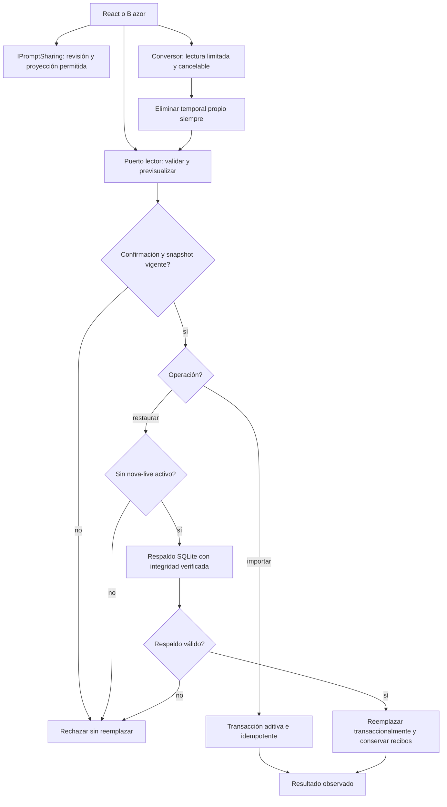

# Archivo, restauración y compartir — 2026-10-20

Estado: incremento IMPLEMENTADO y VERIFICADO. El goal global y la versión siguen
abiertos. No se ejecutó inferencia ni se sustituyó el núcleo semántico.

## Auditoría y decisión

React mezclaba endpoints/esquemas de archivo con Configuración y Ayuda.
LibraryEndpoints recibía LocalStore completo. La aplicación server-rendered aún
restauraba con Store.Import, sin la revisión de snapshot y el respaldo verificado
de NovaRestore. Codecs, transacciones y proyección portátil ya tenían propietario.

(A) Conservar llamadas directas mantiene caminos divergentes; (B) puertos pequeños
y una fábrica compartida por ambos hosts reutilizan el propietario; (C) otro
repositorio/framework/codec por reflexión duplicaría reglas sin necesidad real.
Se elige B. Sin nuevos paquetes, modelos ni migraciones.

## Workflow y algoritmo



```text
construir LocalPromptLibrary una vez por host y ruta; registrar alias de sus puertos
compartir: comprobar existencia/revisión y usar la proyección portátil existente
convertir: comprobar cancelación; leer como máximo 4.000.001 bytes
  rechazar antes de escribir más de 4.000.000; validar esquema/filas
  devolver Archive existente; cerrar conexiones y eliminar temporal propio siempre
importar: validar documento completo; exigir confirmación; delegar transacción aditiva
restaurar: validar documento y publicar snapshot bajo el lock del propietario
  exigir confirmación; revalidar ejecución y snapshot; respaldar y verificar
  reemplazar dentro de la transacción existente; conservar recibos antirreplay
ante fallo: no simular éxito, conceder permisos nuevos ni reintentar automáticamente
```

## Contratos y propietarios

| Puerto / propietario | Entrada y salida | Invariantes |
|---|---|---|
| LocalPromptLibrary | Ruta → Store y adaptadores compartidos | Construcción común sin DI/HTTP/React; cada host registra su lifetime singleton |
| ILibraryArchiveReader | JsonElement → preview/snapshot; export → JSON | Sólo lectura; codec Archive v1/v2 y portátil existente |
| ILibraryArchiveWriter | LibraryImportInput → cantidad; Backup → archivo/integridad | Confirmación, snapshot vigente, guardia de ejecución visible, respaldo previo verificado |
| IPromptSharing | ID/revisión → JSON portátil | Sólo título, texto, descripción y categoría; sin valores, identidad ni historial |
| ILegacyArchiveConverter | Stream/CancellationToken → JSON Archive | Cota de 4 MB, esquema permitido, origen abierto e intacto, temporal limpiado en finally |
| LibraryArchiveClient | Datos/AbortSignal → respuesta validada | Conserva Blob binario, confirmación y snapshot; sin retries ni estado React |
| LocalStore y codecs | Documento validado → transacción | Únicos propietarios del formato, duplicados, historial, respaldo y reemplazo |

ValidationException, ConflictException y MissingPromptException mantienen su
semántica; la cancelación del conversor se propaga. Los puertos de archivo no se
registran como herramientas del modelo. El snapshot se obtiene bajo el lock de
una instancia: no se afirma exclusión entre procesos. NovaRestore protege nova-live;
no se afirma que controle sesiones antiguas de Quick Assist. Las escrituras son
síncronas/transaccionales; no se permite cancelar a mitad de un reemplazo. La
conversión comprueba cancelación entre lecturas/filas, sin prometer interrumpir una
llamada SQLite síncrona a mitad de ejecución.

## Implementación, compatibilidad y retirada

Application/LibraryArchives.cs define puertos/resultados. Infrastructure mantiene
los adaptadores en NovaLibraryArchives y la construcción en LocalPromptLibrary.
LibraryEndpoints sólo recibe contratos de aplicación. ApplicationModules y el
Program de Blazor registran la fábrica. React library.ts concentra conexión/Zod;
LibraryTools y LearningCenter consumen archives. Home.Sharing/Home.razor.cs usan
los mismos puertos y ahora restauran con snapshot y respaldo previo.

Rutas y formatos JSON conservados. LegacyImporter mantiene Convert(Stream) y añade
el overload cancelable/copia acotada. No se elimina: conserva consumidores activos.
Se retiraron conexión/esquemas duplicados de componentes y acceso directo que
eludía las protecciones de restauración. No se borran validaciones por contener
condicionales ni se fuerzan jerarquías artificiales de clases.

## Verificación ejecutada

Evidencia conjunta: [verification.json](../evidence/archive-ports-20261020/verification.json).

- **789/789 backend**, sin omitidas; cinco pruebas nuevas de puertos/SQLite real,
  privacidad, revisiones, respaldo, antirreplay, límites/cancelación/temporales.
  Tras corregir una advertencia del analizador, tanda dirigida final **5/5**.
- **151/151** de la aplicación compartida anterior, sin omitidas.
- **151/151 frontend**, incluidos cinco contratos nuevos de archivo. Build
  TypeScript/Vite correcto; permanece la advertencia anterior de chunk principal.
- Builds API/Blazor correctos, cero errores/advertencias y DLL compartidas iguales.
- **14 comprobaciones en Edge visible**: React/API/SQLite y Blazor reales, sin
  mocks; compartir/privacidad, cancelar, importar dos veces, revisión obsoleta,
  restaurar, respaldar y cargar SQLite sin modificar origen. Cero errores de
  navegador y solicitudes externas. Puertos y bases sintéticas propios.
- Seis controles estáticos de fronteras correctos. No prueban comprensión del agente.

Se conserva la tanda inicial de 11 recorridos. La ampliación comprobó los dos
consumidores de conversión y compartir Blazor. Una tanda intermedia alcanzó 13 y
se detuvo por selector ambiguo del harness («Opciones»/«Opciones avanzadas»).
Corregido sólo el selector, pasan las 14; no cambió el producto ni la expectativa.
No se ejecutaron corpus Qwen ajenos a este bloque.

## Rollout, reversión y pendientes

Sin migraciones ni promoción del candidato semántico. Para revertir, restaurar
exclusivamente estos consumidores/puertos/fábrica y su composición; no resetear
trabajo previo, borrar datos ni restaurar una base como rollback de código.

Quedan la sustitución semántica rechazada por fidelidad y otros consumidores
anteriores/capacidades aún concretas. La matriz canónica permanece **34 CERRADO /
54 abiertos**. Este incremento no demuestra cierre global ni agente infalible.
