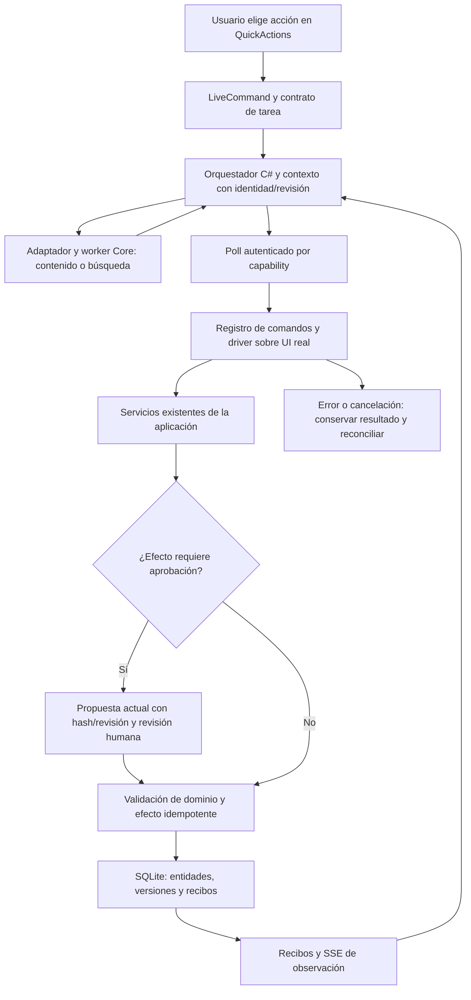

# Auditoría funcional del agente tras el rediseño

2026-10-23, America/La_Paz. Commit de la entrega visual y escritorio:
`a3922c27464af6f55ac28cd59ea0c82d0ac7a05d`.

**Resultado: flujo principal operativo en los casos probados, con dos hallazgos
pendientes. No procede afirmar que todo está correcto ni certificar fidelidad
autónoma del contenido.** Esta auditoría no modifica la aceptación humana previa
de 1.0.0 ni implementa una reparación de los hallazgos.

## Candidato y alcance

- Frontend reconstruido de las fuentes del commit; índice idéntico al servido
  por la instancia habitual 5277.
- API congelada de la entrega r1: hashes de API, Application, Infrastructure y
  Domain coinciden con `runtimeIdentity.candidateFilesSha256` del
  [manifiesto r1](../releases/nova-v1.0.0-r1.json). Worker coincide con su fuente.
  El rebuild de backend tiene otro hash/InformationalVersion; las pruebas del
  código reconstruido y la ejecución del candidato congelado se distinguen.
- Qwen3:8b local, runtime adaptive-core y SDK ya configurados. Sin nuevos paquetes,
  modelos, presupuestos, servicios externos o cambios de proveedor de producto.
- Navegador → API → modelo → SQLite propias en 5289. Segundo perfil en 5290,
  con endpoint local inaccesible, para aislamiento de fallo. La biblioteca de
  5277 no se empleó como fixture ni se modificó.
- Datos sintéticos: acta de reunión y análisis SQL. El acta exige exactamente
  tres tareas; Ana tiene fecha, Luis carece de fecha y la tercera tarea carece
  de responsable/fecha. La regla exige «no indicado» sólo para lo ausente.

## Qué se verificó

| Comprobación | Resultado y alcance |
| --- | --- |
| Backend reconstruido | 1.163/1.163 tests; cero omitidos |
| Frontend | 272/272 tests en 41 archivos |
| Build | TypeScript/Vite correcto; aviso existente de bundle >500 kB |
| Arquitectura/documentación | 36 controles estáticos; 13 documentos; 3 tests del comprobador |
| Creación manual | Dos prompts guardados y reabiertos con variables |
| Compilación | Las notas visibles llegan completas al texto preparado, incluido Luis |
| Ejecución local real | Stream completo y UI terminada; **FAIL de contenido** descrito abajo |
| Búsqueda por significado | Descripción de compromisos de reunión abre el acta frente al control SQL; sin modificación del prompt |
| Reserva de comandos | Escritura humana mediante teclado en búsqueda permanece bloqueada durante ejecución |
| Adaptación | Conserva tres tareas, fallback, prohibición de inventar y sólo `<notas>`; añade la tabla solicitada |
| Aprobación | Antes de confirmar, origen sigue en revisión 1; después, mismo ID en revisión 2, cuerpo exacto de la propuesta y dos versiones conservadas |
| Cancelación real | Creación detenida durante inferencia; estado CANCELLED, effectCommitted=false, marco retirado; edición humana posterior no reemplazada y biblioteca sigue con dos prompts |
| Revisión de borrado | Muestra identidad y advertencia; cancelar conserva el prompt. No se ejecutó borrado definitivo |
| Archivo/recuperación | SQL archivado y recuperado, revisión 1→2→3 y contenido intacto; historial visible |
| Proveedor inaccesible | Error visible, ninguna respuesta inventada; Detener devuelve control; biblioteca manual permanece y sobrevive recarga. **Espera deficiente** descrita abajo |
| Solicitud sin cabecera de cliente válida | POST de preparación del fixture rechazado con 403; no creó un registro. Se continuó por UI normal |

Los tests cubren además identidades/revisiones, aprobación obsoleta, replay,
cancelación, reinicio y recibos. Sus dobles prueban contratos, no semántica de
Qwen. No se ejecutó en esta consulta una campaña estadística, carga sostenida,
otro proveedor, publicación externa, restauración destructiva ni una evaluación
independiente por otro agente. La creación completa con aprobación del turno
anterior es evidencia previa, no una nueva ejecución de este turno.

## Hallazgos pendientes

### A01 — Medio: una respuesta completa pierde un hecho conocido

Run `6f2c8fdb-b2d2-44c6-8311-540f9bbc7fe3`. Entrada preparada:
«Luis revisará el contrato; no se acordó fecha». La respuesta muestra
«Revisar contrato — Responsable: no indicado — Fecha: no indicado».
Debía conservar Luis y usar fallback sólo para la fecha.

El texto preparado y el resultado visible demuestran el incumplimiento. El
endpoint de [ejecución](../../backend/QuickPrompt.Api/PreparationEndpoints.cs)
envía `draft.CompiledText` y transmite `output.Text`; el
[lector de stream](../../apps/web/src/services/localStream.ts) valida estructura,
revisión y terminación. No comprueba esa relación factual.

Primera divergencia observada: texto preparado correcto → respuesta mostrada
incorrecta. No se capturó el paquete HTTP interno al proveedor ni su salida
previa al adaptador; atribuir una causa interna exclusiva a Qwen permanece sin
confirmar. Sí está confirmado que la verificación de transporte/terminación no
detecta este error semántico. No se cambió el prompt para conseguir otro PASS.

[PreparedUse](../../apps/web/src/features/nova/PreparedUse.tsx) añade el texto
accesible «Respuesta verificada» al recibir `complete`, aunque no haya validación
semántica. Conviene expresar el grado real: respuesta recibida completa, distinta
de contenido correcto. La revisión humana sigue siendo necesaria.

Siguiente experimento justificado: capturar en fixture sintético las fronteras
requerido/enviado/devuelto/mostrado para responsabilidades y fechas, con controles
positivos y ausencias legítimas. No introducir un juez, retry o handler por nombre
sin identificar primero el mecanismo y mantener el proveedor autorizado.

### A02 — Medio: el driver no corta pronto ante el error de ejecución

Run offline `7a16e8bc-42e9-49fb-9e57-8a1f3c8b59ab`. El diálogo muestra
«Core no pudo conectar con el modelo local. La biblioteca sigue disponible», pero
el agente conserva control hasta intervención/timeout. Se observó y se detuvo a
los 48,9 s del run; no se afirma haber agotado su timeout.

Causa confirmada en [AgentUiCommands](../../apps/web/src/features/nova/AgentUiCommands.ts),
comando `ui_execute_local`: después del clic, `host.until` sólo espera
`local-response-complete` durante 150.000 ms. El error del diálogo no satisface
ni interrumpe ese predicado. `AgentUiDriver.until` comprueba cancelación y tiempo,
pero no añade una condición terminal de error a esa espera. El usuario puede salir
con Detener; el run quedó CANCELLED y no se generó una respuesta.

La corrección futura pertenece a esa espera/recibo, preservando el error visible,
la identidad del run y la no repetición del clic. Aceptación: error real corta la
espera y devuelve control sin esperar 150 s; éxito sigue funcionando; cancelación
y entrega repetida de recibo no repiten la operación.

## Cómo está construido y qué funcionó bien



La UI compone puertos de `ApplicationServices`; C# conserva contratos, permisos,
revisiones y efectos; los adaptadores realizan E/S. La selección explícita evita
volver a deducir una acción ya elegida. La consulta original llega al buscador;
la similitud no concede autorización. El driver utiliza controles opt-in e IDs
estables y no recibe scripts/selectores arbitrarios del modelo. SSE despierta el
poll, pero no entrega acciones ejecutables. Propuesta, borrador, respuesta y
registro persistido mantienen identidades y responsabilidades diferentes.

El rediseño conservó esos contratos al extraer presentación controlada: sidebar,
footer, bienvenida y toolbar. Mapa y aprobación reutilizan el snapshot de NovaLive;
no añaden polling ni otro escritor. La reserva de eventos arbitra la interacción;
la autoridad sigue en el servidor. Por eso se pudo cambiar la composición y
seguir guardando una revisión exacta con el driver real.

```text
fijar expectativa original, origen/revisión y efectos permitidos
observar el control real y ejecutar por su propietario existente
al obtener propuesta: conservar registro original hasta confirmación exacta
al guardar: comprobar mismo ID, nueva revisión, cuerpo y versiones persistidas
al cancelar: detener driver e invalidar trabajo pendiente; comprobar efecto final
al recibir respuesta: distinguir stream completo de fidelidad a los datos
al fallar proveedor: conservar vía manual y propagar error al ciclo del agente
```

## Transferencia a ai-software-delivery

Se actualizaron la entrada de la skill global y sus referencias
`visible-ui-agents.md`, `validation-transfer.md` y `origin-and-tools.md`.
Conservan configuración, framework y política de cada proyecto. Los aprendizajes
añaden contratos de interacción al rediseñar, foco/portales y guardias de eventos,
esperas de éxito/error/cancelación, respuestas tardías y grados de verificación.
La acción explícita se ofrece como opción de producto, no como imposición universal.

Validación: frontmatter sin cambios y 14 enlaces locales existentes. Se intentó
el validador oficial, pero no pudo importar PyYAML; tampoco está en el Python
bundled. No se instaló ni simuló esa dependencia. La revisión documental propia
no constituye una evaluación independiente del comportamiento de la skill.
Los helpers ejecutables no fueron modificados. La skill global está fuera del
repositorio QuickPrompt; su actualización no forma parte del commit de producto.

## Evidencia y cierre

Artefactos locales, sin bases privadas, en `.playwright/agent-audit-20261023/`:
`candidate-hashes.json`, `release-artifact-match.json`, `execute-pending.json`
(contiene el estado ya COMPLETED), `execute-content-failure.png`,
`adaptation-pending.json`, `adaptation-completed.json`, `source-before-approval.json`,
`source-after-approval.json`, `source-versions.json`, `creation-cancelled.json`,
`offline-cancelled.json`, `library-final.json`, `approved-version.png`,
`skill-resource-check.json`, `skill-after-hashes.json` y copia anterior de la skill.
Se excluyen de Git según la [política de evidencia](../evidence/README.md).

No se repararon A01/A02 en una consulta de auditoría. El resultado permite una
decisión concreta: priorizar la propagación de error del driver y después medir
fidelidad con las fronteras reales, conservando revisión y permisos. No reemplazar
todo el sistema por estos dos hallazgos: son mecanismos distintos y no acreditan
tres fallos del mismo invariante.

Al cerrar, se detuvieron sólo los procesos propios de 5289/5290 tras comprobar su
identidad. La instancia principal conserva PID 16080 y `/health` devuelve `ok`;
el observador sigue activo. No se cambió el número de versión ni se movieron tags.
