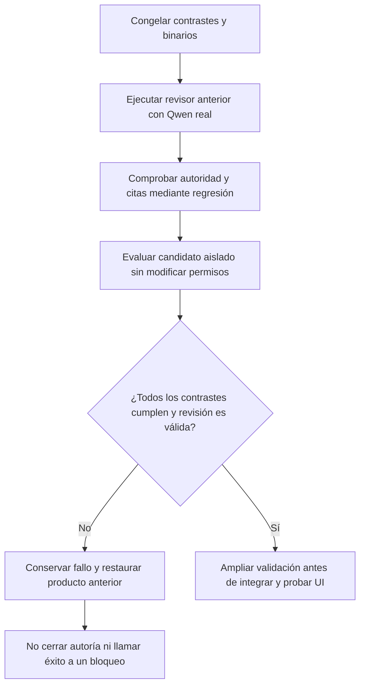

# Autoridad y evidencia del revisor de autoría

Fecha: 2026-10-19, America/La_Paz. Goal activo. **AUT-07 continúa FALLA; ninguna corrección experimental se promovió.** La matriz sigue con 20 requisitos cerrados y 68 abiertos.

## Primera divergencia comprobada

`ReviewDraftFidelity` construye `authorizedUserRequest` con `bodyRequestClauses` cuando existen. Esos fragmentos los seleccionó el generador. Por tanto, la interpretación del generador sustituye a la petición original en la entrada del revisor y en la validación de sus citas.

Si el generador clasifica una restricción futura como externa, el revisor no la recibe. Incluso un revisor que cite esa restricción real puede recibir `CONTENT_FIDELITY_REVIEW_INVALID` porque su cita no está en el subconjunto. La regresión reprodujo esa transición: esperaba `CONTENT_FIDELITY_MISMATCH` por una condición omitida y obtuvo revisión inválida. [Prueba antes del cambio](../evidence/draft-authority-20261019/authority-before.trx).

El problema no se corrige tratando los fragmentos del modelo como autoridad ni relajando grounding. La petición original debe seguir siendo autoridad; la selección del generador es una afirmación revisable. Sin embargo, una frontera de autoridad correcta tampoco garantiza que el modelo interprete sus ámbitos correctamente.

## Método y criterio congelado

Se crearon seis contrastes de desarrollo con cuerpos controlados, petición original y selección de requisitos: tres cuerpos correctos y tres incorrectos. Se conservaron todas las expectativas. [Dataset](../../Tests/nova/datasets/authoring-authority-v1/development.json) y [criterio de componente](../../Tests/nova/datasets/authoring-authority-v1/thresholds.json).

La aceptación del componente exige acuerdo en los seis, cero falsas aceptaciones/rechazos y ninguna revisión inválida. Un error técnico o de contrato no demuestra que se haya reconocido un defecto real del artefacto. No se cambiaron los umbrales de recovery-v1 ni se leyó o ajustó su holdout.



```text
congelar petición, borrador controlado, selección y expectativa
ejecutar versiones aisladas con mismo Qwen3 8B, sin caché de inferencia
comparar aceptación y validez del juicio, no sólo ausencia de propuesta
si falla un positivo o se acepta un negativo: candidato no cualificado
conservar los intentos no terminados como NOT_TESTED
restaurar el producto si no supera el criterio
mejorar la observabilidad del diagnóstico sin cambiar expectativas
```

## Resultados conservados

| Variante | Ejecutado | Resultado y decisión |
| --- | --- | --- |
| Binario anterior, requisitos recortados | 6/6 casos | Aceptó los tres positivos y el negativo contaminado fue bloqueado; **aceptó indebidamente dos omisiones**: no inventar datos y aprobación futura. Acuerdo de disposición 4/6, no precisión general del agente |
| Petición completa + selección provisional en el mismo paquete | 3 casos; 3 NOT_TESTED | Bloqueó un positivo, aceptó contaminación y produjo revisiones inválidas. Detenido al ser inalcanzable el criterio; **RECHAZADO** |
| Petición, respuesta propuesta y revisión en roles conversacionales separados | 6/6 casos | Disposición coincide en 5/6, pero **todavía acepta la omisión factual**; además el bloqueo del cuerpo contaminado acabó como revisión inválida y la crítica de otra fila mezcló una condición futura real con un control actual. **RECHAZADO**, no 5/6 de fidelidad semántica demostrada |
| Cobertura por pasaje con evidencias del cuerpo, reasoning activado | 2 casos; 4 NOT_TESTED | Primer caso incompleto por agotamiento del presupuesto; segundo emitió rechazo. El criterio ya era inalcanzable por el positivo inválido. **RECHAZADO**; no se aumentó silenciosamente el presupuesto |
| Mismo tipo de cobertura, sin reasoning interno | 6/6 casos | Acuerdo de disposición 2/6; rechazó los tres positivos y aceptó contaminación. Las etiquetas y referencias válidas no prueban sus relaciones semánticas. **RECHAZADO** |

Son contrastes expuestos de desarrollo, no holdout ni recorridos de generación, UI o persistencia. Los cuerpos se controlaron para aislar al revisor. No se mide rapidez de usuario, p95, rendimiento comparativo ni calidad de una creación completa. Se usó Qwen3 8B con el digest conservado en [el manifiesto](../evidence/draft-authority-20261019/manifest.json); sin modelos nuevos, nube ni datos privados.

El cambio de autoridad pasó una regresión de transporte antes de su rechazo semántico; ese PASS **no** lo convierte en una solución de producto. La prueba y las variantes quedaron archivadas fuera del proyecto de tests activo. Los ensayos posteriores añadieron casos de continuidad, cita inventada y presupuesto, pero no se declara que esos casos adicionales se hayan ejecutado como parte de la tanda de una prueba. La versión de producto se restauró exactamente al hash anterior de `DraftFidelity.cs`: `4A6FFAB970646244007ADDB46C9D375B0087BEC80773E99F8EB2E25D2A0E4BA8`.

Evidencia: [baseline](../evidence/draft-authority-20261019/baseline-real.json), [paquete completo rechazado](../evidence/draft-authority-20261019/candidate-real.json), [roles conversacionales](../evidence/draft-authority-20261019/conversation-real.json), [cobertura sin reasoning](../evidence/draft-authority-20261019/witness-fast-probe.json).

## Mejora conservada del diagnóstico

`GenerationDiagnostic` ahora registra `errorCode`, `reviewOutcome`, `expectedReview` y `reviewConforms`. Distingue:

- `REVIEW_ACCEPTED`: evaluación aceptada; todavía requiere revisar fidelidad contra la expectativa.
- `CONTENT_REJECTED`: rechazo explícito `CONTENT_FIDELITY_MISMATCH`.
- `REVIEW_INCONCLUSIVE`: salida inválida, error de contrato, indisponibilidad, cancelación u otro fallo sin juicio semántico válido. Nunca satisface por sí solo una expectativa negativa.

Esto alinea el diagnóstico de creación con la regla que `FidelityEvaluation` ya aplicaba. No se afirma que ese evaluador anterior contara indiscriminadamente excepciones como aciertos. El cambio corrige la ambigüedad de las etiquetas y datos del diagnóstico de generación, sin modificar decisiones del agente.

Cada fila registra también el endpoint de inferencia y `modelIdentityVerified=false`: el nombre solicitado no prueba que haya respondido ese modelo. Se usan etiquetas neutrales de revisión/generación; una ejecución contra un servidor de respuestas controladas no se anuncia como modelo real. Las campañas reales necesitan el manifiesto/digest y la procedencia correspondientes.

Se añadió `NOVA_QA_OLLAMA` únicamente al evaluador para pruebas de transporte reproducibles. Conserva por defecto `http://127.0.0.1:11434` y aplica la validación loopback existente. No es configuración del producto ni acceso a proveedores remotos.

Cuando el fixture declara `expectedReview`, un resultado inválido o una decisión distinta hace terminar el evaluador con código **2**, después de conservar todas las filas. Sin expectativas, conserva su carácter de diagnóstico. El estado del proceso no convierte una excepción en acierto semántico.

`Tests/nova/review-diagnostic.cjs` ejecuta el evaluador contra un servidor HTTP de prueba en puerto propio: aceptación válida, rechazo de contenido y revisión inválida tras sus dos intentos. **Tres controles PASS**; el último conserva `reviewConforms=false` y exit code 2 aunque la expectativa fuera rechazo. También comprueba endpoint y ausencia de identidad certificada. Es una prueba de contrato/observabilidad con respuestas controladas, **no comprensión de Qwen**. [Resultado final](../evidence/review-diagnostic-20261019/1792418076017/results.json).

## Estado y siguiente trabajo

Producto restaurado: backend completo **466/466 PASS**, cero omitidas; [TRX](../evidence/draft-authority-20261019/restored-backend.trx). Evaluador final compila sin errores ni advertencias. No hay cambios frontend respecto al candidato de categorías; no se repitió React, UI general, generación, validación independiente, holdout ni benchmarks en este trabajo. La instancia previa 5190 no se reinició.

No repetir estas variantes como si fueran hipótesis nuevas. La recuperación de autoría necesita que interpretación, generación y evaluación compartan autoridad completa sin convertir controles actuales en obligaciones futuras, y que el revisor compruebe tanto positivos como negativos. Esto sigue sin cualificar con los perfiles ensayados.

El goal continúa también por trabajo de producto autorizado que no depende de promover este revisor: **SAV-04 requiere una capacidad tipada de revisión de eliminación con identidad/revisión, confirmación humana vigente y recibo del efecto**, ausente en el catálogo actual. Debe conservarse la intención semántica y la cancelación sin navegación; no se resolverá con rutas por palabras ni un clic automático en Eliminar. Resolver esa capacidad no exime AUT-01..08 ni la campaña integral.

Reproducción del diagnóstico de contrato, con las herramientas existentes:

```powershell
dotnet build backend/QuickPrompt.Evaluation/QuickPrompt.Evaluation.csproj --no-restore -o .playwright/draft-authority-20261019/final-diagnostic4 --verbosity quiet
$env:NOVA_DIAGNOSTIC_BUILD='.playwright/draft-authority-20261019/final-diagnostic4/QuickPrompt.Evaluation.dll'
node Tests/nova/review-diagnostic.cjs
```
