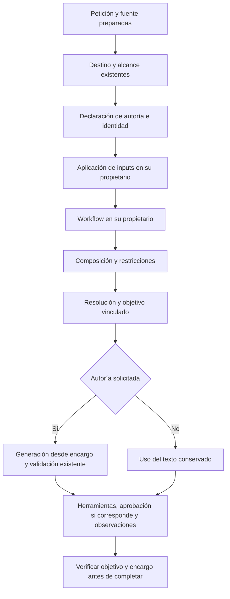
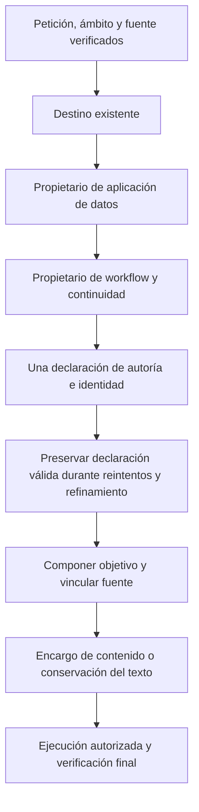
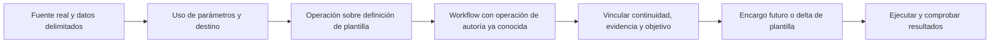
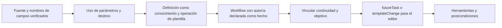

# Autoría e identidad — candidato aislado

2026-10-20. Estado: **IMPLEMENTADO PARA CUALIFICACIÓN, NO PROMOCIONADO**. No cierra la versión ni criterios semánticos. Continúa el [goal vigente](VERSION_COMPLETION_GOAL.md) y el [contrato de composición](SEMANTIC_CONTRACT_COMPOSITION.md).

## Contrato y propietarios

`InstructionUseInference` incorpora una ruta alternativa de autoría/identidad en `PreparationInference`. Devuelve `InstructionAuthoring` con conservar/revisar/crear, encargo de contenido, evidencia y hashes de petición/tarea pendiente. No devuelve aplicación de campos ni acciones de workflow. En esa ruta no se invocan `ReviewAuthoringScope` ni `AdditionalArtifactRequested`; los propietarios existentes conservan fuentes, valores, workflow y aprobación.

El generador consume `ContentInstruction` como encargo. La petición original conserva su papel explícito de datos para referencias literales, metadatos y comprobación de fidelidad; no sustituye el encargo al faltar uno. `Generate` rechaza `KEEP_TEXT` y encargos vinculados a otra petición. Las decisiones de texto no conceden guardar o ejecutar.

`TaskSourceResolver` transmite la declaración al refinar una fuente y conserva el resultado tipado al recompilar. `NovaTaskPlanner.Resolve` vincula un `TaskGoal` después de resolver/refinar; `TaskGoal.FromAuthoring` conserva efectos, cláusulas y restricciones. El cierre y las evaluaciones de contenido quedan ligados al mismo encargo; sustituirlo invalida la comprobación. Las aprobaciones y los IDs/revisiones siguen en sus propietarios existentes.

La configuración temporal `QuickPrompt:Preparation:AuthoringUseContract` selecciona la ruta candidata; **por defecto es false**. Con true, un fallo no cambia silenciosamente a la ruta antigua. El constructor C# recibe un parámetro opcional añadido; no cambia el contrato HTTP ni SQLite. No se añaden dependencias, modelos, proveedores ni configuración global de Ollama. El selector se justifica por cualificación/rollback; no interpreta frases ni sustituye los criterios de aceptación.

Flujo candidato v1:



```text
declarar una identidad y un encargo sin decisiones de campos/workflow
vincular declaración a petición actual y, cuando aplique, tarea pendiente
reutilizarla durante refinamiento; no consultar otro árbitro de identidad
componer con las decisiones de los propietarios de datos y workflow
resolver fuente y crear objetivo antes de efectos
generar sólo desde un encargo compatible, con evidencia literal como datos
aplicar comprobaciones, aprobación exacta y observaciones existentes
rechazar cierre o evaluación de contenido si cambia el encargo vinculado
```

Se mantienen cancelación y presupuestos de etapas. Los errores de esquema, evidencia o vinculación no conceden efectos. Sigue pendiente comprobar que también se conserve la decisión durante todos los reintentos del coordinador; no basta el caso de refinamiento.

## Verificación ejecutada del candidato v1

- [Nueve contratos controlados](../evidence/closure-20261020/tests/authoring-decision-candidate.trx): **9/9**, cero omitidas. Petición/tarea pendiente diferentes, identidad incompatible, prohibición de generar al conservar, cambio de encargo antes de completar, invalidación de evaluación anterior y transporte real HTTP con modelo controlado para conservar/revisar/crear/refinar.
- [Backend completo](../evidence/closure-20261020/tests/authoring-decision-backend-full.trx): **648/648**, cero omitidas. Los contratos controlados no miden precisión de Qwen.
- API compilada con dependencias: cero warnings/errores. Application/Infrastructure/Domain idénticos por SHA-256 a los usados por las pruebas. El primer empaquetado sin dependencias carecía de ensamblados y no llegó a ejecutar UI: [fallo conservado](../evidence/latency-1792471471723/failure.txt).
- La [campaña UI real](../evidence/latency-1792471535010/measurements.json) usa Edge, Qwen3 8B, copia de SQLite exclusivamente sintética y frontend conservado. **No se promociona** mientras la campaña tenga fallos o esté incompleta. Primer recorrido inline pasa en 51542 ms/10 llamadas; valor, preview y copia exactos. `sourceUnchanged=false` tras el clic manual corresponde sólo al contador de uso: `fieldCopyVerification` acredita biblioteca intacta durante el agente y cambio exclusivo de uso después de copiar.
- La variante con datos separados **falla**, 125694 ms/14 llamadas. El campo queda vacío, sin compilación. Hay una sola declaración de autoría, pero eligió `REVISE_TEXT` y describió completar/copiar como contenido. La generación posterior fue rechazada por contaminación de órdenes de sesión. No es un fallo de localizar o escribir el control de campo: el plan ya incluía una adaptación incorrecta antes de ejecutarlo.
- Creación y continuación: **COMPLETED/correcto**, 133535 ms/17 llamadas para el recorrido compuesto; se alcanzó el segundo turno. Editor, título, valores y preview coinciden con el artefacto, y las dos capturas se inspeccionaron. Es evidencia de ese recorrido sin guardar, no aprobación/guardado ni fiabilidad general. La identidad interna `DraftRef` no es observable en esa vista pública y requiere sus pruebas de transporte.

Resultado conjunto: **2/3**, [validación FAIL](../evidence/latency-1792471535010/validation.json). Se conserva el [manifiesto y archivo de fuentes v1](../evidence/closure-20261020/authoring-identity-candidate-v1.json). El proceso del arnés terminó con código 0, pero eso no convierte la campaña en PASS. La prueba de copiar acredita el control y su texto capturado en navegador; no certifica integración del portapapeles del sistema operativo.

No se han ejecutado validation/holdout ni aceptación de latencia. Los 51542 ms no constituyen baseline ni mejora general aceptada.

## Contrastes de representación conservados

Mismos veinte paquetes de desarrollo/sintéticos, diecinueve adjudicados para autoría. Ninguno ejecuta acciones ni acredita UI o fidelidad de creación:

| Resultado local | Aciertos de autoría | Decisión |
| --- | --- | --- |
| [Autoría/identidad con encargo, sin razonamiento](../evidence/closure-20261020/authoring-identity-only-v1.json) | 12/19 | Rechazado |
| [Mismo contrato sin redactar encargo](../evidence/closure-20261020/authoring-identity-only-v2.json) | 12/19 | Retirar el encargo no basta |
| [Extracción del componente de texto anterior](../evidence/closure-20261020/authoring-component-v1.json) | 6/19 | No se adopta por el 19/19 histórico de otra forma de salida |
| [Esquema también en el mensaje](../evidence/closure-20261020/authoring-identity-schema-grounded-v1.json) | 9/19 | Rechazado |
| [Mismo mensaje/esquema validado, transporte JSON](../evidence/closure-20261020/authoring-identity-json-control-v1.json) | 9/19 | No demuestra que la restricción de formato cause el error semántico |
| [Razonamiento/presupuesto de texto de producción](../evidence/closure-20261020/authoring-identity-production-profile-v1.json) | 18/19 | Aún falla preparar Qwen sin editar; no es aprobación de calidad |

Los últimos contrastes mantienen los mismos casos y no ajustan frases individuales. La [documentación oficial de Ollama](https://github.com/ollama/ollama/blob/main/docs/capabilities/structured-outputs.mdx) describe salida estructurada; su validez no demuestra intención correcta. No se registra razonamiento privado.

## Primera divergencia y siguiente corrección

La traza real de datos separados muestra que el propietario de datos ya extrajo el valor literal. Sin embargo, la autoría se declara **antes** de la intención de aplicación de esos datos y del workflow completo. Sólo recibe la identidad/campos de la fuente y el destino; después el propietario de datos confirma FILL y el workflow confirma COPY. El encargo erróneo termina repitiendo esas operaciones como una adaptación del prompt. Los paquetes de componente no reproducen exactamente ese contexto real, por lo que sus aciertos no pueden trasladarse al coordinador.

La corrección coherente que debe contrastarse es romper la dependencia circular: interpretar aplicación de datos sin una conclusión previa de autoría, interpretar workflow en su propietario, y ofrecer esos resultados como hechos independientes al único propietario de autoría/identidad. Conservar cualquier modificación de contenido adicional solicitada; no suprimir autoría por detectar datos o un destino. No usar oráculos como hechos del modelo, ni un segundo revisor para compensar la declaración.

También debe protegerse la declaración válida dentro del presupuesto de reintentos del coordinador, además del refinamiento de fuente. Ambos cambios pertenecen a esta misma frontera de propiedad y deben verificarse antes de repetir los recorridos reales en el candidato siguiente. No se rebajan criterios ni se da por cerrado ningún requisito de la matriz.

## Candidato v2 — orden de capacidades y declaración estable

Implementado sin activar por defecto. Datos interpreta primero su propio uso, sin recibir una conclusión previa de autoría. Workflow interpreta después sus ejes y la continuidad de una tarea pendiente. Autoría recibe ambos resultados como hechos tipados y decide sólo su contenido/identidad. Se ofrecen nombres de campos suministrados, no sus valores. El contexto sigue distinguiendo la selección real de una fuente recién resuelta; no se simula una selección para influir en el modelo.

La continuidad pertenece a workflow y no se deriva de que exista una revisión del texto. La procedencia de una cita de autoría es un dato independiente: una modificación actual puede continuar el workflow anterior sin tomar su evidencia del mensaje anterior. Las declaraciones de eliminación que citen una tarea pendiente requieren continuidad validada; siguen sin conceder aprobación. Los contratos privados antiguos conservan su comportamiento cuando el selector está desactivado.



```text
obtener datos y workflow en sus propietarios sin depender de autoría
validar continuidad y procedencia antes de ofrecer contexto pendiente
declarar autoría con esos hechos, sin convertirlos en instrucciones de contenido
conservar la declaración válida en el presupuesto local de la petición
si falla otra etapa, recuperar sólo dentro del presupuesto sin redeclarar identidad
vincular encargo, fuente, objetivo y comprobación final como en el candidato anterior
```

La regresión de orden falla **5/5 antes**: faltaban los hechos independientes y se entregaba autoría como premisa a datos. Tras invertir el orden, pasan nueve controles y falla el reintento: **1 declaración esperada, 2 reales**. Se corrige conservando la declaración válida en el presupuesto local, sin estado global, otra consulta o aprobación reutilizada.

Evidencias: [antes del orden](../evidence/closure-20261020/tests/authoring-owner-order-before.trx), [orden sin conservación durante reintento](../evidence/closure-20261020/tests/authoring-owner-order-without-retry-cache.trx), [orden y reintento corregidos: 10/10](../evidence/closure-20261020/tests/authoring-owner-order-and-retry-after.trx). Añadidas procedencia/continuidad y vinculación a tarea pendiente, [contratos v2: **13/13**, cero omitidas](../evidence/closure-20261020/tests/authoring-owner-v2-final-contracts.trx).

La regresión completa, el build API v2 y la repetición UI se ejecutan separadamente. Los **2/3 de UI pertenecen al v1** y no acreditan al v2. Continúan pendientes la aceptación semántica general, aprobación/guardado del candidato final, validation/holdout y rapidez comparable.

Resultado final v2: [backend **652/652**, cero omitidas](../evidence/closure-20261020/tests/authoring-owner-v2-backend-full.trx); API sin warnings/errores y tres ensamblados compartidos idénticos. [UI real **0/3**](../evidence/latency-1792472800973/measurements.json): inline 149046 ms/18 llamadas; datos separados 130656 ms/14; creación bloqueada antes del segundo turno, 44315 ms/8. Los dos primeros declaran una edición cuyo encargo describe literalmente llenar/compilar/copiar pese a recibir FILL/COPY como hechos. Workflow añade COPY a la creación sin petición. No hubo cambios en los registros de biblioteca; sí se intentaron acciones de edición no solicitadas. [Archivo de fuentes y manifiesto v2](../evidence/closure-20261020/authoring-identity-candidate-v2.json): **383 fuentes sin cambios durante la tanda**. La corrección mecánica de orden/reintentos es real; no demuestra fiabilidad semántica. Candidato no promocionado.

## Siguiente contrato — representaciones y actores explícitos

La palabra `text` no distingue la definición reutilizable de su instancia compilada: asignar parámetros sí cambia el texto preparado, sin editar `templateText`. La declaración de autoría tampoco recibía el cuerpo real que ya había leído el propietario de fuente. Una creación se representa además como una orden al editor y como tarea del futuro asistente; mezclar ambas en `contentInstruction` permite repetir metainstrucciones. Estas son hipótesis de contrato respaldadas por las respuestas erróneas, no una garantía de que cambiar nombres las resuelva.

El siguiente incremento debe representar mutación de **plantilla**, dar su cuerpo como conocimiento con procedencia y separar tarea futura de cambio sobre plantilla existente. Usar bindings reales del catálogo reflejado como conocimiento. Datos conserva su interpretación independiente; después autoría recibe esos hechos y el destino, y workflow recibe la operación de plantilla ya declarada. La evidencia de una tarea anterior es referencia; workflow sigue decidiendo si la petición actual continúa esa tarea antes de vincular efectos.



```text
mantener los valores de entrada fuera de la decisión de autoría
ofrecer plantilla como datos y distinguir definición, parámetros y compilación
declarar conservar definición, revisar definición o crear otra identidad
para crear: expresar la tarea del futuro asistente; para revisar: expresar el delta
interpretar workflow con esa operación conocida, sin inferir copiar por crear
validar continuidad antes de usar evidencia de una tarea pendiente
preservar la declaración válida y las comprobaciones de objetivo/estado existentes
ejecutar de nuevo los mismos recorridos sin promover por pruebas de componente
```

## Candidato v3 — definición, instancia y tarea futura

El contrato no pide conservar/revisar un `text` ambiguo. Nombra `TEMPLATE_UNCHANGED`, `REVISE_TEMPLATE` y `CREATE_TEMPLATE`, referidos exclusivamente a la definición reutilizable. Los nombres de sus representaciones proceden de las propiedades reales `PromptDocument.TemplateText`, `UiVisibleState.Values` y `UiVisibleState.CompiledText`. El cuerpo que ya leyó fuente se entrega como `instructionKnowledge`, identificado como tarea del futuro asistente y separado de los pasajes de petición; los valores de caso siguen fuera de autoría. El catálogo incorpora sus bindings reales de herramientas.

La creación declara `futureTask`; la revisión declara `templateChange`. El editor recibe `editorOperation` separado y consume el campo correspondiente, sin usar la orden mixta como petición principal. Las unidades originales siguen siendo datos para metadatos, citas y fidelidad. No se eliminan palabras como guardar o prompt si pertenecen realmente a la tarea futura.

El orden se ajusta a las dependencias observadas: datos interpreta de forma independiente; autoría consume datos, destino y definición; workflow recibe la operación de autoría ya declarada para no convertir crear/revisar en una copia implícita. Workflow mantiene la continuidad. Una cita anterior sólo se vincula al objetivo después de validar esa continuidad; citarla no autoriza por sí mismo retomar la tarea.



[Contratos v3: **13/13**, cero omitidas](../evidence/closure-20261020/tests/template-representation-v3-contracts.trx). Se conserva la expectativa original de fuente como conocimiento y petición como autoridad; no se exige ocultar el cuerpo al modelo. Los datos concretos siguen excluidos y la cita de autoría no procede del cuerpo. La revisión completa y la UI del v3 no se deducen de este resultado ni de campañas de versiones anteriores.

Resultado final v3: [UI real](../evidence/latency-1792474435293/measurements.json) sólo completa correctamente el recorrido con valores separados. Inline declara creación extra y falla después; creación produce metainstrucciones y se bloquea antes del seguimiento. [Manifiesto](../evidence/closure-20261020/authoring-identity-candidate-v3.json): 383 fuentes estables y 652 tests históricos de ese candidato; no promoción.

## Candidato v4 — encargo literal y redactor con alcance de contenido

La [auditoría de causa y aceptación](AGENT_RELIABILITY_ROOT_CAUSE.md) documenta los recursos, controles causales, variantes rechazadas y análisis de impacto. Las [matrices por categoría](testing/README.md) separan backend, frontend y agente; este cambio utiliza autoría y su dependencia de completar/copiar.

Autoría deja de generar `futureTask/templateChange`: devuelve operación y referencia. El código conserva la petición literal delimitada fuera de datos de caso. El catálogo reflejado se limita a sus dos operaciones. La creación redacta sólo título, descripción y cuerpo; identidad/decisión son del dominio, nombres de inputs del parser y valores de su extractor existente. Se elimina el segundo reparto de roles del generador candidato. El verificador existente y el objetivo vinculado siguen comprobando la petición original y el mismo encargo. No se cambia HTTP, persistencia, aprobación ni frontend; selector por defecto false.

[21 contratos dirigidos](../evidence/closure-20261020/tests/authoring-literal-content-v4-request-limit.trx), cero omitidos; [cinco comprobaciones del gate de evidencia](../../Tests/nova/acceptance.test.cjs) ejecutadas. Build API sin warnings/errores. No se vuelve a ejecutar una matriz general ajena a este cambio. La UI del mismo candidato se ejecuta por separado y requiere revisión independiente del contenido; estos contratos no cierran autoría ni la versión.

Resultado v4: ambos completar/copiar cumplen la expectativa literal de ID, revisión, cuerpo, valor, compilado y texto entregado al navegador. La creación y su continuación alcanzan COMPLETED y llenan los controles, pero el borrador inicial pide crear el mismo prompt y habla del encargo declarado. La [revisión independiente](../evidence/latency-1792475525468/independent-content-review.json) lo rechaza; el [gate combinado es FAIL](../evidence/latency-1792475525468/acceptance.json), frente al NOT_TESTED bruto del arnés que esperaba esa revisión. No es revisión humana ni prueba del portapapeles nativo.

[Manifiesto v4](../evidence/closure-20261020/authoring-identity-candidate-v4.json): 385 fuentes estables durante UI y tres ensamblados compartidos idénticos a los tests. Tiempos observados: inline 54388 ms/10 llamadas; separado 34483 ms/9; creación+continuación 104609 ms/16. No constituyen aceptación de rendimiento. El gate dispone ahora de **seis controles ejecutados**, incluyendo que el rechazo de contenido prevalece sobre UI correcta y que una revisión positiva nunca oculta UI fallida. Candidato sin promocionar.
