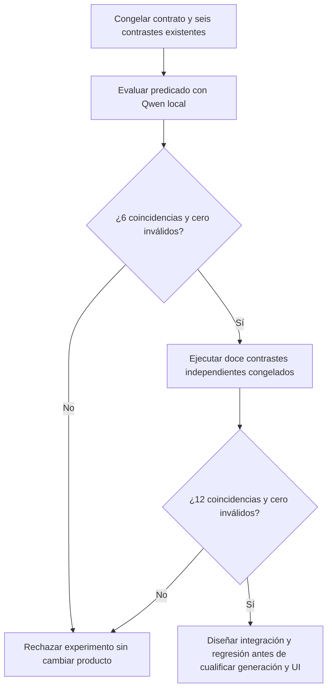

# Fidelidad de autoría — predicado único en evaluación

2026-10-19. **Experimento RECHAZADO, no integrado.** Continúa AUT-01/AUT-07, sin ampliar el alcance ni modificar producto, modelos o permisos. SAV-04 conserva su cierre funcional; estado de versión 21 cerrados/67 abiertos.

## Hipótesis y diferencia respecto a variantes rechazadas

La autoridad recortada y los juicios contradictorios del revisor están documentados en [el diagnóstico anterior](AUTHORING_AUTHORITY_DIAGNOSTIC.md). Cambiar sólo el paquete, roles conversacionales o cobertura por pasajes no superó los contrastes; no se reincorporan esas variantes. La nueva hipótesis es más acotada: un único predicado de satisfacción del artefacto podría evitar contradicciones entre el veredicto, los ámbitos y los arreglos de evidencias de aquel contrato. **Todavía no es evidencia de mejora.**

El modelo recibe petición completa y cuerpo propuesto; no recibe requisitos seleccionados por el generador, expectativas del fixture ni respuestas anteriores. Devuelve un único booleano estructurado. La ausencia de evidencia detallada limita la capacidad de diagnóstico; la simplificación sólo puede considerarse candidata si demuestra el mismo contrato de fidelidad, incluidos positivos y negativos. Una etiqueta válida no prueba que su contenido sea correcto. No concede escritura ni aprobación y no sustituye las validaciones deterministas existentes.



```text
leer contrastes sintéticos congelados y digest del modelo instalado
para cada contraste de desarrollo:
    enviar petición completa y cuerpo candidato, nunca la expectativa
    conservar thinking, contexto y un máximo de 1800 tokens del revisor existente
    limitar la llamada a 90 segundos; no reparar ni votar repetidamente
    validar estructura estricta y comparar el booleano con la expectativa original
    si hay error técnico: registrar INCONCLUSIVE, nunca rechazo semántico correcto
si no coinciden los seis: conservar fallo; validación NOT_TESTED; no integrar
si coinciden los seis: ejecutar la validación independiente ya congelada
si no coinciden los doce: conservar fallo; no integrar
si coinciden: aún faltan contratos de integración, generación fiel y UI real
```

Los doce casos de validación quedaron congelados antes de consultar resultados del primer probe. Cubren ES/EN, metadatos fuera del cuerpo, prohibiciones futuras, aprobación futura, omisiones factuales y adaptación con origen. No son el holdout de recovery-v1 y no autorizan ajustarlo. El producto y `DraftFidelity.cs` permanecen sin cambios durante esta prueba. No se miden latencia de usuario, p95 ni éxito de tareas completas con un diagnóstico de componente.

Prototipo de QA: `.playwright/authoring-predicate-20261019/probe.cjs`; validación congelada adyacente `validation.json`.

## Resultado y decisión

[Resultado con Qwen3 8B real](../evidence/authoring-predicate-20261019/probe.json): **5/6 coincidencias, cero inválidos**, con un falso rechazo del cuerpo fiel de resumen. Se rechazaron correctamente las dos omisiones y la contaminación; aprobación futura y prohibición SQL correctas fueron aceptadas. Esos cinco aciertos no satisfacen el criterio: la autoría no se ha recuperado. El prototipo termina con código 2. Tiempos de componente de 6,6–25 s, no flujo completo ni benchmark.

La validación independiente de doce casos queda **NOT_TESTED** por el fallo de desarrollo. No se retoca el primer contraste ni se invierte la decisión del modelo para conseguir PASS. `DraftFidelity.cs` permanece al hash anterior; ningún control del revisor del producto fue sustituido por este booleano. No se repiten variantes de redacción de la misma hipótesis tras fallar este control.

Continúa el trabajo autorizado sobre otro fallo ya documentado, no una nueva auditoría: el planificador puede sustituir la selección semántica por candidatos con puntuaciones literales parecidas (`PHASE5_CAUSAL_ISOLATION`, GOLD_GOAL caso 02 y selección sin referente). Reproducir y corregir esa frontera mantiene el foco en navegación/contexto/CRUD pendientes sin presentar un experimento de autoría rechazado como solución.
