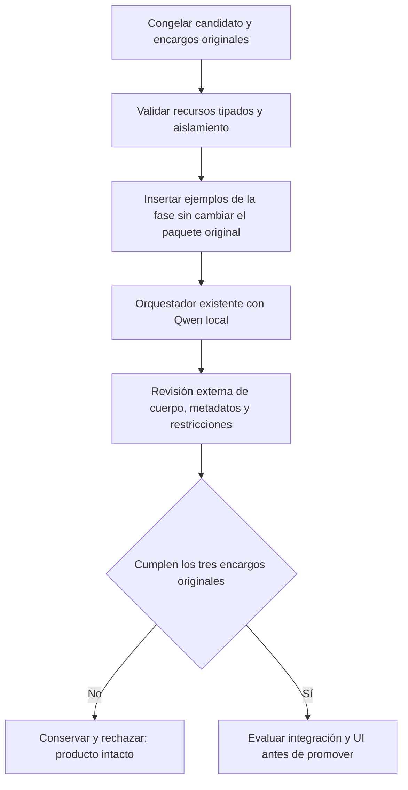

# Recursos demostrativos de autoría y revisión

Estado: RECHAZADO Y RETIRADO DE COMPILACIÓN ACTIVA; no incorporado al producto.

## Evidencia y decisión

La variante por roles anterior conserva el encargo completo y contratos válidos,
pero Qwen copia controles actuales al cuerpo y el revisor acepta contaminación o
demanda título dentro del cuerpo. El transporte/tipo no prueba distinción de actores.
Las proyecciones, rangos y otra redacción de la misma guía ya fueron rechazados;
no se repetirán aquí. No hay nueva evidencia para ampliar presupuestos/modelos.

Se comprobará una hipótesis distinta: el contexto describe responsabilidades, pero
carece de demostraciones concretas de resultados correctos/incorrectos en los
contratos reales. Una cantidad pequeña de ejemplos canónicos puede transmitir esa
relación. La recomendación de ejemplos diversos y contexto acotado procede de
[Anthropic: context engineering](https://www.anthropic.com/engineering/effective-context-engineering-for-ai-agents).
Su utilidad con este Qwen es una hipótesis, no una garantía derivada de esa fuente.

## Contrato y límite

- Dueño: compositor de contexto de autoría/revisión del candidato aislado.
- Primero se prueba mediante interposición **sólo de evaluación**, para capturar el
  paquete real sin modificar el algoritmo ni la configuración de producción.
- Ejemplos de senderismo/traducción, con datos sintéticos, campos de DTO existentes
  y validación estructural por tipos. No proceden del corpus retenido ni del holdout.
  Dos ejemplos de autoría y tres de revisión: dos válidos y uno contaminado.
- Los ejemplos son mensajes demostrativos estáticos, nunca contexto vivo, datos de
  usuario, permisos o recuerdos. El último paquete original sigue intacto. No se
  busca una frase del usuario ni se retorna una respuesta por coincidencia.
- El código propietario de la fase selecciona sus recursos por identidad de fase,
  no por contenido del usuario. El interpositor no ejecuta herramientas ni decide
  autoría, valores, workflow o aceptación.
- Mismo adaptador, modelo, presupuestos, esquemas y orquestador; no se añade árbitro,
  inferencia ni reparación. Se valida el límite total después de insertar recursos.
- Una variante, tres encargos originales congelados, sin cambiar oráculos. Primero
  contratos de aislamiento; luego ejecución local real y revisión externa. Si falla,
  conservar y rechazar, sin probar otra redacción/semilla en esta hipótesis.
- Sólo tras aceptación de contenido procede evaluar integración en el compositor
  existente y recorridos UI. Un acierto de componente no cierra la versión.

Alternativas: repetir proyección/guía repite hipótesis refutadas; añadir clasificador
o revisor extra duplica responsabilidades; enseñar resultados concretos mantiene
los propietarios actuales y comprueba la carencia observada sin una nueva cadena.



```text
congelar dos ejemplos de autoría y tres de revisión ajenos al corpus
validar contextos y salidas contra tipos reales; calcular hashes
por consulta de fase autoría/revisión:
    mantener sistema y último documento original íntegros
    insertar pares demostrativos en orden, con etiqueta de datos sintéticos
    rechazar contexto total excesivo; no truncar ni añadir inferencias
    enviar al transporte existente; grabar únicamente protocolo público
ejecutar una vez los tres encargos conservados con el orquestador original
comparar resultados con los criterios originales fuera del revisor local
ante cualquier incumplimiento: rechazar sin promoción ni nueva variante
```

## Resultado ejecutado y retirada

31 controles de contexto/protocolo PASS, cero omitidos. Evaluador compila sin
warnings/errores. Se ejecutaron los tres encargos originales con Qwen3:8b y el
orquestador existente, manteniendo fuentes, modelo y presupuestos congelados.

| Encargo | Resultado observado | Tiempo |
|---|---|---|
| Reunión | Instrucción directa con agenda/objetivos/acuerdos; contenido aceptado para esta petición, sin UI ni campos cualificados | 63078 ms |
| Aprobación futura | Conserva `<mensaje>` y aprobación futura; excluye prohibición de envío de la sesión. Contenido aceptado para esta petición | 54835 ms |
| Título literal | Mantiene «no realices el resumen ahora» en el cuerpo; revisor exige título dentro del cuerpo e inventa citas con puntos suspensivos. No devuelve artefacto final | 73333 ms |

La extracción del literal del título mejoró en esa observación, pero no resolvió
la distinción entre metadatos, cuerpo y controles actuales. No se incorpora una
parte del recurso por pasar dos casos. No se ejecutó UI/holdout, no se ampliaron
presupuestos y no sigue otra variante de ejemplos o redacción para esta hipótesis.

Evidencias: [congelación](../evidence/authoring-resources-20261020/freeze.json),
[ejecución](../evidence/authoring-resources-20261020/v1-preparation.json),
[revisión externa](../evidence/authoring-resources-20261020/v1-review.json) y
[retirada](../evidence/authoring-resources-20261020/retirement.json).

Se retiraron el interpositor, sus pruebas específicas y el selector experimental
del evaluador. Fuentes, pruebas ejecutadas, recurso exacto y binarios permanecen
congelados fuera de la compilación activa. El evaluador conservado vuelve al estado
previo; la configuración productiva permanece intacta. Los 31 controles archivados
no se suman a la regresión actual. La versión y el objetivo global siguen abiertos.
