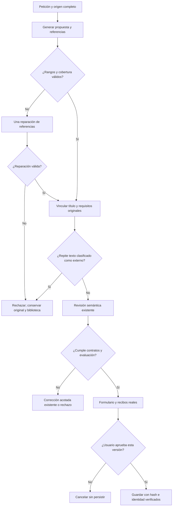

# Autoría y órdenes de sesión — diagnóstico y recuperación

Estado: **PARCIAL / CREACIÓN NO ACEPTADA**. Fecha: 2026-10-18.

## Causa observada

La petición contiene dos programas: lo que NOVA debe hacer durante la autoría y lo que el futuro destinatario debe hacer al utilizar el prompt. `TaskGoal.ContentRequest` conserva citas autorizadas; **no garantiza que sean ya instrucciones exclusivas para el futuro destinatario**.

La generación emitía el borrador y sus referencias de alcance en la misma respuesta. Unos rangos completos y literales pueden estar semánticamente mal clasificados. La revisión independiente también aceptó controles actuales y rechazó restricciones futuras válidas. JSON válido no equivale a significado correcto.

Había además una degradación concreta en código: si fallaban la cobertura y su única reparación, `GenerateCore` continuaba con `FULL_ORIGINAL_REQUEST`. El borrador sin alcance comprobado podía llegar a otro revisor junto con la petición mezclada. Ese camino está eliminado.

## Mapa de responsabilidades

| Componente | Estado | Responsabilidad |
| --- | --- | --- |
| React / controlador de la misma pestaña | PRESENTE | Formulario, navegación y recibos del estado mostrado |
| `LiveCommand`, `TaskGoal`, planificador | PRESENTE | Operación, citas originales, contexto y origen autorizado |
| `PreparationInference` / Ollama Qwen3:8b | PRESENTE, interpretación insuficiente | Propuesta y evaluación; sin autoridad para guardar |
| Dominio, aprobación por hash/revisión y SQLite | PRESENTE | Identidad, permisos y efectos |
| RAG, nuevos servidores o nube | INNECESARIO | La confusión aparece antes de recuperar información externa |

## Cambios conservados

1. **Rechazo tras reparación inválida.** No se degrada una prueba de alcance fallida a una revisión con toda la orden original. No se aplica ese borrador ni se registra una evaluación de contenido satisfactoria.
2. **Origen completo en creación.** También sin el perfil experimental de objetivos, la creación recibe la descripción y el cuerpo completos del origen autorizado. El presupuesto existente rechaza contextos excesivos; no se truncan condiciones al final del documento.
3. **Declaraciones distintas de valores.** Una sugerencia cuyo valor es el propio `<marcador>` no se convierte en datos por citar una oración más amplia. Los valores explícitos y asignaciones literales válidas conservan su precedencia.
4. **Mensaje de recuperación comprensible.** Los detalles de rangos se conservan para la reparación interna; la UI pide concretar la tarea futura y explica que no se aplicó el borrador.

No cambian endpoints, SQLite, autorización, aprobación ni modelo configurado. Los experimentos por proyecciones, huecos, unidades y contratos normalizados se retiraron del producto porque no cumplieron la evaluación real.

## Flujo efectivo



```text
PREPARAR(entrada, plan, origen, cancelación):
    conservar citas originales e identidad autorizada
    aportar origen completo dentro del presupuesto existente
    propuesta, referencias = inferir una vez
    validar rangos, cobertura, solapamientos y metadatos
    si el contrato exige reparar referencias:
        reparar una vez sin reescribir la propuesta
        si vuelve a fallar: rechazar; nunca recuperar con la petición mezclada
    vincular referencias a caracteres originales
    rechazar copias detectadas de fragmentos clasificados como externos
    revisar fidelidad mediante el revisor existente
    si no se valida: corrección acotada existente o rechazo
    si se valida: entregar al controlador visual existente
    guardar sólo tras aprobación de la versión observada
```

## Contratos y trazabilidad

| Invariante | Implementación | Verificación |
| --- | --- | --- |
| Un alcance inválido no permite un camino menos estricto | `GenerateCore`, `RepairAuthoringReferences` | Rangos omitidos/solapados, reparación válida/inválida |
| Referencias vinculadas al original | `BindAuthoringReferences` | Citas inventadas, títulos Unicode, copias externas |
| Origen completo en ambos perfiles | Contexto de `GenerateCore` | Origen guardado y borrador de sesión, con/sin `TaskGoal` |
| Marcadores distintos de datos | `GroundedVariableResolver.Resolve` | Declaraciones actuales/pendientes y valores explícitos |
| Persistencia bajo aprobación | Runtime existente | Estados y recibos reales de UI |

## Resultados

- **PASS — regresión backend:** 449/449 pruebas, `authoring-final.trx`, copiado a `docs/evidence/authoring-scope-20261018/backend-final.trx`. Se incluyen dos comprobaciones nuevas del origen completo sin `TaskGoal` y el rechazo tras reparación inválida. Esto prueba contratos, no comprensión semántica.
- **PASS — compilación final:** API y evaluación, cero errores y cero advertencias.
- **FAIL — solución semántica general:** los experimentos no resolvieron la distinción entre autor actual y destinatario futuro. No se incorporaron sus cadenas adicionales de inferencia.
- **FAIL — verificador alternativo:** sólo seis de doce etiquetas de usabilidad coincidieron con lo esperado en cuerpos controlados: seis correctos y seis contaminados. No son doce recorridos del agente ni pruebas de guardado. No se incorporó ese verificador.
- **FAIL — recorrido de creación en UI final:** ejecución `53c9d71e-0c50-4581-bfa0-47b1a7031981`, estado `BLOCKED`, propuesta nula y `effectCommitted=false`. La lectura independiente de la SQLite sintética confirmó cero prompts. Se mostró el mensaje funcional de recuperación; no se llegó al llenado ni a la aprobación. Evidencia: `docs/evidence/authoring-scope-20261018/ui-1792373055214/results.json` y `failure.png`. La prueba anterior `cbd4d507-7be1-4d99-b206-6d9e50c54113` también quedó bloqueada; se conserva su mensaje técnico anterior como evidencia histórica.
- **NOT_TESTED — holdout y fiabilidad universal:** los ensayos fueron de desarrollo. No se afirma 11/11 ni una creación completamente corregida.

La comparación con/sin gramática JSON no confirmó que el transporte impidiera razonar: sin gramática hubo razonamiento interno y errores de alcance. No se cambia el transporte por esa hipótesis descartada. La comparación de lectura con Qwen2.5 instalado tampoco justificó cambiar el modelo de la aplicación. No hubo descargas ni uso de nube.

Las ejecuciones visuales reales, propuestas, estados y capturas están en `docs/evidence/authoring-scope-20261018/`. Los experimentos rechazados y TRX están en `.playwright/scope-recovery-20261018/`. Las evidencias no publican el razonamiento interno del modelo.

Runtime local actualizado: `http://127.0.0.1:5190/` responde HTTP 200 con el binario final de protección. Se conservaron los tres prompts existentes. Se cerró únicamente el servidor experimental propio de 5192; sus datos y evidencias se conservaron. Resumen verificable: `docs/evidence/authoring-scope-20261018/acceptance.json`.

La aceptación pendiente exige que la creación real conserve tarea, idioma, entradas y restricciones futuras, excluya controles actuales, llene el formulario y complete aprobación/rechazo sin efectos adicionales. Las protecciones implementadas no sustituyen esa aceptación.

Reproducción visual: compilar la API, después ejecutar `node Tests/nova/authoring-scope.cjs`; opcionalmente definir `NOVA_TEST_BUILD` con la ruta del binario que se evaluará. Usa Edge ya instalado, modelo local real y una SQLite nueva. Conserva el fallo y cierra sólo sus procesos de prueba.
