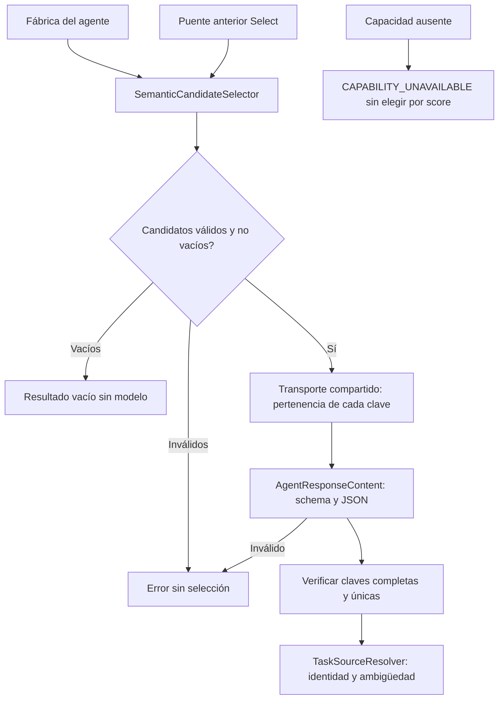

# Selección de candidatos sin autoridad por puntuación

## Auditoría

PreparationInference implementa también ICandidateSelector. Select sólo necesita
transporte, candidatos reales, contrato JSON y presupuesto. No requiere edición,
memoria conversacional, UI ni persistencia. La fábrica actual liga ese puerto al
intérprete completo. Además, el constructor compatible de AgentOrchestrator usa
RankedCandidateCompatibility si no recibe selector: umbral 2 y proporción .85
convierten puntuaciones de recuperación en elección de identidad. No es el camino
de la API con DI, pero constituye una segunda autoridad en consumidores compatibles.

## Decisión modular

Se comparan: extender el monolito conserva dependencia; un proxy al monolito no
permite sustitución; extraer el selector existente permite usar/retirar capacidades
por separado. Se elige extracción, con puente compatible de una sola delegación.
La lectura/validación de respuesta JSON se comparte con el intérprete para no
duplicar el mismo algoritmo de parsing y sus errores.

- SemanticCandidateSelector implementa ICandidateSelector y recibe transporte
  prestado. Conserva instrucciones, claves efímeras, schema, presupuesto, contexto
  y resultado tipado. No incorpora ranking, keywords ni recuperación propia.
- AgentResponseContent posee exclusivamente parsing/validación JSON de respuestas
  del protocolo anterior. No conoce modelos, tareas, permisos ni registros.
- TaskSourceResolver conserva resolución de identidad, revisión y ambigüedad.
- El constructor compatible usa el selector explícito o la capacidad publicada
  por su intérprete. Si ambos faltan, MissingCandidateSelector falla al requerirse
  selección: CAPABILITY_UNAVAILABLE. No devuelve una falsa ausencia de coincidencias
  ni elige por cercanía. Crear o usar una identidad explícita no requiere esa llamada.
- Se retira RankedCandidateCompatibility. No se retira el adaptador tipado de
  intención ni se promueve el candidato semántico rechazado.
- Invariantes: todas las claves exactamente una vez; identidades únicas/reales;
  omisiones/duplicados/propiedades ajenas/tipos inválidos rechazados; cero llamadas
  de modelo para conjunto vacío o entrada inválida; cancelación propagada.
- Sin cambios HTTP/SQLite/paquetes/modelos. Cambio deliberado de compatibilidad C#:
  consumidores que dependían de selección por score deben inyectar ICandidateSelector
  o ITaskPlanner, publicar esa capacidad en el intérprete o seleccionar un ID explícito.



```text
resolver selector explícito o capacidad ya publicada por el intérprete
si no existe: conservar adaptador de ausencia que falla cuando se necesita
al seleccionar:
    comprobar cancelación e identidades únicas
    si no hay candidatos devolver conjunto vacío sin modelo
    construir claves, contexto y schema existentes sin cambiar instrucciones
    consultar transporte; validar JSON con el lector compartido
    exigir todas las claves una vez y devolver sólo IDs reales marcados
el resolvedor de orígenes conserva sus reglas y permisos
```

## Aceptación prevista

Probar fábrica real con intérprete/editor prohibidos, contexto/modelo/token y
ausencia de efectos. Comparar método extraído e instrucciones con original.
Probar HTTP real controlado con y sin puente, respuestas inválidas y ausencia de
capacidad frente a scores altos. Ejecutar consumidores/orquestador afectados;
migrar fixtures tipados a capacidades explícitas sin afirmar comprensión del modelo.

## Resultado ejecutado

IMPLEMENTADO Y VALIDADO para propiedad, protocolo y autoridad de selección. El
método e instrucciones extraídos son idénticos byte a byte; los cuerpos de parsing
y sus errores también. PreparationInference conserva una sola delegación por cada
capacidad extraída. El puerto productivo se compone directamente sobre transporte.

Pasan 625 pruebas compiladas de 48 clases que referencian los contratos afectados,
cero fallidas/omitidas. Incluyen 18 variantes HTTP controladas mediante selector
independiente/puente y seis pruebas nuevas de fábrica, entradas inválidas, ausencia
de capacidad, identidad explícita y precedencia de membresía frente a scores.
No son solicitudes a Qwen ni recorridos UI. API/Blazor compilan sin errores ni
advertencias; sus tres DLL compartidas coinciden con las probadas. Evaluation
compila con las pruebas. Diecisiete controles estáticos pasan; OpenAPI sin cambios.

La primera tanda tuvo 220 PASS y dos fallos en fixtures que dependían de la selección
implícita por score. Se conservan sus resultados y se publican en esos fixtures las
coincidencias controladas que ya presuponían; no se modifican sus assertions. Un
intento posterior de compilación detectó sintaxis de var y un método de biblioteca
inexistente en la prueba nueva; se corrige sólo el fixture y se conserva el log.
Después pasan 93 dirigidas, antes de congelar y ampliar a las 625 finales.

[Fuentes y selección de pruebas](../evidence/candidate-selection-module-20261020/test-selection.json),
[procedencia compilada](../evidence/candidate-selection-module-20261020/compiled-provenance.json),
[resultado y límites](../evidence/candidate-selection-module-20261020/verification.json).

Los consumidores compatibles que antes obtenían identidad por score pueden ahora
recibir CAPABILITY_UNAVAILABLE; deben inyectar la capacidad o una identidad explícita.
Cuando su intérprete ya publica ICandidateSelector se usa esa implementación; si es
un cliente real puede implicar la consulta semántica que antes se omitía. La ruta
productiva con DI ya consultaba el modelo: no se añade otra llamada a esa ruta.
No se declara reducción de latencia ni mejora de comprensión por esta extracción.

La cadena semántica principal permanece pendiente de sustitución cualificada. No se
promueve el experimento rechazado; MAUI y auditoría global siguen abiertos. Las 88
filas canónicas no cambian de criterio ni estado, 34 cerradas y 54 abiertas.
