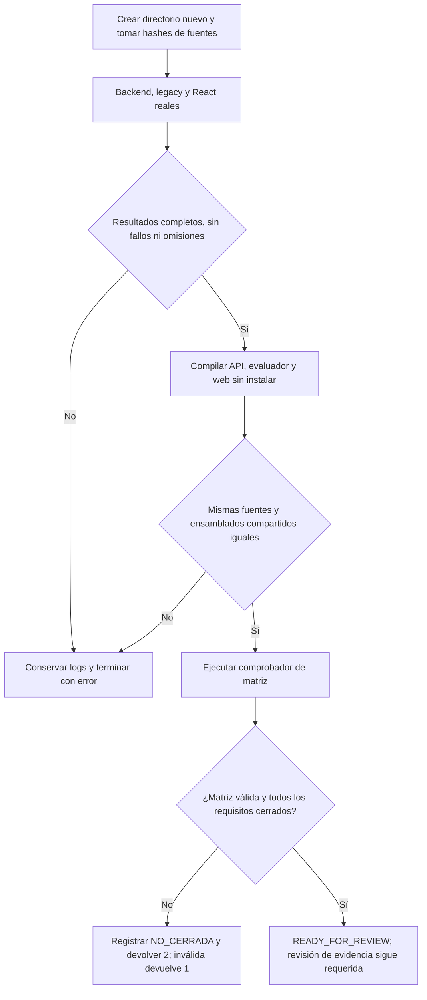

# Verificación reproducible de un candidato NOVA

Propietarios: los proyectos existentes compilan y prueban su código; `scripts/Check-VersionClosure.cjs` conserva la autoridad sobre la matriz. `scripts/Verify-NovaCandidate.cjs` sólo secuencia esos controles y conserva sus resultados. No interpreta peticiones ni cambia el agente, permisos, dependencias, modelos, base de datos o servidores existentes.

Problema de cierre REL-03/REL-07: las comprobaciones se ejecutaban por separado y no había un procedimiento único que conservara todos los resultados e impidiera una señal verde con requisitos abiertos. Se extiende el tooling existente mediante un script concreto. No se añade framework, servicio ni workflow de despliegue; el CI anterior no se cambia silenciosamente.



```text
exigir directorio nuevo dentro del workspace; nunca limpiar otro candidato
hash de fuentes de producto, contratos y scripts desde inventario Git
ejecutar secuencialmente suites reales y comprobar conteos de sus artefactos
compilar API/evaluador Debug y web TypeScript/Vite sin restaurar/instalar
comparar hashes Domain/Application/Infrastructure de API y evaluador
repetir hash de fuentes: cualquier cambio durante el run invalida el candidato
ejecutar Check-VersionClosure sin modificar la matriz
guardar comandos, exit codes, logs, resultados, hashes y estado de gate
si hay fallo, ausencia de resultados o matriz inválida: exit 1
si hay requisitos abiertos: exit 2, aunque los controles mecánicos pasen
sólo sin pendientes: exit 0 READY_FOR_REVIEW, nunca aprobación humana inventada
```

Entradas: checkout actual y `--out` opcional, restringido a un directorio nuevo dentro del workspace. Salidas: `verification.json`, logs completos, TRX/JSON y builds aislados. Cada proceso tiene límite de cinco minutos; se termina su árbol si excede el límite o se interrumpe el script. No se leen `.env`, bases privadas, tokens o configuraciones personales; el inventario guarda rutas de código y hashes, no su contenido. No hay descargas, llamadas a Ollama, navegadores ni nube. Las advertencias de Vite se conservan; no se aumenta su umbral.

Compatibilidad: no cambia API/DB/arranque/despliegue. Los tests y ambos builds .NET usan Debug explícito en este checkpoint para identificar una misma configuración; esto no certifica un instalador Release. UI, semántica, operación, seguridad y piloto conservan sus gates en la matriz y no se sustituyen por este script. No ejecutar el holdout desde cada build.

Uso desde la raíz:

```powershell
node scripts/Verify-NovaCandidate.cjs --out .playwright/nova-candidate-checkpoint
```

No reusar la salida: el script se niega a sobrescribirla. Código 2 significa controles mecánicos válidos con versión abierta; no debe convertirse en éxito en CI. El script es un procedimiento automatizado equivalente local, no una afirmación de que el workflow remoto ya lo invoque. La evidencia ejecutada y los negativos se detallan debajo.

## Evidencia ejecutada

[Verificación conjunta del código conservado](../evidence/closure-20261020/candidate-retained-final-v2/verification.json): 621/621 backend, 151/151 legacy y 136/136 React, ninguna omitida; builds API/evaluador/TypeScript/Vite PASS, Domain/Application/Infrastructure idénticos y 332 entradas de fuentes sin cambios. Estado final `CHECKS_PASSED_VERSION_OPEN`: el comprobador de matriz devolvió 2 con 61 abiertos en ese instante, no señal verde. Después de revisar ese resultado se cerraron únicamente REL-03/07; la matriz actual conserva 59 abiertos. El informe original no se reescribió para cambiar su checkpoint.

[Negativos de tooling](../evidence/closure-20261020/verification-negative-cases.json): tres invocaciones rechazadas (sobrescritura, salida fuera del workspace y argumentos inválidos), archivo previo idéntico y un run en repositorio sintético sin proyecto backend que propaga el fallo real de dotnet, conserva log y termina FAIL. El primer run positivo también falló al intentar leer un archivo ya eliminado del árbol; su informe permanece en `candidate-retained-final/verification.json`. El inventario ahora usa delimitación NUL y representa archivos eliminados como `null`, por lo que también detecta una restitución durante el run. No se descartó el archivo del inventario ni se ocultó el primer fallo.

Advertencia retenida: Vite produce chunk principal 569,58 kB, superior a 500 kB; no se elevó el límite. [UI manual de los mismos artefactos](../evidence/closure-20261020/versions-1792464729730/results.json): 21/21 PASS, sin modelo/peticiones externas. UI del agente, semántica/fidelidad, rendimiento, operación y piloto no están certificados por este procedimiento y mantienen sus requisitos abiertos. REL-03/07 se cierran sólo con esta distinción explícita.
