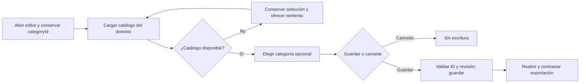

# PAR-01 — categorías editables en React

Fecha: 2026-10-19, America/La_Paz. **CERRADO en el alcance de PAR-01; versión NO CERRADA.**

## Causa y solución

El DTO, la validación de dominio y SQLite ya admitían `categoryId`. React lo copiaba del prompt existente, pero el formulario sólo permitía cambiar título, contenido y descripción. El problema era la ausencia de un control y de un catálogo público de categorías para la UI, no una pérdida de persistencia.

`PromptCategories` deriva los IDs del enum persistido y añade etiquetas de presentación. El nuevo endpoint de lectura `GET /api/v1/categories` devuelve `{ id, name }[]`; no llama al modelo ni escribe datos. Es una adición explícita al contrato OpenAPI, sin migración, renumeración de categorías ni cambio de las operaciones de guardado.

El editor incluye Categoría dentro de «Categoría y descripción opcionales». Cambiarla sólo modifica el borrador; el guardado existente valida identidad/revisión e ID. La carga, fallo o reintento del catálogo no reemplazan la selección actual ni guardan el formulario. Una respuesta tardía tras desmontar el componente se descarta mediante cancelación.



```text
obtener catálogo a partir de los valores del enum de dominio
mostrar la categoría del borrador, incluso durante carga/error
al elegir un ID conocido: actualizar sólo categoryId del borrador
al cancelar: no escribir el registro
al guardar: usar PUT/POST existentes con revisión y validación de dominio
comprobar lectura posterior y categoría exportada/importada
```

## Evidencia ejecutada

- Backend completo: **466/466 PASS**, cero omitidas. Nueva regresión recorre las 29 categorías y prueba edición, ID inválido sin escritura y exportación/importación real SQLite. [TRX](../evidence/categories-20261019/backend-categories.trx).
- React: **97/97 PASS** en repetición completa. Incluye dos regresiones del selector: IDs del servidor, estado controlado, fallo/reintento sin perder selección y botón que no envía el formulario. [Resultado](../evidence/categories-20261019/react-rerun.json).
- Primer intento React: **96 PASS y un timeout** de 5 s en cancelar eliminación desde tarjetas. Esa prueba no abre el editor de categorías; pasó después aislada y en la tanda completa, sin cambios de expectativas ni timeout. Se conserva el [fallo original](../evidence/categories-20261019/react-initial-timeout.json). No se interpreta como prueba de ausencia de intermitencia general; PER-03 sigue abierto.
- API build: cero errores y advertencias. TypeScript/Vite: PASS; permanece el aviso de bundle principal mayor de 500 kB. Los builds se produjeron en directorios propios, sin reemplazar los assets de la instancia del usuario.
- Edge real, visible, API y SQLite sintética: **ocho controles PASS**, cero errores de página. Crear con categoría, recargar/reabrir, cambiar con revisión, cancelar sin escribir, exportar desde configuración, control visible a 375 px y rechazo de ID inválido con biblioteca intacta. [Resultado final y hashes](../evidence/categories-20261019/1792416440035/results.json).

La primera campaña visual también pasó; después se añadió separación vertical entre categoría y descripción y se repitieron los ocho controles con los assets finales. Capturas de la primera campaña fueron inspeccionadas visualmente; se conserva cada build/captura con sus hashes. La segunda campaña acredita el mismo recorrido después del ajuste de espaciado.

Revisión de UI con `ui-ux-pro-max` y `react-best-practices`: label asociado, control nativo de teclado, esquema fuera del render, efecto cancelable, valor controlado sin mutación implícita, IDs estables, control opcional y separación entre campos. Se reutilizaron tokens/estilos y no se añadieron dependencias.

## Reproducción y límites

```powershell
dotnet test backend/QuickPrompt.Tests/QuickPrompt.Tests.csproj --no-restore
dotnet build backend/QuickPrompt.Api/QuickPrompt.Api.csproj --no-restore -o .playwright/parity-categories-20261019/api --verbosity quiet
npm.cmd run build --prefix apps/web -- --outDir ../../.playwright/parity-categories-20261019/web
npm.cmd test --prefix apps/web -- --maxWorkers=1
$env:NOVA_TEST_BUILD='.playwright/parity-categories-20261019/api/QuickPrompt.Api.dll'
$env:NOVA_TEST_WEBROOT='.playwright/parity-categories-20261019/web'
node Tests/nova/categories.cjs
```

El harness usa Edge y Playwright ya instalados, su propio proceso/puerto y una SQLite sintética. No hay descargas, inferencia, datos privados, cambios globales de Ollama, commit ni publicación. El servidor QA se cierra al terminar. La instancia previa en 5190 no se reinició ni se presenta como actualizada con este build.

La clasificación automática de categoría por el agente, el filtrado adicional por categoría y el cierre de otros pendientes de paridad no quedan probados por PAR-01. La campaña integral REL-04 deberá repetir este comportamiento cuando se congele el candidato final.
