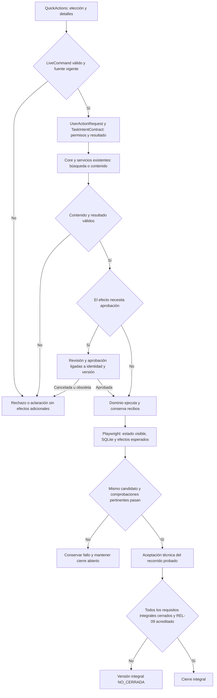

# QuickPrompt por acciones: acta técnica y revisión de cierre

Fecha de proyecto: 2026-10-22, America/La_Paz. Las evidencias registran UTC, que ya corresponde al 23 de octubre.

**Actualización posterior:** el usuario confirmó que probó el flujo y funcionó, aceptó REL-09 y solicitó publicar la versión inicial. [NOVA 1.0.0 cerrada por aceptación del usuario](../releases/NOVA_1.0.0.md). Los estados pendientes descritos debajo documentan la revisión anterior a esa confirmación; el alcance ampliado histórico sigue separado de la entrega inicial aceptada.

## Qué es REL-09

REL-09 significa **piloto humano de tareas reales y revisión de calidad**. Su criterio canónico está en [la matriz de cierre](VERSION_CLOSURE_MATRIX.json): el usuario completa tareas reales, valora utilidad/fidelidad y registra fricción para aceptar el alcance. Es una comprobación de uso; no es una excepción de código ni un fallo del modelo. No se ejecutó ese piloto y no se declara realizado.

La solicitud actual autoriza verificar y cerrar si las pruebas pasan. Permite registrar la aceptación técnica del recorrido comprobado; no aporta un resultado humano ni elimina otros criterios de la matriz. El cierre integral se decide mediante sus requisitos, no mediante el número agregado de tests.

## Alcance comprobado

El usuario eligió explícitamente **elegir la acción y usar IA para contenido y búsqueda**. El candidato es `action-workbench-release-20261022`; el intérprete automático rechazado queda fuera de producción y sus evaluaciones fallidas se conservan. Este acta no lo declara reparado ni modifica los oráculos históricos.

Propietarios actuales:

- `LiveCommand` recibe la acción; `UserActionRequest` y `TaskIntentContract` fijan resultados y límites de dominio.
- `ActionChoiceInterpreter` pide elegir una acción cuando falta; no infiere operaciones ni inicia recuperación/LLM.
- Adaptive Core y Qwen realizan las capacidades de contenido y búsqueda necesarias. La consulta original llega al buscador; los datos no conceden permisos.
- Las capacidades de dominio conservan identidad/revisión, revisión de contenido, aprobación de persistencia, recibos, cancelación y verificación del resultado.
- La API publicada no distribuye `QuickPrompt.Evaluation.dll`; los decodificadores históricos sólo están en el evaluador.



```text
comprobar identidad de fuentes, API, web, SDK, modelo y evidencias previas
ejecutar navegador con biblioteca sintética propia y configuración explícita
para cada recorrido:
    comparar resultado con expectativa independiente y efectos prohibidos
    comprobar revisiones, aprobaciones, persistencia y registros ajenos
    conservar fallos; clasificar producto, entorno o arnés con evidencia
    no ampliar límites LLM ni cambiar proveedor para obtener aceptación
si hay cambios de producto: congelar y repetir las comprobaciones afectadas
si el recorrido pasa: cerrar técnicamente ese alcance, sin afirmar universalidad
ejecutar comprobador de matriz; si hay obligatorios abiertos: no cerrar integralmente
registrar aceptación humana sólo si existe evidencia de participación del usuario
```

## Evidencia del candidato

Directorio: `docs/evidence/closure-lab-20261021/action-workbench-release-20261022/`.

| Comprobación | Resultado observado |
| --- | --- |
| Backend | 1160/1160 PASS, `components.trx`; identidad de los cuatro DLL de producto con publicación en `test-identity.json`. Evidencia anterior, verificada por hash en esta revisión; no se afirma una nueva ejecución. |
| React | 253/253 PASS en `../action-workbench-20261022/frontend-tests.log`, con build TypeScript/Vite previo correcto. Evidencia anterior, verificada por hash. |
| SDK | 54/54 PASS en `../action-request-replacement-20261022/sdk-tests.log`. Evidencia anterior, verificada por hash. |
| Navegador anterior | 14/14 PASS con Qwen real en `browser/1792725848537/results.json`. No es piloto humano. |
| Integridad actual | `release-review/integrity.json`: 8 evidencias previas, 364 archivos congelados, 43 archivos API, 305 fuentes .NET y 4 fuentes web comprobadas; ninguna diferencia. Hash del paquete web `D5319764D9B24140B385A22F1EF01A2723383988EE851ECF796ECA9CC1665783`. |
| Vista activa | `release-review/active-preview.json`: PID 29708, puerto 5277, rutas esperadas de API/web/SDK/datos y `/health` con estado `ok`, esquema 2. |
| Biblioteca de revisión | `release-review/preview-library.json`: integridad SQLite `ok`, hash lógico idéntico al anterior `ADFDE2C27B7E071BA7677C89860CF6442AD34D808C7EE1D32D73A05F10526818`. Sólo lectura para esta comprobación; no se accedió al puerto 5196 ni a su base privada. |

El modelo requerido sigue siendo `qwen3:8b`, digest `500a1f067a9f782620b40bee6f7b0c89e17ae61f686b92c24933e4ca4b2b8b41`. No se descargan modelos, cambian proveedores ni amplían presupuestos.

## Repetición actual: intentos conservados

`release-review/1792726904524/results.json` conserva una tanda **FAIL**: el producto pasó creación/guardado/reapertura, mejora/revisión 2, ejecución de ambas tareas/responsables, búsqueda y eliminación aprobada. Después, el segundo consumidor del SDK terminó con código **9009** porque la invocación usaba el alias `python` de Windows. `adaptive-core-run.log` confirma que Python no estaba disponible mediante ese alias. No es una demostración de fallo de Qwen o de los efectos de QuickPrompt.

Se repite con el mismo producto y oráculo, usando el Python del entorno existente y el SDK congelado. El segundo consumidor usa `decoding=prompted`, como la aceptación anterior. La configuración de esa invocación se corrige; no se modifica producto, tiempos LLM ni expectativas.

**Resultado final: 14/14 PASS**, salida de proceso 0, en `release-review/1792727155676/results.json`. La tanda completa volvió a ejecutar búsqueda, creación y guardado de copia revisada, recarga/apertura con la misma identidad, mejora y guardado de revisión 2, respuesta local con ambas tareas/responsables, eliminación confirmada con conservación del registro independiente y portapapeles, actividad visible y una sola pestaña. También pasó el segundo consumidor genérico del SDK con Qwen real y sin efectos de negocio.

**Flujo por acciones: CERRADO_TECNICAMENTE en el alcance comprobado. Versión integral: NO_CERRADA. REL-09: SIN_VERIFICAR.** Esta conclusión no atribuye el piloto al usuario ni acepta por silencio los demás requisitos. El intento fallido de invocación permanece junto a la tanda final; no se suman resultados parciales de ambos para construir el PASS.

## Cierre integral y trabajo pendiente

El comprobador `node scripts/Check-VersionClosure.cjs` encontró una matriz válida, con **33 requisitos cerrados y 55 abiertos**. Retorna **2**, no 0. Sus estados incluyen evidencia histórica y no se reevalúan todos por esta campaña. Entre los alcances todavía sin aceptación integral figuran interpretación libre, paridad/configuración, portapapeles nativo, datos/recuperación, seguridad, servicios externos, recursos, campañas independientes y piloto humano. Las pruebas actuales no sustituyen esas familias.

No se declara `CERRADA` la versión integral, no se registra un piloto humano inexistente y no se introduce una dispensa inferida. El acta técnica del flujo por acciones y la matriz integral conservan alcances distintos y explícitos. No se realiza commit, etiqueta, publicación ni migración de datos privados.

## Qué conservar y cómo mejorar el método

Conservar el control explícito de la acción elegido por el usuario, la autoridad del dominio, la consulta original, las aprobaciones y la prueba del resultado completo. Conservar también la separación entre fallos del producto y del arnés, los intentos rechazados y la identidad de cada artefacto.

La [revisión de adaptive-ai-systems](ADAPTIVE_CORE_AI_SKILL_REVIEW_20261022.md) propone mejoras concretas y situaciones de evaluación: propiedad de la selección de operación, cita frente a autorización, valores que ya conoce el host, parada tras fallos repetidos, perfiles activos frente a diagnósticos y cierre técnico frente a aceptación humana. Es una propuesta analizada; no una modificación global ni una validación conductual de la skill.
