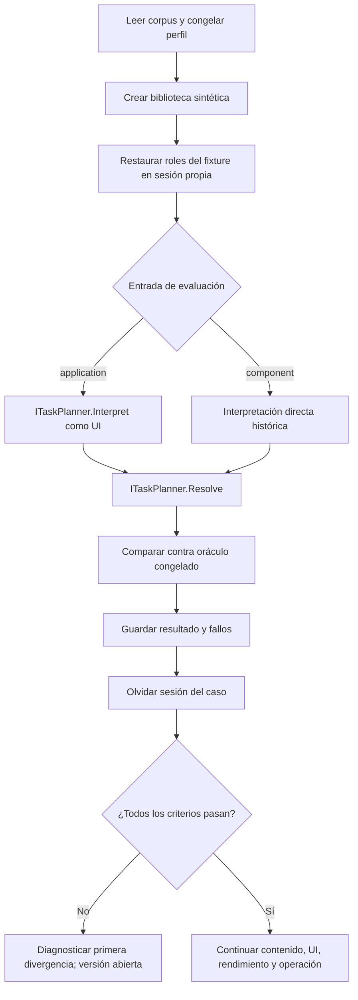
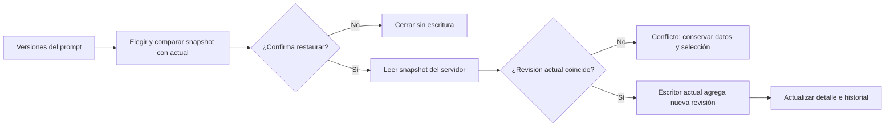
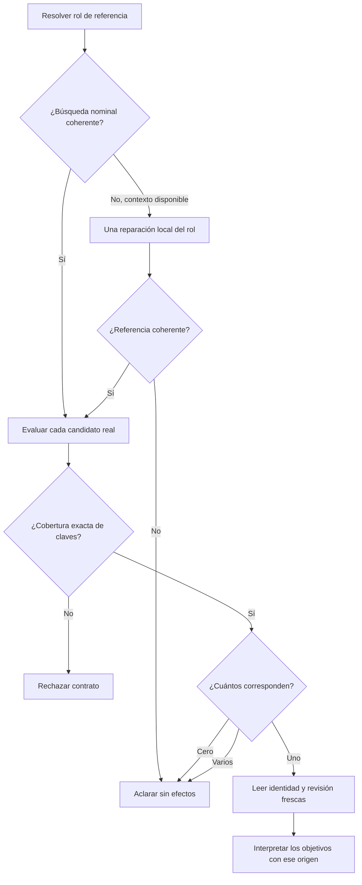
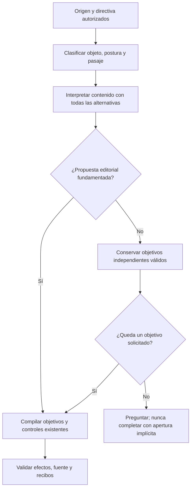
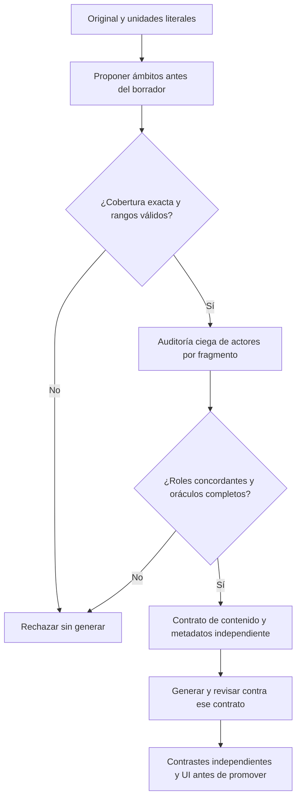
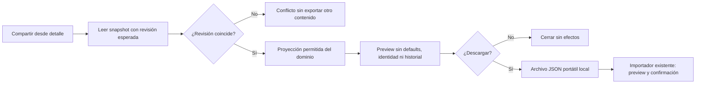
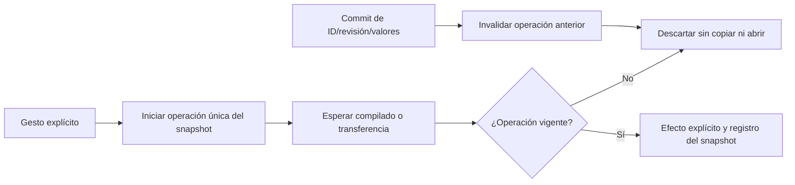

# Checkpoint vigente — meta de 88 requisitos

2026-10-20: **34 CERRADO / 54 abiertos; goal ACTIVO; versión NO CERRADA**.
El resto de este archivo conserva historia, no aceptación actual.
Véase [mandato y ejecución finita](VERSION_COMPLETION_GOAL.md) y
[matriz canónica](VERSION_CLOSURE_MATRIX.md). Nuevos cierres: LIB-02, EXE-07, SAV-01 y DAT-06.
Desarrollo Qwen de referencias 15/16; guardado adicional sigue FAIL.
Ambos completar/copiar pasan en UI; siguiente guardado del borrador falla por
vínculo a generación del run actual. Corrección de aprobación con 97 contratos
PASS; guardado temporal, reapertura y rollback QA PASS en [wave6](CLOSURE_WAVE6.md).
La adaptación desde fuente aún falla antes de revisión; su tanda conserva FAIL.

---

# Ejecución de cierre de la versión

Estado: EN CURSO; no sustituye la matriz obligatoria ni acredita cierre.

Checkpoint de interpretación: [refactor modular conservado](INSTRUCTION_USE_REFACTOR.md), con `InstructionUseResult`, presupuesto por petición y diagnóstico de respuestas inválidas. Identidad deja de recibir valores de campos como instrucciones (reproducción FAIL antes, PASS después). Backend final 639/639; API/evaluador recompilados y hashes compartidos idénticos. Se retiran el protocolo conjunto (19/19 autoría, pero cuatro llenados extra) y la reducción de contexto (Qwen/UI 0/3; dos COMPLETED con edición no pedida y creación bloqueada). Se conserva el paquete original de conocimiento en el módulo extraído. No hay cierre semántico ni otra variante por frase.

Checkpoint de contexto: [ciclo de vida compartido](CONVERSATION_ARTIFACT_LIFECYCLE.md) corrige una pérdida reproducida de identidad/revisión/procedencia al completar campos. Editor, navegador, preparación y recuperación/completado del modal usan `AgentSessions.ObserveDraft`; recibos de operación y aprobación conservan sus propietarios. Candidato final: 636 backend, 151 legacy, 136 React y builds PASS; UI manual repetida 21/21, con timeout anterior de foco conservado. Los dos mensajes libres de completar/copiar aún fallan con Qwen antes de actualizar memoria: añaden una adaptación no solicitada y acaban rechazados, 138699/139856 ms. Se mantiene NO CERRADA; no se presenta la corrección de contexto como recuperación semántica ni se inicia otra variante de prompting por caso.

## Auditoría y primera corrección

La aplicación usa `ITaskPlanner.Interpret` → resolución/lectura del origen → interpretación dependiente del origen → `Resolve`. `RecoveryEvaluation.Run` invoca directamente `PreparationInference.Interpret` con candidatos sintéticos y sólo después llama `Resolve`. Por tanto, esa campaña es evidencia del componente histórico, no del mismo recorrido de planificación de la UI. El caso de desarrollo 02 conservado en `docs/evidence/closure-20261020/development-production-baseline.json` pregunta por una selección entre dos candidatos antes de ejecutar el nuevo propietario de referencias. Ese archivo mantiene el nombre inicial; su perfil real se distingue en este informe.

No se atribuyen todos los fallos a este desfase. La generación todavía entrega sus propias cláusulas al revisor, lo que puede recortar su autoridad; las alternativas anteriores de paquete completo, roles y predicado fueron rechazadas. No se reincorporan por haber identificado de nuevo esa frontera.

## Contrato del incremento de evaluación

- Propietario: `RecoveryEvaluation`, sin cambios al producto ni otro planificador.
- Entrada: los mismos fixtures sintéticos, peticiones, roles de contexto y umbrales congelados. Las anotaciones de resultado esperado nunca alimentan la planificación.
- Extensión: `NOVA_EVAL_PLANNING_ENTRY=application` elige el coordinador real. `component` conserva el camino histórico; cualquier valor desconocido falla antes de inferir. El informe identifica explícitamente el camino y los perfiles efectivos.
- Contexto: una sesión independiente por caso, cargada desde los roles del fixture; mismos origen seleccionado, candidatos y borrador previo. No elegir origen mediante el resultado esperado.
- Salida: los mismos oráculos y tasas; trazas del contrato, sin razonamiento privado. La campaña de planificación nunca se presenta como éxito de contenido, UI o persistencia.
- Cancelación/errores: conservar el límite por caso, los errores y las expectativas. Olvidar la sesión en `finally`; no repetir casos para escoger sólo resultados favorables.
- Alternativas: extender el evaluador existente es suficiente. Reimplementar el planificador en el evaluador o habilitar un perfil experimental introduciría divergencia y se descarta.
- Compatibilidad: opt-in del arnés; sin cambio HTTP, SQLite, dependencias, modelos o instancia 5190. Rollback: retirar sólo este selector y su preparación de sesión.



```text
validar selector antes de cargar modelo
para cada caso del split sin cambiar su expectativa:
    crear una sesión aislada a partir del contexto del fixture
    ejecutar el coordinador de aplicación o el componente declarado
    resolver fuente con el mismo coordinador
    medir efectos pedidos, adicionales, destino y errores con el oráculo existente
    conservar resultado, perfil y hashes; olvidar sesión aun si falla/cancela
no pasar a holdout ni declarar cierre basándose sólo en planificación
```

Verificación prevista: compilar evaluador, campaña completa de desarrollo con configuración de producción (`TaskGoals=false`, `TaskResultContract=false`), y regresiones backend/legacy. Los siguientes incrementos necesitan su propia causa, contrato y evidencia. La matriz sigue siendo la autoridad de aceptación de los 88 requisitos.

## H2: autoridad completa con contexto temporal ligado al código

Hipótesis candidata, todavía no aceptada: el revisor recibe una petición que describe dos actores, pero no el estado real de la transacción que diferencia sus obligaciones. El paquete completo anterior falló al exigir que el cuerpo repitiera «no realizar ahora»; el paquete recortado acepta restricciones omitidas. Se probará la petición completa acompañada por el contexto de sesión derivado del plan compilado (fase de revisión, efectos actuales y prohibidos, destinatario futuro del artefacto). Las referencias del generador serán pistas no autoritativas; nunca sustituyen la petición. No es otra proyección de contenido ni un nuevo intérprete.

Propietario: `PreparationInference.ReviewDraftFidelity`; sin nueva capa, llamada LLM, modelo o permiso. Mantener esquema/verificación de evidencias y presupuesto actuales. Los efectos de sesión son datos ligados al plan, no reglas de contenido: una restricción explícita para el futuro sigue siendo obligatoria aunque prohíba la misma acción que el workflow actual.

Gate antes de promover: regresión de transporte que verifica autoridad íntegra y separación de actores; seis contrastes existentes de autoría con Qwen real, cero inválidos; después doce contrastes independientes ya congelados y nunca usados para ajustar este candidato. Un error técnico no cuenta como rechazo correcto. Si falla: archivar cambios/resultados y restaurar exactamente el archivo anterior, sin incorporar la variante ni tocar umbrales. Sólo tras superar esos gates se probarán creación real y UI; los PASS de componente no cierran AUT ni AI.

```text
revisor(entrada original, plan compilado, propuesta):
    obtener autoridad original completa del propietario de la tarea
    obtener fase/efectos actuales del plan ya validado, nunca del generador
    aportar referencias propuestas como datos no autoritativos
    evaluar tarea futura y restricciones contra autoridad completa y origen
    validar citas/veredicto; reparar contrato una vez como máximo
    no conceder efectos ni registrar evaluación si hay discrepancia
```

El workflow de H2 sigue Generar → Revisar autoridad completa y actores → Validar contrato → Aplicar/Detener. Se descartan tanto eliminar el revisor como repetir los ensayos anteriores sin contexto de sesión ligado al código. El candidato aislado no se publica en 5190.

## PAR-03: historial y restauración de versiones

Requisito ya abierto, independiente del modelo. Extender `PromptLibrary` y su lector existente: el almacén conserva snapshots, pero React no permite compararlos y restaurarlos. No crear otro propietario de escritura ni enviar snapshots arbitrarios desde el navegador.

Contrato: consultar versiones no modifica nada; seleccionar/comparar/cancelar tampoco. Restaurar exige confirmación, ID de origen, revisión histórica existente y revisión actual esperada. Copiar únicamente título, descripción, cuerpo, categoría y defaults desde el snapshot del servidor; conservar identidad, creación, favoritos, archivo y contadores actuales. El escritor transaccional existente agrega una revisión nueva, sin borrar historial. Un conflicto conserva la versión actual y la selección de la UI; no reintentar escritura automáticamente.

HTTP: conservar GET `/prompts/{id}/versions` y su representación; añadir POST `/prompts/{id}/versions/{versionRevision}/restore` con `ConfirmInput` y respuesta `PromptDocument`. No migración de SQLite ni nuevas dependencias. Integrar el control en el detalle mediante un diálogo con icono; el estado de biblioteca sigue perteneciendo a App. Cancelación aborta lecturas; no confundir cerrar durante una escritura enviada con deshacer una transacción confirmada.



```text
listar snapshots del ID vigente sin efectos
al confirmar revisión histórica: validar confirmación, ID y revisiones
leer snapshot real, nunca contenido del cliente
aplicar sólo campos editoriales mediante writer.Change con revisión esperada
conservar historial y estado operativo actual; devolver documento actualizado
si falla/conflicta: mostrar error y no navegar ni repetir la escritura
```

Verificación: integración SQLite con reinicio, restauración exacta/defaults/Unicode y preservación de estado; confirmación ausente, revisión inexistente y conflicto sin efectos; React cancelar/confirmar/error; recorrido real Edge del mismo candidato. No acredita creación semántica ni reduce sus gates.

## Resultados preservados del primer checkpoint

- Backend base 597/597, legacy 150/150 y React base 112/112 ejecutados, cero omitidas. VAR-03 cerrado por la repetición conjunta del parser compartido: 22 cerrados/66 abiertos.
- Componente directo histórico: 10/16 intenciones y destinos correctos; no satisface el gate. Coordinador real: 12/16 intenciones, 14/16 destinos. No es una mejora A/B de producto: cambia la frontera evaluada; ambos usan los mismos hashes de producto, peticiones y expectativas. Los fallos del camino real se preservan: cambio editorial omitido, propuesta anterior tratada como consejo, ambigüedad de origen perdida y referencia contextual tratada como búsqueda sin descripción.
- H2 RECHAZADO: aunque 24/24 contratos de transporte pasaron, Qwen volvió a rechazar un cuerpo válido y aceptó contaminación. Se restauraron exactamente `DraftFidelity.cs` y su test previo; el test candidato queda en `.playwright/closure-20261020/rejected-authority-v1/`. No se ejecuta la validación independiente ni se modifica la configuración del producto. La campaña de seis conserva también errores de revisión como INCONCLUSIVE, nunca aciertos.
- PAR-03: cinco pruebas SQLite y tres React pasan. Primeros fallos del arnés React fueron una expectativa que normalizaba saltos de línea y un UUID sintético inválido; se corrigió el fixture, sin alterar la igualdad literal ni el comportamiento del producto. Falta el recorrido real de UI antes de cerrar.

## H3: conservar cardinalidad y reparar referencias contradictorias

Dos causas observadas del mismo propietario: el selector declara un ganador sin rendir cuenta del resto de registros compatibles; y una clasificación de búsqueda por nombre puede devolver después descripción vacía pese a tener contexto vigente. En desarrollo real se eligió una de dos facturas y se perdió una referencia contextual al clasificarla como búsqueda vacía. No son fallos de SQLite o navegación.

Extender `PreparationInference.Select`: el modelo juzga correspondencia de CADA candidato real, mediante claves opacas ligadas por código; el dominio deriva cero/uno/varios de ese conjunto completo. No pedir ranking ni un ID ganador. La salida debe cubrir todas las claves exactamente una vez, sin claves ajenas/duplicadas. Las coincidencias semánticas siguen siendo propuestas probabilísticas; índices y scoring no conceden autoridad. `TaskSourceResolver` conserva la decisión de pedir aclaración cuando son varias.

Extender `ResolveReference`, no otro resolver: si una búsqueda nominal no identifica descripción y hay un contexto de artefacto real, permitir UNA reparación local con la contradicción, petición original y mismos roles disponibles. No elegir por defecto el actual ni un registro cercano. Si vuelve a fallar, preguntar sin efectos; no reiniciar destino, generación o workflow. Descartar la respuesta rechazada de caché y respetar cancelación/límite existentes.



```text
selección(descripción, candidatos reales):
    ligar una clave opaca a cada ID, sin exponer una elección arbitraria
    pedir correspondencia independiente para todas las claves, no un ganador
    validar cobertura exacta y esquema; mapear claves positivas a IDs reales
    propietario de fuentes pide aclaración para cero/varios, lee fresco para uno
referencia(petición, contexto, reparaciones restantes=1):
    resolver rol y descripción por contratos existentes
    si rol nominal sin descripción y hay contexto real:
        descartar respuesta; reparar sólo referencia contra la contradicción
    si no se resuelve: conservar aclaración; jamás inferir identidad por proximidad
```

Alternativas: un veto por similitud o coincidencias literales no prueba unicidad y se descarta; nuevo índice/modelo/orquestador no corrige estas transiciones. Cambia sólo el JSON privado de matching, no `ICandidateSelector`, HTTP, almacenamiento o permisos. Gate: contratos de cardinalidad/identidad y reparación/cancelación, seguido por el corpus de desarrollo completo y UI; no ajustar validation/holdout para este cambio.

## H4: alcance editorial por objeto y evidencia, sin veto previo del esquema

El booleano previo `authoringRequested=false` eliminaba del esquema todas las opciones de creación/adaptación antes de interpretar el contenido. En dos peticiones reales de desarrollo la explicación posterior reconoció la edición solicitada, pero ya no podía proponerla; se devolvió apertura/consejo. Otro camino borraba una propuesta editorial rechazada y podía completar con la apertura implícita del origen, aun cuando no quedaba objetivo solicitado.

Extender el revisor de alcance existente reutilizando `ScopeStance` y `DirectivePassages`: objeto de la petición, postura y pasaje literal de soporte. Descripciones de capacidades obtenidas del catálogo por atributos; el origen seleccionado es un artefacto reutilizable, no una respuesta ya ejecutada. No usar frases, expresiones regulares ni similitud como permiso. Un cambio del cuerpo/especificación del artefacto es distinto de sus valores o del resultado de ejecutarlo.

La revisión previa puede seleccionar el presupuesto de razonamiento, pero **no puede recortar las alternativas del contrato de contenido**. La revisión final conserva las restricciones de autoridad. Si se descarta autoría y no queda ningún objetivo independiente de acceso, datos, destino, persistencia o control, detener con pregunta funcional; no inventar una apertura satisfactoria. Conservar los objetivos independientes válidos, incluyendo completar valores, aunque una propuesta de edición fuera espuria.



```text
clasificar objeto/postura sobre pasajes originales fuera de datos de caso
autorizar propuesta editorial sólo con objeto de instrucción y evidencia solicitada
interpretar contenido sin que una clasificación negativa elimine alternativas
si se rechaza una propuesta editorial:
    conservar los otros ejes ya fundamentados
    si todos esos ejes están vacíos: detener y pedir aclaración
seguir usando compilador, permisos y comprobación de efectos existentes
```

Sin cambio público o de persistencia; pruebas de transporte actualizan sólo el JSON privado, manteniendo sus oráculos de efectos. Gates: edición/contexto real y negativos de llenado/uso/datos, contrato de no éxito vacío, corpus completo y UI. Ningún PASS de estas pruebas acredita por sí solo generación fiel.

### Primera divergencia restante: rol y descripción de referencia atómicos

La tanda H3/H4 conserva los aciertos de cambio editorial/contexto y ambigüedad, pero dos formulaciones eligen `NAMED_LIBRARY_SOURCE` y luego extraen propiedades deseadas del cambio como consulta de origen. La reparación de consulta vacía no aplica porque esa cadena incorrecta produce texto no vacío. No añadir otro verificador o regla por frase.

Reemplazar las dos respuestas inconexas (rol → extracción de consulta) por una respuesta discriminada de referencia: los roles contextuales no llevan consulta; una búsqueda nominal debe aportar conjuntamente una mención literal del origen existente y su descripción de búsqueda. El modelo ve las mismas identidades/roles y petición, sin decidir efectos. Las opciones de catálogo que proyectan un título completo por código sólo se ofrecen para una única identidad cuyo título completo aparece literalmente en la directiva; una descripción genérica no se convierte en el nombre de un ganador. La cardinalidad continúa perteneciendo al selector completo y al dominio. Igualdad de un título real no es routing de intención ni permiso de escritura.

Eliminar la extracción nominal separada y sus demostraciones al dejar de tener consumidores. Una cita inventada permite una sola reparación local del mismo contrato; una segunda discrepancia pregunta. Mantener la propiedad/cancelación vigentes. Comparar otra vez los dieciséis mensajes congelados, sin ajustar corpus, holdout ni umbrales. Los binarios y fuentes H3/H4-v1 se conservan antes del cambio.

```text
resolver referencia:
    ofrecer roles reales de contexto y rama de búsqueda nominal
    inferir rol y, sólo para búsqueda nominal, mención literal + consulta juntos
    validar mención contra la directiva autorizada, no contra texto del catálogo
    si la mención es inventada: reparar el mismo contrato una vez; después aclarar
    contexto -> ligar identidad real; nominal -> recuperar y evaluar conjunto completo
```

### Aislamiento del arnés

Las dos tandas completas siguientes fallaron antes de invocar el producto en `HttpListener.Start`: distintos tests reservaron/liberaron un puerto TCP y registraron después el prefijo HTTP de Windows. Veintiuna clases comparten ese recurso de proceso y el patrón tiene una ventana de carrera entre reserva y registro. Se conservan ambos TRX. Configurar xUnit para ejecutar los casos secuencialmente elimina la competencia entre casos por esa reserva; no se cambian timeouts, aserciones ni pruebas de concurrencia interna (siguen ejecutando sus operaciones simultáneas). No afecta a la concurrencia de la aplicación ni a los benchmarks. Si el registro vuelve a fallar con ese aislamiento, investigar el registro/limpieza HTTP y no declararlo resuelto por repetición.

La primera referencia atómica (v2) se conserva **RECHAZADA: 10/16 coincidencias estrictas** (12/16 intención, 11/16 destino y un efecto de guardar copia no solicitado). No se presenta como mejora ni se despliega. Se detectaron además dos incoherencias de su contrato: el discriminador aparecía después de campos libres sólo en la rama nominal, y una definición seguía describiendo la etapa de extracción ya eliminada. La siguiente cualificación v3 ordena el discriminador primero en ambas ramas, corrige esa definición y exige que la consulta sea un fragmento literal de la mención del origen. No incorpora sinónimos/verbos/casos al dominio. Pruebas de grounding v3: 16/16; el gate semántico completo continúa pendiente. Si no supera la tanda congelada, conservar el incremento anterior de cardinalidad/alcance editorial, sin promover esta representación por sus tests mecánicos.

## H5 — cualificación previa de un contrato de autoría independiente

PROTOTIPO DE QA, todavía no implementado en producto. Causa que permanece: el generador propone al mismo tiempo cuerpo y selección de requisitos; el revisor puede recibir una selección que justifica la propia propuesta. Darle toda la petición en su lugar ya falló varias veces por convertir controles actuales en requisitos del futuro lector. No repetir otra redacción del mismo crítico global.

Se cualificará un cambio de propiedad: **delimitar y comprobar roles antes de que exista un borrador**, con cobertura literal completa del original; después generador y revisor consumen el mismo contrato. La diferencia con los ensayos anteriores es temporal y de autoridad: no aceptar selección hecha por el autor del artefacto, ni una proyección comprobada sólo mediante booleano después de generarlo. No se incorporará si falla la cualificación.

Reutilizar las unidades/rangos de autoría existentes para proponer FUTURE_TASK, CURRENT_WORKFLOW, ARTIFACT_METADATA y CASE_DATA. Validar IDs, cobertura exacta y Unicode por código. Un segundo juicio ve el original y cada fragmento literal SIN sus etiquetas propuestas y SIN artefacto; asigna el actor o MIXED. Exigir concordancia y contrastar además con oráculos humanos congelados: dos modelos coincidiendo no prueban corrección. Un ámbito mixto o discrepante no autoriza cuerpo ni efectos. El contrato no decide permisos, origen, ejecución o persistencia.

Gate del prototipo: tres peticiones únicas de los seis contrastes de desarrollo, con tarea/restricciones futuras completas y controles actuales excluidos; auditoría ciega concordante; después los seis cuerpos controlados con el revisor real sin sustituir sus expectativas. Si pasa, cualificar los doce contrastes independientes ya congelados antes de diseñar la integración. Nunca inspeccionar/tocar holdout para ajustarlo. Cualquier inválido/fallo detiene promoción y queda conservado. No añadir otra llamada al camino de uso/llenado sin autoría.



```text
prototipo(petición original sintética):
    proponer partición de todas sus unidades por actor/tipo
    comprobar cobertura, límites y literalidad sin normalizar el texto
    pedir roles de los fragmentos sin mostrar etiquetas previas ni cuerpo candidato
    comparar roles y oráculos humanos congelados de requisitos/control de sesión
    sólo si pasa, ejecutar crítico real con TODOS los requisitos futuros del contrato
    conservar todos los fallos; no integrar por consenso o JSON válido solamente
```

## PAR-08 — compartir una plantilla sin datos de uso

Requisito existente de paridad. `TemplatePackage.From` y `LocalStore.ExportTemplate` ya implementan la proyección permitida: título, instrucción, descripción y categoría. Reutilizarlos en React, sin exportar un backup como sustituto de compartir ni duplicar reglas de privacidad.

Extender el exportador existente con revisión esperada opcional comprobada sobre el MISMO snapshot leído; firmas previas siguen funcionando. Añadir GET `/prompts/{id}/share?revision=N` que devuelve el paquete portátil existente, con los mismos nombres/formato del legado. No publicar ni enviar a servicios externos. React muestra preview y permite descargar JSON sólo tras acción explícita; cancelar no escribe, cuenta uso ni navega. Una respuesta tardía o un cambio de identidad/revisión invalida la preview. Importación/preview/duplicados/confirmación continúan en `LibraryTools`, su propietario actual.



```text
leer plantilla una vez; rechazar si su revisión no coincide con la solicitada
proyectar con TemplatePackage.From, nunca serializar Template o Archive para compartir
validar esquema permitido en el cliente y ligar preview a ID/revisión
descargar sólo el paquete revisado; no registrar uso ni abrir destinos
usar el importador existente para validar/confirmar y detectar duplicados
```

No cambian SQLite, autorización, sintaxis, modelo o formato portátil. Rollback del nuevo control/endpoint; el exportador conserva el argumento opcional compatible. Gate: SQLite demuestra exclusión de defaults/historial/preferencias/identidad y conflicto sin mutación; UI prueba cancelar, descargar bytes y usar el importador con duplicados/cancelación. Sin ese gate PAR-08 sigue pendiente.

## Límites de los ensayos y prueba de capacidad nativa

La referencia atómica v3 tampoco supera el gate. Sus fuentes/binarios quedan archivados y se restaura el incremento previo H3/H4-v1 (14/16). Se conserva una corrección del evaluador: en la entrada `application`, el destino observado proviene del coordinador, nunca de inferir el ID B del fixture para una referencia OTHER no resuelta. El informe v3 original no se sobrescribe; ese error del oráculo no explica ni corrige los otros fallos.

H5 no se integra: las particiones por rangos fallaron cobertura con y sin esquema visible; el etiquetado por unidad elimina ese problema mecánico pero falla semántica/auditoría en los tres controles, tanto en modo rápido como con reasoning. Dos etiquetas coincidentes tampoco superan un oráculo humano discrepante. El crítico de producto permanece restaurado; no añadir esos clasificadores al runtime.

Antes de proponer otra expansión, se hará una prueba acotada de capacidad del modelo con su protocolo nativo de funciones: la misma evaluación de los seis cuerpos contrastados, petición original completa y artefacto de sólo lectura; elegir una función de aceptar o pedir revisión con evidencia literal. No clasificar palabras, no ejecutar herramientas de dominio y no permitir que el generador seleccione autoridad. Mantener modelo, temperatura 0, contexto 12288, 1800 tokens y límite de 90 s; sin voto ni reintentos para escoger respuestas favorables. Ausencia/multiplicidad de llamadas, argumentos inválidos, citas inventadas y truncamiento son INCONCLUSIVE, nunca rechazos correctos. Sólo 6/6 permite pasar a la validación independiente; después aún faltan generación real e integración/UI. Si falla, conservar el límite del componente y detener rediseños especulativos de ese crítico.

La presentación del esquema tiene respaldo en la [documentación oficial de Ollama](https://docs.ollama.com/capabilities/structured-outputs), pero su recomendación no acredita una mejora: el contraste H5 con esquema visible falló y se conserva. No se cambió globalmente el gateway por esa hipótesis.

## Resultado del control nativo y cierre PAR-08

El control nativo terminó: 2/6 juicios correctos, un rechazo falso y tres inconcluyentes (una salida truncada y dos sin llamada única). El rechazo falso vuelve a exigir instrucciones de la sesión en el artefacto futuro. Se conserva `native-fidelity-development.json`, sin integrar el crítico ni ejecutar validación independiente sobre una hipótesis ya rechazada. Esto demuestra el fallo con este contrato y modelo, no que cualquier arquitectura o modelo vaya a fallar.

PAR-08 supera su gate: `versions-1792460091844/results.json` registra nueve recorridos PASS, incluyendo cinco de versiones y cuatro de intercambio/importación en Edge real, API y SQLite aislada. La plantilla portátil no contiene defaults, historial, identidad ni preferencias; cancelación, conflicto de revisión, duplicados e importación con identidad nueva se comprobaron. Legacy 151/151 y React de compartir 4/4 PASS. Se cierra únicamente PAR-08; autoría, portapapeles nativo, rendimiento y aceptación general siguen abiertos.

## Operaciones ligadas al contexto visible — VAR-02 / CTX-07

Observado: la preview invalida su resultado al cambiar ID/revisión/valores, pero la copia de `PromptFocus` sólo aborta al desmontar. `ProviderPicker` comprueba cancelación después de escribir el portapapeles externo. Una respuesta anterior puede por tanto cruzar el límite de efecto aunque el formulario ya haya cambiado. El problema es la vida de una operación, no la frase del usuario.

Propietarios: cada pantalla conserva su estado y sus endpoints; un hook compartido posee únicamente la operación pendiente, su cancelación y su validez respecto al snapshot comprometido. Extender cada componente duplicaría la misma regla; un servicio global añadiría autoridad y acoplamiento innecesarios. Se elige el hook local reutilizable con dos consumidores. Sin API, modelo, esquema ni persistencia nuevos.



```text
al cambiar el snapshot comprometido o desmontar: abortar y liberar la operación
al iniciar: rechazar un segundo inicio mientras existe una operación vigente
tras cada espera y antes de efectos: comprobar identidad de operación y señal
al cancelar: invalidar antes de liberar el estado de actividad
al finalizar: sólo el dueño vigente puede liberar el estado
```

Invariantes: ninguna respuesta de otra revisión/valores copia, navega o publica un resultado; una finalización vieja no libera una operación nueva. La API del portapapeles no permite revocar una escritura ya solicitada: se verifica antes de invocarla y no se promete rollback. Probar primero respuestas retardadas ante cambios/reemplazo/cancelación y luego el flujo real de navegador; estos controles no acreditan fidelidad de inferencia ni normalización del portapapeles Windows.

Resultado: cinco de seis controles iniciales reproducen escrituras obsoletas; después los seis pasan. Un séptimo demuestra que una ejecución cancelada no publica salida ni libera una posterior, que registra sólo sus valores vigentes. Suite React conjunta 126/126 antes de añadir ese séptimo control; su ejecución específica 7/7 PASS. Backend retenido 605/605, cero omitidas; evaluador compila sin avisos. Build web PASS tras corregir una opción inválida del test de accesibilidad; se conserva aviso Vite de chunk principal >500 kB (565,06 kB), sin aumentar el límite.

Edge/API/SQLite `versions-1792460781998/results.json`: 14/14 recorridos PASS, sin llamadas externas ni Ollama. Incluye respuesta retenida/cambio de valores/descarte, copia nueva exacta, descarga UTF-8, fallo de escritura y recuperación, preview visible incompleta sin readiness/uso. El fallo de clipboard es instrumentado; VAR-04 nativo sigue abierto. Se cierran VAR-02 y VAR-05 en esos contratos. No se cierra CTX-07 completo ni se infiere éxito del agente.

El mismo dueño de operación se extiende al editor: una transformación pendiente capturaba todos los campos del borrador y podía reponer un título anterior. El control inicial produjo dos falsos positivos porque categorías y transformación compartían la misma instancia consumible de `Response`; esos informes se conservan pero no se usan como evidencia de producto. Al aislar endpoints, `operation-context-editor-before-isolated.json` reproduce la sobrescritura. La corrección invalida la transformación cuando cambia el borrador/identidad y evita mover después la selección de un textarea que ya perdió el foco. No se añade un segundo dueño de edición ni se cambia el parser.

Verificación conjunta posterior: React **128/128**, cero fallos/omitidas (`react-context-final.json`); backend **605/605**, legacy **151/151**. API y evaluador actuales compilan sin errores/avisos; `retained-shared-hashes.json` prueba igualdad de Domain/Application/Infrastructure. Web TypeScript/Vite PASS con el aviso de tamaño conservado. La repetición con la API recién compilada termina **16/16** en `versions-1792461000981/results.json`, sin peticiones externas: añade roundtrip de variable con selección/foco y protección del título humano ante respuesta retenida. Se revisó la captura `current-operation.png`; esto no es una aceptación visual general ni cierra los criterios UX pendientes.

Estado: 26/88 requisitos cerrados; 62 abiertos. La comparación local propuesta no se ejecuta sin autorización de descarga. `qwen3:8b`, Nomic, la biblioteca privada, la instancia personal y el remoto no se modificaron. La autoría/revisión sigue fallando y la planificación retenida sigue por debajo del gate; no se declara mejora de latencia ni versión cerrada.

## Checkpoint posterior — autorización, editor y verificación reproducible

Se recibió la autorización de comparación local y se evaluó sólo Qwen3.5 9B fijado por digest. Resultado: 12/16 en planificación frente a 13/16 de Qwen3 8B en el mismo runtime; crítico nativo 9B con dos juicios correctos y cuatro inconcluyentes de seis. Se rechazó el candidato, se retiró su tag temporal y se verificó que permanecen Qwen3 8B y Nomic. No hay promoción ni mejora comparable de latencia. [Informe](LOCAL_MODEL_COMPARISON_PROPOSAL.md).

PAR-07 se cierra: renombrado reutiliza el dominio; historial efímero acotado preserva borrador, defaults, selección y originales de variables. La regresión de selección real se reprodujo y corrigió. No se amplía autoridad de metadata de NOVA ni se cambia optionalidad. [Contrato y evidencia](EDITOR_PARITY_ACCEPTANCE.md).

El candidato de propiedad independiente de explicación pasó 636 pruebas de componente, pero falló el modelo/UI: desarrollo intención 11/16, cuatro planes con efectos extra y tres prohibidos; la UI abrió y adaptó cuando sólo se pidió abrir/explicar sin editar (128080 ms). Se conservó y retiró el experimento completo y sus quince pruebas específicas. El contrato activo previo y sus regresiones permanecen, junto al editor y la política aislada de modelos. El contraste nativo de capacidades reflejadas dio 6 PASS/3 FAIL/8 INCONCLUSIVE y tampoco se incorporó. No se reetiquetan fallos ni se introducen reglas por frases. [Causa, retirada y límites](SEMANTIC_CAPABILITY_OWNERSHIP.md).

REL-03 y REL-07 se cierran en su alcance: procedimiento `Verify-NovaCandidate.cjs` ejecutado, **621 backend / 151 legacy / 136 React PASS**, cero omitidas, API/evaluador Debug y web compilados, tres ensamblados compartidos iguales y 332 entradas de fuentes estables. Conserva logs y fallos; rechaza sobrescritura/rutas inválidas y un proyecto ausente propaga error. La matriz abierta evita señal verde. Vite conserva aviso 569,58 kB >500 kB. El primer fallo del inventario ante un archivo eliminado se conserva; el snapshot ahora representa su eliminación, sin descartarlo. [Verificación reproducible](CANDIDATE_VERIFICATION.md).

Edge/API/SQLite de esos artefactos exactos: **21/21 manuales PASS** (`versions-1792464729730/results.json`), sin modelo ni peticiones externas. Se comprobaron hashes de ensamblados y assets web contra el manifiesto del verificador. El [gate posterior a la revisión](../evidence/closure-20261020/post-review-gate.json) conserva salida real 2 del comprobador y matriz válida. Estado actual: **29/88 cerrados, 59 abiertos, goal ACTIVO y versión NO CERRADA**. La creación fiel, semántica/contexto general, latencia comparable, operación y aceptación final/piloto siguen abiertos. No se hizo commit/push/publicación ni se cambió la configuración generativa activa o la biblioteca privada.
