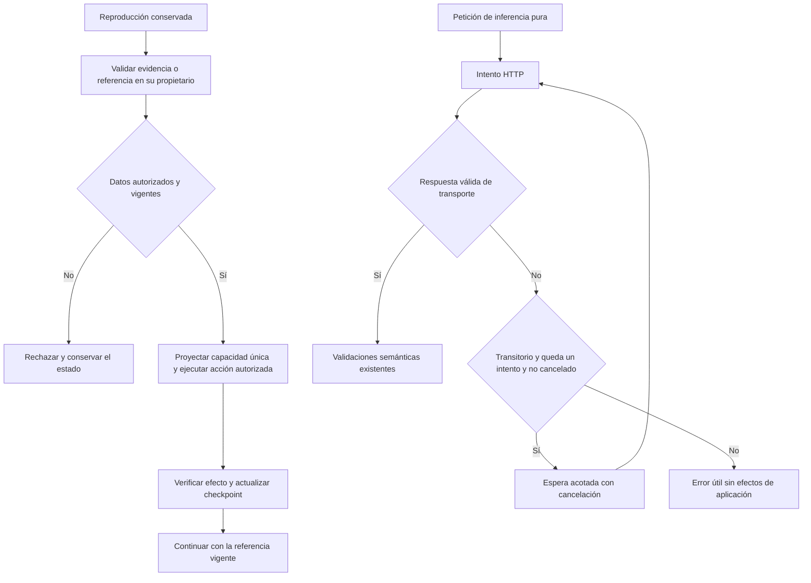

# Cierre — primer bloque de causas compartidas

2026-10-20. Meta activa: completar los 88 criterios originales. No se cierra un
requisito por registrar esta nota. Candidato base: `debug-points-20261020-a6`.

## Contrato de cambio

| Capacidad | Propietario | Corrección e invariantes |
|---|---|---|
| Evidencias de capacidades | `InstructionUseInference.ReviewAuthoringScope` | Validar todas las citas; varias citas válidas pueden apoyar una misma operación. Derivar un conjunto de capacidades sin duplicar efectos. Conservar rechazo de índices ajenos y presupuesto de 12 declaraciones. |
| Identidad y revisión temporal | `AgentSessions`, `AgentOrchestrator`, `UiToolCatalog` | Referencia de sesión existente, con identidad/revisión/contenido vigentes y pertenencia. Un checkpoint sólo avanza después de un efecto observado y validado. `TaskGoals=false` no elimina la identidad. No permitir cualquier ID nulo, ni reemplazar cambios manuales/otra sesión. |
| Recuperación de inferencia pura | `PreparationInference.Chat` | Máximo dos intentos para fallos de conexión/HTTP transitorios, mismo paquete y token de cancelación, espera breve acotada. No repetir por errores HTTP permanentes, ni ejecutar herramientas o escrituras en este bucle. Cada petición real tiene su propia medición. Revisión semántica conserva su propio presupuesto. |

Se extienden los propietarios existentes. Un helper compartido nuevo no tiene
segundo consumidor demostrado; otro coordinador duplicaría identidad,
autorización o transporte. No se agregan dependencias, modelos ni tablas.
El catálogo, los argumentos del modelo y las APIs HTTP no cambian. La referencia
temporal añadida al validador es un argumento C# interno obtenido del propietario
de sesión, nunca una declaración del LLM o del cliente.



```text
capacidad: validar cada índice y presupuesto antes de agrupar operaciones
temporal: exigir referencia actual de AgentSessions antes de la herramienta
  validar resultado; sólo entonces registrar nueva revisión y retener su referencia
inferencia: hasta 2 peticiones idénticas bajo el mismo deadline
  éxito HTTP -> validar respuesta como antes
  fallo transitorio en primer intento -> esperar 250 ms cancelables y reintentar
  cancelación/permanente/segundo fallo -> propagar sin herramientas ni guardados
```

## Registro finito

- Evidencia: reproducción de duplicados falla antes; variante 1 acepta la
  proyección de conjunto conservando rechazo de índices inválidos.
- Temporal: reproducción sin TaskGoal falla antes. Variante 1 detecta que el
  checkpoint original queda obsoleto tras la propia edición verificada; falla
  también una regresión con TaskGoal. Variante 2 avanza la referencia esperada
  exclusivamente al observar el checkpoint validado. Los cuatro recorridos
  controlados (con/sin Goal y con/sin interrupción) pasan. Prueba real pendiente.
- Transporte: una única variante prevista de recuperación acotada; no ampliar
  intentos ante resultados desfavorables. No certifica calidad ni latencia global.

Las pruebas de contrato no sustituyen Qwen/UI. Tras los límites dirigidos se
congelará candidato y se repetirán los escenarios originales afectados.

## Resultado ejecutado

`docs/evidence/closure-goal-20261020/wave1/manifest.json`: 114 contratos
dirigidos PASS, sin omitidos; API/evaluador Debug compilan sin errores ni avisos.
Los seis casos originales de eliminación pasan en UI con Qwen real, incluida la
pregunta explicativa que antes fallaba. Adaptación temporal y recuperación tras
cancelación pasan sus controles y revisión independiente de contenido (Codex,
no piloto humano), con igualdad del cuerpo observado y su hash.

El transitorio original se recupera. El persistente, aislado en proceso nuevo,
devuelve `MODEL_UNAVAILABLE` tras exactamente dos peticiones, sin escrituras.
La tanda combinada conserva FAIL: al ejecutar el persistente después del
transitorio, nueve respuestas de caché evitaron las peticiones HTTP y se
inyectaron cero fallos. Esa prueba no ejercitaba la avería prevista. Se conserva
su resultado y se acredita el límite con la prueba aislada, sin deshabilitar
la caché productiva ni bajar la expectativa de dos intentos.

Los tiempos son diagnósticos (147,975 s para crear y adaptar; 57,660 s para
recuperar tras interrupción; 25,311 s para la recuperación transitoria). No
acreditan rapidez global ni se comparan como baseline. Los criterios generales
de continuidad y transporte permanecen pendientes de sus demás casos y de la
validación del candidato final. No se declara cierre de versión.
