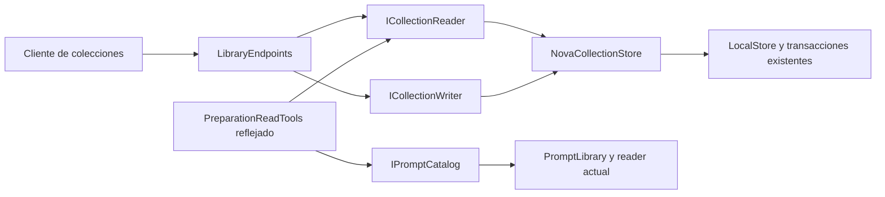

# Colecciones y consultas del agente: puertos de aplicación — 2026-10-20

Estado: INCREMENTO IMPLEMENTADO Y VERIFICADO. No cierra la refactorización global,
la interpretación libre ni la versión.

## Auditoría y decisión

`PreparationReadTools` dependía de `LocalStore` completo sólo para listar grupos y
leer versiones. El endpoint de biblioteca estaba en Program y mezclaba composición
con rutas de CRUD. Las transacciones/revisiones correctas ya pertenecían a
`LocalStore`/`NovaOrganizationStore`; no se duplican en otro servicio.

(A) Pasar el store completo a todos los consumidores mantiene el acoplamiento;
(B) puertos pequeños de consulta/escritura sobre el adaptador existente permiten
sustitución y menor autoridad: alternativa seleccionada; (C) otro repositorio,
registro genérico o unidad de trabajo reemplazaría transacciones sin una necesidad
observada. Se conserva el monolito modular, sin framework ni dependencia nueva.

## Workflow y algoritmo



```text
componer una instancia de PromptLibrary como biblioteca y catálogo de consulta
componer una instancia de NovaCollectionStore como reader y writer de colecciones
registrar lecturas reflejadas sólo con IPromptCatalog e ICollectionReader
para HTTP de colecciones: adaptar DTO y usar el puerto de su operación
para consultar versiones: validar existencia en PromptLibrary y leer historial actual
para modificar: delegar a la transacción existente, conservando revisión/confirmación
propagar error original sin reintentar efectos ni mutar registros ajenos
verificar UI, ausencia de DELETE al cancelar y revisión/contenido tras operaciones
```

## Contratos y propietarios

| Puerto / bloque | Entrada y salida | Límites y propietario |
|---|---|---|
| IPromptCatalog | Get, Search y Versions sobre identidades reales | PromptLibrary aplica existencia y documento; no ofrece escritura |
| ICollectionReader | Groups y Memberships(promptId) | NovaCollectionStore conserva validación de existencia; sin métodos de mutación |
| ICollectionWriter | Create, Rename, Delete, Assign con DTO existentes | Una transacción actual en LocalStore; revisión/confirmación permanecen obligatorias |
| PreparationReadTools | get_prompt, get_prompt_revision, list_groups | Registro reflejado y contrato JSON sin cambios; sólo permisos Read |
| LibraryEndpoints | Rutas existentes de biblioteca, plantillas, grupos, respaldo y traslado preparado | Adaptación HTTP retirada de Program; rutas, cuerpos y códigos preservados |
| ApplicationModules | Alias singleton de biblioteca/catálogo y colección/reader/writer | Único punto de composición; no es nuevo dueño de datos |

No se exponen escrituras por reflection al modelo. La cancelación del registro
se comprueba antes y después de la lectura, igual que antes; SQL sigue síncrono
con su ciclo de conexión actual. Se propagan MissingPromptException,
ConflictException y ValidationException. No hay reintentos automáticos de escritura,
nuevas cachés, cambios de aislamiento, schema o autorizaciones.

El método Versions de PromptLibrary reúne la comprobación que repetían endpoint y
lector del agente. La restauración histórica lo reutiliza; se conserva escritor,
revisión actual y snapshot de origen. La API de colecciones comparte el mismo
adaptador que el lector del agente; dos conjuntos de reglas paralelos no se crean.

## Implementación y compatibilidad

Archivos: `Application/Collections.cs`, `Application/Prompts.cs`,
`Infrastructure/NovaCollectionStore.cs`, `Infrastructure/PreparationReadTools.cs`,
`Api/LibraryEndpoints.cs`, `Api/ApplicationModules.cs`, `Api/NovaEndpoints.cs` y
`Api/Program.cs`. Los consumidores de tests/evaluación usan los mismos puertos.
El constructor interno de PreparationReadTools cambia deliberadamente y todos sus
consumidores encontrados se actualizaron; no se mantiene constructor legado.

Las rutas de comando/interpretación pasan al módulo NovaEndpoints. Program conserva
host, middleware de origen, limitadores, salud, contrato OpenAPI, web y composición.
La agrupación HTTP no elimina reglas de negocio ni las atribuye a reflexión.
Las rutas de archivo/compartir todavía usan LocalStore: frontera pendiente antes de
una declaración global de separación. No se borra una aplicación anterior sin paridad.

## Verificación ejecutada

- Backend completo actual: **784/784 PASS**, cero omitidas, en
  `docs/evidence/role-context-20261020/tests/backend-collection-modules-final.trx`.
- Consumidores dirigidos: 85 PASS; puertos/contexto/historial: 38 PASS. Son selecciones
  incluidas en el completo, no cobertura adicional que deba sumarse.
- Sustitución real de los puertos de lectura en contrato reflejado sin SQLite ni
  escritor; revisión nueva observada. Integración SQLite comprueba revisión obsoleta,
  confirmación falsa, preservación de pertenencia ante conflicto, borrado de colección
  sin alterar prompt/historial y referencias inexistentes.
- Build API final: 0 errores/advertencias, `.playwright/role-context-20261020/final-api`.
- Edge visible: cuatro controles de crear/asignar/renombrar/cancelar/eliminar, además
  de conflictos e inexistentes: `docs/evidence/collection-ports-1792503275980/results.json`.
  Cancelar envía cero DELETE; confirmar envía uno; texto, ID y versiones del prompt
  quedan iguales. Captura `membership.png` inspeccionada.
- Mismo API y web por hashes: siete controles de comandos tipados del agente,
  `docs/evidence/ui-surface-20261019/1792503285625/results.json`: abrir en tarjetas y
  filas, llenar campo/compilar exacto, preparar proveedor, ausencia de persistencia
  extra y edición/guardado/reapertura manual.
- Límites arquitectónicos: cinco controles estáticos PASS. Grafo productivo sin
  Evaluation; el candidato de inferencia no se activa.

No se repite frontend unitario porque sus fuentes no cambiaron. El PASS anterior
146/146 queda con su alcance y build anterior, sin presentarlo como nueva ejecución.
No se repiten matrices de modelo ajenas a estos puertos. La interpretación libre
se evalúa y falla por separado en ROLE_CONTEXT_REFACTOR_20261020.md.

Manifiesto con hashes y pruebas: `docs/evidence/role-context-20261020/verification.json`.
No se tocaron datos privados, procesos personales 5190/5191, modelos ni dependencias.
Los procesos y navegadores QA finalizaron. Las rutas y schema persistente permanecen
compatibles; revertir exige restaurar este conjunto coherente de consumidores y
composición, sin restaurar una base ni descartar trabajo ajeno.
