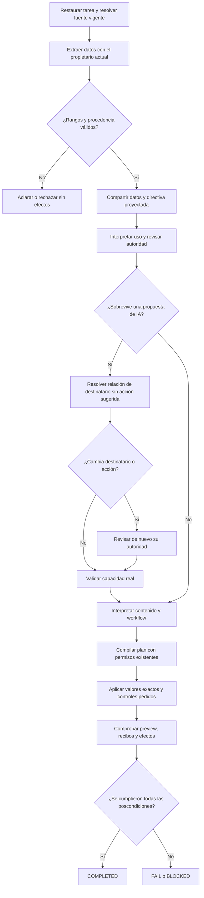

# Completar, copiar y latencia: implementación y aceptación

2026-10-19. **IMPLEMENTACIÓN PARCIAL; versión NO CERRADA.** Se ejecutó el [plan aprobado](COMPLETION_COPY_LATENCY_PLAN.md). Se conserva el incremento de campos/copia; la optimización de autoría no superó los controles y fue retirada.

## Propiedad y contratos del incremento conservado

`PreparationInference` mantiene interpretación y extracción; `GroundedVariableResolver` mantiene vinculación literal; `NovaTaskPlanner` y `TaskSourceResolver` conservan fuente, continuidad y revisión. Se extendieron esas capacidades mediante `IInputScopeInterpreter` y un valor inmutable `UserInputScope`, excluido del JSON público. No se añadió otro orquestador, servicio, framework, caché, dependencia o modelo.

- Una etiqueta delimita una asignación candidata, no demuestra que todo el sufijo sea dato. Se reutiliza el extractor semántico existente para separar el valor de las órdenes posteriores.
- El dominio valida nombres reales, prefijos originales, evidencia, rangos Unicode, petición e identidad/revisión. Conserva unidades originales completas, incluidos signos y comillas. No reconoce intenciones por keywords/regex ni corta datos por verbos.
- Ese mismo ámbito se transporta hasta las proyecciones semánticas, extracción posterior y controles UI. No se vuelve al sufijo del parser al escribir el campo. Los consumidores sin el puerto opcional conservan su gramática anterior.
- El extractor recibe contratos de campo TEXT: una clave no impone por sí misma un nombre propio ni una relación con otra entidad. Una pregunta simultánea a valores completos no se descarta: se permite una corrección local contra la misma entrada. Si la pregunta o el error de vinculación persisten, se bloquea. No se repiten fuente ni objetivos.
- Los nuevos datos literales siguen prevaleciendo sobre valores anteriores del contexto visible. Las entradas estructuradas del preparador conservan su prioridad propia.
- Se mantienen el clasificador de uso y su revisión de roles/autorización. Para una propuesta de IA que sobreviva a esa revisión, una extracción de relación de destinatario, sin la acción sugerida, evita elegir Ollama para suplir una copia. Un destino desconocido pregunta; un cambio de destinatario vuelve a revisar autoridad. Capacidad y permiso siguen separados. El fallo de esa etapa no repite toda la cadena.
- El uso recibe el nombre literal de la fuente como dato cuando el propietario lo ha ligado por nombre, ID y revisión. Sólo se proyecta un título único que coincide con la referencia consultada. Los nombres ambiguos/repetidos y los destinos mencionados al buscar una fuente por otra descripción conservan su representación original. No hay reglas para marcas o frases: se utiliza la identidad real del catálogo.
- Sobre un origen ligado y sin tarea pendiente, se reutiliza la revisión existente de autoría antes de seleccionar el contrato costoso de contenido. Sólo su resultado negativo limita esa interpretación a uso/consejo y evita thinking innecesario. La autoría conserva sus controles y perfil anterior.

Las demostraciones sintéticas de relaciones son contexto del modelo, no manejadores de frases ni permisos. El prototipo aislado pasó 14/15 casos de desarrollo y confundió una fuente cuyo título incluye Claude; no es un clasificador autónomo acreditado. El candidato conserva fuente y revisión de roles y debe probar su composición real.

La primera composición también falló con ese título: se conserva [4/5 variantes](../evidence/completion-copy-20261019/planning-variants-verification.json). Al proyectar la identidad de fuente ligada pasan [5/5 variantes](../evidence/completion-copy-20261019/planning-variants-source-binding-verification.json): fuente que contiene un proveedor, destinatario indirecto, campos con Gemini, órdenes citadas como datos y cláusulas reordenadas. Son comprobaciones del planificador con Qwen, no UI ni holdout general.

La repetición sobre los mismos hashes que la UI final pasa [5/5 variantes](../evidence/completion-copy-20261019/planning-variants-contract-final-verification.json), incluidos los valores exactos del ámbito y la ausencia de efectos adicionales en esos planes.

HTTP/JSON público, SQLite, aprobación, conflictos, pausa/cancelación y UI mantienen sus contratos. No se publica sobre 5190 ni se modifica la biblioteca personal. Rollback sólo del incremento propio contra `.playwright/completion-copy-20261019/before`, preservando trabajo anterior.

## Algoritmo conservado



```text
resolver fuente antes de inferir objetivos dependientes
si hay asignaciones: reutilizar extracción y ligar prefijos originales a campos reales
rechazar reescrituras, nombres ajenos, cruces de petición/revisión y cortes Unicode
usar el ámbito ligado tanto para interpretar directivas como para rellenar controles
revisar rol/autoridad antes de convertir una propuesta en capacidad
reconciliar su destinatario sin sugerirle la acción ni un proveedor por defecto
si cambia: revisar autoridad; si falla: terminar esa etapa sin reiniciar toda la cadena
reutilizar la premisa negativa de autoría para evitar trabajo de contenido innecesario
conservar los controles anteriores de generación, fidelidad, aprobación y persistencia
comprobar campos, preview, fuente y todos los efectos antes de declarar completo
```

## Oráculo y ejecuciones conservadas

[Expectativas v2](../evidence/completion-copy-20261019/acceptance-v2.json), [v3](../evidence/completion-copy-20261019/acceptance-v3.json), [v4](../evidence/completion-copy-20261019/acceptance-v4.json). Los mensajes originales no cambian. El dato en línea conserva su punto; el separado no lo incluye. Se comprueban identidad/revisión, cuerpo sin modificar, campos nativos, preview, COPY_PROMPT, botón real y handoff exacto al clipboard aislado del navegador. **Clipboard del sistema operativo: SIN VERIFICAR.**

Se corrigieron contradicciones del arnés sin borrar fallos: Copiar registra un uso, por lo que sólo se admite ese incremento y su timestamp después del clic manual de QA; antes del clic, NOVA debe dejar la biblioteca intacta. Los escenarios de variables deben recibir su fixture declarado Proyecto técnico, no Redactar correos. v4 quedó fijado antes de la repetición correspondiente.

- Primer candidato: valores correctos, pero preparación local añadida; FAIL conservados.
- Segundo candidato: dos FAIL del oráculo de identidad/uso y cuatro PASS; guardado 121397 ms / 14 llamadas, todavía con dos generaciones.
- Primer intento v3: timeout del arnés al consultar usos de la ficha equivocada.
- v3 con oráculo corregido: cinco PASS, incluidos los dos recorridos de copia; guardado BLOCKED, 143139 ms / 14 llamadas. No se promociona esa modificación de autoría.

## Optimización de autoría rechazada

Se ensayó reutilizar la clasificación existente de cláusulas para delimitar la edición y compartir contexto con fidelidad. Se conservaron pruebas de componente e intentos reales. Un primer cuerpo correcto fue rechazado y una corrección añadió workflow. Otras variantes con citas acotadas y separación de interpretación/cuerpo no superaron los controles de borrador válido, aprobación futura o metadatos. La repetición volvió a rechazar un cuerpo válido.

[Registro del rechazo y hashes](../evidence/completion-copy-20261019/rejected-authoring.json). Fuentes y binarios de los experimentos permanecen en el archivo indicado. `ContentRequestScope`, sus consumidores y cambios de fidelidad fueron retirados del producto. `DraftFidelity.cs` se restauró exactamente contra su snapshot. No se deshabilita revisión, no se aceptan propuestas por fuerza y no se aumenta el presupuesto.

## Verificación del candidato conservado

[597/597 backend PASS, ninguna omitida](../evidence/completion-copy-20261019/tests/backend-input-contract-final.trx). Son 22 comprobaciones adicionales sobre la base 575, con rangos, Unicode, procedencia, compatibilidad, continuidad, reparación local acotada y transporte hasta campos UI. Las tandas de 598 pertenecían a un experimento posteriormente retirado. No se presentan como evidencia del candidato final.

API y evaluador finales: cero warnings/errores. [Hashes finales](../evidence/completion-copy-20261019/candidate-contract-final.json): Application/Infrastructure coinciden entre ambos y la restauración de fidelidad es exacta. [Manifiesto de validación](../evidence/completion-copy-20261019/validation.json): seis recorridos UI y cinco variantes del planificador pasan en ese candidato; se conservan todas las ejecuciones anteriores.

**UI del candidato COMPLETION_CONTRACT_FINAL: 6/6 PASS con Qwen y Edge visibles.** Datos en línea 23169 ms, separados 20374 ms, apertura 16526 ms, Claude 20605 ms, ejecución local 20300 ms y guardado 79997 ms. Ambos recorridos de datos comprobaron botón real y texto compilado exacto. Guardado: una generación, una revisión, aprobación de QA, mismo ID/revisión 2, formulario/preview/registro idénticos y otros registros conservados. [Datos, vídeos y capturas](../evidence/latency-1792450415863/measurements.json).

Las tandas anteriores con la identidad de fuente ligada midieron guardado 77904 y 78774 ms, también con una generación. En la segunda tanda hubo un fallo de aclaración de campos, preservado y corregido mediante contrato TEXT/reparación local; no se cuenta como tanda 6/6. Estas cifras son observaciones dirigidas, no tres baselines comparables ni aceptación global de rendimiento.

## Pendientes que impiden el cierre

El guardado pasó en el candidato dirigido, pero los fallos de fidelidad históricos no prueban recuperación general por una tanda. Su latencia y fidelidad de primer intento siguen abiertas para la campaña completa. Tres baselines comparables, campaña repetida, separación frío/caliente y holdout mantienen sus requisitos; no se acreditan p50/p95 ni mejora global a partir de una tanda dirigida. La matriz conserva 88 requisitos y sus criterios. Este incremento no completa la aceptación de rendimiento ni cierra la versión.
