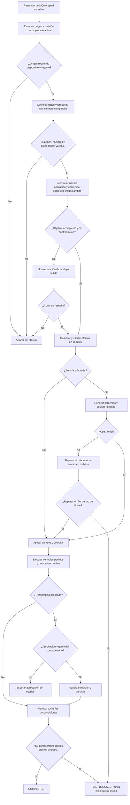

# Diagnóstico y plan: completar, copiar y latencia

2026-10-19. **Plan en ejecución; implementación acotada añadida después del diagnóstico inicial.** Las secciones de diagnóstico conservan la evidencia anterior. El avance y los resultados del candidato se registran al final y en [COMPLETION_COPY_IMPLEMENTATION](COMPLETION_COPY_IMPLEMENTATION.md). Se mantienen la matriz y sus criterios.

## Evidencia y primer punto incorrecto

Se cotejaron los 15 hashes de código del último manifiesto con los archivos actuales: coinciden. Se analizaron las seis peticiones sintéticas de los builds modular-v3/v4 y se ejecutaron 59 pruebas existentes de contexto, orden de validación y contrato del editor: 59 PASS, cero omitidas. No se repitió inferencia, navegador, benchmark ni holdout. La tanda completa 575/575 es evidencia previa del candidato, no una ejecución nueva de esta consulta.

[Diagnóstico estructurado y tiempos por etapa](../evidence/semantic-diagnosis-20261019/diagnosis.json). [Pruebas ejecutadas](../evidence/semantic-diagnosis-20261019/existing-boundaries.trx).

| Recorrido existente | Observado | Primera transición incorrecta |
| --- | --- | --- |
| Variables en línea | COMPLETED, pero FAIL semántico; 29,857 s / 7 llamadas | `GroundedVariableResolver.LabeledBinding` consume hasta la siguiente etiqueta declarada o el final. Incluye la orden posterior de copiar dentro del valor. `DirectiveOutsideInputs` la oculta al intérprete y la UI la escribe en el campo. Ocurre antes de que Qwen decida el workflow. |
| Variables con datos separados | BLOCKED / INVALID_DECISION; 8,591 s / 7 llamadas | La orden de copiar permanece visible, el origen es correcto, pero `InterpretDestination` produce PREPARE/null dos veces. Se repite la revisión y se rechaza la capacidad antes de interpretar/completar los campos. |
| Guardado como versión | PASS en su alcance; 134,256 s / 14 llamadas | El primer cuerpo incluye una orden de aprobación/guardado. La revisión la rechaza; una segunda generación y revisión producen el cuerpo aprobado. El éxito depende todavía de reparación. |

Fuente de los dos fallos: `docs/evidence/latency-1792436543200/measurements.json`. Fuente del guardado: `docs/evidence/latency-1792436909263/measurements.json`.

El selector de origen ya identifica Proyecto técnico; no hay evidencia para atribuir estos dos fallos al ranking, a SQLite o a la escritura de Playwright. La validación de PREPARE/null rechaza una combinación inválida correctamente: el defecto está en proponer ese uso para esta petición, no en impedir ejecutarlo.

La traza conserva las propuestas de destino, pero no el resultado JSON crudo de cada revisión de alcance. Que la propuesta no se estrecha se deduce del código y de que el flujo vuelve a fallar antes de `InterpretTextGoal`; no se presenta como una transcripción independiente del revisor.

## Causa compartida y límites del diagnóstico

La petición no tiene todavía una representación común y validada de **datos del caso, requisitos del contenido y operaciones de la aplicación**. Un parser fija un ámbito demasiado amplio para el dato; otras etapas vuelven a interpretar uso, autoría y workflow en vistas distintas. Separar las clases del planificador resolvió propiedad y orden de lectura del origen, pero no sustituyó ese contrato semántico.

En el uso, el clasificador plantea primero una elección centrada en IA, antes de resolver el uso completo de la aplicación. El revisor recibe después un efecto ya propuesto. Es **hipótesis** que este encuadre refuerce la falsa preparación; está **observado** que ambas etapas no recuperan el recorrido. Se debe demostrar causalmente una alternativa antes de promoverla. El prototipo conjunto anterior sólo pasó 2/9; las variantes de contexto, esquema relacional, destinatario primero y catálogo de herramientas tampoco superaron su gate. No se reactivan con otro nombre.

Hay además una contradicción en el oráculo de `Tests/nova/latency.cjs`: espera el sufijo completo después de `proyecto:`, incluida la orden de copiar, y simultáneamente exige COPY_PROMPT. Una implementación que separe correctamente el dato fallaría esa igualdad. El mensaje congelado se conserva; la nueva expectativa se debe escribir de forma independiente y versionada **antes de implementar**, manteniendo o reforzando las poscondiciones. No se cambia el valor esperado a partir de lo que devuelva el modelo.

## Dónde se consumen los 134 segundos

Tiempos de spans LLM del servidor; no se suman los spans padres de planificación/herramientas que los contienen. El proxy mide aproximadamente 0,27 s menos; se conserva la diferencia de instrumentación.

| Medida del guardado | Tiempo | Interpretación |
| --- | ---: | --- |
| Pared completa | 134,256 s | Incluye UI, aprobación automatizada de QA y persistencia |
| 14 llamadas LLM | 123,252 s | 91,8 % del total |
| InterpretTextGoal | 27,046 s | Interpretación con thinking habilitado |
| Dos generaciones y dos revisiones de fidelidad | 74,697 s | 55,6 % del total |
| Segunda generación y revisión | 36,000 s | Coste medido de la reparación; no es ahorro futuro garantizado |
| Carga de modelo, suma | 1,155 s | Menos del 1 % del total de este guardado |
| Prefill, suma | 4,345 s | No domina esta muestra |
| Generación de tokens, suma | 111,236 s | Principal componente medido de las llamadas |
| Tiempo exterior a spans LLM | 11,004 s | No equivale a coste puro de Playwright |
| Primera acción visible | 52,491 s | La planificación tarda 50,292 s antes de la navegación |

Las cinco llamadas con thinking habilitado acumulan 101,742 s. Esto no prueba que desactivarlo preserve calidad; ya existe un experimento rápido rechazado por perder precisión. No se leen ni almacenan trazas privadas de razonamiento.

La muestra previa al guardado tenía 426192 KiB de RAM libre (aprox. 0,41 GiB). Es un factor de variación posible, no una explicación causal cuantificada. La apertura fría anterior sí tuvo unos 10,9 s de carga, por lo que frío y caliente deben separarse. No hay p50/p95 acreditados con estas muestras.

## Contrato de cambio propuesto

**Resultado:** el dato correcto se aplica a los campos reales, la orden de copiar sigue siendo una operación, la copia contiene el compilado exacto y no se añade preparación/ejecución/guardado. El guardado existente conserva fidelidad y aprobación y reduce coste sin retirar controles.

**Propietarios existentes y extensión mínima:**

- `PreparationInference` mantiene interpretación semántica y extracción; extender sus contratos existentes, sin otro orquestador, modelo ni servicio.
- `GroundedVariableResolver` mantiene vinculación y validación literal de los valores. Admitir un ámbito propuesto y validado, además de las entradas estructuradas explícitas. La gramática heredada no debe cambiar silenciosamente para otros consumidores.
- Añadir, si la implementación lo requiere, un único valor interno e inmutable de petición delimitada: identidad/hash de petición, origen/revisión, rangos de datos por nombre de campo, rangos de directivas y evidencia de sus roles. No es una base de datos ni una nueva autoridad.
- `NovaTaskPlanner` transporta ese conocimiento validado; `TaskSourceResolver` conserva lectura fresca y cardinalidad. `SemanticPlanCompiler`/validador conservan planes, efectos y permisos.
- Generador y `ReviewDraftFidelity` conservan responsabilidades separadas. El cuerpo exacto aprobado, los recibos UI y la revisión siguen siendo obligatorios para persistir.

**Invariantes:** rangos dentro del texto original y sin cortar Unicode; nombres pertenecientes al formulario real; valores obtenidos por slicing literal, no por reescritura; ningún mismo fragmento de dato concede autoridad de aplicación; no se trunca texto al encontrar puntos o verbos. Conservar entradas explícitas de formulario, negaciones, varias variables, datos multilineales y tarea pendiente autorizada. El modelo propone roles, pero un esquema válido no demuestra semántica correcta: eso se verifica con evaluación y tareas reales.

El ámbito queda ligado a petición y revisión; no se comparte por mera similitud ni se reutiliza después de cambiar origen, borrador o contexto autorizado. Ambigüedad no resuelta requiere una pregunta concreta antes de efectos. Pausa/cancelación explícitas y conflictos reales conservan sus controles; tocar la pantalla no se convierte en pausa automática.

**Alternativas:** A) extender las capacidades actuales con el contrato común anterior, elegida; B) un nuevo parser/router de frases, rechazada por repetir el problema; C) nuevo framework, índice, modelo o gran clasificador único, injustificado y sin evidencia de fiabilidad. Un DTO compartido no obliga a concentrar todas las decisiones en una única llamada LLM.

## Flujo propuesto



```text
entrada: petición literal, sesión autorizada, formulario/origen vigente
respetar cancelación y presupuesto global existentes durante cada etapa
resolver referencia mediante TaskSourceResolver, sin cambiar selección humana
obtener datos explícitos; proponer límites sólo cuando haga falta interpretar el texto
validar nombres, rangos, procedencia, revisión y separación dato/directiva
si no se puede establecer el ámbito: preguntar una vez, sin rellenar ni ejecutar
interpretar objetivos sobre la misma petición delimitada; no volver a adivinar sus roles
validar el plan con el compilador y las capacidades reales
si una etapa contradice el contrato: reparar sólo esa etapa una vez
si persiste: devolver rechazo/aclaración; no repetir la cadena completa
no borrar objetivos para satisfacer el esquema; invalidar sólo hechos dependientes afectados
si hay autoría: generar sólo contenido; revisar contra la petición original y fuente
si sólo hay uso: no ejecutar generación ni revisión de un nuevo cuerpo
aplicar valores exactos, compilar y realizar únicamente los controles solicitados
copiar sólo el compilado verificado; no elegir IA para suplir una copia
para guardar: esperar aprobación exacta, revalidar revisión y consumirla una vez
verificar campos + preview + efecto + recibo; declarar completo sólo si todo coincide
cancelación: devolver CANCELLED sin nuevos efectos; presupuesto agotado: BLOCKED
```

| Nodo | Propietario / archivos previstos | Verificación del incremento |
| --- | --- | --- |
| A–C | TaskPlanning, TaskConversationContext, TaskSourceResolver | Origen, revisión y continuidad actuales no regresan |
| D–E | Preparation/IVariableResolver + extracción en PreparationInference; ámbito interno en SemanticContext si procede | Rangos literales, Unicode, datos hostiles y campos dinámicos |
| F–H | SemanticInference + SemanticPlanCompiler/Validator | Uso/copia frente a destino; sin proveedor inventado ni efectos añadidos |
| I–K | PreparationInference y DraftFidelity | Sin autoría para llenar/copiar; autoría fiel con revisión independiente |
| J–N | Ejecutor y AgentUiDriver existentes | Campos, preview, copia y recibos reales; sin cambios cosméticos necesarios |
| O–P | Aprobación/persistencia existentes | Mismo ID/revisión, hash del cuerpo aprobado, sin doble commit |

## Orden de implementación y gates

1. **Congelar aceptación correcta y diagnóstico reproducible.** Mantener los dos mensajes originales. Definir por separado el literal del caso, las operaciones pedidas y las prohibidas. En el caso en línea, excluir la oración de workflow del dato sin normalizar arbitrariamente su puntuación. Añadir evidencia sintética del ámbito y de la primera contradicción, sin mostrar lógica de desarrollo en la UI. La expectativa se fija antes del candidato.
2. **Corregir ámbito y uso como un incremento vertical.** Extender extracción/vinculación existente; migrar los consumidores NOVA de las proyecciones para que usen el mismo ámbito. En uso, representar explícitamente objetos y operaciones de aplicación, no sólo opciones de IA. Resolver destinatario únicamente si el objetivo realmente lo requiere. Evaluar ese contrato aisladamente antes de retirar los clasificadores redundantes; no añadir otro gate encima del mismo error. Si una variante falla los positivos de Claude/Qwen o los negativos de copia, se rechaza y conserva.
3. **Reducir coste desde el plan validado.** Ejecutar autoría y revisión de contenido sólo cuando sean necesarias; evitar redecidir hechos ya ligados al ámbito; sustituir el reintento exterior completo por reparación local acotada. Para adaptación, proyectar requisitos de contenido con evidencia original separada del workflow y conservar la revisión independiente. El objetivo es evitar la contaminación del primer cuerpo, no aceptar más cuerpos malos. Cualquier cambio de thinking/contexto/tokens se ensaya por etapa con calidad como gate; no se cambia globalmente para conseguir una cifra rápida.
4. **Validar el mismo candidato completo.** Dos recorridos de completar/copiar, apertura, guardado con aprobación, Claude sin envío y Qwen local, sobre la misma SQLite sintética aislada y hashes de API/web/modelo. Ejecutar la regresión backend pertinente y completa; React sólo si cambia su código. Mantener los fallos anteriores. No actualizar 5190 ni los estados de cierre hasta tener evidencia correspondiente.

La caché existente `InferenceReuse` no es el primer arreglo: los benchmarks usan ReuseInference=false y los errores se producen en peticiones nuevas. Cachear una clasificación incorrecta no corrige fidelidad. Su uso posterior, si aporta beneficio medido, debe limitarse a inferencia pura con identidad/digest y contexto completos; jamás cachear aprobación, efectos o asumir revisiones vigentes. No se añade otra caché.

## Aceptación sin rebajar criterios

- En ambos mensajes originales: origen correcto, dato literal sin workflow en el campo, cuerpo original sin editar, preview igual al compilador y copia del texto compilado correcto mediante el control real. Debe existir recibo; COPY_PROMPT en el plan por sí solo no prueba clipboard. Si el navegador impide comprobar esa integración, marcar SIN VERIFICAR, no PASS.
- Ningún proveedor, ejecución, autoría o guardado añadido al completar/copiar. Las solicitudes reales de Claude y Qwen siguen funcionando; no se arregla el negativo suprimiendo los positivos.
- Variaciones de los mismos fallos: orden de cláusulas, nombres de campos declarados distintos, varias variables, texto multilineal/citado con órdenes que son datos, negación y continuación con valores existentes. No son nuevos features ni nuevas filas de cierre. Una ambigüedad real puede preguntar; los mensajes congelados con datos suficientes no se convierten en éxitos mediante una aclaración innecesaria.
- Guardado: cuerpo sin workflow, campos y preview idénticos al cuerpo aprobado, mismo origen/revisión incrementada una vez, otros registros intactos. Mantener rechazo seguro cuando no haya fidelidad; no quitar la revisión para ahorrar su tiempo.
- Evaluación semántica según thresholds existentes: intentAccuracy >= 0,90; validPlanRate/target/goalCompletion/toolCallAccuracy >= 0,95; adaptationFidelity/taskSuccessRate >= 0,90; cero efectos no autorizados, IDs inventados, contaminación y finalización prematura. Desarrollo/validación separados; holdout sólo tras congelar el candidato, sin ajustar contra sus resultados.
- Rendimiento según PER-01/02/03 actuales: tres baselines comparables antes de fijar la meta numérica. Separar frío/caliente, espera de aprobación, tiempo a primera acción real y tiempo a resultado correcto; registrar llamadas/tokens y recursos. Para p50/p95, campaña suficientemente repetida (plan: al menos 30 observaciones comparables por recorrido medido), conservando fallos/timeouts y sin percentiles calculados sólo sobre éxitos. Ninguna promesa de segundos o porcentaje se deriva de esta única ejecución de 134 s.

## Entrega, compatibilidad y rollback

Cambios previstos en contratos internos y sus adaptadores; HTTP/JSON públicos, SQLite y permisos se conservan. No se activa TaskGoals, TaskResultContract o recuperación vectorial como atajo. No se instala ningún paquete/modelo ni se usa nube. Conservar baseline, candidatos rechazados, hashes y TRX; rollback sólo del incremento propio contra su snapshot, sin resetear el árbol con trabajo ajeno.

Primero se debe demostrar la separación de petición y el uso correcto en los dos fallos. Después se puede atribuir una mejora de latencia a etapas concretas. El diagnóstico precedente no acreditaba su corrección. La implementación posterior conserva esa distinción y no declara cerrada la versión.
