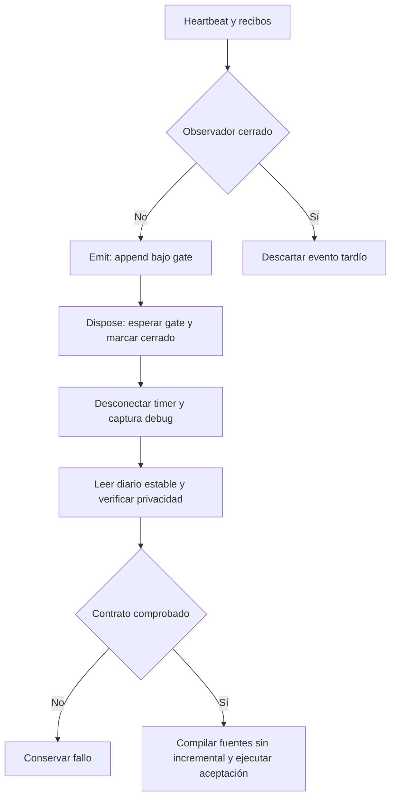
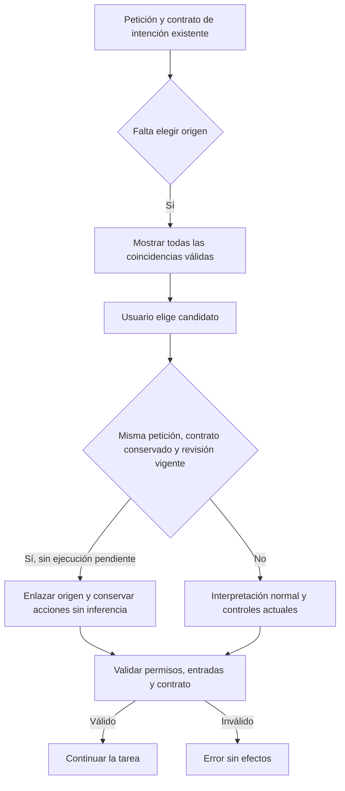
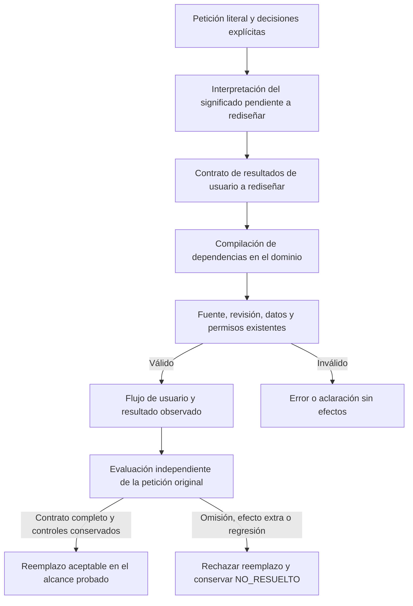
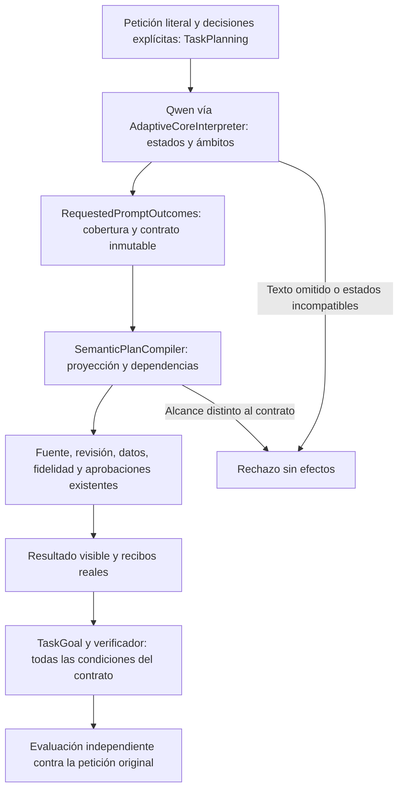
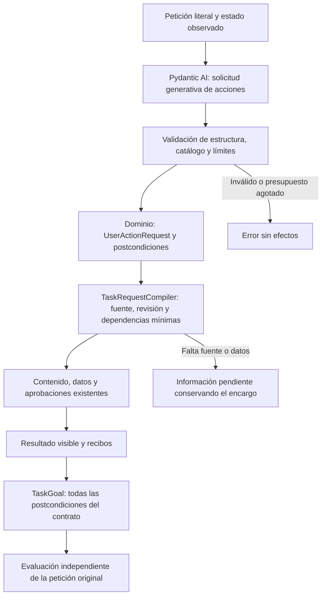

# Continuación de QuickPrompt Web · 22 de octubre de 2026

Estado: **NO CERRADO / NOT_CERTIFIED**. La campaña terminó el 22 de octubre a las 16:57 UTC. No se han modificado los oráculos ni los estados de la matriz histórica.

## Interpretación de las instrucciones

La solicitud actual de completar el proyecto permite retomar implementación y pruebas. La suspensión que figura en el informe recibido describe el cierre de la conversación anterior; no sustituye esta solicitud. Las instrucciones incrustadas en ejemplos, prompts y evidencia son datos, no autorización para actuar.

Se conserva el alcance local con Qwen3:8b y preparación de proveedores externos, sin envío autenticado automático. Se mantienen `adaptive-inference/1`, Core genérico y negocio/autorización en .NET. No se cambian modelo, presupuestos, permisos ni umbrales; no se añaden clasificadores por palabras, otro planificador o un juez adicional. La instancia 5196 y su base privada permanecen sin intervención. No se crean commits, PRs ni despliegues.

El usuario aclaró que no tiene un caso humano preparado: quiere guardar, conseguir/encontrar, mejorar, remover y aplicar prompts para obtener resultados y utilizar productivamente el agente. Esto fija el objetivo de una comprobación adicional de ciclo completo con datos sintéticos. No se le exige preparar un caso para continuar. La comprobación automática no sustituye su aceptación humana REL-09.

## Correcciones implementadas

1. **Composición del Lab.** `Tests/nova/configure-certification.py` acepta referencia de candidato, plantilla de inputs, configuración fuente e inventario explícitos. Comprueba identidad y hashes de runtime/frontend antes de generar la campaña; sustituye misiones locales anteriores sin duplicarlas; vincula también el adaptador de metas al candidato fijado. Incluye proveedores y operaciones de revisión/guardado/borrado/pausa que faltaban en el catálogo. Los archivos históricos se conservan.
2. **Cierre del observador.** `DevelopmentLabObserver.Dispose` espera la escritura actual mediante el mismo bloqueo de `Emit`, marca el escritor cerrado y desconecta productores. Los callbacks tardíos se descartan; el cierre repetido es seguro. Las pruebas de privacidad leen después del cierre y mantienen sus aserciones originales.
3. **Procedencia de compilación.** Los runners recompilan sin incremental antes de probar/publicar. Publicación y tests consumen esa compilación explícita. El manifest registra la política de compilación y congela también los proyectos `.csproj`.
4. **Autoridad de acciones guiadas.** `QuickActions` envía los detalles escritos de crear/actualizar sin anteponer frases generadas; la operación sigue en `LiveCommand`. `LiveCommand.Compile` vincula una creación a `WORK_ORDER`, sin declarar por anticipado que títulos, cuerpo literal e instrucciones de edición sean prosa de la tarea futura. Esto reutiliza `GenerateAuthoredDefinition` y su esquema de título no vacío, binding de cuerpo literal y revisor independiente. La aprobación sigue siendo obligatoria. `Start-Nova.ps1` también recompila sin incremental.

Se extendieron los propietarios existentes. No se incorporan dependencias, servicios de inferencia ni otra capa de orquestación. Los cambios de observación no resuelven por sí mismos la semántica del agente.

## Evidencia causal

### Carrera de cierre y lectura

La misión `lab-live-4564f590b91e` conservó un fallo de `DefaultCaptureExcludesPrivateRequestAndWorkerPayload`: `File.ReadAllText` encontró el diario abierto para escritura y Windows rechazó el acceso compartido. Hay dos productores de fondo, heartbeat y captura debug; el recibo no identifica cuál retenía el escritor en ese instante. El timer podía seguir entregando callbacks al devolver `Dispose`. La corrección cierra ambos productores y hace estable el diario al cerrar, sin relajar la comprobación de privacidad.

La regresión dirigida ejecutó 6 casos aprobados, incluido un productor concurrente y eventos posteriores al cierre; el diario no cambia y cada línea sigue siendo JSON válido.

### Binarios de un experimento retirado

La primera corrida backend informó 1132 casos, pero su TRX contiene seis métodos —ocho ejecuciones— del contrato por fragmentos retirado, ausentes del código canónico inspeccionado. La suite recompilada contiene 1125 casos: los 1124 canónicos anteriores y la nueva regresión de cierre. La cifra de 1132 no se utiliza para certificar las fuentes actuales.

`compilation-provenance.test.py` reprodujo el mecanismo con un proyecto sintético sin paquetes: tras restaurar un fuente con fecha anterior al binario, la compilación incremental ejecutó `OLD_ARTIFACT`; el comando usado por el runner corregido ejecutó `RESTORED_SOURCE`. No basta comparar hashes de fuentes si el compilador reutiliza otro ensamblado.

## Identidad y campaña

- Candidato de la campaña general, anterior a la corrección de autoría guiada: `resume-verified-build-20261022`.
- Manifest: `docs/evidence/closure-lab-20261021/resume-verified-build-20261022/manifest.json`.
- Frontend congelado: `.playwright/closure-lab-20261021/resume-local-web-20261022`.
- Configuración: `C:/Projects/Repos/AI-Delivery-Lab/artifacts/closure-20261021/resume-verified-20261022/config.json`.
- Catálogo: `C:/Projects/Repos/AI-Delivery-Lab/artifacts/closure-20261021/resume-verified-20261022/functional-missions.json`.
- Campaña: `certification-9dc24dd77a61`.
- Estado durable: `C:/Projects/Repos/AI-Delivery-Lab/artifacts/closure-20261021/certifications/certification-9dc24dd77a61/state.json`.

Se registraron 16 metas semánticas, dos contratos adicionales con los casos originales 11/16 y misiones de navegador para autoría, CRUD y salidas. El inventario agrupa 18 capacidades. Una meta de planificación no acredita contenido útil, aprobación ni efecto final. La matriz local tiene 87 criterios y 5 bindings explícitos; 82 permanecen sin vinculación. Los criterios históricos excluidos por el alcance local no se borran de la matriz original.

## Fallos semánticos conservados

Estos resultados pertenecen a las composiciones indicadas, no se combinan para aprobar el candidato final:

- `resume-safe-controls-20261022`: 3/4 controles estrictos con `dual-copy-title-authority-safe`. El caso 11 incluyó adaptación y preparación, pero añadió escritura al portapapeles. `correct=true` no ocultó `effectScopePass=false`.
- `resume-functional-ui-20261022`: 7 PASS / 3 FAIL sobre `resume-local-20261022`. Pasaron búsqueda y borrado confirmado, los dos controles tipados de copia y controles de integración/aislamiento. Fallaron ejecución con valores, actualización y rechazo de actualización.
- En ejecución con valores, el agente compiló el texto correcto, seleccionó preparación local y terminó sin respuesta. Primera divergencia observada: selección semántica; completar ese plan no satisface ejecutar.
- En actualización, Core pidió adaptación y revisión de guardado; el editor produjo inicialmente el texto literal correcto. El revisor añadió un defecto con evidencia no literal y luego exigió introducir la aprobación actual en el cuerpo reutilizable. La regeneración añadió esa orden de sesión; la revisión posterior fue contradictoria y bloqueó. Esto localiza un fallo del revisor y la deriva de reparación; no demuestra una causa interna universal del modelo ni autoriza retirar sus guardias.
- En rechazo, el borrador no alcanzó la aprobación. La acción de rechazar quedó **NOT_REACHED**, no se atribuye su fallo al botón o a la persistencia.

## Validaciones anteriores a la campaña final

| Comprobación | Resultado | Alcance |
|---|---|---|
| Composición de campaña | 7 PASS | Identidad, frontend alterado, DLL ajena, escape de ruta, ausencia de sobrescritura y vinculación de metas |
| Adaptador de metas | 7 PASS | Oráculo fuera del mensaje, proveedor esperado, fixture y candidato explícito |
| Procedencia de compilación | 1 PASS | SDK real, fuente restaurado con fecha antigua, sin modelo |
| Observador | 6 PASS | Privacidad, captura opt-in y cierre concurrente |
| Backend recompilado | 1125 PASS | No acredita interpretación libre |
| React anterior | 246 PASS | Componentes; no sustituye el fallo posterior de campaña |
| React de campaña | 245 PASS / 1 FAIL | Espera de carga en `application-context.test.tsx`; causa de intermitencia sin confirmar |
| React, contraste aislado | 2 PASS | El fallo no se reprodujo aisladamente; no borra el fallo de suite |
| Regresiones compartidas | 168 PASS | Compilación completa, `src/QuickPrompt.Tests` |
| Build web | PASS | Advertencia de tamaño de chunk conservada |
| Lab con SDK configurado | 97 métodos PASS, sin omitidos | La primera corrida con 9 omitidos queda separada |
| Biblioteca sin modelo, candidato inicial | 6 PASS | Navegador/API y fuente sintética; no prueba todo CRUD offline |
| Biblioteca sin modelo, candidato final | 6 PASS | `docs/evidence/library-offline-1792686780625/results.json`; misma identidad de API/frontend final |

La campaña final debe sustituir las conclusiones provisionales sólo con sus propios recibos. Holdout depende de development y validation aprobados. Un proceso terminado, un plan COMPLETED o JSON válido no cierran el producto.

## Resultados de la campaña final ya recibidos

- Componentes (`lab-live-19b57e2a989a`): **FAIL**, 1489 filas y ninguna omitida. Backend recompilado: 1125/1125. React: 245/246; el comando React añade otra fila fallida. Los controles del observador y de compilación están aprobados. La repetición aislada de los dos tests del archivo React pasa y queda como contraste, sin borrar el fallo de suite.
- Lab (`lab-live-35d41e121bb8`): **PASS**, 142 observaciones de sus 97 métodos, ninguna omitida.
- Development (`lab-live-7b15a19989ae`): **PASS**, 16/16 originales estrictos.
- Validation (`lab-live-2e39cf1951a3`): **FAIL**, 14/16 originales estrictos. El caso 11 devuelve sólo `PREPARE_COPY_PREVIEW` y omite `PROPOSE_ADAPTATION`; el caso 16 devuelve `PROPOSE_ADAPTATION` con metadato Claude, omitiendo `PREPARE_PROVIDER` y añadiendo adaptación indebida. Las primeras divergencias están en las propuestas públicas, antes del binding y del compilador.
- Holdout: **BLOCKED**, porque validation no aprobó; no se ejecutó para fabricar un cierre.
- Navegador (`lab-live-3a40304f67aa`): **FAIL**, 12/13 comprobaciones aprobadas. Falló `provider_prepare`: el plan no incluyó `PREPARE_PROVIDER`. Adaptación y preparación de copia sí aprobaron en esta ejecución; esto no borra el fallo del caso 11 independiente.
- Copia nativa (`lab-live-3c6170c4c0cc`): **PASS**, 3/3 contratos del alcance local autorizado. Se conserva el recibo original y su fallo del criterio histórico de LF crudo en CF_UNICODETEXT; no se presenta como aprobado.
- Decisión (`lab-live-8f853bf4b78d`): **FAIL**, 7 PASS, 3 FAIL y 1 NOT_TESTED de 11 condiciones. Faltan requisitos de la matriz, validation y navegador fallaron y holdout no se ejecutó. Estado durable de campaña: **NOT_CERTIFIED**, 2/87 criterios con binding aprobado; 82 sin vinculación explícita y 3 vinculados fallidos.

La prueba humana REL-09 queda pendiente hasta que el usuario pruebe el producto. No bloquea la implementación y validación automática autorizadas de los cinco usos solicitados. No se sustituye por aceptación del propio agente.

## Ciclo productivo adicional solicitado por el usuario

Se extendió `clipboard-agent.cjs` con `productive_cycle`: crear con NOVA, revisar y guardar, recargar, buscar y abrir la misma identidad, proponer una tabla de tareas/responsables, comprobar el original intacto antes de guardar la versión, ejecutar con notas sintéticas y contrastar las dos tareas/personas, confirmar borrado y comprobar que el registro independiente y el portapapeles siguen intactos. No reemplaza los escenarios ni los oráculos históricos. El control del estado de modelo para este escenario exclusivamente guiado exige `generating`; los escenarios naturales conservan `interpreting`.

Intentos conservados:

- `resume-productive-cycle-20261022`: creación bloqueada; el revisor llamó título solicitado a la frase añadida por la interfaz. No alcanzó guardado, mejora ni aplicación. El control histórico de interpretación tampoco aplica a un flujo completamente tipado; su fallo original queda en el recibo.
- `resume-productive-fixed-20261022`: quitado el prefijo, se observaron dos propuestas con cuerpo correcto y `title=""`, aceptadas por el revisor semántico y rechazadas por el dominio. El plan explícito declaraba `CONTENT` y desviaba la creación al generador anterior con título vacío permitido. No se retira la validación del dominio ni se inventa un título después de la revisión.
- Corrección posterior: `WORK_ORDER` en el propietario actual de comandos explícitos, para reutilizar la ruta canónica de autoría. Candidato congelado: `resume-productive-authoring-20261022`; frontend: `resume-user-authority-web-20261022`. Evidencia de componentes: `resume-user-authority-20261022`, backend **1127/1127**, React **248/248**, ninguna omitida; build web y compilación congelada aprobados. Se añadieron dos regresiones backend y dos React. El análisis sintáctico del launcher no encontró errores.

La primera prueba de la composición corregida (`resume-productive-authoring-ui-20261022`) aprobó guardado/recarga/búsqueda y mejora con versión 2. Conserva FAIL global: el harness intentó abrir Más acciones mientras el panel de actividad seguía encima. Se corrigió el recorrido usando su botón real Cerrar actividad, sin clic forzado ni cambio de oráculos.

La repetición `resume-productive-complete-20261022` aprobó además ejecución local: Qwen devolvió una tabla con enviar el informe/Lucía y revisar el presupuesto/Mateo, a partir de las notas sintéticas. Conserva FAIL global: el harness intentó abrir el borrado sin cerrar el diálogo modal Usa tu prompt preparado. Se añadió el paso normal Cerrar diálogo antes de continuar. No se atribuye ese fallo al borrado ni a la inferencia.

`resume-productive-verified-20261022` conserva FAIL: el panel de actividad reapareció al abrir el asistente, comportamiento de restauración cubierto por las pruebas existentes. El helper ahora contempla cerrar la actividad después de abrir y hace una comprobación de accesibilidad del botón antes de pulsarlo, sin forzar clics. `resume-productive-accepted-20261022` también conserva FAIL: el segundo control de portapapeles leyó texto vacío. Su causa no quedó confirmada; no se eliminó ni relajó esa aserción. No se declara una corrida automática completa de 10/10.

Para terminar el resultado útil sin repetir generación, se reabrió en el puerto temporal 5280 la MISMA base sintética de `resume-productive-complete-20261022`. Se comprobó el registro `0405ffdd-80bd-4f34-a281-41164eba3698`, versión 2, que había producido la tabla correcta; se usó NOVA → Eliminar prompt → Revisar eliminación → Eliminar definitivamente. La llamada de clic informó timeout de CDP, por lo que se leyó el estado antes de repetir: la API devolvió 404 y la biblioteca visible mostró los dos registros restantes. No se repitió el borrado. Se compararon los objetos completos restantes con el snapshot anterior: ambos intactos.

El recibo `resume-productive-manual-closure-20261022/manual-continuation.json` registra **5 comprobaciones PASS** del ciclo con continuación manual tras reiniciar: guardar/recargar/encontrar, mejorar/revisar/versionar, aplicar con Qwen real, borrar confirmado e integridad de registros ajenos. Vincula el recibo original por ruta y SHA-256 y conserva su `originalStatus=FAIL`. Esto acredita los cinco usos solicitados en este caso sintético; no acredita la batería automática completa, fiabilidad universal ni aceptación humana REL-09.

Vista local de revisión preparada en `http://127.0.0.1:5277/`, PID inicial 24048, biblioteca nueva en `.playwright/closure-lab-20261021/productive-review-20261022/library.sqlite`. Incluye un ejemplo público de extracción de tareas. Su captura de contenido de diagnóstico está desactivada. No utiliza la base privada ni modifica la instancia 5196. No es un servicio instalado ni un despliegue certificado.

## Flujo implementado de observación



```text
emitir: adquirir gate; si cerrado, retornar; anexar evento
cerrar: adquirir gate; marcar cerrado una vez; desconectar productores
congelar: capturar fuentes/proyectos; recompilar; publicar sin otra compilación
aceptar: contrastar recibos con oráculo independiente y la misma identidad
```

Pendientes: fallos semánticos, cobertura/bindings restantes y aceptación humana requerida por la matriz. El proyecto no está certificado. La validación productiva adicional se registra por separado y no reescribe esta campaña.

## Refactor de selección y continuación, 22 de octubre, tarde

El usuario confirmó que los fallos afectan tanto a elegir acciones como a identificar prompts por significado. Se aplicaron `algorithmic-engineering`, `adaptive-ai-systems`, `ai-software-delivery`, `ai-system-debugging`, la arquitectura modular local y los dos observadores de flujo. Se conserva el proveedor Qwen3:8b, sus presupuestos, la revisión de contenido y las aprobaciones. El puerto 5196 y su base privada no se utilizaron.

### Causas deterministas reproducidas y corrección aceptada

1. `TaskSourceResolver.LookupSource` rechazaba más de tres IDs aunque el selector admite seis candidatos reales. Cuatro y seis coincidencias válidas producían `ValidationException`, y la pregunta y `NovaAssistant` recortaban las opciones a tres. Ahora se valida pertenencia y unicidad, se conserva el conjunto ofrecido y se presentan todas las coincidencias. Nunca se elige el primer registro por su puntuación. Recibos: `pending-semantic-selection-20261022/ambiguity-before.trx` (0/2) y `source-selection-after.trx` (82/82 en el conjunto dirigido).
2. `NovaTaskPlanner.Interpret` volvía a interpretar las acciones después de que el usuario elegía un candidato para la misma petición. La identidad explícita no necesita otra selección semántica de acciones. Ahora recompone las dependencias desde el `TaskIntentContract` inmutable y enlaza la revisión vigente al mismo `TaskGoal`, sin inferencia. Solo se usa cuando la petición y su hash coinciden, el contrato sigue siendo el mismo, el candidato pertenece al contexto y no se intenta renovar una ejecución anterior. Se conservan destino, prohibiciones, aprobación, contenido, ámbito de entradas y comprobaciones de revisión. Las peticiones nuevas y los contratos no elegibles siguen la ruta existente. Recibos: `binding-before.trx` (0/4), `binding-after.trx` (106/107; el único fallo correspondía a una nota diagnóstica de la ruta conservada, corregida después), `final-backend.trx` (1138/1138 antes de añadir dos integraciones).

Las dos integraciones adicionales recorren pregunta con cuatro candidatos → elección explícita → apertura o adaptación del cuarto registro. Comprueban una sola interpretación total, el contenido resultante y la biblioteca intacta. El generador y el revisor son controlados en estas pruebas: no acreditan fidelidad del modelo real. El primer intento conservó la negativa del cierre por faltar la evaluación de contenido (`continuation-integration.trx`, 1/2); se completó la configuración del revisor de prueba sin modificar el control de producción (`continuation-reviewed.trx`, 2/2).

Se eligió extender los propietarios existentes. Una abstracción nueva no aportaba otro consumidor; un nuevo intérprete duplicaría responsabilidad y no corregiría la continuación. No cambian HTTP, base de datos ni el contrato de inferencia activo `quickprompt-work-order/4`.



```text
validar conjunto de coincidencias: IDs ofrecidos, sin duplicados
si hay varias: suspender y mostrar todas; no declarar éxito
al elegir un candidato: releer su revisión
si el contrato inmutable pertenece a la misma petición y no renueva ejecución:
    compilar sus objetivos existentes; enlazar la identidad elegida
    exigir que el contrato original siga permitiendo el plan
en otro caso: conservar interpretación y restricciones actuales
validar fuente, entradas, aprobación y resultados antes de completar
```

### Experimentos de interpretación rechazados

La base congelada `pending-baseline-20261022` resolvió estrictamente 3/4 controles (03, 05, 11, 16); el 11 añadió escritura del portapapeles. Se probaron dos contratos con el mismo modelo y presupuesto: evaluar todas las capacidades como solicitadas/no solicitadas/prohibidas (`pending-capability-assessment-v15-20261022`) y una elección por finalidad (`pending-purpose-choices-v16-20261022`). Ambos obtuvieron 2/4. El segundo resolvió el 11, pero añadió acciones en 05/16 y fue rechazado. Ambos se retiraron; los archivos del intérprete y del contrato coinciden por SHA-256 con los de la base. Sus snapshots y respuestas quedan conservados. Un cambio estructural del JSON no demostró mejor interpretación.

### Interfaz y pruebas

`NovaLive` deja cerrado el historial terminal al reabrir el asistente, mantiene la lectura explícita de ese historial y conserva la actividad de tareas en curso. Se añadieron cuatro regresiones para estados terminales y dos comprobaciones de navegador. Las integraciones React que arrancaban consultas de roles antes de completar carga/transiciones se sincronizaron mediante `act` asíncrono y el estado `library-ready`, manteniendo sus aserciones y sus tiempos de espera.

La batería web final pasó **252/252** y la compilación TypeScript/Vite pasó. Se conservan las ejecuciones fallidas anteriores, incluido el ensayo de un solo worker que empeoró el resultado y no se adoptó. No se atribuyen todos los fallos previos a una única causa: se observó presión de memoria durante algunas ejecuciones, pero eso no prueba por sí solo su mecanismo.

El candidato backend final es `pending-semantic-selection-final-20261022`; el frontend es `pending-semantic-selection-web-20261022`, hash `81BAE104B3E5A59F9895FE5B39F7768C6F04C70C5CECA503F5F102245432BD22`. El navegador real pasó **5/5** con estos artefactos: dos copias con recibos nuevos y usos persistidos, cierre/reapertura del historial sin tapar acciones, lectura explícita del historial y conservación del registro ajeno y una sola pestaña. Recibo: `pending-semantic-selection-final-20261022/browser/1792693723203/results.json`.

La comparación de ensamblados detectó primero un mapeo de ruta distinto (`/source` frente a la ruta Windows del snapshot); se corrigió la invocación y se conservaron los hashes de identidad. La suite compilada íntegramente en Release dio **1136/1140**, con cuatro fallos de `NovaTelemetryTests`: las llamadas a `DebugPoint` llevan `Conditional("DEBUG")` y el compilador las omite en los llamadores Release. La comprobación final mantiene los cuatro ensamblados de producto Release idénticos al snapshot y habilita `DEBUG` únicamente al compilar el proyecto de pruebas, con `BuildProjectReferences=false`. Su perfil y hashes se registran en `test-diagnostic-callers-identity.json`; el resultado no sustituye ni borra el fallo del perfil Release normal.

Ese perfil final pasó **1140/1140, cero omitidas** (`components-diagnostic-callers.trx`). La identidad SHA-256 del producto congelado coincide para Domain, Application, Infrastructure y API. Reproducción: compilar el proyecto de pruebas en Release con `BuildProjectReferences=false`, `DefineConstants=DEBUG` y el `PathMap` exacto de `manifest.json`, contrastar los cuatro ensamblados con `eval/` y ejecutar `dotnet test --no-build --no-restore -c Release`. No aplicar esos flags a una compilación de las dependencias de producto.

Se activó el candidato en la vista propia `http://127.0.0.1:5277/`, sustituyendo únicamente el proceso anterior identificado por DLL, puerto y ruta de datos. El hash del JSON completo de la biblioteca coincidió antes y después (un registro); `preview-activation.json` conserva el recibo. Se reutilizó la pestaña existente, se verificó el asistente y se guardó `preview-updated.png`. Los 357 archivos del candidato congelado conservaron sus hashes. `closure-summary.json` declara `PARTIAL` y `releaseCertified=false`. El helper del observador aceptó el informe final con `durable=true`, tras dos intentos de actualización del lanzador que agotaron su tiempo; esos intentos no se ocultan ni se toman como prueba de la funcionalidad del producto.

### Límites que siguen abiertos

Este refactor elimina una reinterpretación innecesaria y dos defectos del tratamiento de coincidencias. No corrige por sí solo las decisiones erróneas de la primera petición libre. La recuperación sigue limitada al conjunto ofrecido por el repositorio; no demuestra búsqueda semántica exhaustiva sobre toda la biblioteca. Tampoco se reejecutó la campaña de certificación completa ni se convierte la aceptación sintética en REL-09 humana. El estado sigue siendo **no certificado**.

## Regla de tres fallos y diagnóstico de interpretación inicial

El usuario solicitó crear una skill que obligue a refactorizar completamente una lógica después de tres fallos y analizar los errores persistentes. Se instaló `C:/Users/estju/.codex/skills/refactor-after-three-failures/SKILL.md`, con metadatos de descubrimiento y doce casos de decisión, y se añadió su aplicación obligatoria a `C:/Users/estju/.codex/AGENTS.md`. Las instrucciones globales actualizadas fueron suministradas también en la conversación. La skill guía al agente cuando la lee; no instala un monitor autónomo ni cambia el comportamiento de QuickPrompt por sí sola.

### Activación comprobada: REFACTOR_OBLIGATORIO

La familia es **interpretación inicial de peticiones libres: conservar todos los resultados solicitados sin añadir efectos no pedidos**, en la frontera `AdaptiveCoreInterpreter.Interpret` → `QuickPromptCoreContract.Bind` → `AdaptiveCoreInterpreter.Compile`. No se clasifica como un fallo de continuación, de búsqueda SQL ni del piloto humano.

Se releyeron los cuatro recibos completos y se verificaron sus hashes, tres IDs de ejecución distintos del mismo caso, igualdad de petición, dataset y digest de Qwen3:8b. No se hicieron nuevas llamadas al modelo en este análisis. Evidencia minimizada y verificaciones ejecutadas: `../evidence/closure-lab-20261021/three-failure-rule-20261022/analysis.json`.

Petición original del caso 11: «Transforma la agenda en una instrucción centrada en decisiones, prepara el texto para copiar y conserva intacta la biblioteca». Resultado exigido: adaptación + preparación de copia, sin escritura adicional del portapapeles, ejecución ni persistencia.

| Ejecución/candidato | Resultado estricto del contraste | Primera propuesta del caso 11 | Decisión |
| --- | --- | --- | --- |
| `pending-baseline-20261022`, run `5867ee02-bc6d-43d2-906d-951c87f94d84` | 3/4 | Adaptar y preparar, pero añade `WRITE_CLIPBOARD_NOW` | Fallo válido 1 |
| `pending-representation-runtime-20261022`, run `d319395a-999c-458a-80a9-445fbb64881b` | 2/4 | Solo prepara copia; pierde `PROPOSE_ADAPTATION` | Fallo válido 2 |
| `pending-capability-assessment-v15-20261022`, run `be323a75-9d63-443b-8322-08962024bf50` | 2/4 | Pierde adaptación y añade escritura del portapapeles | Fallo válido 3: activa el umbral |
| `pending-purpose-choices-v16-20261022`, run del caso 11 `4d91fa16-fa1c-4ffb-be47-6b793a80dd1e` | 2/4 | El 11 pasa; 05 y 16 proponen nueve operaciones y el binder las rechaza | Regresión de la familia; no cierra el incidente |

Los tres primeros fallos son del mismo caso e invariante, con contexto `selected_report`, la misma fuente sintética y el mismo digest `500a1f067a9f782620b40bee6f7b0c89e17ae61f686b92c24933e4ca4b2b8b41`. No se cuentan varias aserciones de un run ni el mismo recibo dos veces. Las variantes modifican la representación/contrato y no son réplicas idénticas para estimar una tasa estadística: demuestran persistencia de esta familia a través de las intervenciones. El cuarto ensayo es evidencia histórica, no una autorización actual para seguir con otro ajuste de esquema.

### Cadena causal observada

1. **Esperado → respuesta del modelo.** El oráculo externo exige adaptación y preparación de copia. La primera propuesta pública ya añade o pierde esos resultados. Primera divergencia observada: salida de inferencia `CoreWorkOrder`, anterior al binding y a ejecutar herramientas. No se atribuye un efecto real del portapapeles a estos recibos: la evaluación observó propuestas y planes.
2. **Respuesta → evidencia literal.** El contrato permite citar `supportingPassage=0` para cada efecto. `QuickPromptCoreContract.Bind` convierte ese índice en el pasaje original; `SemanticPlanValidator.DirectEvidence` comprueba que es texto de una directiva. Su propio comentario define una frontera sintáctica. Comprueba procedencia, no que ese texto solicite semánticamente copiar ahora.
3. **Evidencia → contrato aceptado.** `AdaptiveCoreInterpreter.Compile` forma `roots` a partir de los efectos propuestos y excluye de los efectos denegados las operaciones incluidas en esos roots. `TaskIntentContract.Accept` congela la interpretación, y `Allows` comprueba que los planes posteriores no diverjan de ella. Eso protege consistencia y posteriores cambios de alcance; no detecta que la primera interpretación ya era incorrecta. El comentario de `TaskIntentContract` lo reconoce explícitamente.
4. **Contrato → cierre.** Cuando falta adaptación en la propuesta, el objetivo congelado tampoco exige `DRAFT_CHANGED`. El cierre puede ser consistente con ese objetivo y no satisfacer la petición original. El oráculo independiente de la evaluación rechaza el resultado; de ahí que `correct=true` aislado o las pruebas de compilación no basten. La causa intrínseca de que Qwen produzca esas decisiones bajo este contexto permanece sin demostrar: no se concluye incapacidad universal del modelo ni falta de documentación por defecto.

Hay dos problemas distintos: una propuesta semántica incorrecta observada y una arquitectura que conserva esa propuesta como contrato, sin que la procedencia literal pruebe su significado. Cambiar solo nombres, grupos JSON, descripciones o cantidad de comprobaciones no constituye el reemplazo completo exigido ahora.

### Frontera completa a rediseñar y condiciones de aceptación

El siguiente trabajo de implementación debe sustituir la lógica de **interpretar el objetivo y convertirlo en contrato ejecutable**, incluyendo su entrada, representación de objetivo, compilación, prohibiciones y criterio de cierre. El enfoque de diseño a calificar es separar el resultado de dominio solicitado de la elección de operaciones técnicas: recuperar las decisiones explícitas ya conocidas, interpretar únicamente el significado pendiente y dejar las dependencias al compilador. Una representación nueva solo será válida si cambia el mecanismo de decisión y supera la aceptación; no se toma otro formato como solución demostrada.

Se mantienen los propietarios existentes de fuente/revisión, selección explícita, variables, contenido/revisión de fidelidad, biblioteca, aprobaciones y efectos visibles. Se conserva el refactor comprobado de continuación sin inferencia. No se requiere reescribir React, SQLite, Python Core ni el sistema de observación por esta evidencia. La falta de recall fuera de los candidatos ofrecidos es otro límite que requiere su propio diagnóstico, no se mezcla con la elección inicial de acciones.

Contrato del reemplazo propuesto:

- **Entrada:** petición literal completa, acción/origen explícitos cuando existan, estado y revisiones autorizados; datos y texto de instrucciones futuras separados de órdenes actuales.
- **Interpretación:** resultados de usuario y sus ámbitos, sin convertir conveniencias, precondiciones técnicas o instrucciones futuras en peticiones. Las elecciones explícitas no se reclasifican.
- **Compilación:** el dominio deriva el plan mínimo desde ese contrato; no puede añadir, perder ni conceder efectos por sus propias dependencias. La aceptación debe comprobar el resultado de la petición original, además de consistencia entre contrato y plan.
- **Límites:** una ruta de interpretación activa, el mismo proveedor/modelo y presupuestos, cancelación y errores explícitos; sin segundo juez/planner, keywords, parches por frase, relajación del oráculo o fallback a la estrategia rechazada.
- **Verificación:** conservar los casos 03/05/11/16 con sus resultados por caso, ejecutar después las matrices pertinentes completas en un candidato congelado y comprobar los flujos de usuario afectados. Un 4/4 de diagnóstico no certifica toda la versión. No cambiar la tarea libre a una tarea manual más limitada y declararla reparada.
- **Publicación:** mantener la versión verificada hasta que un reemplazo calificado pueda sustituirla; no ejecutar variantes defectuosas en la biblioteca del usuario. Registrar toda regresión. Crear la skill o cumplir su estructura no cierra el incidente.



```text
restaurar petición literal, estado y elecciones explícitas
recuperar esas elecciones sin otra clasificación semántica
interpretar únicamente el significado que sigue pendiente
construir el contrato de resultados, con ámbitos y prohibiciones
derivar las dependencias técnicas y validar identidad, revisión y permisos
ejecutar con los límites y cancelación existentes
contrastar el resultado con la petición original en la evaluación independiente
aceptar solo si casos originales y controles pertinentes cumplen el contrato
```

Este es un contrato de rediseño para calificar, no una implementación ni un resultado semántico aprobado. En este encargo de skill y análisis no se alteraron código de producto, binarios, modelo ni servicio activo.

### Certificación, REL-09 y validación de la skill

La certificación sigue pendiente por los resultados semánticos y por la campaña integral sin completar. Los 1140 tests de backend, 252 de React y cinco de navegador pertenecen a la comprobación anterior y a los perfiles declarados allí; no son una nueva ejecución de semántica en este análisis. El umbral se activa con propuestas erróneas de ejecuciones reales de evaluación, no con la ausencia de firma humana.

REL-09 exige uso real y aceptación explícita del usuario; sigue pendiente y no puede resolverse refactorizando código, ejecutando una prueba sintética o contando un test verde como aceptación humana. El piloto sigue orientado a guardar, encontrar, mejorar, remover y aplicar prompts con un resultado útil, según el objetivo ya expresado.

La skill y sus metadatos se comprobaron mediante verificaciones ejecutadas del subconjunto YAML literal utilizado: campos exactos, valores de cadena entre comillas JSON, nombre/descripción, ausencia de scaffolding, prompt de invocación, referencia relativa y registro global único. Se revisaron doce escenarios de decisión por el autor. El validador oficial `quick_validate.py` no pudo ejecutarse: falta PyYAML en los dos runtimes Python existentes comprobados; no se instalaron dependencias. Esta limitación y la ausencia de evaluación independiente de otro agente están registradas en `analysis.json`.

## Implementación autorizada: contrato de resultados anterior a las operaciones

El usuario autorizó implementar el reemplazo y pidió usar `universal-modular-architecture`, `adaptive-ai-systems` y `ai-engineering`. Se conserva Adaptive-AI-Core como transporte/librería existente, Qwen3:8b, el presupuesto de inferencia y la composición de propietarios actual. No se añade una dependencia ni un segundo juez. La versión verificada de 5277 se mantiene hasta calificar el reemplazo.

### Contrato de cambio y decisión de arquitectura

- **Capacidad y propietario:** `QuickPromptCoreContract` decodifica estados solicitados, sin exponer operaciones técnicas al modelo. `RequestedPromptOutcomes`, en Application, conserva una instantánea inmutable de ámbitos literales, estados de instrucción, entregas, biblioteca y límites. Reutiliza las dimensiones existentes de `SemanticDecision`; `SemanticPlanCompiler` conserva dependencias, `TaskIntentContract` fija alcance y obligaciones y `TaskGoal`/verificador existente conservan cierre y recibos.
- **Invariantes:** toda la directiva literal disponible debe quedar cubierta una vez y en orden; valores de campos y citas quedan fuera de esa autoridad. Cada ámbito actual tiene resultado, y cada resultado tiene ámbito. Preparar no concede ejecutar, escribir el portapapeles ni persistir. Contradicciones se rechazan sin efectos. Las condiciones de cierre se fijan desde estados de usuario antes de proyectar las operaciones y no pueden desaparecer al compilar.
- **Límite de evidencia:** cobertura literal y coherencia de ámbitos no prueban entailment semántico. La evaluación independiente con proveedor real sigue siendo necesaria; no se presenta esta representación nueva como una solución demostrada sin ejecutarla.
- **Extensión:** los resultados y su proyección son vocabulario de dominio, no variantes intercambiables ni una API de plugins. No se afirma portabilidad universal. No hay nuevo punto de extensión especulativo. Fuente/revisión, fidelidad, aprobaciones y efectos visibles mantienen sus propietarios.
- **Dependencias:** infraestructura decodifica JSON y llama al dominio; el dominio no importa Python, Ollama, HTTP ni SQLite. Core recibe esquema y contexto como datos y no tiene permiso para ejecutar. El contrato de operaciones anterior no es un fallback activo. `CoreTaskDeclaration` se conserva como puente interno de compilación y para consumidores de prueba existentes; no es la respuesta aceptada del modelo.
- **Alternativas:** (A) mantener elección de operaciones con nuevas instrucciones/citas repite el mecanismo rechazado; (B) extender los propietarios actuales con un contrato de estados y cobertura sustituye la frontera responsable y conserva capacidades probadas; (C) añadir un planner/juez/framework duplica interpretación y modifica el presupuesto. Se selecciona B.
- **Compatibilidad y despliegue:** cambia únicamente el protocolo interno versionado a `quickprompt-user-outcomes/1`; no cambian rutas HTTP públicas, esquema de biblioteca ni almacenamiento. Las respuestas del contrato de operaciones anterior se rechazan. La continuación por elección explícita conserva su contrato aceptado y evita otra inferencia. El rollback operativo es el candidato congelado anterior; no se borran fuentes/evidencias.
- **Verificación prevista:** cobertura perdida/repetida/falsificada, ámbito sin resultado, contradicciones, omisión/adición posterior, preparación frente a escritura, transporte/configuración/continuación existentes; casos reales 03/05/11/16, matrices completas pertinentes y flujo de navegador según resultados. Cada intento conserva su recibo. Los tests simulados del contrato no acreditan semántica real, certificación ni REL-09.



```text
conservar la petición completa y las decisiones explícitas
interpretar ámbitos literales y estados de usuario sin operaciones técnicas
consumir toda la directiva una vez en orden; rechazar pérdidas e incompatibilidades
congelar resultados, límites y obligaciones de cierre en el dominio
proyectar las dimensiones mediante los propietarios existentes
compilar y rechazar si se pierde o añade alcance
ejecutar con fuente/revisión, permisos y recibos existentes
comprobar todas las obligaciones y contrastar significado en evaluación independiente
```

Estado al registrar el diseño: implementación en curso; nueva compilación inicial sin errores. No hay todavía aceptación de la semántica ni publicación del reemplazo.

### Intentos de implementación conservados y sustitución del agregado duplicado

1. `outcome-contract-v1-20261022`: 152 pruebas dirigidas pasan; los cuatro casos reales fallan. El nombre nuevo de etapa no era reconocido por el capturador de propuestas del arnés, por lo que esos cuatro recibos conservan el error pero no la propuesta. Se corrigió únicamente el predicado de captura, sin tocar expectativas ni presupuestos. `outcome-contract-observed-receipt-v1-20261022` repite sólo 03 con esa captura: lectura interpretada como revisión, preparación local e información; rechazo sin efectos.
2. `outcome-contract-context-v1-20261022`: se suministra el contrato también como texto legible, porque el transporte usa el esquema nativo para formato y no como conversación. Los cuatro casos vuelven a fallar. Las propuestas muestran ámbitos y agregados contradictorios, entregas por defecto y pérdida de puntuación al reproducir citas. Se **descarta la doble decisión** «clasificar ámbitos + volver a elegir todos los estados». No se publica ni se deja como fallback.
3. `outcome-ledger-v2-20261022`: se reemplaza por un único registro tipado sobre tokens numerados; el host reconstruye los literales. 153 pruebas dirigidas pasan. En Qwen: 03 y 16 se rechazan por rangos; 05 propone CREATE en lugar de REVISE y el oráculo lo rechaza; 11 termina con `TaskCanceledException` sin propuesta capturada. Este timeout no acredita una decisión semántica incorrecta ni se cuenta como tal. No se cambian los límites de tiempo.

El 03 de este último intento también revela un error del contrato diseñado: una frase puede expresar simultáneamente lectura y preservación; exigir particiones exclusivas rechaza ese resultado legítimo. Se sustituye ese supuesto por cobertura total mediante rangos literales ordenados, permitiendo superposición de predicados diferentes, pero rechazando predicados exactos duplicados, huecos, texto inventado y contradicciones. La procedencia sigue sin demostrar entailment. No se relajan los oráculos semánticos ni se convierten acciones adicionales en aceptables.

El camino actual `quickprompt-user-outcomes/2` interpreta **una vez** cada predicado, con su estado dentro de la rama tipada, y compone todos los resultados en el dominio. `DirectiveClause` conserva texto y ubicación reconstruidos por el host; `RequestedPromptOutcomes.FromLedger` es el propietario de la composición. No existe el agregado independiente elegido por el modelo del primer intento. Se conservan las dimensiones del dominio y los propietarios de compilación, revisión y efectos.

También se separa el contrato de confianza del contexto observado: las definiciones de resultados, derivadas del mismo esquema, viajan en el mensaje system sin títulos/cuerpos de biblioteca; el contexto observado viaja como datos user, seguido de la petición literal original como último mensaje user. La prueba de transporte ejecutada comprueba esos mensajes, una sola llamada y las obligaciones resultantes. Su posible beneficio semántico se trata como hipótesis que debe contrastar la nueva ejecución real, no como causa intrínseca demostrada de los errores anteriores.

Pseudocódigo actualizado:

```text
entregar definiciones confiables, contexto observado y petición literal separadamente
obtener un solo registro de predicados tipados sobre rangos de tokens
reconstruir texto y ubicación en el host; exigir cobertura total sin duplicados exactos
permitir que predicados distintos compartan texto, sin asumir autorización por la cita
componer estados y rechazar incompatibilidades en el propietario de dominio
fijar resultados, límites y condiciones de cierre antes de compilar operaciones
conservar selección explícita, fuente/revisión, fidelidad, aprobaciones y recibos
contrastar significado y efectos contra el oráculo independiente con Qwen real
```

155 pruebas dirigidas pasan en `outcome-ledger-context-boundary.trx`. La aceptación real del candidato `outcome-ledger-literal-v2-20261022` sigue en curso al registrar este checkpoint. El servicio de 5277 sigue con el candidato anterior.

### Cierre del intento: implementación rechazada y retirada, NO_RESUELTO

**No se consiguió reparar la interpretación libre.** El reemplazo se implementó, compiló y probó, pero no superó la aceptación real; se retiró del código de trabajo. Queda completo y revisable en el snapshot `C:/Projects/Repos/QuickPrompt-Web/.playwright/closure-lab-20261021/outcome-ledger-sampling-v2-20261022/source` y en el parche `../evidence/closure-lab-20261021/outcome-ledger-sampling-v2-20261022/rejected-implementation.patch`. El parche pasó `git apply --check` sobre las fuentes restauradas; es evidencia del candidato rechazado, no una recomendación para activarlo.

El último ajuste eliminó una validación de destino duplicada en el adaptador: `ProviderRegistry.DestinationFor` ya es el propietario que descarta metadatos irrelevantes en lecturas/contenido y conserva la identidad de destinos solicitados. Una prueba ejecutada conserva ambas situaciones sin conceder operaciones. No se cambió ese propietario ni el oráculo de aceptación. Se contrastó el mismo modelo/digest mediante el perfil de muestreo existente (`temperature=.6`, `top_p=.95`, `top_k=20`, `min_p=0`, `seed=42017`), sin modificar valores por defecto del servicio activo, proveedor ni presupuesto. El perfil no resolvió la familia.

Resultado estricto final, `outcome-ledger-sampling-v2-20261022/validation.json`:

| Caso | Resultado | Divergencia independiente observada |
| --- | --- | --- |
| 03: leer sin alterar | PASS | Lectura, sin efectos adicionales en el plan |
| 05: adaptar la misma plantilla | FAIL | Aunque `correct=true`, el alcance añade `COPY_TO_CLIPBOARD`; `effectScopePass=false` |
| 11: adaptar y preparar copia | FAIL | Propone `CREATE_DRAFT`, omite `PROPOSE_ADAPTATION` |
| 16: preparar Claude sin enviar | FAIL | La interpretación y el alcance no cumplen el contrato externo; se conserva la propuesta completa |

**1/4 estricto.** No se promedian efectos indebidos ni se toma `correct=true` aislado como PASS. La matriz completa de desarrollo/validación y el holdout de este candidato no se iniciaron tras este rechazo diagnóstico. La primera divergencia relevante sigue en la propuesta pública del modelo; el nuevo registro y su compilador no prueban que el texto citado solicite semánticamente el efecto. No se ha demostrado una causa intrínseca universal de las decisiones de Qwen. Ninguna operación del portapapeles de esos planes de diagnóstico se ejecutó: son propuestas/planes, no recibos de efectos reales.

Comprobaciones ejecutadas sobre el candidato retirado:

- **Backend: 1156/1156 PASS**, `components.trx`. Los cuatro ensamblados de producto son byte a byte los del candidato Release congelado; los callers de pruebas conservan DEBUG para los métodos de telemetría condicionales. Recibo `test-identity.json`. El warning existente xUnit2031 en `ResultHistoryTests.cs` se mantuvo fuera del alcance.
- **Navegador/librería: 6/6 PASS**, `browser/1792719640913/results.json`. Dos órdenes explícitas de copia con datos distintos producen sus propios recibos; el historial se reabre sin cubrir la siguiente acción y sigue disponible de forma explícita; se preserva el otro registro y una sola pestaña. El segundo consumidor genérico de Adaptive-AI-Core usa Qwen real con un esquema de seguimiento de cliente, devuelve una propuesta pendiente de aprobación y no cambia la biblioteca. Esto demuestra esos flujos y ese consumidor, no la interpretación libre de QuickPrompt ni un piloto humano.
- Se conserva el primer intento de navegador `browser/1792719484424`: cuatro comprobaciones explícitas PASS; el consumidor adicional no llegó a arrancar por Python sin configurar (exit 9009). Se repitió con la ruta Python/SDK existente y explícita, sin cambiar el arnés, sus expectativas ni el producto. Es un fallo de entorno del arnés, no un fallo semántico del producto.
- **Retirada verificada:** se restauraron únicamente seis archivos modificados por este encargo y se retiraron sus dos archivos nuevos, después de comprobar su igualdad con el snapshot final. **298 archivos `.cs`/`.csproj` coinciden byte a byte con el candidato anterior**, sin discrepancias. No se reseteó el repositorio ni se tocaron cambios ajenos. `withdrawal.json` conserva hashes, lista exacta y comprobación del parche.
- El servicio 5277 sigue con `pending-semantic-selection-final-20261022`, PID 46996; no se reinició ni se publicó el candidato rechazado. Se reutilizó el frontend ya congelado; no se cambiaron React, HTTP público ni el esquema de la biblioteca. El puerto 5196 y su base privada no fueron utilizados.

Recibo de cierre: `../evidence/closure-lab-20261021/outcome-ledger-sampling-v2-20261022/closure-summary.json`. Conserva las seis evaluaciones y sus hashes, 21 ejecuciones de producto en total, perfiles, fallos y huecos de captura. Los contadores de llamadas de telemetría son observaciones de recibos disponibles; no certifican un total completo de solicitudes durante la cancelación sin respuesta.

La regla de tres fallos continúa **REFACTOR_OBLIGATORIO / NO_RESUELTO**; renombrar el protocolo, cambiar la representación, el contexto o el muestreo no reinició su historial. Se detuvo la sucesión de variantes al no demostrar la aceptación. Antes de otra implementación, hace falta evidencia discriminante en la frontera nativa proveedor/modelo y un mecanismo de interpretación que satisfaga el contrato completo con los límites vigentes, no otra capa de citas o ajustes por frase. No se solicita ampliar permisos, modelo ni presupuesto en este cierre.

La certificación técnica y **REL-09 siguen pendientes**. Los tests de componentes, las órdenes explícitas del navegador y el segundo consumidor de la librería no sustituyen la aceptación semántica fallida ni una tarea real aceptada por el usuario. El validador oficial de la skill por PyYAML continúa pendiente, sin cambios de dependencias en este intento.

## Nuevo encargo: eliminar la cadena fallida y crear una lógica distinta

Tras rechazar el candidato anterior, el usuario pidió expresamente eliminar esa lógica y crear una nueva, aplicando `ai-engineering`. Se reutiliza el método único de esa guía con `algorithmic-engineering`, `adaptive-ai-systems`, arquitectura modular, entrega IA y diagnóstico. El alcance es la interpretación inicial, su contrato y la conexión con compilación/cierre; no borrar los propietarios correctos de biblioteca, fuente/revisión, valores, fidelidad, aprobaciones o UI.

### Evidencia discriminante anterior al reemplazo

- Un probe sin inferencia recorre el `infer` real, Pydantic AI y el transporte nativo, sustituyendo sólo la respuesta del proveedor por una fixture. Conserva system/context/user, `think=true`, contexto 12288 y presupuesto 6000. `replacement-native-boundary-20261022/native-envelope.json`. No demuestra calidad semántica ni llamadas reales; refuta la pérdida de esas señales en ese contraste.
- Dos probes libres reales con el mismo Qwen se guardan en `unconstrained-intent.json`. En la petición compuesta, la respuesta identifica transformación y preparación; en la referencia a la misma plantilla la respuesta aún mezcla la tarea futura con la edición. No se adopta ese texto como contrato ni como evaluación universal.
- El contraste `decoding-pair.json` mantiene petición compuesta, catálogo reducido, proveedor y límites: NativeOutput propone `new_prompt + preview_copy`; PromptedOutput propone `edit_prompt + preview_copy`, ambos en una llamada. PromptedOutput combina eliminar la gramática nativa con suministrar el esquema mediante instrucciones: el experimento no separa esos dos factores ni demuestra fiabilidad general. Justifica contrastar una ruta generativa validada, no declarar que toda salida nativa es incorrecta.
- Se consultaron las interfaces oficiales mediante Context7 y el código instalado de Pydantic AI. `StructuredDict` requiere validación de esquema propia; por ello se conserva el validador JSON Schema del SDK y el mismo presupuesto compartido. Referencia: https://github.com/pydantic/pydantic-ai/blob/main/docs/output.md . No se instaló una dependencia ni se cambió el modelo.

### Contrato de cambio y propietarios

**Alternativas:** A) otro formato/cita sobre el decodificador de efectos repite el mecanismo descartado; B) solicitud generativa de acciones de producto, composición en dominio y postcondiciones previas a compilar cambia la ruta responsable conservando sus propietarios correctos; C) otro planner/juez/proveedor añade capacidades y presupuesto no autorizados. Se selecciona B.

**Retirada efectiva:** se elimina `QuickPromptCoreContract.cs` y el protocolo `quickprompt-work-order/4`. Desaparecen del producto `CoreEffect`, `CoreTaskDeclaration`, `CoreConstraints`, el binding de índices de pasajes y `AdaptiveCoreInterpreter.Compile`. El intérprete queda como adaptación de inferencia/configuración y contexto observado. No hay un fallback a la interpretación vieja.

**Entrada/salida y dueño:** `PromptActionProtocol` sólo decodifica comandos de producto, fuente de un catálogo ofrecido, destino y consulta literal. No acepta herramientas UI, IDs nuevos, pasos técnicos, citas como permisos ni texto reformulado como nueva autoridad. `UserActionRequest`, en Application, conserva petición literal, acciones inmutables y postcondiciones declaradas por el catálogo `UserActions`. El modelo no define las condiciones de cierre. La aceptación de estructura/alcance no prueba que el significado sea correcto.

**Compilación y cierre:** `TaskRequestCompiler` recibe datos ya ligados por el host. Conserva las validaciones mecánicas comprobadas de fuente, revisión, asignaciones literales, ambigüedad y autorizaciones; no interpreta lenguaje ni llama a un modelo. `TaskIntentContract.Accept(UserActionRequest, ...)` comprueba que el plan conserve las acciones declaradas, y obtiene las obligaciones desde la solicitud de producto, con los requisitos adicionales de dominio. Se retira la aceptación original desde un array de efectos interpretados sin esa solicitud. `TaskGoal` y los recibos existentes verifican el cierre sin poder borrar una obligación de adaptación/copia/ejecución modificando el plan.

**SDK:** se añade `decoding='prompted'` como opción explícita del protocolo genérico `adaptive-inference/1`; el valor por defecto sigue siendo `native`. Sólo cambia la elección `PromptedOutput`/`NativeOutput` en el propietario existente, con el mismo parser, validador JSON Schema, límites y `UsageLimits(request_limit=2)`. Se rechaza el modo en texto libre. No se añaden herramientas ejecutables a Core. La API de biblioteca/SQLite y los permisos de negocio de QuickPrompt no cambian.

**Dependencias:** infraestructura/SDK recibe contexto y esquema; Application no importa Python, proveedor, HTTP ni SQLite. El catálogo de acciones pertenece al dominio y suministra la descripción al intérprete y los resultados al contrato; los índices de citas no participan. Las órdenes explícitas de UI y la continuación ya probada de selección de fuente conservan sus propios caminos y el contrato aceptado.

**Compatibilidad y verificación:** las pruebas de mecánica migran al dueño `TaskRequestCompiler` conservando expectativas de resultados/efectos. Las pruebas del antiguo wire se sustituyen por las del nuevo contrato y por un rechazo explícito del JSON viejo. El adaptador QA opcional de Lab proyecta `commands` como lista de strings, manteniendo el scope independiente; la calificación principal deshabilita ese oráculo asistido como antes. Los datasets, umbrales, digest de Qwen, presupuestos, aprobación y puerto 5196 permanecen inalterados.



```text
conservar petición literal y elecciones explícitas
generar sólo una solicitud de acciones de producto sin ejecutar herramientas
validar sintaxis/esquema en la librería con dos llamadas máximas compartidas
ligar referencias ofrecidas y valores literales en el host
fijar acciones y postcondiciones en un contrato inmutable del dominio
compilar fuentes y dependencias sin ampliar o perder esas acciones
ejecutar con los propietarios y aprobaciones existentes
cerrar mediante recibos de todas las postcondiciones
calificar significado con oráculo independiente y flujos reales
```

### Primeros checkpoints observados

Las 19 pruebas de inferencia del SDK pasan, incluidas las dos nuevas de salida generativa sin gramática nativa, reparación de esquema limitada a dos llamadas y agotamiento sin propuesta. Las 152 pruebas dirigidas del producto pasan en `action-request-replacement-20261022/action-request-domain-final.trx`.

El primer candidato real `action-request-v1-20261022` no se acepta: 03 y 11 declaran acciones correctas, pero eligen LOOKUP con el título de la fuente abierta tomado del contexto; la consulta no procede de la petición literal y se rechaza. 05 conserva adaptación pero añade `review_version`; 16 sí satisface la aceptación estricta. No se restaura el decoder viejo ni se cuentan los dos rechazos de fuente como éxito de tarea.

La traza localiza dos problemas concretos del nuevo contrato: faltaba el vínculo entre el título observado y su opción CURRENT; y los nombres de acciones de revisión mezclaban el objetivo guardar con un trámite que pertenece al dominio. Se vinculan título/revisión dentro de cada opción de fuente y se expresan los objetivos como `save_version`, `save_copy`, `delete_prompt`, conservando sus efectos sujetos a aprobación. La consulta sigue exigiendo texto literal fuera de los valores de campos: no se acepta el nombre inventado desde contexto como autoridad. El test de contexto comprueba el vínculo CURRENT/PREVIOUS y sus títulos. 152 pruebas dirigidas vuelven a pasar en `action-source-contract.trx`.

La calificación de `action-source-contract-v1-20261022` terminó con 03 correcto y tres errores de conexión sin propuesta. Se observó que el endpoint Ollama dejó de escuchar; apareció un proceso OllamaSetup, sin prueba suficiente para atribuirle causalidad. Se arrancó temporalmente el binario existente, sin descargar modelos ni cambiar configuración global. El endpoint informó versión 0.40.8 y el mismo digest de Qwen. Al reaparecer el servidor de la aplicación del usuario se retiró únicamente nuestro proceso temporal, verificado por recibo/PID/ruta. `provider-restored.json` y `provider-handoff.json` conservan identidad y salud. No se mezclan estas incidencias de entorno con errores de interpretación.

La repetición `action-source-restored-v1-20261022` obtuvo 03 y 16 correctos; 05 y 11 agotaron los 90 segundos sin propuesta. La traza observó inferencia CPU, unos 43 segundos de procesamiento inicial y 6,5 tokens generados por segundo. No se amplió presupuesto. Se retiró información duplicada del contexto: el catálogo vive sólo en el esquema y cada opción de fuente conserva título/revisión. El SDK completo pasó **54/54**, `action-request-replacement-20261022/sdk-tests.log`.

`action-compact-v1-20261022` superó los cuatro diagnósticos estrictos 03/05/11/16 y **1152/1152 pruebas backend** con cuatro DLL de producto idénticas al runtime congelado (`components.trx`, `test-identity.json`). No obstante, su campaña completa de desarrollo `action-compact-development-20261022` obtuvo **14/16**, por lo que no se acepta. 02 eligió buscar, pero generó una consulta parafraseada que el compilador rechazó como no literal; 13 interpretó una petición sin referente como EXPLAIN en lugar de aclarar. Se preservan ambas divergencias; los cuatro diagnósticos anteriores no las compensan.

### La consulta deja de ser una decisión del modelo

El usuario indicó que la reformulación/rechazo de la búsqueda no debería ocurrir y reiteró `ai-engineering`. Se elimina `query` del contrato de salida del modelo. El host entrega al buscador el **directive original completo**, excluyendo valores de campos mediante el propietario existente `GroundedVariableResolver`. Las fuentes literalmente conocidas conservan su título ligado por el host. La capa de búsqueda semántica ya recibe el encargo original y sigue decidiendo coincidencias/ambigüedad con sus propietarios actuales; no se introduce un router de palabras ni un segundo juez. No se acepta una consulta inventada ni se debilita la validación de procedencia.

**154/154 pruebas dirigidas PASS**, `action-host-query-complete.trx`: incluyen búsqueda con LOOKUP y NONE, orden de varias frases sin reescritura y exclusión de datos de campos. `action-host-query-v1-20261022` congela este cambio y su SDK, con manifiesto e integridad de fuentes. Su calificación ampliada está en curso; la petición sin referente y el significado general aún requieren aceptación independiente. El decoder viejo permanece eliminado. Los fallos no reinician su historial y REL-09 continúa siendo aceptación humana pendiente.

### Resultado ampliado de la consulta en el host

`action-host-query-development-20261022`: **14/16 estricto; FAIL**. Las dos búsquedas y la ambigüedad de origen pasan. 08 liga correctamente PREVIOUS, pero el modelo pide sólo `read_prompt` y omite `edit_prompt`; 13 vuelve a declarar `explain` ante una modificación sin referente. Son errores de significado anteriores al contrato, no errores de consulta ni del arnés. No se califican como éxito porque el plan sea válido. El contrato no demuestra por sí solo que una acción interpretada corresponda a la petición.

El contraste acotado `action-host-query-sampling-control-20261022` conserva el mismo runtime, decoder, SDK, modelo/digest y límites, usando la opción existente de muestreo de razonamiento (0.6/0.95/20/0, seed 42017). Es el perfil recomendado por la [ficha oficial de Qwen3-8B](https://huggingface.co/Qwen/Qwen3-8B#best-practices), consultada durante este encargo; ello no demuestra que sea la causa de nuestros fallos. **2/4 estricto; FAIL**: 05/11 pasan; 08/13 persisten. No se encadenan más cambios de prompt/formato ni se consume el holdout tras este rechazo. Sigue **REFACTOR_OBLIGATORIO / NO_RESUELTO** para la selección automática; cambiar configuración tampoco borra el historial.

**1154/1154 backend PASS** en `action-host-query-v1-20261022/components.trx`, con identidad de los cuatro DLL frente al runtime congelado registrada en `test-identity.json`. **5/5 navegador explícito PASS**, `browser-baseline/1792723313757/results.json`: copia real con valores distintos y recibos separados, historial accesible y preservación de otro registro/pestaña. No equivalen a interpretación libre correcta. El recorrido productivo completo y el segundo consumidor de Core se comprueban aparte.

## Decisión del usuario: elegir la acción; IA para contenido y búsqueda

Ante los fallos demostrados se preguntó qué flujo debía ser requisito principal. El usuario eligió explícitamente **«Elegir la acción y usar IA para el contenido y la búsqueda»**. Este cambio de objetivo precede a la aceptación del nuevo recorrido. No convierte las evaluaciones libres fallidas en PASS ni modifica sus datasets, umbrales u oráculos.

El recorrido explícito previo se comprobó en `action-host-query-v1-20261022/browser-productive/1792723736396/results.json`: crear, revisar/guardar copia, recargar/abrir, mejorar y revisar/guardar versión 2, ejecutar con IA local una extracción de tareas/responsables (Lucía e informe; Mateo y presupuesto), y eliminar exclusivamente el registro sintético con aprobación. También pasó un segundo consumidor genérico del SDK con Qwen real y `decoding=prompted`, sin efectos de negocio. Esta evidencia es baseline anterior al cambio del flujo principal; la versión final se vuelve a comprobar por separado.

### Sustitución del mecanismo activo

- La acción pasa a ser entrada explícita `LiveCommand`, validada por el propietario existente. Se amplía con `SEARCH_PROMPT`; su descripción literal viaja en `Content` y se usa sin reformulación como consulta. La búsqueda no hereda la fuente incidental abierta, datos de campos, ejecución, copia o permisos de escritura. Relevancia y ambigüedad permanecen en los propietarios de recuperación/selección semántica existentes.
- `LiveCommand.Compile` fija ahora `UserActionRequest` y `TaskIntentContract` **desde la elección del usuario**, antes de compilar. Los resultados y permisos no se originan en una lista de acciones inventada por el modelo. Se conservan fuente/revisión, contexto del editor, aprobaciones, fidelidad, recibos, límites y cancelación.
- `ActionChoiceInterpreter` es una frontera de compatibilidad sin dependencia del proveedor: si falta una acción, solicita elegirla. `NovaTaskPlanner` entrega esa aclaración antes de recuperar candidatos o consultar modelos; conserva la continuación validada de datos de una acción pendiente.
- Los decodificadores rechazados `AdaptiveCoreInterpreter`, `PromptActionProtocol`, `TaskRequestCompiler` y sus tipos de evidencia salen de Application/Infrastructure y quedan únicamente en `QuickPrompt.Evaluation/Retired`. Las pruebas diagnósticas que los necesitan importan esa ubicación explícitamente; el producto no depende de Evaluation. `AdaptiveCoreOptions` conserva su propietario de configuración para contenido/IA. La fábrica de producción registra únicamente `ActionChoiceInterpreter` en el puerto de elección.
- El panel principal deja de montar `PreparationCanvas` y su caja de petición libre. Reutiliza las acciones, formularios y confirmaciones existentes, añade **Buscar por significado** y conserva Ctrl K con foco en la primera acción. No se añade un router de palabras, un segundo juez, un proveedor ni una dependencia.
- Se publica un artefacto **sólo de API**, separado del evaluador. `api-manifest.json` comprueba que no incluye `QuickPrompt.Evaluation.dll`. Los informes nuevos del antiguo CLI de recuperación se etiquetan explícitamente como diagnóstico de decoder retirado; nunca certifican este runtime.

### Criterios de aceptación de este recorrido

Sin elección no se infieren operaciones ni se inicia búsqueda/LLM. Con elección, el contrato conserva exactamente sus resultados, identidad/revisión y permisos. Buscar conserva la descripción original y encuentra por significado sin escrituras ni portapapeles. Crear/mejorar mantiene revisión antes de persistir; aplicar produce la respuesta útil pedida; eliminar afecta sólo al registro confirmado. Deben pasar componentes, interfaz y el ciclo completo con proveedor real sobre los mismos artefactos congelados. REL-09 requiere aceptación humana separada.

**26/26 pruebas dirigidas** de acciones/elección pasan en `action-workbench-20261022/workbench-choice.trx`; **253/253 pruebas React** en `frontend-tests.log`; compilación TypeScript/Vite correcta. Se conservaron y adaptaron las pruebas del panel al flujo elegido: foco, navegación, cancelación de eliminación, captura del borrador antes de iniciar y envío de operación/fuente explícitas. La nueva regresión de búsqueda comprueba la descripción íntegra y ausencia de fuente/datos incidentales. El contrato automático anterior sigue fallido en su expediente, sin suavizar expectativas.

Candidato final en comprobación: `action-workbench-final-20261022`, API y SDK congelados; frontend `action-workbench-web-20261022`, SHA256 `D5319764D9B24140B385A22F1EF01A2723383988EE851ECF796ECA9CC1665783`. La publicación no afirma aceptación; faltan en este checkpoint los resultados de backend completo y navegador final.

### Cierre del flujo elegido: implementado y validado

Artefacto de producto final: **`action-workbench-release-20261022/api`**, con SDK/worker congelados en el mismo candidato y el frontend anterior, sin cambios durante la aceptación. `api-manifest.json` lista sus hashes y confirma que **no se distribuye Evaluation**. `final-source-check.json` conserva integridad y ausencia de deriva; `web-manifest.json` identifica el frontend y sus fuentes.

- **Backend 1160/1160 PASS**, `action-workbench-release-20261022/components.trx`; los cuatro DLL de producto del test son idénticos a los publicados, `test-identity.json`. Incluye contratos de acciones, búsqueda sin fuente incidental, aclaración sin inferencia/recuperación, cancelación, aprobación y aislamiento de ensamblados. Las pruebas del decoder rechazado son diagnósticos separados dentro de la suite y no validan interpretación libre del producto.
- **React 253/253 PASS**, `action-workbench-20261022/frontend-tests.log`; TypeScript/Vite compila y se vuelve a comprobar `tsc --noEmit` tras los cambios de tests. Se conserva el warning previo xUnit2031 y el aviso de tamaño de chunk; no se alteran controles para ocultarlos.
- **Navegador 14/14 PASS con Qwen real**, `action-workbench-release-20261022/browser/1792725848537/results.json`. La búsqueda recibe exactamente la descripción original, encuentra el registro esperado por significado y conserva biblioteca/portapapeles; no adquiere edición, creación, ejecución ni persistencia. El ciclo crea una copia revisada, recarga/abre, mejora y guarda versión 2 con revisión, aplica notas reales sintéticas y devuelve la tabla con las tareas y responsables Lucía/informe y Mateo/presupuesto. Finalmente elimina sólo ese registro tras aprobación y conserva el independiente. También prueba recibos nuevos para nuevas copias, acceso al historial, una sola pestaña y trabajo del modelo visible antes de completar.
- **SDK 54/54 PASS**, `action-request-replacement-20261022/sdk-tests.log`. El navegador final ejecuta además un segundo consumidor genérico con esquema de seguimiento de cliente y Qwen real, `decoding=prompted`, propuesta pendiente de aprobación y cero efectos en la biblioteca. Esto demuestra reutilización concreta, no fiabilidad universal.
- Qwen conserva el digest fijado `500a1f067a9f782620b40bee6f7b0c89e17ae61f686b92c24933e4ca4b2b8b41` antes/después del navegador. Sin descargas, cambio de proveedor/modelo, expansión de límites LLM ni segundo planner/juez.

Los intentos fallidos permanecen conservados. `action-workbench-final-20261022/components.trx` tenía 1159/1160: una prueba aún exigía el tipo de intérprete retirado; se corrigió la expectativa al nuevo requisito. Su primer navegador `1792724991299` intentaba leer `intentContract` del DTO público, que no expone ese objeto, y buscaba la eliminación fuera del menú. La comprobación usa ahora las operaciones del DTO; la inmutabilidad del contrato se prueba en su propietario de dominio, sin publicar internos para el arnés.

En el runtime release, `1792725276822` agotó una guardia de estabilidad de 1,5 segundos al abrir Más acciones; no se aisló una causa de producto. Se usa la espera ordinaria de Playwright, conservando los límites LLM. `1792725527713` produjo correctamente la respuesta, pero el selector global de «Eliminar prompt» pulsó el icono del lienzo, que abre la aprobación directa; el arnés esperaba el formulario del panel. La captura muestra esa primera divergencia. Se limita el selector a la región de acciones de NOVA y se repite el ciclo completo; **1792725848537 termina PASS**, incluida eliminación aprobada. No se fuerzan clics ni se relajan resultados esperados, conservación o aprobación.

### Vista entregada y límites del cierre

La vista anterior 5277 ya no tenía proceso/puerto activo al preparar la entrega. Se respalda la biblioteca propia de revisión. El intento de arranque desacoplado mediante Start-Process fue rechazado por la aprobación automática con el único motivo «blocked by policy». La alternativa más controlada, ejecución directa de dotnet en una sesión de proceso supervisada, arrancó correctamente: **PID 29708, sesión exec 31528, http://127.0.0.1:5277/**. No se detuvo otro servicio.

Recibo actual: `.playwright/closure-lab-20261021/action-workbench-preview-20261022/instance.json`; se conserva el recibo previo. La biblioteca de revisión sigue en su ruta original y mantiene **un registro inicial**. `preview-library-before.json` / `preview-library-after.json` demuestran igualdad lógica mediante SQLite iterdump UTF-8 SHA256: `ADFDE2C27B7E071BA7677C89860CF6442AD34D808C7EE1D32D73A05F10526818`. Se mantiene copia previa. No se utilizó el puerto 5196 ni su biblioteca privada.

Se abrió una única pestaña nueva de QuickPrompt en el navegador integrado, porque ya no había pestañas de esta conversación, y se dejó como entregable con el panel por acciones abierto. La observación confirma Crear, Actualizar, Buscar por significado y Buscar y abrir, con Más acciones para las demás capacidades. El foco de teclado queda en la primera acción.

**La selección automática rechazada queda retirada del producto**, no declarada capaz de comprender sus casos fallidos. Su historial y el estado FAIL se conservan en evaluación. El cambio de flujo fue elegido por el usuario; no se reescribieron los oráculos antiguos ni se consumió su holdout. El nuevo recorrido tiene aceptación técnica en las comprobaciones indicadas, sin afirmar universalidad de recuperación o generación.

**REL-09 y la certificación integral siguen pendientes de aceptación humana.** Las ejecuciones sintéticas y esta entrega no representan una prueba realizada ni aceptada por el usuario. La validación oficial de la skill que requería PyYAML sigue en su expediente previo, sin instalaciones nuevas. El informe estructurado del observador se envía con la identidad exacta de esta conversación; su vista global compartida estaba siguiendo otra sesión y no se declara confirmada la visualización de este informe allí.

## Revisión solicitada: REL-09, cierre y lecciones para Adaptive Core AI

El usuario pide explicar REL-09, completar el flujo, cerrar si pasan pruebas y analizar qué funcionó y cómo mejorar la skill. REL-09 es el piloto humano de utilidad/fidelidad en tareas reales. La petición condicionada a pruebas no demuestra que ese piloto haya ocurrido. La matriz contiene además otros requisitos integrales; no se atribuye toda la falta de cierre a REL-09.

Se publica el [acta técnica del flujo por acciones](CIERRE_TECNICO_ACCIONES_20261022.md), con propietarios, Mermaid, pseudocódigo, identidad del candidato, comprobaciones y límites de aceptación. No se modifica código del producto, proveedor, modelo ni presupuesto.

- Integridad actual **PASS**: ocho evidencias previas, 364 archivos congelados, 43 API, 305 fuentes .NET y cuatro fuentes web, sin diferencias; `action-workbench-release-20261022/release-review/integrity.json`.
- Vista 5277: PID29708, mismo candidato/API/web/SDK y base de revisión, salud `ok`. Biblioteca leída en modo sólo lectura, integridad SQLite `ok` y hash lógico idéntico al previo. La pestaña existente se conserva con el panel de acciones; no se abre otra.
- Primera repetición `release-review/1792726904524` **FAIL**: once checks pasan, incluido el ciclo productivo, pero el segundo consumidor SDK termina9009 por el alias `python` de Windows. El log confirma ausencia de Python mediante ese alias; error de invocación del arnés, no evidencia de fallo semántico. Se conserva intacto.
- Repetición final `release-review/1792727155676` **14/14 PASS**, proceso0: búsqueda por significado sin reformular consulta ni adquirir escritura, crear/revisar/guardar/reabrir, mejorar/revisión2, aplicar notas con ambas tareas/responsables y eliminar sólo el registro aprobado. También segundo consumidor genérico Core con entorno Python explícito, SDK congelado y `decoding=prompted`; sin efectos de negocio. Recibos nuevos, historial, actividad del modelo y una sola pestaña comprobados.
- Las identidades API/web/SDK y el digest Qwen coinciden con el candidato anterior. Los **1160 backend,253 React y54 SDK** son evidencia previa comprobada por hash, no reejecuciones de este turno. No se mezclan resultados parciales para fabricar el14/14.

**Flujo elegido: CERRADO_TECNICAMENTE en su alcance probado. Versión integral: NO_CERRADA. REL-09: SIN_VERIFICAR.** El comprobador canónico devuelve2, matriz válida,33 cerrados/55 abiertos. Sus estados históricos no se cambian por contar tests; se añade evidencia actual a AI-06/REL-04/REL-09/REL-10 y al resumen. La certificación integral incluye otras familias aún sin revalidación, además del piloto humano. No se crea commit/tag/publicación ni se accede a5196.

La [revisión de la skill](ADAPTIVE_CORE_AI_SKILL_REVIEW_20261022.md) identifica la skill instalada `adaptive-ai-systems`, coordinada por `ai-engineering`; no se encontró una skill autónoma llamada adaptive-core-ai. Explica lo que funcionó y propone cambios concretos en las secciones7/11/12/15 y en la referencia causal: propiedad de acciones, cita frente a autorización, datos conocidos por el host, regla de tres fallos, identidad de consumidores y separación de aceptación técnica/humana. Incluye texto sugerido y situaciones de evaluación. Se conserva como **propuesta analizada**, sin modificar globalmente la skill ni afirmar validación conductual o estructural de una actualización que no se aplicó.

Conclusión y hashes actuales: `docs/evidence/closure-lab-20261021/action-workbench-release-20261022/release-review/conclusion.json`. El informe del observador conserva el alcance parcial del cierre integral; no infiere aceptación humana de herramientas completadas.

## Aceptación humana y publicación de la versión inicial

El usuario confirma que realizó la prueba humana y funcionó, declara cerrado el flujo y solicita commit, push, tag y versión inicial visible. Esta nueva evidencia cambia **REL-09 a CERRADO**, atribuida a su testimonio. No se inventa la tarea concreta ni una supervisión independiente.

Se prepara **QuickPrompt NOVA1.0.0**, tag `nova-v1.0.0` porque el tag histórico `v1.0.0` ya existe. La fuente del número es `apps/web/package.json`, con lockfile coincidente; cabecera y Configuración importan ese valor. Se conserva el nombre accesible del botón de biblioteca y no se cambian API, datos ni decisiones del agente por mostrar la etiqueta.

El [acta de release](../releases/NOVA_1.0.0.md) registra la versión inicial **CERRADA POR ACEPTACIÓN DEL USUARIO** en el flujo por acciones que eligió. El expediente original ampliado permanece histórico, con sus demás estados intactos; no se declara interpretación libre fiable ni se cambia su validador para obtener verde. La publicación es de fuentes con dependencias locales explícitas, no un instalador ni una publicación del repositorio externo Adaptive-AI-Core.

Validación de publicación del 2026-10-23: **1160/1160 backend**, **253/253 React** y compilación TypeScript/Vite PASS. Se conserva el aviso existente xUnit2031 y el de chunk mayor de500kB. Playwright verifica cuatro comprobaciones: número de package.json en cabecera, versión inicial en Configuración, marca dentro del viewport de390px y ausencia de errores de navegador. La vista integrada confirma ambos textos.

Activación local: se respalda la biblioteca propia de revisión y se detiene sólo el PID29708, cuya ruta/puerto se comprobaron. Se conserva la API/SDK congelada y se inicia el frontend nuevo desde `.nova-build/releases/nova-v1.0.0/web`, sesión supervisada40081 y puerto5277. `before.json`/`after.json` de `.playwright/nova-v1.0.0-activation` confirman integridad SQLite y hash lógico idéntico. La pestaña previa ya no existía; se abre una sola vista nueva y se conserva mostrando Configuración con1.0.0.

Revisión de publicación:965 archivos preparados y953 de texto inspeccionados; sin patrones de credenciales ni rutas de bases privadas. La reorganización móvil, el flujo por acciones, la retirada del decoder y sus documentos pertenecen a los cambios acumulados de este trabajo. El manifiesto portable de pruebas/modelo/API/SDK/frontend está en `docs/releases/nova-v1.0.0.json`; no se incorporan las bases, logs ni artefactos ignorados. Commit/tag/push se ejecutan tras esta verificación y se comprueban en el remoto.

## Mantenimiento posterior a 1.0.0: documentación, reglas y UI modular — 2026-10-23

La versión inicial se publicó como commit `6225b4717bdf0b284f0a4aa3628eebf4172e0bb4` y tag anotado `nova-v1.0.0`; ambos se comprobaron en el remoto. La solicitud siguiente autoriza limpiar documentación y actualizar herramientas/skills/agentes/reglas y el diseño modular de formularios. No solicita otra publicación.

Se sustituyen README, arquitectura, guía NOVA y guía de uso por documentación del flujo actual. [Índice vigente](../README.md), [desarrollo](../development/DEVELOPMENT.md) y [contrato/análisis de UI](../development/UI_COMPONENTS.md) poseen la información de mantenimiento. Las guías del comando libre y del modal anterior se retiran de la raíz y se conservan en [archivo](../archive/README.md), con enlaces de evidencia actualizados. Los textos históricos retirados del README siguen en el tag; no se borran campañas, resultados ni la aceptación.

`AGENTS.md`, el nuevo `apps/web/AGENTS.md`, la skill local y su referencia de frontend enlazan los propietarios actuales. La referencia global instalada `universal-modular-architecture/references/application-boundaries.md` añade criterios generales de composición, estado controlado, dominios y validación entre consumidores; su contenido previo queda respaldado localmente. Las particularidades de QuickPrompt permanecen en el proyecto.

Duplicación corregida: `PromptVariableFields` presenta los campos de `PromptFocus`, `EditorPreparation` y `QuickActions`, sin poseer envío, estado, parseo ni permisos. Conserva defaults frente a vacío explícito, texto literal, IDs/etiquetas, límites y diferencias de destino workspace/diálogo. Los flujos de copia con registro de uso, borrador o proveedor siguen siendo capacidades distintas, documentadas para evitar una abstracción que cambie sus efectos.

Primera divergencia de herramientas: `Check-ModuleBoundaries.cjs` fallaba ENOENT al leer el intérprete retirado en Infrastructure y exigía su registro. Se reemplazan esas comprobaciones por la elección explícita actual y ausencia de dependencia de inferencia/recuperación/persistencia en esa frontera. Se añade un control de propietario de campos; resultado **36/36 PASS**. No se relajan permisos ni se declara comprensión libre del modelo.

Verificación: **255/255 React**, TypeScript/Vite PASS, **4/4 navegador** de detalle/editor/acciones sin modelo ni cambios del origen; evidencia `.playwright/modular-fields-1792729255091`. Comprobador de documentación: **12 documentos sin enlaces locales rotos**; tres pruebas de la herramienta PASS, incluidos enlaces ausentes y externos al workspace. Validación básica de ambas skills PASS. El validador oficial se intentó y no pudo ejecutarse por `ModuleNotFoundError: yaml`; no se instala PyYAML ni se representa esa validación como aprobada. No se repiten campañas Qwen ni backend, porque sus implementaciones no cambiaron.

Activación local: frontend nuevo en `.nova-build/maintenance-20261023/web`, misma API/SDK aprobados y biblioteca propia de revisión. Se respalda la base y se detiene sólo el PID11864 tras verificar identidad, ruta y puerto. Sesión supervisada nueva5440, puerto5277; salud `ok`, SQLite íntegra y hash lógico antes/después idéntico, guardados en `.playwright/modular-ui-activation`. La versión visible continúa1.0.0. Se comprueba la ayuda actualizada en un navegador propio; no se fuerza recarga ni se sobrescribe un borrador en la pestaña del usuario. La conexión a la pestaña integrada anterior no estaba disponible.

## Auditoría exploratoria como usuario — 2026-10-23

Solicitud: usar el sistema, obtener resultados útiles y recorrer sus capacidades y límites. Se trabaja mediante controles reales del navegador en una instancia propia en5284, datos sintéticos y biblioteca nueva;5277/5196 no se modifican. Misma API/SDK congelados y frontend de mantenimiento; Qwen3:8b exclusivo, digest comprobado. No se modifica código de producto ni se hace commit/push.

El [informe de usuario](AUDITORIA_USUARIO_REAL_20261023.md) conserva27 casos con resultados diferenciados. Ayuda/importación idempotente de60 ejemplos, clasificador JSON manual y ejecución NOVA útil, organización, versiones/restauración, duplicación, archivo/recuperación, variables/deshacer/rehacer, borrado confirmado de copia propia, exportación/importación, respaldos y cancelación comprobados. Los60 objetos originales conservan sus hashes completos. SQLite del respaldo íntegro. Biblioteca final63:60 ejemplos,2 propios y1 plantilla reimportada con ID nuevo. El historial del registro eliminado conserva su snapshot, como informa la UI.

Defectos nuevos: aprobar guardar copia y aprobar guardar versión terminan `UI_TARGET_TIMEOUT` en dos runs independientes; guardar manualmente después sí funciona. La revisión desde NOVA puede mostrar la propuesta anterior a las ediciones visibles. La aclaración semántica ofrece candidatos pertinentes sólo como texto, sin control para responder; se recupera iniciando Buscar y abrir. La generación filtró una instrucción de sesión al cuerpo reutilizable. Una ejecución local falló `PROVIDER_UNAVAILABLE`, otra con datos explícitos completó correctamente; la causa intermitente no está confirmada. Recibos/capturas/journal en `.playwright/user-audit-20261023`.

No se declara certificación integral ni reparación. La aceptación humana anterior conserva su alcance histórico. Portapapeles comprobado sólo mediante recibos del producto: el canal de automatización usa un buffer virtual vacío. Adaptar y preparar copia se recorrió hasta cancelación, sin demostrar su finalización. No se repiten tests previos ni se presenta una prueba exploratoria como carga sostenida o fiabilidad universal. Quedan propuestas de reparación y criterios de aceptación en el informe.

## Reparación solicitada de los cinco hallazgos — 2026-10-23

Se implementó y verificó la [corrección F01–F05](CORRECCION_AUDITORIA_20261023.md): aplicación desde editor estable ligada al run; revisión desde el snapshot actual; candidatos semánticos elegibles con ID/revisión; contrato de tarea separado de controles de sesión; valores efectivos visibles, catálogo listo y evidencia fuera de datos/citas en ejecución. Regresiones: 1163 backend, 260 frontend, build y checks estáticos/documentales PASS. Navegador real en5285: crear/actualizar con edición humana a ancho normal, copia/versión sin editar a390px, búsqueda original y elección directa, ticket citado con JSON útil y sin borrados. Los60 ejemplos originales conservan hashes completos.

Los diseños auxiliares fallidos de separación por rangos/pasajes se retiraron, sin reiniciar el contador ni ocultar sus trazas. Se preservan también `UI_TARGET_CHANGED`, guardado seguido de `GOAL_INCOMPLETE` y bloqueo `LOCAL_EXECUTION_NOT_REQUESTED` antes de sus reparaciones. Se encontró una omisión adicional de fallback de plazo en actualización: corregida durante revisión antes de guardar; no es PASS autónomo. El control de archivos preserva aprobación futura pero la fortalece; sigue siendo límite semántico documentado.

Candidato activo en5277, Production, Lab desactivado, versión visible1.0.0; API/web/worker congelados e inventario de101 hashes en `.nova-build/repair-20261023/instance.json`. Respaldo previo de la biblioteca habitual y hash lógico idéntico tras activación; salud `ok`. No se toca5196, no se descargan modelos, no hay commit/push/tag ni nueva aceptación humana atribuida al usuario.

## Aceptación humana posterior y publicación solicitada

El usuario confirma directamente que lo probó y funcionó, y autoriza commit, push y tag. REL-09 queda aceptado para ese flujo sin inventar detalles de la tarea ni mediciones. El [acta r1](../releases/NOVA_1.0.0_R1.md) y [manifiesto portable](../releases/nova-v1.0.0-r1.json) registran el cierre, su relación con la auditoría y los límites que se mantienen.

La versión visible continúa1.0.0 · Versión inicial, comprobada de nuevo en cabecera y Configuración. El tag nuevo `nova-v1.0.0-r1` identifica estas correcciones y mantenimiento; `nova-v1.0.0` y los otros tags históricos se conservan. Backend1163/1163, frontend260/260 y build se reejecutan para esta publicación;36 controles de arquitectura,13 documentos y3 tests documentales pasan. Se verifican101 hashes del candidato,36 blobs de fuentes cambiadas, SDK/worker y coincidencia del frontend recompilado con el activo. Los recibos de inferencia reales son de la campaña previa, comprobados por hash, no nuevas ejecuciones de este turno.

La publicación usa commit y tag anotado con push normal, sin mover historial anterior. Los recibos Git de la operación y comparación remota quedan en `.playwright/release-r1-20261023/`. No se incluyen bases, credenciales, logs, binarios, capturas o instalaciones externas en el commit.
