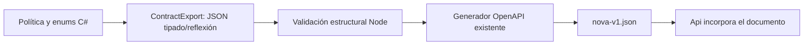

# Metadatos C# como fuente del generador OpenAPI

## Contrato de cambio

Antes del cambio, nova-openapi.cjs duplicaba LocalModelPolicy.Production y enums C#
en listas JavaScript.
Las listas inspeccionadas coinciden; no se afirma un fallo de disponibilidad o que
una entrada admitida esté instalada. Se elimina la segunda declaración para que
cambiar el propietario no exija recordar otro archivo.

- **Dueño:** LocalModelPolicy y los enums NovaIntent/PreparationDecision existentes.
  Exportador CLI pequeño bajo backend, sin nuevos paquetes, referencia Infrastructure
  y sus contratos existentes. No referencia Api ni Evaluation: debe poder generar el
  archivo que Api incorpora sin depender de esa misma incorporación.
- **Salida:** JSON versionado con política predeterminada, capacidades admitidas y
  nombres de enums leídos por reflexión sobre tipos explícitos autorizados. Sin
  Ollama, red, configuración privada, datos de usuario o interpretación de lenguaje.
- **Consumo:** Node ejecuta el exportador y valida estructura antes de escribir el
  documento. Sustituye únicamente listas duplicadas; las otras reglas de contrato
  y el formato se conservan. Metadatos inválidos fallan antes de cambiar el archivo.
- **Alternativas:** mantener listas paralelas permite deriva; analizar texto C# con
  regex no es reflexión; usar Evaluation introduce dependencia hacia Api y el mismo
  OpenAPI embebido que se pretende generar. CLI aislado mantiene un grafo sin ciclo.
- **Compatibilidad:** las políticas y nombres actuales no cambian. La generación
  ahora requiere SDK .NET existente además de Node; no instala modelos ni añade
  librerías. En checkout nuevo se restauran las mismas referencias ya declaradas.
- **Verificación:** exportación real contra los propietarios; generación byte a byte
  igual al documento previo; dos ejecuciones reproducibles, fallos estructurales y
  grafo de proyectos sin Api/Evaluation en el exportador. No es una evaluación LLM.



```text
compilar/ejecutar exportador sólo de metadatos públicos
leer política de producción y nombres de enums desde sus tipos reales
serializar JSON con versión; no consultar modelos instalados
validar versión, campos, unicidad, nombres y capacidades en Node
si falla: terminar antes de escribir OpenAPI
usar las listas exportadas en las posiciones existentes del documento
generar el mismo formato y comprobar estabilidad contra el original
```

## Resultado ejecutado y uso

IMPLEMENTADO Y VALIDADO para los metadatos seleccionados. Los nombres de enum se
obtienen con su serializador real, respetando convertidores y atributos. La política
alimenta NovaRequest, PrepareInput y LiveStart, incluido su modelo predeterminado;
los otros dos destinos son NovaAction.intent y PreparedDraft.decision. El resto del
OpenAPI conserva su generador existente: no se declara reflexión integral de schemas.

Con Node y el SDK .NET 8 ya disponibles:

```powershell
node scripts/nova-openapi.cjs
# Prueba reproducible; elegir un archivo de evidencia nuevo.
node Tests/nova/contract-metadata.cjs docs/evidence/contract-metadata-20261020/rerun.json
```

No se añaden paquetes ni se consulta Ollama. dotnet run puede restaurar las referencias
ya declaradas; sin SDK o ante fallo del exportador, no se escribe el documento.

Pasan siete comprobaciones finales: exportación real, siete entradas inválidas,
fallo previo a escritura, cinco posiciones y valor por defecto, reproducibilidad,
sustitución de metadatos y aislamiento del proyecto. La sustitución sintética prueba
que cambiar el dueño alcanza todos los consumidores; al terminar restaura el contrato
original. Dos generaciones reales mantienen byte a byte las 75 operaciones existentes.
Quince controles estáticos de límites pasan.

La primera comprobación estática detectó una tercera lista/valor predeterminado en
LiveStart, que las primeras cuatro posiciones comprobadas no cubrían. Se corrigió
ese consumidor y se añadió la sustitución completa; el resultado fallido y la primera
fuente congelada se conservan. No se atribuye cobertura final a las tandas previas.

[Verificación final](../evidence/contract-metadata-20261020/verification-v2.json),
[límites finales](../evidence/contract-metadata-20261020/module-boundaries-v2.json).
Sin cambios de política, modelo instalado, HTTP publicado, base de datos o semántica.
