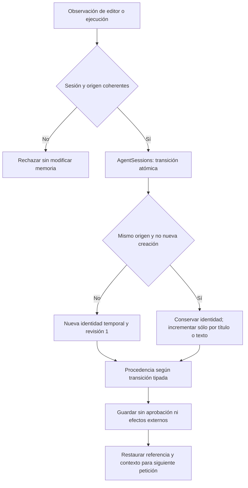

# Identidad y procedencia del borrador de conversación

Estado: contrato de contexto corregido y regresiones mecánicas verificadas; la campaña real conserva fallos semánticos. No cierra la versión.

## Auditoría y alcance

Hay varias entradas al mismo estado temporal: sincronización del editor (`LiveEndpoints`), observaciones del navegador (`RunVisible`), preparación (`RunSemantic`) y recuperación/completado del modal (`PreparationEndpoints`). `AgentSessions` es su almacén existente. El editor y el navegador reconstruían `PreparedDraft` con identificadores de operación nuevos y revisión de conversación 1. El navegador también sustituía la procedencia de autoría por el workflow de completar campos. El camino de preparación tenía otra regla para conservarla. El mismo objeto cumplía dos ciclos distintos: propuesta inmutable de una operación y borrador mutable de conversación.

Esto explica pérdida de continuidad demostrable; no explica por sí solo las clasificaciones equivocadas, referencias mal resueltas o la fidelidad de generación. Esas puertas siguen abiertas. Catálogos reflejados, recuperación y validadores ya existen; añadir otra capa de routing no resolvería este defecto.

## Contrato y alternativas

Se extiende `AgentSessions` con una transición atómica `ObserveDraft`. No se crea almacén, interfaz ni framework. Alternativas rechazadas: mantener políticas equivalentes en cada entrada (duplicación actual); crear un nuevo servicio de memoria (segundo propietario sin necesidad). La variación es un enum tipado: snapshot, autoría observada, nuevo artefacto o recuperación de una propuesta verificada, elegido por acciones ya verificadas, nunca por palabras del usuario. La recuperación copia la procedencia del recibo existente; no convierte el completado de valores en otra generación.

Entradas: sesión, origen leído/revisión validada por el llamador, borrador observado, valores y contexto acotado. Salida: sesión actualizada. La operación no consulta modelos, red o SQLite, no tiene reintentos y no autoriza efectos. Los llamadores comprueban cancelación y revisión antes de publicar observaciones. La transición valida identidad de sesión y coherencia del origen. La retención existente de dos horas/100 sesiones permanece.

Invariantes:

- Identidad temporal separada del recibo/propuesta de operación; no se muta un recibo ya almacenado.
- Mismo origen y revisión mantienen identidad. Sólo cambios de título/contenido incrementan la revisión de conversación. Valores, compilación o repetición del snapshot no la incrementan.
- Creación independiente o cambio de origen/revisión inicia identidad nueva y revisión 1.
- Snapshot idéntico conserva procedencia; cambio manual de contenido o título la elimina; autoría verificada la sustituye explícitamente.
- La procedencia no concede ejecución/guardado. Aprobación de la observación siempre NOT_GRANTED; no se copian permisos ni tareas pendientes anteriores implícitamente.
- Aislamiento por sesión; las escrituras observadas son atómicas sobre el estado anterior real.

Dependencias: API/navegador/preparación → `AgentSessions`; lectura/compilación/dominio y aprobación conservan sus propietarios. Las propuestas de `/nova/editor-drafts` continúan almacenadas con su ID y fingerprint nuevos; la copia de conversación tiene su propio ID. No cambia esquema público, base de datos, configuración de modelos ni despliegue.



```text
observar(snapshot, transición):
  validar sesión no vacía, sesión del borrador y origen/revisión
  actualizar atómicamente contra sesión anterior:
    mismaIdentidad = mismo origen/revisión y transición no es NUEVO_ARTEFACTO
    mismoContenido = mismaIdentidad y mismo título y texto
    id = anterior.id si mismaIdentidad; de otro modo nuevo id temporal
    revisión = anterior.revisión + cambioContenido si mismaIdentidad; de otro modo 1
    procedencia = entrada si transición de autoría/nuevo/recuperación
                  anterior si snapshot idéntico; de otro modo ninguna
    guardar copia de borrador con identidad/procedencia calculadas
    guardar contexto de entrada con aprobación NOT_GRANTED
  devolver sesión; nunca cambiar propuesta de operación almacenada
```

Validación prevista: reproducir pérdida en ejecución real del orquestador con navegador/modelo controlados; contratos de identidad/revisión/procedencia y aislamiento; regresión backend; API y recorrido de navegador real con SQLite sintética. Esos contratos no demuestran precisión de Qwen. Se conserva el fallo previo y se reporta por separado lo que no se ejecutó. Rollback: retirar la transición y sus llamadas, sin migración ni eliminación de datos.

## Evidencia conservada

El primer fixture de reproducción era inválido por omitir `Reason`; su fallo se conserva en `conversation-artifact-before.trx` y no prueba el defecto. Corregido sólo ese dato, `conversation-artifact-before-valid-fixture.trx` falla porque completar un campo cambia el ID de conversación. Con la transición compartida, la misma aserción y las otras 99 pruebas de `LiveExecutionTests`/`SemanticContextTests` pasan (`conversation-artifact-integration.trx`). El backend intermedio pasa 635/635 (`conversation-artifact-full.trx`). Estos controles usan inferencia y navegador controlados, no acreditan comprensión de Qwen.

Los recibos citados están en `docs/evidence/closure-20261020/tests`. La sincronización de selección (`/sessions/.../context`) ahora conserva también la revisión del borrador que ya mantenía; no cambia su identidad, no refresca una fuente obsoleta y no autoriza reanudación nueva. Recuperar una propuesta desde otra sesión copia deliberadamente su contenido al contexto solicitado sin modificar el recibo ni compartir la identidad temporal de la sesión anterior.

El [candidato final](../evidence/closure-20261020/candidate-conversation-final/verification.json) pasa 636/636 backend (15 contratos nuevos), 151/151 legacy y 136/136 React, sin omitidas. API/evaluador/web compilan; ensamblados compartidos idénticos y 333 entradas de fuentes estables durante la verificación. Son controles mecánicos, no precisión lingüística. La puerta de versión devuelve abierto. Las propuestas de observación visible dejan de escribirse como recibos adicionales en SQLite; las propuestas públicas de preparación/completado conservan su almacenamiento e idempotencia.

UI manual Edge/API/SQLite: [21/21 en repetición](../evidence/closure-20261020/versions-1792466488855/results.json). El [primer intento](../evidence/closure-20261020/versions-1792466428260/results.json) se detuvo tras 14 pasos, con texto convertido a literal y timeout al comprobar el roundtrip de selección/foco. Se conserva vídeo/captura; sin causa confirmada ni cambios de producto entre ambos intentos. Se añadió al arnés sólo stack y estado de selección para próximas incidencias. No se elimina el intento fallido ni se confunde esta tanda manual con 21 tareas NOVA.

## Frontera semántica que sigue abierta

[Qwen y Edge reales, mismo candidato](../evidence/latency-1792466522328/measurements.json): los dos mensajes originales de completar/copiar vuelven a fallar. En el primero, el contrato de texto devuelve REVISION_REQUEST y añade «[Preparado para copiar]» a instructionTask; el plan contiene PROPOSE_ADAPTATION además de los campos/copia. La generación reproduce workflow dentro del cuerpo y el validador lo rechaza. Tiempos observados: 138699 ms/18 llamadas y 139856 ms/15 llamadas. No hubo guardado. La primera divergencia antecede a la transición de memoria, en una sesión sin borrador previo; `SemanticInference.cs` es idéntico al candidato conservado anterior.

Esta cadena conecta errores funcionales y latencia: una autoría inventada activa generación, revisión y corrección que la tarea no necesitaba. No demuestra que toda latencia provenga de ello. Memoria libre observada durante esta campaña: aproximadamente 0,4 GiB, por lo que tampoco constituye comparación controlada de rendimiento ni p95. El problema de representación de autoría/uso del programa permanece; los contrastes de catálogo y scope rechazados no se incorporaron.

La solución de contexto es común a todas las entradas y no contiene reconocimiento de frases. No se amplían presupuestos, no se añade otro revisor LLM y no se retiran validadores para aceptar el cuerpo incorrecto. Interpretación, fidelidad y la campaña multi-turno general deben superar sus puertas originales antes de cerrar CTX/AI/AUT o la versión.

Tanda terminada: **0/3 recorridos NOVA aprobados**. El tercero se bloquea en creación (114263 ms/10 llamadas), de modo que no llegó a comprobar adaptación/multi-turno. Su revisor emite ACCEPT/FUTURE_TASK_ONLY junto con citas que declara workflow de la aplicación; entre ellas hay una restricción del futuro prompt («No inventes información…»). La respuesta es contradictoria y el rechazo no demuestra contaminación real de ese fragmento. El contrato también exige títulos literales con evidencia; no se elimina esa protección. Esto se distingue de los dos casos de campos, donde la instrucción propuesta sí incorpora «[Preparado para copiar]» después de inventar una edición. Los tres mantienen `sourceUnchanged:true`, sin escritura autorizada. El módulo de fidelidad ya tiene un único dueño (`PreparationInference.Generate` → `ReviewDraftFidelity`) con correcciones acotadas: no se inventa una duplicación de revisores para explicar sus llamadas sucesivas.

Resultado resumido y referencias: [checkpoint conservado](../evidence/closure-20261020/conversation-lifecycle-checkpoint.json). La matriz sigue en **29/88 cerrados, 59 abiertos**; CTX-05/07 permanecen PARCIAL. No se ejecutaron validación independiente ni holdout sobre una tanda fallida. Se retuvieron Qwen3 8B/Nomic, configuración y criterios anteriores; no se instalaron modelos ni dependencias.
