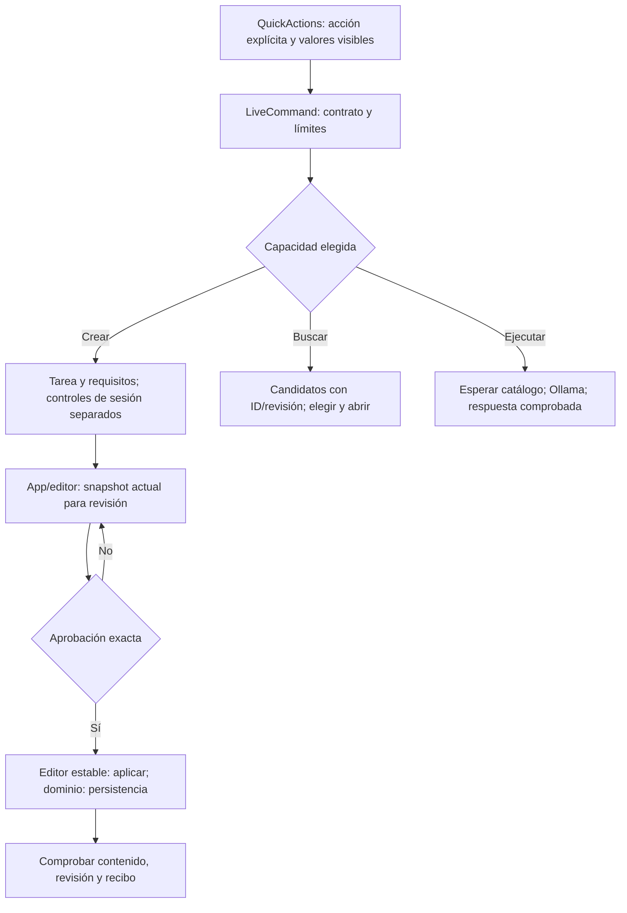

# Corrección de los cinco hallazgos de uso real

Aceptación posterior: el usuario confirmó que probó el sistema y funcionó, y pidió commit/push/tag. El [cierre r1](../releases/NOVA_1.0.0_R1.md) registra esa aceptación humana y conserva los límites de esta campaña técnica.

Fecha: 2026-10-23. Solicitud: corregir F01–F05 de la [auditoría exploratoria](AUDITORIA_USUARIO_REAL_20261023.md). Se conservan sus fallos y la aceptación histórica de 1.0.0.

## Resultado y alcance

Los cinco mecanismos se han cambiado y sus reproducciones principales pasan en navegador real. Crear/guardar copia, actualizar/guardar versión, revisar ediciones actuales, responder una ambigüedad y ejecutar con valores visibles tienen evidencia del producto. No se declara fiabilidad semántica universal: se encontraron además las limitaciones de contenido descritas abajo.

La reparación se probó en 5285 con una copia aislada de la biblioteca sintética/pública. Los 60 registros originales conservaron sus hashes completos. No se usó la base privada de 5196. El candidato se activó en 5277 con su biblioteca anterior: SQLite íntegra y hash lógico idéntico antes/después, respaldo previo y diagnóstico de contenido deshabilitado. La versión visible sigue siendo 1.0.0; no hubo commit, push ni tag para este trabajo.

## Cambios por propietario

| Hallazgo | Reparación | Aceptación observada |
| --- | --- | --- |
| F01 Guardado aprobado | `approval.apply` pasa del portal de actividad al editor estable, ligado al run aprobado. El dominio mantiene propuesta/hash/revisión. La aprobación humana exacta tiene procedencia separada de la evaluación IA. | Copia y versión con ediciones a ancho normal; copia y versión sin edición manual a 390 px. Persistencia, contenido y revisión comprobados. |
| F02 Revisión obsoleta | NOVA y Guardar usan `prepareLiveReview`, que propone el snapshot actual antes de mostrar confirmación. | Dos ediciones sucesivas, ambas entradas de revisión y guardado del último cuerpo; hash viejo rechazado en regresión. |
| F03 Aclaración sin controles | `LiveView.sourceChoices` expone candidatos con ID/revisión. Elegir obtiene el origen actual y comienza `OPEN_PROMPT`, sin otros efectos. | Consulta original: dos opciones a 390 px; elegir «Revisar código antes de integrarlo» lo abre sin otra búsqueda, escritura o ejecución. |
| F04 Contaminación de sesión | La creación explícita recibe `taskInstruction`, `requirements`, `currentSessionControls`; el host compila sólo tarea/requisitos. El revisor existente recibe el encargo completo. | El encargo original de actas produce la tarea futura con `<notas>`, sin «prepara el borrador/sin guardar». El control de archivos conserva aprobación futura e inventario sin incorporar la revisión actual. Ver límites. |
| F05 Valores/proveedor | Se muestran los valores efectivos y se elimina la mezcla invisible al enviar. Borrar un requerido bloquea envío; otro origen usa sus defaults. El agente espera el catálogo; error en el mismo diálogo. Evidencia del comando fuera de citas/datos. | Herencia visible, vacío bloqueado y ticket restaurado: ejecución real Ollama produce JSON correcto Sol/baja/factura. Regresión de catálogo demorado y proveedor ausente. |

## Flujo y contrato



```text
recibir acción explícita con identidad/revisión y valores mostrados
mantener datos/citas fuera de la evidencia de efectos
si crear: redactar contrato; compilar tarea/requisitos; revisar encargo completo
si búsqueda ambigua: candidatos reales; comprobar revisión al elegir; abrir sin adquirir efectos
si guardar: proponer edición actual; confirmar hash/revisión; aplicar desde editor del mismo run
si ejecutar: campos completos; esperar catálogo; seleccionar proveedor; comprobar respuesta
verificar postcondiciones; conservar fallos; distinguir aprobación humana de juicio IA
```

## Recibos de navegador

Evidencia local en `.playwright/repair-20261023/`, ignorada por Git, sin bases privadas.

| Caso | Identidad y evidencia | Resultado |
| --- | --- | --- |
| Crear actas, editar, revisar por NOVA/editor, aprobar | `69c17a09-5793-4e79-8b14-7489b56bff28`; `final-create.json`, `review-current-edits.png`, `saved-edited-copy.json` | COMPLETED, escritura confirmada; registro `0bd40340-71e6-4501-a47a-0b8d6360e913`, revisión 1. |
| Actualizar actas con corrección humana previa | `74f45168-44a3-4aec-9d04-b37249851756`; `final-update.json`, `saved-edited-version-2.json` | Guardado PASS, revisión 2 exacta; contenido inicial PARTIAL por omitir fallback de plazo. |
| Buscar y elegir | `078222e7-4d95-4181-bf1f-cc29f00cb173` → `d3861abf-a52d-487d-b84c-a85cba45e80a`; `final-search-choices.json`, `final-search-open.json`, `search-choice-390.png` | Aclaración visible y apertura correcta sin escritura. |
| Ejecutar ticket citado original | `bd0016c6-4e84-4a3a-91c2-fbef1ca8bbb1`; `final-execution.json`, `final-local-response-390.png` | COMPLETED; JSON exacto `{"cliente":"Sol","prioridad":"baja","resumen":"no puede descargar su factura"}`; sin borrados/guardados. |
| Guardar copia sin editar a 390 px | `c42c9d1d-de99-4b76-8284-9ff0815a9689`; `final-create-narrow.json` | COMPLETED, revisión 1 persistida. |
| Añadir frase y guardar versión sin editar a 390 px | `b9e8a218-53c2-4b0d-8f01-b93c98f7b72b`; `final-update-narrow.json`, `saved-narrow-version-2.json`, `final-save-version-390.png` | COMPLETED, revisión 2 y frase final comprobadas; puntuación normalizada por el modelo. |

`verify_public.py` comprueba por lectura independiente los 60 hashes, ambas versiones 2, el JSON local exacto, la identidad de apertura sin escritura y los guardados estrechos. Resultado: `public-integrity.json`.

## Intentos fallidos preservados

- La separación auxiliar por rangos/actores superó tres fallos verificados y se retiró. La alternativa por pasajes invirtió roles y se descartó. Evidencias: `lab/`, `lab-passages/`, `lab-passages-2/`. El contrato final de tarea sustituye esos mecanismos; no queda `PromptDraftGenerator.Scope.cs` ni inferencia auxiliar activa.
- Un candidato intermedio mostraba contenido limpio y revisión actual, pero guardar produjo `UI_TARGET_CHANGED` al reconstruirse el portal: `creation-clean-review-current-save-remount-failed.json`. Se retiró de ese portal la aplicación de escritura. No se afirma haber capturado el DOM exacto de los timeouts originales.
- Después de estabilizar guardado, un intento persistió pero cerró `FAILED/GOAL_INCOMPLETE`: el cuerpo editado por el humano no tenía evaluación previa IA. `create-completed.json` conserva ese fallo pese a su nombre antiguo. Se añadió aprobación humana exacta con procedencia propia; no se fabricó evaluación IA. El posterior `final-create.json` completa ambos contratos.
- El ticket citado falló inicialmente `LOCAL_EXECUTION_NOT_REQUESTED`, antes de inferencia: `execution-before-inference-failed.json`. El comando citaba el sobre completo; la validación exige evidencia fuera de comillas/datos. El compilador usa ahora un fragmento de directiva, con autoridad tipada intacta. La regresión rechaza datos solos e impide que abrir adquiera ejecución/borrado.
- Fallos de compilación/fixtures durante desarrollo quedan en logs separados. No cuentan como fallos semánticos ni se mezclan con resultados finales.

## Validación ejecutada

- Backend: **1163/1163**, sin omitidos; `backend-final.log`. Incluye aprobación exacta frente a cuerpo/hash viejo y evidencia de ejecución fuera de datos/citas.
- Frontend: **260/260**; `web-tests-accepted.log`. Incluye destino con actividad cambiante, control ligado al run, snapshot actual, elección, valores visibles/vacíos y proveedor demorado.
- TypeScript/Vite build PASS: `web-fields-build.log`. Persiste aviso de tamaño de bundle, sin error de compilación.
- Arquitectura: **36 controles PASS**; `module-boundaries-final.json`. Documentación: **12 documentos PASS**, **3 tests PASS**. `git diff --check` sin errores de contenido.
- Exclusivamente Qwen3:8b, digest `500a1f067a9f782620b40bee6f7b0c89e17ae61f686b92c24933e4ca4b2b8b41`; mismo SDK Core y presupuestos. Sin descargar modelos/dependencias.
- Candidato: `.nova-build/repair-20261023/instance.json`, 101 archivos con hash; API/web/worker congelados, 5277 Production, Lab desactivado. `primary-before.json`, `primary-after.json`, `primary-before.sqlite`: activación sin cambio de biblioteca. Salud `ok` y vista real cargada tras activar.

## Límites y seguimiento

En la actualización de actas el modelo añadió Plazo pero omitió «si no hay plazo, No indicado»; el revisor la aceptó. Se corrigió manualmente **antes** de aprobar y se comprobó lo guardado. No es PASS de generación autónoma. El control de archivos preservó aprobación futura pero la hizo más restrictiva («antes de sugerir» frente a «antes de mover/borrar») y añadió estructura; se aprobó para la copia de prueba, no como fidelidad literal perfecta. Son hallazgos adicionales de fidelidad, distintos de los cinco mecanismos reparados, y requieren seguimiento.

El catálogo demorado se valida con el driver; no se demuestra que fuera la causa exacta del `PROVIDER_UNAVAILABLE` histórico. El flujo frío real sí completó selección/ejecución. No se probaron carga sostenida, todos los proveedores externos ni fiabilidad universal. La campaña es verificación técnica del agente, no nueva aceptación humana del usuario.

Se actualizaron guía de uso y arquitectura. No se modificaron skills globales para ocultar fallos ni se publicó otra versión. Se conservó el trabajo previo de mantenimiento del árbol.

La instancia temporal5285 se detuvo después de conservar los recibos.5277 permanece activa y su pestaña se dejó abierta. El observador aceptó el informe estructurado de esta consulta con almacenamiento durable; queda provisional hasta recibir el evento final del turno. Esto no convierte los límites semánticos en PASS ni confirma por sí solo la visualización del informe en el dashboard.
