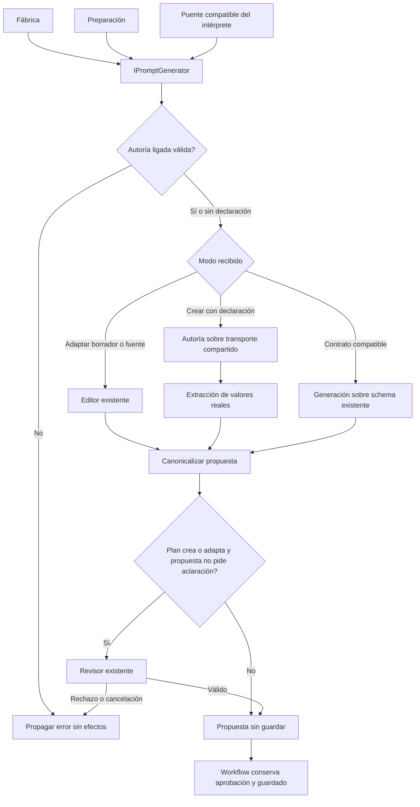

# Generación de borradores independiente

## Auditoría y contrato de cambio

PreparationInference posee interpretación, generación, adaptación y compatibilidad
de otras capacidades. Generate y el parcial Authoring sólo necesitan transporte,
editor, extractor, revisor, política y opciones. IPromptGenerator existe, pero la
fábrica lo resuelve al intérprete completo. La extracción anterior del revisor
permite ahora aislar el consumidor completo sin duplicar sus reglas.

Se compararon mantener el parcial dentro del intérprete, envolver el monolito y
mover la capacidad a un proveedor independiente. Las dos primeras conservan la
dependencia de construcción; se elige PromptDraftGenerator bajo el puerto existente.
No se crea otro árbitro, motor de intención ni propietario de datos/workflow.

Entradas: PrepareInput, Understanding, candidatos con identidad/revisión y token.
Salida: PromptProposal canonicalizada o los errores existentes. El nuevo proveedor
recibe transporte validado, editor, extractor y revisor prestados; no los dispone.
La fábrica es responsable de su ciclo de vida. No crea conexiones, guarda registros,
concede permisos ni modifica el plan. Diagnóstico opcional por llamada, sin estado
mutable de sesión en el singleton. IPromptGenerator conserva su método de cuatro
argumentos y añade una sobrecarga con implementación predeterminada para diagnóstico;
implementaciones anteriores siguen usando su método existente.

Invariantes: preservar instrucciones, schema, presupuestos, una revisión, reparación
acotada, identidad/revisión de edición, rechazo de autoría no solicitada, evidencia
literal y canonicalización. Sin cambios de base, HTTP, UI, modelo o paquetes.
PreparationInference conserva delegaciones compatibles y schemas públicos como alias;
el parcial antiguo se retira con copia exacta. Consumidores recompilan. El perfil
opcional de metadatos identifica ahora al nuevo propietario de autoría; esa migración
no acredita fidelidad lingüística ni cierra los fallos semánticos conocidos.



```text
generar(input, entendimiento, candidatos, cancelación, diagnóstico):
  validar autoría ligada al encargo como antes
  adaptar borrador/fuente, crear según declaración o usar contrato compatible
  mantener cancelación, validación de identidad y reparación acotada existentes
  canonicalizar y emitir diagnóstico por llamada
  cuando el plan exige revisión y no es aclaración, revisar una vez
  ante rechazo, conservar propuesta rechazada y propagar error
  devolver propuesta; aprobación, verificación de efectos y persistencia son externas
```

Aceptación prevista: comparación exacta de cuerpos frente a archivos archivados,
fábrica real con intérprete prohibido, variantes de creación/adaptación, cancelación,
revisión y diagnóstico por llamada; compatibilidad de implementaciones antiguas del
puerto y ausencia de disposición de recursos prestados. Ejecutar matrices afectadas,
compilar API/Blazor y verificar igualdad de ensamblados probados. No repetir matrices
UI o modelo no afectadas ni convertir resultados controlados en fiabilidad semántica.

Reversión: restaurar before.json y retirar conjuntamente proveedor y pruebas nuevos;
conservar evidencias. No requiere migración de datos. Alcance sólo web, MAUI excluido.

## Resultado observado

Generación y edición se componen como PromptDraftGenerator, sin construir el
intérprete. El parcial anterior está retirado y archivado. La comparación de
cuerpos, schema e instrucciones confirma igualdad tras los cambios declarados
de propietario, puerto de revisión y parámetro de diagnóstico. No se añaden
consultas ni revisiones. Metadatos opcionales migran consumer/version de autoría.

Pasan 676 pruebas compiladas de 55 clases, cero fallidas/omitidas. Incluyen diez
casos nuevos de fábrica con intérprete prohibido, ambos perfiles de metadatos,
extracción/revisión prestadas, identidad/revisión de edición, rechazo, cancelación,
disponibilidad, implementación antigua del puerto y aislamiento concurrente de
diagnóstico. Las 78 iniciales y 22 de composición son subconjuntos históricos y
no se suman. Siguen pasando las pruebas HTTP de reparación y autoridad existentes.

API/Blazor compilan sin errores ni advertencias, con DLL compartidas idénticas a
las probadas. Evaluation compila con tests y su captura de autoría usa el nuevo
propietario. Veintiún controles estáticos pasan; el guard histórico de fuente
nativa no es aceptación MAUI. OpenAPI publicado y matriz canónica idénticos.

[Selección](../evidence/draft-generation-module-20261020/test-selection.json),
[comparación](../evidence/draft-generation-module-20261020/extraction.json),
[proveniencia compilada](../evidence/draft-generation-module-20261020/compiled-provenance.json),
[validación](../evidence/draft-generation-module-20261020/verification.json).

Estado: PASS del módulo controlado. No se ejecutó nueva campaña de UI ni Qwen:
la separación conserva comportamiento, incluyendo limitaciones semánticas
conocidas. Autoría permanece FAIL; versión NO_CERRADA, 34 cerradas/54 abiertas.
La interpretación principal y la auditoría global web todavía requieren trabajo.
