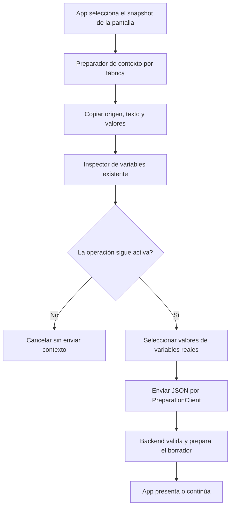

# Preparación común del contexto del editor

## Auditoría y contrato

App tiene dos algoritmos de inspección, mezcla/filtrado de valores y editorDraft:
useWorkingDraft (presentación de destinos) y syncEditorContext (contexto antes de
NOVA/salir/guardar). Sus diferencias de origen, defaults y título corresponden a
la pantalla y se conservan en App. EditorPreparation sigue poseyendo preview/copia
y cambio asistido del formulario; no se mezcla con el contexto de sesión del backend.

El propietario extraído es EditorContextPreparer: recibe EditorContextSnapshot
inmutable por contrato (origen {id,revision}|null, título/texto, defaults/valores y
sesión), devuelve PreparedDraft existente. Una fábrica compone una clase privada
sobre Pick<TemplateClient,'inspect'> y Pick<PreparationClient,'editorDraft'>.
App crea una instancia estable por pareja de puertos y ambos recorridos la usan.
Sin React/DOM, HTTP directo, parsing alternativo, estado global, inferencia ni BD.

Algoritmo común: copiar metadatos y entradas antes del primer await, inspeccionar
variables del texto, seleccionar valores no vacíos para nombres realmente informados
por el servidor y enviar el JSON con el adaptador existente. Map para entradas propias
impide tratar propiedades heredadas de Object como datos. No reconoce peticiones por
keys/regex/patrones; los nombres son identidades exactas del contrato del inspector.
Valores explícitos (incluido vacío) pisan defaults; trim sólo decide presencia, no
modifica el valor enviado. No se elevan instrucciones de contenido a autoridad.

Autoridad/validación: TemplateClient conserva la validación de la respuesta del
inspector; PreparationClient conserva Zod/JSON/errores del protocolo. El backend
valida límites, variables, origen/revisión y archivo, evalúa determinísticamente y
actualiza su sesión. El nuevo módulo no concede guardado ni sustituye esos controles.
TS describe entradas; no se afirma validación runtime completa antes de llegar al
backend ni se duplican sus reglas en otra capa.

Cancelación: signal opcional se propaga a ambos puertos, se comprueba antes de iniciar,
entre inspección y envío, y antes de entregar resultado. No se reintenta. Cancelar
tras un POST no deshace un efecto que el servidor ya recibió. App conserva su ciclo
de vida actual y no añade signal en este incremento; no se afirma resolución de
carreras de navegación/contexto o atomicidad entre solicitudes concurrentes.

Alternativas: conservar o sólo factorizar el filtro deja preparación repartida;
un megacontrolador con mode/selected/draft acopla reglas UI al módulo; snapshot
estrecho + interfaz/fábrica/clase separa la capacidad real sin framework ni duplicar
sintaxis, workflow de dominio o lógica semántica. No requiere herencia artificial.

Compatibilidad: mismos endpoints, schemas, títulos, origen y precedencia de entradas
para los recorridos existentes. Sin dependencias/paquetes/BD/modelos nuevos. Rollback
conjunto desde before.json. No se eliminan funciones de presentación que aún tienen
consumidores; se retira de ellas el algoritmo duplicado.

Aceptación: cohorte actual antes/después; comparación de payloads legacy/nuevos en
matriz estructural y pruebas de snapshot/cancelación/errores/puertos; suite frontend,
TypeScript/build/guardas; recorrido real del editor/API/SQLite sobre candidato
congelado. No matriz backend/Qwen sin cambios en sus algoritmos; guardar fallos.



```text
App decide origen/título/defaults/valores desde la pantalla existente
capturar un snapshot de esos datos; revisar signal
inspect(texto, signal); revisar signal antes de escribir
construir values sólo para nombres del inspector con entrada propia no vacía
editorDraft({origen/revisión, título, texto, values, sesión}, signal)
revisar signal antes de devolver PreparedDraft; propagar fallos sin retries
App conserva las decisiones de presentar, sincronizar y navegar
```

## Resultado ejecutado

IMPLEMENTADO. Ambas rutas de App delegan inspección/selección/envío a la interfaz
común. La fábrica compone una clase privada sobre puertos prestados; App sólo
selecciona el snapshot y decide presentar o continuar. Sin nuevo parser/autoridad.

- Cohorte inicial **12/12** antes; dirigida **24/24** después (12 casos nuevos).
  Suite final **209/209**, 34 archivos, cero omitidas. Snapshot previo al await,
  precedencia/defaults/blancos/literales, claves propias, tres fases de cancelación,
  errores sin retry y sustitución por transportes reales validados cubiertos.
- Ocho escenas de ambas funciones anteriores/actuales producen exactamente los
  mismos payloads y efectos de presentación. Resto de tokens de App idéntico salvo
  import/composición declarados. Estas escenas son compatibilidad, no precisión AI.
- TypeScript y build PASS. Error inicial de tipos de la tabla de casos corregido
  con tipo explícito, sin cambiar criterios; log conservado. Advertencia de chunk
  >500 kB retenida (579,48 kB /178,84 kB gzip).
- Cuatro controles **headed Edge/API/SQLite** pasan tanto en build anterior como
  candidato con el mismo harness y backend: JSON de usar coincide con campos y
  texto compilado; salir envía snapshot idéntico sin persistir prompt; guardar
  sincroniza título/revisión efectivamente guardados; nuevo borrador usa origen
  null aunque hubiera selección anterior. Sin inferencia ni navegación externa.
  Captura final revisada; puerto propio 5272 cerrado.
- **33** guardas estáticas PASS; **54/54** módulos TypeScript alcanzables. Backend
  congelado por hashes; sin recompilación/matriz C# ajena. API y matriz canónica
  idénticas; **34 cerrados/54 abiertos**, versión NO_CERRADA y meta activa.

No se afirma cancelar automáticamente todos los callbacks de App ni resolver sus
carreras concurrentes; el contrato opcional de signal está probado en el módulo.
No cualifica interpretación Qwen, autoría ni latencia. MAUI excluido.
Rollback de tooling: auxiliary-before.json conserva harness/guardas previos, además
de before.json para App. Los nuevos archivos son internos y no alteran HTTP/BD.

[Evidencia y provenance](../evidence/editor-context-preparation-20261020/verification.json).
