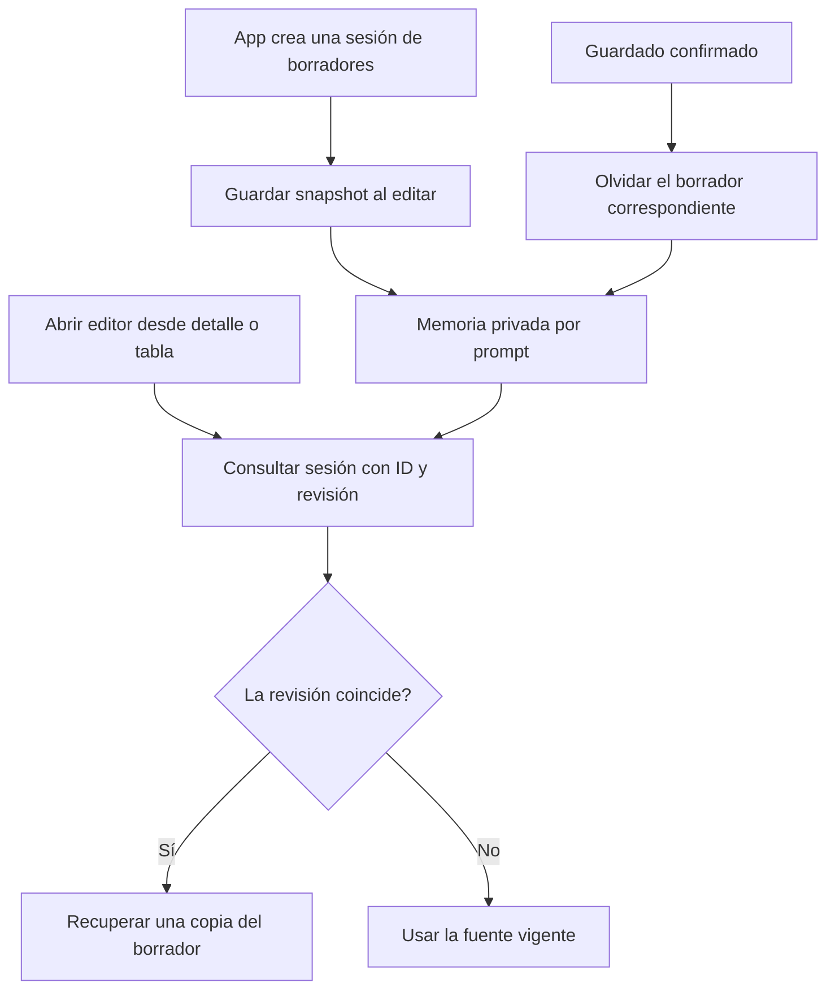

# Sesión de borradores del editor

## Auditoría, alternativas y contrato

App conserva una Map de borradores con lecturas/escrituras repartidas entre crear,
modificar, editar desde detalle/tabla, recibir propuestas y guardar manual/aprobado.
edit() lee por ID sin comprobar revisión; editFromLibrary() comprueba revisión.
useEditorHistory posee deshacer/rehacer del editor abierto, no esta memoria entre
navegaciones. Los valores y el formulario actual continúan bajo App; el backend
posee sintaxis, datos persistentes, revisión transaccional y autorización.

Se extrae el propietario existente de memoria a EditorDraftSession, una interfaz
estrecha con read(source), remember(promptId,draft) y forget(promptId). Una fábrica
crea una clase privada por montaje. No existe registro global ni se expone la Map.
La revisión es un dato estructural de origen, no una intención ni keyword.

Invariantes: read sólo entrega un snapshot de la revisión solicitada; borrador
nuevo separado de IDs persistentes; copiar al guardar y leer, incluidos defaults;
ninguna referencia externa modifica el snapshot privado. Misma instancia para todas
las entradas del editor; nueva instancia no comparte datos. Olvidar sólo tras éxito
persistente. Un mismatch no elimina el snapshot privado ni autoriza guardar sobre
otra revisión; el editor usa la fuente vigente como ya hace la entrada desde tabla.
No se implementa UI de recuperación de snapshots antiguos en este incremento.

Alternativas: repetir comprobación en edit() corrige un síntoma pero deja la regla
distribuida; mover todo App a un megacontrolador mezcla responsabilidades; sesión
pequeña con contrato/clase/fábrica concentra la regla real y permite sustituirla.
No se añade herencia/reflexión artificial: el frontend consume DTOs tipados; los
mecanismos de reflexión del backend conservan sus responsabilidades.

Entradas/salidas: PromptDraft y fuente {id,revision}; read retorna snapshot o undefined.
Operaciones síncronas, sin HTTP/cancelación/retry ni errores de negocio añadidos.
Dependencia sólo de tipos del DTO. Estado privado efímero por App, sin almacenamiento
persistente; finaliza al desmontar. Interfaz interna web, sin cambios HTTP/BD/paquetes.
Rollback conjunto desde before.json, conservando evidencia de fallos originales.

Aceptación: reproducir inconsistencia de ambas entradas; misma prueba tras cambio;
contratos de revisión/copia/aislamiento y olvido; suite frontend/typecheck/build;
recorrido real con API y SQLite sintético. No campaña Qwen/matriz backend para este
cambio de estado UI. Contratos y criterios canónicos permanecen; versión abierta.



```text
crear sesión de memoria por montaje y prestar su interfaz al shell
remember(id o null, draft): guardar copia propia incluyendo defaults
read(null): recuperar copia del borrador nuevo si existe
read(source): buscar ID y devolver copia sólo si revisión coincide
si no hay snapshot compatible, construir formulario desde fuente vigente
tras guardado manual/aprobado confirmado: forget(id o null)
no mutar historial de deshacer, valores, contexto semántico ni datos persistentes
```

## Resultado ejecutado

IMPLEMENTADO. Los ocho accesos directos a Map se retiraron de App: tres lecturas,
tres escrituras y dos olvidos delegan en la interfaz. La fábrica crea una clase
privada por montaje con snapshots desprendidos. No hay estado global ni autoridad
nueva. El resto de App coincide exactamente después de las sustituciones declaradas.

- UI de componentes original: **1 PASS /1 FAIL** (detalle falla, tabla pasa);
  ambos casos pasan tras unificar la regla. Tres contratos puros adicionales
  verifican revisión, copias/defaults, separación entre sesiones y olvido selectivo.
- Suite final **197/197**, 33 archivos, cero omitidas. TypeScript y build PASS;
  warning retenido >500 kB (579,11 kB /178,71 kB gzip). Sin fallos inesperados del
  candidato ni ajustes de oráculos.
- **Mismo harness headed Edge** sobre build anterior y candidato, mismo backend
  por SHA y bases SQLite sintéticas separadas. El anterior reproduce el borrador
  obsoleto; candidato pasa cinco comprobaciones: origen actualizado, borrador
  compatible desde detalle/tabla sin persistirlo, separación nuevo/existente,
  limpieza del nuevo tras guardar y guardado de versión por CRUD normal. Unicode
  exacto y contenido API verificados; cero errores browser. Captura final revisada.
- **32** controles estáticos PASS; **53/53** módulos TypeScript alcanzables.
  OpenAPI y matriz canónica mantienen hashes. Backend reutilizado, sin build o
  matriz C# ajena al cambio; puerto propio 5272 cerrado al terminar.

Esta evidencia no acepta interpretación Qwen, autoría, latencia ni recuperación
de snapshots antiguos. Los valores/formulario actual y sincronización de contexto
siguen en App; deshacer sigue en useEditorHistory. La meta general continúa activa;
versión NO_CERRADA, **34 cerrados/54 abiertos**. MAUI fuera del alcance elegido.

[Evidencia y provenance](../evidence/editor-draft-session-20261020/verification.json).
