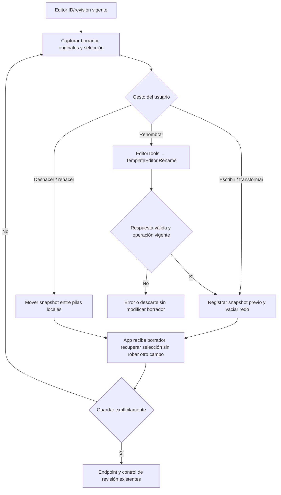

# Paridad del editor — contrato de cierre PAR-07

Estado: implementado y aceptación acotada PASS. La comparación de modelos fue autorizada durante este incremento; el editor no usa inferencia ni datos privados.

La UI React permite crear/quitar variables, pero no ofrece renombrado ni historial controlado de cambios del formulario. El dominio ya posee `TemplateEditor.Rename`, con actualización de marcadores repetidos, defaults y escapes. Se reutiliza esa regla desde `EditorTools`; no se vuelve a analizar sintaxis mediante regex en React. El historial de interacción será local a la instancia React, como el historial del circuito legado es local a su instancia; no es el historial persistido de versiones.

Propietarios y contratos:

- `TemplateEditor`: nombres válidos, selección, renombrado de todas las ocurrencias y conservación de literales/defaults. `EditorTools` adapta una petición pura a esa capacidad, sin escribir SQLite ni crear sesiones de servidor.
- `InlinePromptEditor`: proyección de controles, selección y mensajes. Un historial concreto de interacción mantiene hasta 100 snapshots y un presupuesto acotado de texto; borrador, literales originales y selección se deshacen juntos. Se pierde al desmontar o cambiar identidad/revisión, sin persistir contenido fuera del consentimiento.
- `App`: conserva el borrador actual y guarda únicamente con el gesto y revisión existentes. `PromptDraft.defaults` es opcional y sólo se envía cuando una edición humana lo cambia explícitamente; los borradores actuales de NOVA mantienen su contrato sin defaults.
- Renombrado: entrada texto, selección UTF-16, nuevo nombre y defaults del borrador/origen; salida texto, nombres, defaults y selección. Validación existente del dominio; error atómico y sin escritura. Se deshabilita el cambio de metadatos mientras una ejecución NOVA controla la propuesta, sin debilitar su autorización.
- Crear/quitar variable sigue usando el endpoint existente. Undo/redo incluye los literales originales para que renombrar y quitar después no pierda el texto original. Una edición nueva elimina redo; cambios de otro ID/revisión no entran al historial actual.
- Toda transformación asíncrona conserva `useBoundOperation`: si cambia el borrador antes de responder, no sobrescribe campos ni mueve selección.

Alternativas: duplicar el parser/renombrado en React rompería propiedad única; enviar todo el historial a HTTP en cada tecla aumentaría payload y latencia; crear un registro de sesiones de edición en servidor añadiría ciclo de vida innecesario. Se eligen transformación pura existente y memoria de interacción local, sin dependencias ni migración.



```text
al cambiar identidad/revisión o desmontar: descartar historial local y cancelar operaciones
al editar: capturar snapshot anterior, limitar memoria, guardar nuevo borrador, vaciar redo
al transformar: usar selección real y dominio existente; aplicar sólo si sigue vigente
al renombrar: mover también el literal original y los defaults devueltos por el dominio
al deshacer/rehacer: restaurar snapshot completo; no llamar a persistencia ni al modelo
al guardar: usar App y revisión vigente; un conflicto conserva el borrador
```

Aceptación: crear/quitar/renombrar con selección completa y caret; repetidos, Unicode, multilínea y escapes; colisión/nombre inválido sin efectos; undo/redo y rama nueva; actualización externa/identidad/revisión y respuesta tardía; defaults conservados y compilado tras guardar/reiniciar; controles NOVA sin ampliación de permisos. PAR-07 sólo se cerrará con pruebas de dominio, React y navegador/API/SQLite ejecutadas. La optionalidad PAR-02 no cambia en este incremento.

Primer recorrido Edge: FALLA antes de probar la colisión. La traza HTTP conserva `start:0,end:0` aunque había una selección en el textarea; el cache de `onSelect` no la actualizó antes de mover el foco al nombre. `editor-selection-before.json` reproduce el fallo sin disparar artificialmente ese callback. La corrección toma la selección real del nodo al comenzar cada comando y la captura al perder foco. Se conserva el límite de operación vigente; no se modifica el parser ni se reetiqueta el primer recorrido.

Evidencia ejecutada:

- `tests/editor-rename.trx`: quince controles de renombrado y editor existente PASS; cubren Unicode, marcadores repetidos, escapes, defaults, caret, rangos inválidos y colisiones.
- `tests/backend-editor-parity-final.trx`: 615/615 PASS, cero omitidas. `tests/react-editor-parity-final.json`: 134/134 PASS antes de añadir dos controles adicionales de cancelación/budget; `tests/editor-history-final.json` contiene los ocho controles específicos finales PASS.
- `versions-1792461605087/results.json`: diez recorridos Edge/API/SQLite PASS. Cinco de versiones y cinco de editor: colisión sin cambios, renombrado desde caret con defaults/preview y undo/redo, guardar/reiniciar, literal multilínea Unicode tras crear/renombrar/deshacer/rehacer/quitar y rama humana que elimina redo sin guardar.
- Build API y TypeScript/Vite PASS. Se conserva el aviso del chunk principal >500 kB; no se amplió el límite.

PAR-07 puede cerrarse con esta evidencia. Esto no acredita autoría/planificación del agente ni cambia la semántica de optionalidad (PAR-02). El historial es efímero, acotado a 100 pasos y al presupuesto de texto; se reinicia por identidad, revisión y cambio de control de metadatos. Los defaults no referenciados por el texto vigente se omiten del resultado del renombrado, de igual manera que una edición manual conserva sólo defaults compatibles.
