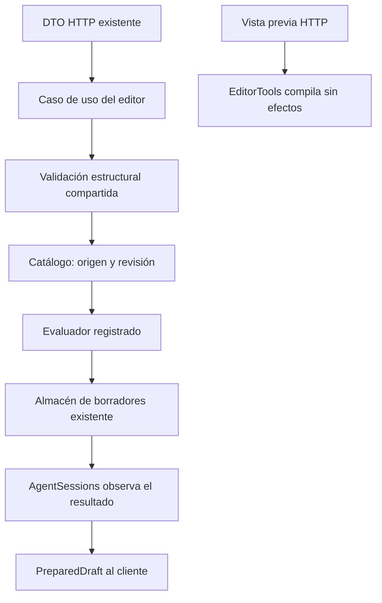

# Caso de uso de preparación explícita del editor

## Auditoría y contrato

LiveEndpoints contiene reglas de valores, compilación, lectura/revisión de origen,
construcción/evaluación de propuestas, registro de preparación y actualización de
AgentSessions. Esto es lógica de aplicación en el adaptador HTTP. El evaluador se
construye directamente y omite el IPromptEvaluator ya registrado. No se crea un
segundo propietario de sesiones, persistencia o autorización.

Propietarios existentes: EditorTools y TemplateCompiler para operaciones estructurales;
IPromptCatalog/PromptLibrary para lectura; IPromptEvaluator para evaluar; IPreparedDraftStore
para borradores/recibos; AgentSessions para identidad y transición de memoria. Se
introduce IEditorDraftPreparation y EditorDraftPreparation como caso de uso determinista
sobre esos propietarios. El endpoint adapta el DTO a EditorDraftRequest y delega.

Alternativas: extender AgentOrchestrator o PromptPreparationPipeline obligaría al editor
sin inferencia a depender de generación/retrieval/modelos; dejar el bloque o un wrapper
HTTP mantiene reglas fuera de aplicación. Caso de uso cohesivo, puerto y factory DI
existente permiten sustituir la capacidad sin resolver NOVA/LLM ni duplicar almacenes.
No se añade framework, herencia artificial o otro árbitro semántico.

EditorTools recibe Compile(text,values) con resultado EditorCompilation y la validación
compartida interna. El dominio conserva el parser. DTOs HTTP EditorCompileInput y
EditorDraftInput permanecen en API con firma/namespace/assembly originales. La petición
EditorDraftRequest es contrato de aplicación: adaptación explícita para no romper API
C# pública ni acoplar aplicación a DTOs del host. JSON/OpenAPI y endpoints sin cambios.

Invariantes: mismos límites y mensajes, orden de rechazo y validación de origen; ningún
modelo, guardado de prompt o aprobación implícita; mismas decisiones READY/NEEDS_INFORMATION,
valores literales y recibo hash; mismo orden Put antes de ObserveDraft. No cambiar la
política actual de Source/Values previos cuando el borrador nuevo no tiene origen.
La compilación no modifica almacenes/sesiones. Fallos antes del registro no escriben.
Un fallo posterior de sesión no se anuncia como éxito; no se añade compensación ficticia.

Lifecycle: servicio sin estado propio ni recursos, puertos prestados por la composición;
operaciones síncronas y acotadas. Sin retry, nuevo loop ni signal de rollback. No se
promete transacción entre almacén y sesión ni orden total entre solicitudes concurrentes.
Persistencia de contenido continúa opt-in; la ruta conserva recibo hash y memoria efímera.
No se cambian BD, permisos, schemas de herramientas, modelos, SDKs ni paquetes.

Aceptación: baseline de 88 pruebas de editor/preparación/runtime/composición; contratos
nuevos de caso de uso/evaluador/fallos/revisión/memoria y compilador; mismas validaciones
HTTP y recorrido real de frontend con SQLite sintético. Compilar API/evaluador/Blazor
web si cambia assembly Application; verificar DLL comunes y metadata de reflexión.
No campaña Qwen ni suite frontend ajena si TypeScript/JSX no cambia. MAUI excluido.
Rollback conjunto desde before.json más retirada de archivos nuevos; preservar fallos
reales y criterios canónicos. Meta y versión permanecen abiertas hasta prueba completa.



```text
HTTP adapta DTO sin decidir semántica ni persistencia
EditorTools valida texto y valores con las reglas existentes
caso de uso comprueba pareja origen/revisión y sesión, y lee origen vigente
IPromptEvaluator evalúa la misma propuesta y valores explícitos
registrar PreparedDraft y fingerprint en el almacén existente
si hay sesión, observar resultado con la misma política de contexto previo
retornar resultado; propagar fallos sin reintentar ni inventar transacción
compilación pura delega a TemplateCompiler con misma validación y missingVariables
```

## Resultado ejecutado

IMPLEMENTADO. HTTP conserva sus DTO públicos y delega al caso de uso por interfaz.
EditorTools posee compilación/validación compartida; el caso utiliza el evaluador
registrado y conserva los propietarios de catálogo, borradores y sesiones. No se
resuelve un modelo para preparar el editor.

- Baseline **88/88**, cinco clases; final **109/109**, seis clases, cero omitidas.
  **21 casos nuevos** de estado, valores literales/incompletos, identidades, límites,
  conflictos, errores sin efectos/reintentos, política de contexto y composición sin
  modelos. Error inicial de declaración C# del fixture conservado y corregido.
- Tokens del algoritmo y validación movidos idénticos salvo sustitución explícita
  del evaluador y llamada al validador compartido. Resto de endpoints/composición
  y declaraciones públicas de DTO preservadas.
- **21 controles HTTP por build** antiguo/nuevo con respuestas iguales tras
  normalizar timestamps/correlaciones e IDs sintéticos. Errores 400/404/409,
  snapshots recuperables, no recuerdo implícito y fuente sin escritura comprobados.
  Primer fallo de setup 201/200 conservado; no cambian los oráculos del editor.
- **4 controles headed del editor** y **15 de host normal/desactivado/sustituido**
  PASS sobre backend recién compilado, frontend congelado y SQLite sintético.
  Captura revisada. Puertos propios cerrados; sin servicios personales reiniciados.
- API, evaluador y host Blazor web compilan con **0 errores/advertencias**; las DLL
  comunes coinciden con las probadas. Dominio idéntico al baseline. Los cuatro
  schemas/capacidades reflejados son byte a byte iguales; **34** guardas estáticas
  PASS. OpenAPI y matriz canónica conservan hashes.

No se repite la suite frontend (fuentes/artefactos del candidato de 209 casos
verificados sin cambios), ni campañas Qwen/latencia. Se preserva la política previa
de Source/Values al observar un nuevo artefacto; no es aceptación de su interpretación
semántica. Sin transacción ficticia almacén/sesión ni nueva garantía de cancelación.
MAUI fuera del alcance elegido. Versión NO_CERRADA, **34 cerrados/54 abiertos**, meta activa.

[Verificación y provenance](../evidence/editor-preparation-case-20261020/verification.json).
