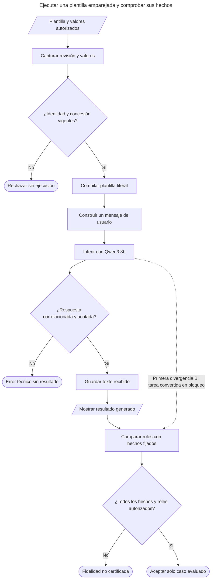
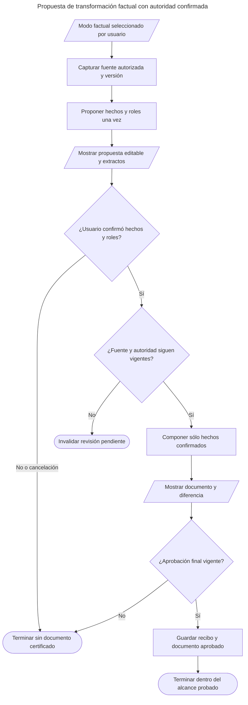

# Fidelidad factual de ejecuciones: diagnóstico del 28 de octubre de 2026

Estado: **NO RESUELTO / REFACTOR_OBLIGATORIO** de la asignación autoritativa de roles factuales desde prosa libre. Este expediente separa ejecución de plantillas de autoría asistida de NOVA. El contrato de autoría confirmado no verifica los hechos generados al ejecutar una plantilla. No hay reparación de producto aplicada en este expediente.

## Caso y evidencia

El recibo histórico `rc7-primary-qwen-acta-acceptance.json` identifica el prompt QA `30703999-227e-42e9-b866-f2b029152747`, revisión 1, perfil `Mi-PC-Ejecutar-Prompts`, Qwen3:8b y una ejecución que conservó los hechos principales pero añadió participantes no establecidos. El supuesto archivo de respuesta RC7 sólo captura una vista de accesibilidad sin cambios: **no contiene notas ni respuesta literal**. No permite reconstruir el paquete original.

La plantilla literal recuperada por el propietario desde MCP es:

> Convierte las notas de &lt;reunion&gt; en un acta en español. Identifica acuerdos, tareas con responsable y plazo explícitos, y preguntas pendientes. Usa sólo estas notas: &lt;notas&gt;. Marca como pendiente cualquier dato que no aparezca; no lo inventes. Entrega Markdown.

El propietario recuperó después la instrucción y respuesta completas desde la UI del único resultado QA autorizado: `.playwright/saas-delivery-20261026/rc7-acta-recovered-source-20261028.json`. Valores exactos:

- `reunion`: `Revisión del prototipo · 28 de octubre de 2026`.
- `notas`: `Ana terminó el prototipo. Luis revisará las pruebas el 30 de octubre de 2026. El equipo acordó mantener el alcance actual. La fecha de publicación no se ha confirmado.`

Antes de la nueva inferencia A, `EditorTools.Compile` se comparó por igualdad exacta con `blocks[0]`: 458 caracteres, SHA-256 `839E57D3017D228B1810B2BF6637FC3CB841D805F74761DB1C848C1EA26C827B`, incluida la doble puntuación tras `confirmado..`. No se reformuló ni limpió el caso.

El control B sintético fijó antes de inferencia asistentes explícitos, una persona mencionada que **no asistió**, dos tareas con un único plazo explícito, decisión y fecha de publicación desconocida. Los criterios originales y el paquete completo quedan en `.playwright/saas-delivery-20261026/local-execution-factuality-20261028-02/acta-control-b-explicit-roles.json`; revisión manual del autor en `semantic-review.json` del mismo directorio.

## Recorrido observado y propietarios



Las flechas E8→E9 describen la **evaluación**, no un validador semántico instalado en producción. El diagrama no fue comprobado visualmente en un renderizador.

| Nodo | Propietario y contrato |
|---|---|
| E1–E2 | `AccountExecutionAccess.Submit`: captura `CompileWork` con fuente/revisión/valores; comprueba identidad, admisión y conexión. |
| E3 | `ExecutionQueue.Local.ClaimLocal` → `CompileExecutionHandler` → `EditorTools.Compile`: sustitución de variables de la instantánea autorizada. |
| E4 | `CompanionConnection.ClaimInference`: un mensaje `user` con la instrucción compilada, `think=false`, contexto 12288, salida 2600, temperatura 0. Sin mensaje de sistema adicional ni herramientas. |
| E5–E6 | `CompanionRunner` → `AdaptiveCoreModelTransport`: proveedor local seleccionado, límites y correlación del protocolo; contenido no vacío y máximo 64000 caracteres. |
| E7 | `ExecutionQueue.Local.FinishLocal`: revalida dueño, revisión/arrendamiento/cancelación, conserva respuesta y modelo. No reescribe roles factuales. |
| E9–E10 | Revisión del arnés y del autor con hechos congelados. No es una inferencia adicional ni aceptación humana. |

```text
capturar plantilla, revisión, valores y autorización
si identidad/conexión no permiten ejecutar: rechazar sin efectos
compilar los valores de esa instantánea; no extraer otras notas
enviar el paquete del adaptador emparejado al proveedor seleccionado una vez
si falla correlación, plazo o contenido: terminar como error técnico
revalidar arrendamiento, cancelación y propietario
guardar el texto recibido como resultado generado
en evaluación: comparar cada hecho y su rol con el oracle anterior a la llamada
si cambia un rol o añade una afirmación: conservar FAIL aunque el transporte pase
```

## Resultados y mecanismo

Control B: una inferencia real, 17,7 segundos; sin reintento, juez, cambio de modelo ni modificación del producto. Los asistentes y el no asistente se conservaron; la publicación siguió sin fecha. Sin embargo, Qwen clasificó la tarea de accesibilidad sin fecha bajo **Bloqueos**, aunque la nota sólo establece una tarea pendiente de plazo. Añadió una observación que vincula la ausencia de Laura con su participación en una revisión de documentación no establecida por las notas. **FAIL factual del control**, aunque la prueba xUnit pasó sus comprobaciones exclusivamente técnicas.

La primera divergencia observada está en el texto del proveedor. El adaptador envía la instrucción compilada y no transforma tareas en bloqueos. Las comprobaciones actuales verifican transporte, límites y autorización; **no demuestran que una clasificación factual de prosa sea consecuencia de la fuente**. Conservar nombres o citas no autoriza roles nuevos. Éste es un límite confirmado del contrato de ejecución actual; no demuestra incapacidad universal del modelo.

El primer intento del arnés usó por error Python bundled de Codex y falló antes de inferencia (`DEPENDENCY_MISSING`, cero solicitudes al proveedor). Se preserva en `local-execution-factuality-20261028-01`. Seleccionar el entorno **ya existente** de Adaptive Core corrigió sólo el arnés. No cuenta como fallo semántico.

Caso A recuperado: una inferencia real, 20,3 segundos, mismo adaptador y configuración; **FAIL**, porque vuelve a añadir `Participantes: Ana, Luis, Equipo`, aunque no existe afirmación de asistencia. La respuesta es idéntica, sin normalización, a la histórica: 980 caracteres y SHA-256 `C7EEE5C061550FD03DD386BA53116EC059AFF2455684CB45EE0A93E5F89647BF`. Se preservaron el trabajo terminado de Ana, la tarea futura de Luis y su plazo, el acuerdo colectivo y la publicación pendiente. Esos aciertos no compensan el rol inventado. Recibos en `local-execution-factuality-20261028-03/acta-original-a-recovered-rc7.json` y `semantic-review.json`.

Un intento de build anterior a A encontró `LibrarySummary` inexistente en el nuevo test de capacidad de otro propietario. Ese propietario lo corrigió; hubo cero llamadas al modelo antes de esa corrección. Recibo separado `local-execution-factuality-a-build-failure-20261028.json`. No se cuenta como fallo de inferencia.

Presupuesto final: **dos inferencias de dos autorizadas** (B y A), sin llamadas de juez ni más muestras para obtener PASS. Ambos tests xUnit pasaron compilación/replay y transporte; ambos controles semánticos fallaron. Qwen3:8b permaneció seleccionado; no se instalaron dependencias ni se cambió el producto.

El historial verificable de la familia **asignar roles factuales no autorizados por las notas** contiene RC7 (asistencia inferida), B (tarea clasificada como bloqueo) y A (asistencia inferida reproducida). Activa el reemplazo obligatorio de ese mecanismo si se pretende certificar transformación factual. El subtipo exacto de asistencia tiene dos ejecuciones; no fingir tres reproducciones idénticas ni mezclar fallos de autoría, entorno o build. Un control correcto de asistentes en B no borra su error de otra clasificación factual.

## Opciones y cierre

- Un cambio de instrucciones de ejemplo o un juez adicional no proporciona autoridad factual y no está justificado como reparación del contrato.
- Un modo factual explícito podría pedir al usuario hechos/roles confirmados, permitir que IA proponga clasificaciones editables y componer a partir de esa autoridad, con aprobación separada. Eso sería una capacidad nueva y una mitigación de autoría factual; **no una garantía de que la ejecución libre interprete todas las notas**. Requeriría decisión de producto, contratos/UI y casos de otras familias antes de implementarlo.
- Mantener ejecución general significa tratar sus resultados como propuestas para revisión, sin certificación factual autónoma. Una advertencia por sí sola no resuelve la exactitud pedida en el incidente.

No continuar parches de instrucciones, traducciones de encabezados o reintentos sobre el generador libre como si proporcionaran autoridad factual. El caso A ya fue recuperado y reproducido: el incidente permanece abierto por resultado incorrecto, no por falta de entradas. El contrato nuevo propuesto a continuación requerirá alcance de producto confirmado y aceptación con casos originales; no ampliar el presupuesto automáticamente.

Ningún cambio del producto, esquema, permisos, presupuesto o despliegue forma parte de este diagnóstico. La certificación comercial depende del cierre global del propietario de la entrega.

## Contrato de reemplazo propuesto, todavía no implementado

La ejecución general puede seguir existiendo como generación revisable. Para certificar una **transformación factual**, la decisión de roles no debe quedar como autoridad final de un generador libre. El usuario seleccionaría explícitamente ese modo; no se activaría buscando palabras como «acta» o «no inventes».

Contratos mínimos en los propietarios actuales:

| Contrato | Fuente de autoridad y reglas |
|---|---|
| `FactualSource` | Servidor captura cuenta, biblioteca, ejecución, revisión de plantilla, valores y texto compilado exactos. Su versión invalida revisiones pendientes si cambia la fuente. Ningún hash proporcionado por cliente sustituye esta identidad. |
| `FactProposal` | Una propuesta acotada del modelo con hechos, clasificación/rol, extracto y ubicación de fuente. Que el extracto exista sólo prueba procedencia, **no** que autorice el rol. Sin efectos ni resultado factual certificado. |
| `ConfirmedFacts` | El usuario revisa explícitamente contenido, rol y dato desconocido; puede corregir o rechazar. Servidor liga confirmación a la versión de fuente, propietario, conexión y turno vigentes. Guarda diferencia propuesta→confirmación para no afirmar comprensión autónoma del modelo. |
| `FactualLayout` | Secciones y campos seleccionados explícitamente, con desconocidos representados como pendientes. Roles confirmados determinan ubicación; una tarea sin fecha no cambia automáticamente a bloqueo. No hay catálogo de roles inferido por keywords de la petición. |
| `RenderedFactualDocument` | Compositor determinista en aplicación conserva texto y campos confirmados. No hay segunda llamada para reescribir la prosa, ni juez que apruebe sus propias inferencias. Roles no confirmados se omiten o aparecen como no especificados según el contrato elegido. |
| `FinalApproval` | Aprobación final del documento aparte de confirmar hechos. Cancelar, revocar o editar la fuente impide envío tardío/guardado. Preserva límites, cuotas, idempotencia, aislamiento y permisos actuales. |



```text
exigir selección explícita del modo factual y de disposición documental
capturar identidad, revisión y fuente exacta con el propietario actual
proponer hechos/roles una sola vez dentro del presupuesto elegido
mostrar cada propuesta con su fuente; jamás convertir cita existente en autorización semántica
esperar confirmación o corrección explícita del usuario
si cancela o cambia fuente/autoridad: invalidar; no componer ni guardar
verificar versión y propietario de la confirmación en servidor
renderizar literalmente los hechos/roles confirmados y los desconocidos declarados
registrar diferencias del modelo y origen humano sin atribuirlas a comprensión del modelo
esperar aprobación final separada y volver a comprobar cancelación/revisión
persistir una sola vez por operación; ante error conservar estado pendiente y recibo
```

Aceptación mínima del reemplazo: A sin asistentes inventados; B tarea de Diego bajo tareas y Laura no asistente; otro dominio con hecho mencionado que no implique rol; rechazo de citas válidas con roles no confirmados; edición/cancelación/revocación entre propuesta y confirmación; reintentos idempotentes; modelo indisponible sin guardado; baseline general y CRUD conservados; E2E con cuenta/conexión real y versiones congeladas. La propuesta inicial se evalúa por separado de las correcciones humanas; un resultado final correcto no certifica comprensión autónoma. No ejecutar estas campañas sin nuevo presupuesto explícito.
