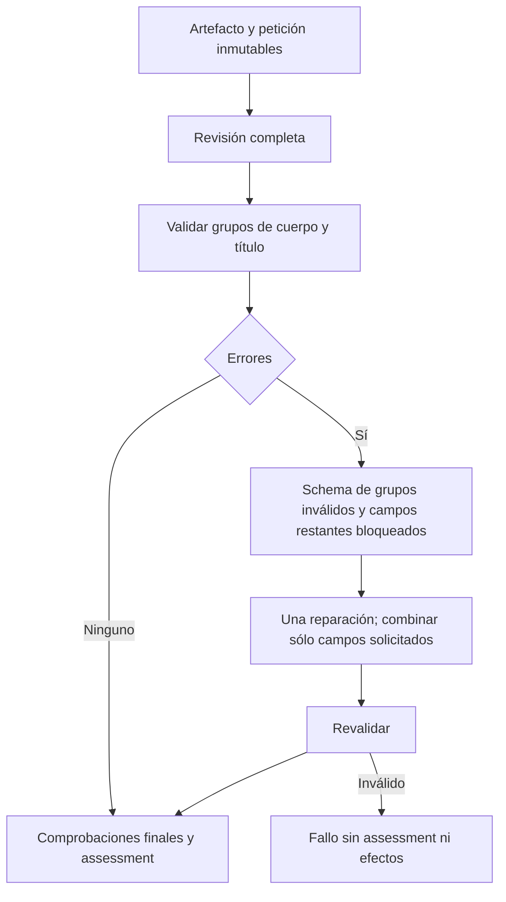

# Reparación del revisor sin sustituir decisiones válidas

2026-10-20. Estado: reparación implementada y comprobada en su alcance; cualificación semántica FAIL, no cierra autoría.

- **Resultado:** un fallo de procedencia del título no debe provocar un nuevo juicio del cuerpo ya válido como declaración. Un título o un defecto del cuerpo no se descarta para lograr aceptación.
- **Propietario:** `PreparationInference.ReviewDraftFidelity`, sin revisor, árbitro o servicio adicional. Consumidores: generación y evaluación del `TaskGoal` existente.
- **Evidencia:** `actual-creation-review-production.json`, caso `accept-faithful-summary`: ACCEPT inicial, cita `Artefacto sintético` ausente de la petición; tras reparar, REVISE por omitir una orden de sesión. Es deriva durante recuperación, además del fallo semántico aún pendiente.
- **Grupos:** cuerpo = verdict/instructionScope/applicationWorkflowQuotes/issues; metadato = requestedTitleQuote. Las contradicciones del cuerpo invalidan su grupo completo. Una cita de título sin procedencia invalida el metadato. La schema y las referencias actuales siguen siendo obligatorias.
- **Invariantes:** mismo artefacto, petición, fuente y presupuesto; máximo dos llamadas; rechazo real conservado; título literal sigue comparándose exactamente; ninguna autorización de escritura o ejecución; cancelación compartida; assessment ligado al cuerpo y objetivo existentes.
- **Dependencias:** sólo contratos de JSON y gateway actuales. La reparación del metadato recibe petición original y título del origen, sin título generado ni cuerpo, para no convertirlos en evidencia del usuario.
- **Alternativas:** reexaminar todo reproduce la deriva observada; ignorar una cita inválida pierde validación; agregar otro árbitro duplica autoridad y latencia. Se extiende el propietario actual con reparación por grupos y combinación de campos cerrada por schema.
- **Compatibilidad:** sin cambios HTTP, SQLite, datos/workflow o UI; no cambia modelo ni configuración global. Los contadores de diagnóstico distinguen respuesta parcial y declaración combinada. No presentar esa combinación como una nueva respuesta completa del modelo.
- **Verificación:** reproducción controlada antes/después, recuperación sólo del título y sólo del cuerpo, presupuesto agotado, título realmente distinto y defecto de contenido no pueden aceptarse; luego repetir los seis contrastes reales del mismo revisor. Suites de frontend y CRUD manual ajenos no se ejecutan.



```text
obtener revisión completa con el presupuesto existente
validar procedencia y coherencia de cuerpo y título
si hay defecto real citado del cuerpo: conservar rechazo
si hay campos inválidos y queda la única reparación:
    fijar campos de los grupos válidos
    solicitar sólo grupos inválidos con schema cerrado
    combinar únicamente las propiedades solicitadas
    revalidar sin ampliar presupuesto
comparar título solicitado con título propuesto y aplicar el juicio del cuerpo
si falla cualquier contrato o resultado: no registrar assessment
si todo cumple: registrar assessment del mismo cuerpo y objetivo
```

La validez de una declaración no prueba por sí sola su acierto semántico. Esta corrección sólo impide que la recuperación de un grupo sustituya otro independiente; el gate semántico sigue exigiendo los oráculos externos.

## Implementación y evidencia ejecutada

Se extiende `ReviewDraftFidelity` en su archivo actual. El esquema de reparación sólo admite los campos del grupo inválido; una respuesta que intente añadir propiedades del grupo bloqueado se rechaza. La combinación final vuelve a validarse con el contrato completo. No se convierte un fallo de formato del revisor en un nuevo intento del generador. Los errores agotados conservan `CONTENT_FIDELITY_REVIEW_INVALID` y el límite total de dos llamadas; no se registra assessment en ese estado. Cancelación y disponibilidad del modelo conservan su propagación actual.

El título aislado usa una extracción sin razonamiento, presupuesto de 600 tokens y sólo petición/título del origen. El cuerpo conserva la política de razonamiento vigente. El diagnóstico distingue explícitamente respuesta parcial, campos reparados, campos conservados y declaración final combinada. No se guardan cadenas de razonamiento.

[Archivo verificable de fuentes, hashes y revisión](../evidence/closure-20261020/fidelity-independent-repair/review.json):

- Antes: seis de ocho regresiones originales fallan; dos controles ya pasan. Son respuestas controladas para reproducir el límite del propietario, no peticiones libres al modelo.
- Después: las ocho pasan. Se agregan dos intentos de sobrescribir el grupo bloqueado. La selección final pasa **78 comprobaciones**, incluidas esas diez y los consumidores directos de restricciones, origen y objetivo. No se presenta como suite general del backend.
- API y evaluador finales compilan sin advertencias/errores. Cuatro fuentes congeladas verificadas y tres ensamblados compartidos idénticos entre pruebas, API y evaluador.
- Revisor real de creación con Qwen3:8b, mismos seis artefactos de desarrollo: cuatro coincidencias de etiqueta y seis declaraciones válidas; **dos ACCEPT indebidos**. Acepta perder «No inventes datos» y conserva órdenes de la sesión en otro cuerpo. No se rebaja el oráculo.
- La omisión de aprobación futura sí se rechaza citando esa obligación. En la campaña anterior, otra etiqueta REJECT coincidía por una razón equivocada: exigía una orden de sesión. Se conserva como diagnóstico incorrecto, no como acierto semántico.

La evidencia real muestra reparación sólo del metadato con conservación del cuerpo, pero no permite atribuir la diferencia agregada entre campañas exclusivamente al cambio: también difieren sus primeros juicios. La prueba causal de aislamiento es la regresión controlada antes/después. Los dos falsos ACCEPT mantienen el gate abierto. Los tiempos de cada revisión (10–26 segundos en la campaña final) no prueban latencia del agente completo ni p95. No se han ejecutado generación/UI nueva, suites generales, validación o holdout; no se promueve otro perfil ni se cambia el modelo activo.
